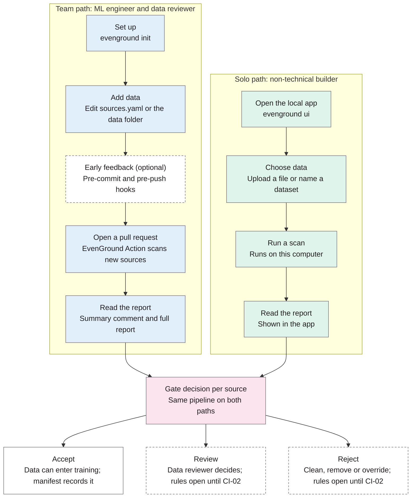

## Question
How a developer adds the tool to a pipeline, runs it, and acts on the result.

## Options considered
Only the chosen option is recorded in the master plan; alternatives that were rejected are noted under Why.

## Decision
**Provisional, 3 November 2026: three personas, an interactive setup command plus a local app, and a sources file.** The blocking and override rules stay open until CI-02, so this decision stays at *exploring* until then.

| Persona | Who they are | How they use EvenGround |
|---|---|---|
| ML engineer | Builds and maintains a training pipeline | Sets up EvenGround, adds data, fixes or overrides rejected sources, through the command line and CI |
| Data reviewer | Data steward, compliance or ethics lead | Reads the report and decides "review" items; never uses the command line |
| Non-technical builder | Someone with little technical expertise building something like a chatbot as a side project, with no CI pipeline | Uses the local app to choose data, run a scan and read the report |

Dashed: an optional step, or a rule still to be decided in CI-02. Teams use EvenGround as a CI gate; a solo builder uses the local app on their own computer. Both paths run the same pipeline and reach the same accept, review or reject decision.

**Setup**

- `evenground init` asks a few questions in the terminal (data folder, which hooks, local model only or ensemble) and creates the config file, an empty manifest, `sources.yaml`, the GitHub workflow file and the hook config.
- `evenground ui` opens a local web app on the user's own computer for setup, choosing data (upload a file or name a dataset), running a scan and reading the report. It runs locally only, with the local model by default; the API ensemble needs an explicit opt-in.
- The local app is built after the core pipeline works and is kept to those four tasks; its technology is chosen in UI-01. If time runs short it becomes a stretch goal, and the solo path falls back to `evenground scan` plus the HTML report.

**Declaring sources:** `sources.yaml` lists every Hugging Face dataset (name and pinned version), URL list and data folder meant for training. Adding data means editing this file, so every addition appears in the pull request diff, and CI runs when this file or the data folder changes.

## Why
- Personas make design teams engage with users' needs better than scenarios alone, and surface needs other methods miss (Pruitt and Grudin, 2003). Three personas cover the aim's promise of a report non-technical staff can act on, and give VAL-03 defined users to evaluate against.
- The non-technical builder is the user least likely to know about representational bias and most likely to fine-tune on scraped data without checks, and has no CI pipeline, so a local app is the only realistic way in.
- A setup command and a sources file make the correct path the easy one, and keep every data addition visible in review.

## Consequences
- CI-02 decides whether review blocks a merge, where review decisions are recorded, and how overrides work; this flow is updated then.
- UI-01 chooses the local app's technology and designs one report for all three personas.
- VAL-03's heuristic evaluation and cognitive walkthrough are run against named persona tasks, for example "a non-technical builder scans a dataset and decides whether to use it".
- The local app adds work in phase 4; its scope is limited to setup, choosing data, scanning and reading the report.
- This diagram is the user-flow figure for the interim report.
