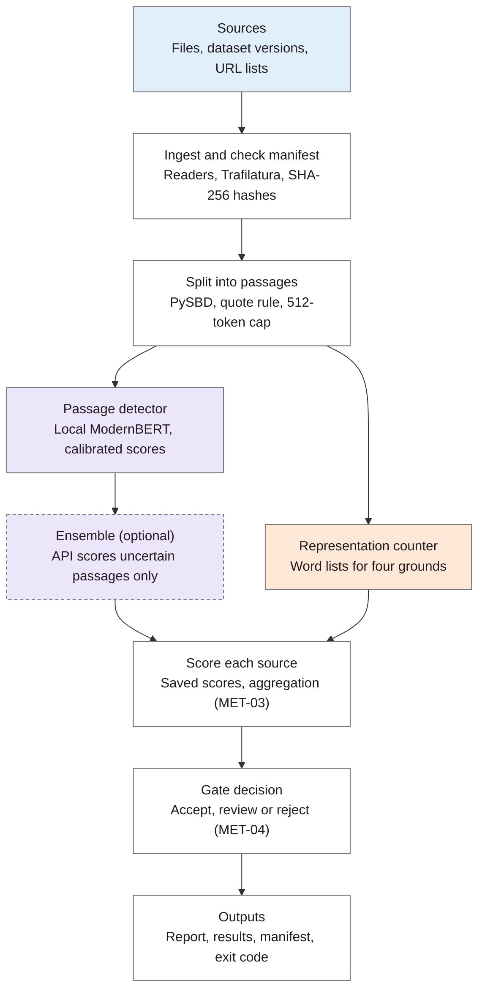

## Question
The components and how data moves through them, from ingestion to score, gate decision and report.

## Options considered
- **A long-running service with a database**: not chosen; a database for querying history is future work.
- **A single-process pipeline with file-based results.** **Chosen.** A time-limited local session is a stretch goal.

## Decision
**A single-process pipeline with a shared scorer interface, saved scores and file-based results, decided 3 November 2026.**

Each source is ingested and checked against the manifest, split into passages, scored by the local detector (with the optional API ensemble for uncertain passages) and by the representation counter, combined into a source score, passed through the gate, and written to the outputs. The dashed box sends text to an external API.

| Choice | Decision |
|---|---|
| How it runs | One process per `evenground scan`: load the model, run the pipeline, exit. Stretch goal: a time-limited local session (`evenground serve --idle 30m`, `evenground stop`) that keeps the model loaded for repeated local scans; it listens on the local machine only and shuts down when idle. |
| Backends | A shared scorer interface: a passage in, the DET-06 frame with calibrated probabilities out. The local model, the API adapter and the optional session are all scorers. |
| Scoring and deciding | Score once, decide many: passage scores are saved, keyed by text hash, checkpoint and backend; aggregation and the gate run on saved scores, so a threshold change re-decides without re-running the model. |
| Results | Files: a JSON results file per run plus the manifest (ARCH-03), committed or kept as CI artifacts. |

## Why
- A shared scorer interface and validated configuration keep each stage replaceable.
- A single process suits CI, where every run starts on a fresh machine; the session only helps repeated local runs, and a base-size model loads in seconds, so it is a convenience feature rather than a core requirement.
- Saving scores separately from decisions makes threshold tuning (MET-04) and every MET-05 metric cheap to recompute.
- Files are easy to read, diff and audit in a pull request, which supports the AI Act Article 10 audit trail.
- EvenGround sits between data collection and model training; validating data as a pipeline step follows Breck et al. (2019).

## Consequences
- The scorer interface is the first piece of code written; the local model, API adapter and test doubles for EVAL-05 implement it.
- The score cache is invalidated by a new checkpoint, backend or splitter version.
- A database for querying history is future work.
- This diagram is the architecture figure for the interim report.
