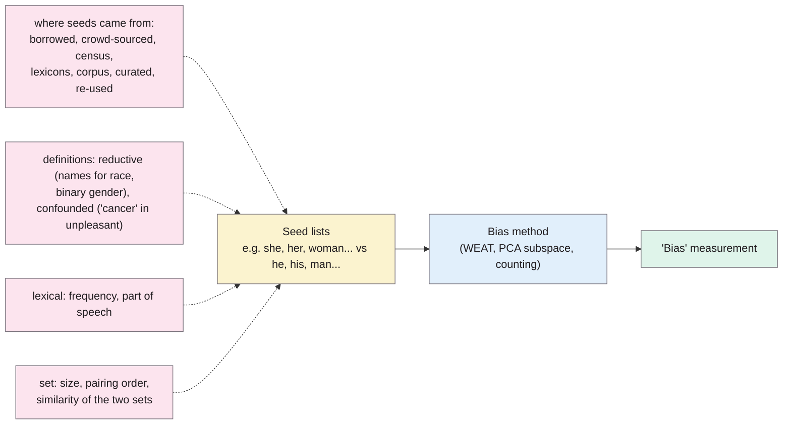
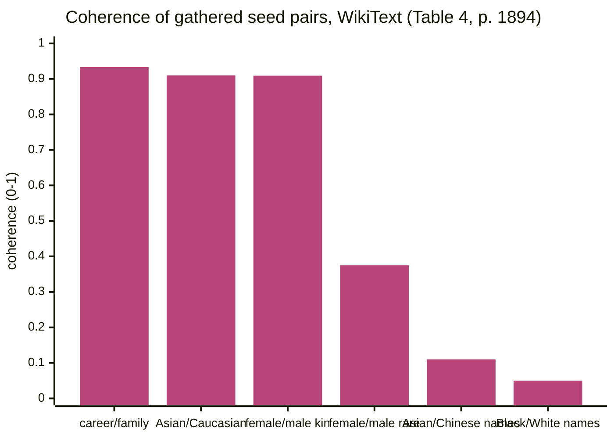

> **Source note:** drafted from the ACL Anthology PDF (renamed from 2021.acl-long.148.pdf; Zotero also holds a duplicate PDF). Page numbers are the printed proceedings pages, 1889–1904. The appendix wasn't summarised.

## TL;DR
Every lexical bias measurement, from WEAT to simple counting, depends on hand-picked **seed word lists**, and nobody checks them. The authors gather **178 seed sets** from 18 highly cited papers, trace where they come from, and show on three small corpora that the choice, order, frequency and similarity of seeds can change the measurement a lot (pp. 1890–1896). Some published seeds even contain stereotypes themselves: an "ugliness" set with "fat", "obese" and "wrinkled" (p. 1889). Their advice: trace each seed set's origin, test it, compare it with alternatives, and document it (p. 1897). For this project it's the reason the source-level counter only uses word lists for four grounds, and the checklist for documenting those lists.

**Analogy:** a census taker who decides who counts as "Irish" by checking a list of surnames. Change the list and the population changes, even though nobody moved. Seeds are the surname list of bias measurement.

Factors from §4 and §8 (pp. 1891–1896).

## 1. What is the aim of the paper?
Bias measurement methods are increasingly used not only to debias models but by social scientists and digital humanities scholars to measure bias *in a corpus* and compare corpora (p. 1889). All of these methods rely on seed lexicons, but "the rationale for choosing specific seeds is often unclear", their impact isn't understood, and seed sets are re-used in new corpora without checking (p. 1889).

Two questions (pp. 1889–1890): (1) how are seeds selected and from which sources; (2) which features of seeds cause unstable measurements?

## 2. How did the authors carry out the research?
**Survey (pp. 1891–1892).** 178 seed sets from a representative sample of 18 highly cited papers, released publicly on GitHub (footnote 1, p. 1890). Sources found (Table 3, p. 1891): corpus-derived (7/18 papers), re-used (7/18), borrowed from social sciences (6/18), curated by hand (5/18), adapted from lexical resources (3/18), crowd-sourced (2/18), population-derived such as census data (2/18).

**Corpora (pp. 1890–1891, Table 2).** Deliberately small and specific, like a scholar studying one collection: New York Times articles (Apr–Jun 2016, 8,888 articles), WikiText-103 (28,472 articles), Goodreads reviews in romance (197,000) and history/biography (136,000); plus the pretrained Google News word2vec for replication. Lowercased, unigrams only, words seen fewer than 10 times dropped.

**Methods tested (pp. 1892–1893).** Two embedding-based measures:
- **WEAT** (Caliskan et al. 2017):

$$s(X,Y,A,B) = \sum_{x\in X} s(x,A,B) - \sum_{y\in Y} s(y,A,B)$$

where $s(w,A,B)$ is the mean cosine similarity of $w$ to attribute set $A$ minus that to $B$.
- **PCA bias subspace** (Bolukbasi et al. 2016): the first principal component of difference vectors between paired seeds.

word2vec (skip-gram, window 5, 100 dimensions), trained on **20 bootstrapped samples** of each corpus (p. 1893).

**Coherence (p. 1893).** Their own metric: rank every word in the vocabulary by its projection onto the bias direction and take the absolute difference in mean rank of the two seed sets, normalised to [0, 1]:

$$\text{Coherence}(X_1, Y_2) = |R_1 - R_2|$$

Higher means the two seed sets end up far apart, i.e. the subspace separates them. They also generate many artificial seed sets (a random word plus its four nearest neighbours) to control for frequency and part of speech.

## 3. What are the primary results?
- **Seed choice changes conclusions (p. 1894, Figure 2).** Six published "female" seed sets give consistent results on romance reviews but very different ones on history and biography reviews, enough for a researcher to reach different conclusions.
- **Coherence varies widely (p. 1894, Table 4),** for gathered seed sets on WikiText with WEAT:

| Gathered seed set pair | Coherence |
|---|---|
| CAREER vs FAMILY | 0.933 |
| ASIAN vs CAUCASIAN (group terms) | 0.910 |
| FEMALE vs MALE (kinship: sister, mother… / brother, father…) | 0.909 |
| FEMALE vs MALE (rare words: countrywoman, sororal, witches…) | 0.375 |
| NAMES ASIAN vs NAMES CHINESE | 0.110 |
| NAMES BLACK vs NAMES WHITE | 0.050 |

Note in the table: the published Black and White name lists **share surnames** (both include "harris" and "robinson"), and some US racial categories "are not distinguishable from available census data" (p. 1894).

- **Pairing order matters (pp. 1895–1896, Figures 3–4).** Ordered gender pairs (man–woman, he–she) give one dominant principal component; shuffle the pairing and it disappears. For social-class pairs the opposite happens: shuffled pairs explain *more* variance than "obvious" pairs (richest–poorest).
- **Similar sets are hard to separate (p. 1896, Figure 5).** Set similarity correlates with explained variance at Pearson r = −0.67 (p < 0.05); name-based race sets are more similar to each other and explain less variance than role-based ones.
- **Instability factors (pp. 1894–1896):** reductive definitions (names as race, binary gender); imprecise definitions with confounds ("cancer" in "unpleasant"; "mom" in "domestic work"); seeds that encode stigma ("fat", "wrinkled" in "ugliness"); frequency and part of speech; set size and pairing; set similarity.
- **Documentation is poor (p. 1897):** seeds hard-coded in repositories, contradictions between sources, and in one case the full list couldn't be found.

## 4. What do the authors think the results mean?
"Seeds and their rationales need to be tested and documented, rather than hidden in code or copied without examination" (p. 1896). Recommendations (p. 1897):
1. Trace the origin of each seed set, mindful of the risks of that origin type.
2. Examine seed features (part of speech, frequency, semantic similarity, pairing order), manually and with tests.
3. **Compare against alternative seed sets** for the same concept, especially when comparing corpora.
4. Document every seed and its rationale, with concept definitions; make full lists accessible, labelled and matched to experiments (with content warnings where seeds are offensive).

Seed sets "are probably unavoidable", but "no technical tool can absolve researchers from the duty to choose seeds carefully and intentionally" (p. 1897).

## 5. What do I think it means?
*Claude's draft. Rewrite this in your own words when you verify.*

- **MET-01 follows its recommendations to the letter:** word lists documented with origin and rationale, published as files, checked for presence in the corpus, and compared with an alternative list. Say in the methodology that this is the Antoniak and Mimno checklist.
- **Careful with how the master plan uses the coherence numbers.** Coherence measures how well an *embedding subspace* separates two seed sets (WEAT/PCA), not how reliably a *word count* finds a group. EvenGround's counter counts mentions, it doesn't train embeddings. The evidence still supports your choice, but for slightly different reasons:
  - name lists are poor proxies for race (reductive definitions, shared surnames, p. 1894), so don't count by names → supports "race by group terms only";
  - group terms like "Asian/Caucasian" separate well (0.910) → supports counting by group terms.
  - **Even gender seeds can fail:** rare-word gender seeds scored 0.375 (Table 4). So the reason gender works is common, well-chosen terms, not gender as such. Choose frequent seeds and report frequencies.
  Suggest rewording MET-01's "Why" to: "seed lists for names are unreliable proxies (Antoniak and Mimno 2021), so race is counted by group terms only" rather than leaning on 0.909 vs 0.050 as if it measured counting reliability.
- **Confounds matter for skewed association (DET-01 source level).** If the "occupation" side of an association list contains gendered words ("nanny", "businesswoman"), the association is circular. Check attribute lists for words that already contain the group.
- **Disambiguation:** not covered directly here (they use unigrams and lowercase), but "blind date" and "black coffee" are the counting version of their "imprecise definitions" problem. Reporting the counter's false-match rate on a sample (MET-01) is the right test.
- **ARCH-07 / ETH-02:** word lists as versioned files with their own documentation fits "full seed lists should always be accessible, not hard-coded" (p. 1897). Treat them like a dataset with a datasheet.
- **EVAL-05:** regression tests on the counter with a fixed alternative list would turn "compare against alternative seeds" into an automated check.
- **MET-03:** if source-level statistics are compared across sources, their recommendation that cross-corpus comparisons need validation on multiple seed sets applies directly (p. 1897).

**Illustrative, not from the paper:** a counter using a "Traveller" word list containing "traveller" will match every travel blog. That's the counting equivalent of a seed set with low precision, and it would inflate the Traveller share in a holiday dataset. One reason the Traveller ground isn't counted at source level.

Suggested metadata, one line each:
- `metrics`: bias measurement methods and their reliability.
- `data-curation`: measuring bias in a corpus with word lists.
- `related-work`, `methodology`, `evaluation`: lexical methods; the word-list design; reporting the counter's reliability.
- `MET-01`, `MET-03`, `ARCH-07`, `ETH-02`, `EVAL-05`: as above.

## Key numbers
- 178 seed sets from 18 papers (p. 1890; p. 1891).
- Seed sources: corpus-derived 7/18, re-used 7/18, social sciences 6/18, curated 5/18, lexical resources 3/18, crowd-sourced 2/18, population-derived 2/18 (Table 3, p. 1891).
- Largest seed set: 1,460 seeds (Figure 1, p. 1891).
- Corpora: NYT 7.2M words; WikiText 99.2M; Goodreads romance 24.9M; history/biography 14.3M (Table 2, p. 1891).
- 20 bootstrapped models per corpus; word2vec window 5, dimension 100, minimum count 10 (p. 1893).
- Coherence (WikiText, WEAT): career/family 0.933; Asian/Caucasian 0.910; female/male kinship 0.909; female/male rare words 0.375; Black/White names 0.050 (Table 4, p. 1894).
- Set similarity vs explained variance: r = −0.67, p < 0.05 (p. 1896).

Quote (p. 1897): "no technical tool can absolve researchers from the duty to choose seeds carefully".

## Concerns
- **Embedding-based measurements, not counting.** The findings about frequency and pairing order are specific to WEAT/PCA. The documentation and validation advice transfers fully; the numbers don't.
- **Small corpora by design** (p. 1890). Results on web-scale data may be more stable.
- **US-centred seed sources** (census, Bureau of Labor Statistics) (p. 1892). No Irish or EU seed lists exist in their collection; yours will be new and should say so.
- **Coherence is their own metric,** without external validation.
- **Duplicate PDF** in `readings/pdfs/` ("2021.acl-long.148 (1).pdf"); delete one.

## Follow-up
From the reference list (pp. 1897–1900):
- Ethayarajh, K., Duvenaud, D. and Hirst, G. (2019) "Understanding undesirable word embedding associations", ACL 2019, pp. 1696–1705. WEAT requires seeds of similar frequency and can be manipulated; relevant if EVAL-02 uses WEAT-style tests.
- Kozlowski, A. C., Taddy, M. and Evans, J. A. (2019) "The geometry of culture: Analyzing the meanings of class through word embeddings", American Sociological Review, 84(5), pp. 905–949. Corpus-level association measurement in sociology; background for the source level.
- Bender, E. M. and Friedman, B. (2018) "Data statements for natural language processing: Toward mitigating system bias and enabling better science", TACL, 6, pp. 587–604. Data statements, alongside datasheets, for ETH-02.
