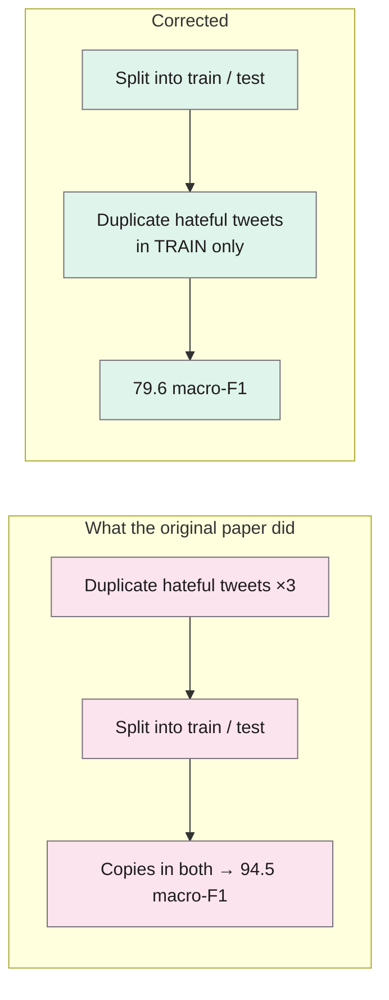
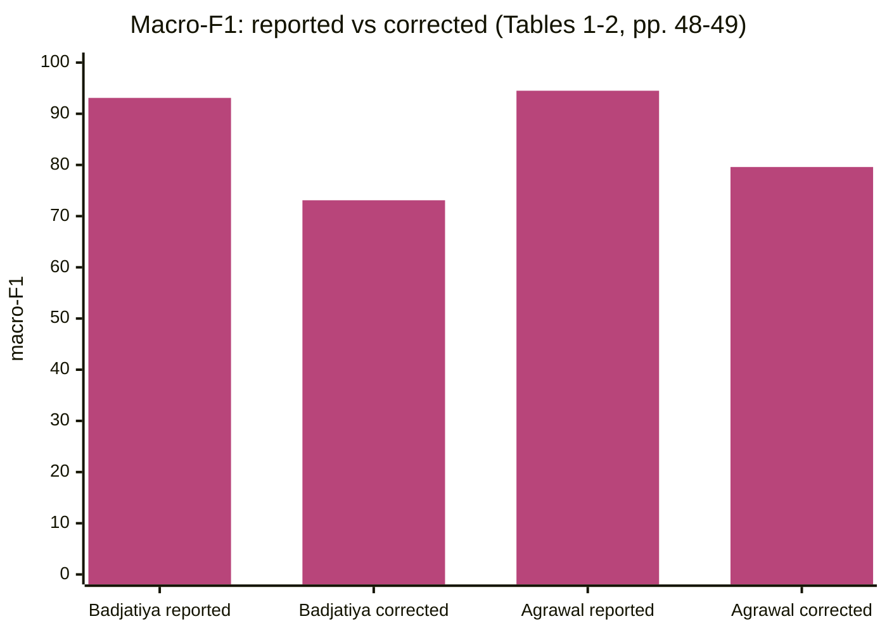

> **Source note:** drafted from the ACM PDF (renamed from 3331184.3331262.pdf). Page numbers are the printed proceedings pages, 45–54. The appendix proof of the oversampling overlap wasn't summarised.

## TL;DR
The two best-reported hate speech detectors (93–94% F1) owed much of their score to **leaks between training and test data**: one learned its features from the whole dataset including the test set; the other **oversampled (duplicated) hateful tweets before splitting**, so copies ended up in both training and test (pp. 46–49). Fixed, their macro-F1 dropped by 15–20 points (to 73.1 and 79.6). Tested on a different dataset, F1 on the hateful class fell from about 70–75% to about **21%** (p. 50). Another cause: in the popular Waseem and Hovy dataset, **two users wrote 65% of the hateful tweets**, so models learned *who* was writing rather than *what* (pp. 46–47, 50). For this project it's the reason DET-03's leakage safeguards exist.

**Analogy:** a student scoring 94% on an exam they'd already seen half the questions of. Give them a fresh paper and the real score appears.

Numbers from Tables 1–2 (pp. 48–49).

## 1. What is the aim of the paper?
Platforms struggle to detect hate speech in practice, yet published methods report near-perfect within-dataset scores (F1 above 93%) (p. 45). The authors investigate this contradiction: are the results methodologically sound, and do they generalise (pp. 45–46)?

## 2. How did the authors carry out the research?
**Methods replicated (pp. 47–48).**
- Badjatiya et al. (2017): learn word embeddings with an LSTM, then classify with gradient-boosted trees; reported 93% F1.
- Agrawal and Awekar (2018): BiLSTM with oversampling of the minority (hate) class; reported 94% F1.
Both replicated with the authors' own code, matching their reported scores (Table 1, p. 48).

**Datasets (p. 47).** Waseem and Hovy (2016): about 16,000 tweets (14,949 recovered), sexist / racist / none. Davidson et al. (2017): 24,802 tweets. SemEval 2019 Task 5: 9,000 tweets about immigrants and women.

**Corrections (pp. 49–50).** Learn features from the training split only; oversample only the training split; test across datasets (train Waseem and Hovy, test SemEval); split by **user** so no author appears in both train and test; cap tweets per user.

## 3. What are the primary results?
- **Feature leak (p. 49):** macro-F1 dropped from 93.1 to **73.1** when features came from the training set only.
- **Oversampling leak (p. 50):** macro-F1 dropped from 94.5 to **79.6** when oversampling happened after the split. They show that with 3× duplication and a 15/85 split, about 38% of hateful tweets appear in both train and test; a trivial "is it in the training set?" classifier already scores 66% F1, i.e. 16 points above the trivial baseline "for free" (p. 49).
- **Cross-dataset (Table 3, p. 50):** trained on Waseem and Hovy, tested on SemEval, F1 on hateful tweets: **21.1** and **21.6** (from about 70 and 75 within-dataset).
- **User bias (pp. 47, 50):** 1,590 users wrote all of Waseem and Hovy; 8 users wrote all racist tweets; one user wrote 96% of racist tweets and another 44% of sexist ones. A classifier that just recognised those two users would score 87% F1 (p. 50). With no user in both train and test, performance dropped sharply (Table 4, p. 51).
- **Partial fix (pp. 50–51, Tables 5–6):** capping tweets per user and adding Davidson et al.'s data improved generalisation to SemEval (hateful F1 up to 52.8 and 62.3).

## 4. What do the authors think the results mean?
- State-of-the-art performance claims are "significantly overestimated", mostly due to data overfitting and sampling issues (p. 45).
- Hate speech detection "is far from solved" (p. 46).
- Dataset creators should disclose more about data composition, especially **user distribution**, so others can sample properly (p. 46). (SemEval's organisers declined to share user IDs for GDPR and because detection "should be focused on language and not users", p. 47.)

## 5. What do I think it means?
*Claude's draft. Rewrite this in your own words when you verify.*

- **DET-03 safeguards map one-to-one:** "oversample or reweight only after splitting" = their oversampling fix; "split by post" = their user-split idea applied to SBIC's multiple annotations per post; near-duplicate removal = the same leak in another form. The master plan's numbers (79.6 → 94.5, ~70–75% → ~21%) are accurate to this paper.
- **Feature leak, your version:** temperature scaling and any thresholds must be fitted on the calibration split, not on test data (MET-02, MET-04). Same principle as their feature extraction leak.
- **User/source bias, your version:** SBIC, CAD and ToxiGen don't all give author IDs, but you can still split by **thread** (CAD) and by **post** (SBIC). For ToxiGen, generated from shared prompts, consider splitting by **prompt** so near-identical generations don't straddle train and test.
- **VAL-01 and MET-05:** cross-dataset tests (leave-one-dataset-out) are the honest number. Report them prominently, not in an appendix; this paper is why.
- **EVAL-03:** the trivial-classifier argument (66% F1 "for free") is a nice way to explain why a baseline matters.

Suggested metadata, one line each:
- `detector-model`, `metrics`, `benchmarks`: validation pitfalls for detectors and datasets.
- `background`, `methodology`, `evaluation`: why reported scores mislead; DET-03 safeguards; honest reporting.
- `DET-03`, `VAL-01`, `MET-05`, `EVAL-03`: as above.

## Key numbers
- Reported: Badjatiya 93% F1, Agrawal 94% (p. 46).
- Corrected macro-F1: 93.1 → 73.1 (feature leak); 94.5 → 79.6 (oversampling leak) (pp. 49–50).
- About 38% of hateful tweets in both splits after 3× oversampling with a 15/85 split (p. 49).
- Cross-dataset hateful-class F1: 21.1 and 21.6 (Table 3, p. 50).
- Waseem and Hovy: 14,949 tweets recovered, 4,839 hateful; 1,590 users; 8 users wrote all racist tweets (p. 47).
- Two-user classifier: 87% F1 (p. 50).

Quote (p. 45): "performance claims of the current state-of-the-art have become significantly overestimated".

## Concerns
- **Older models** (LSTMs, 2017–18), but the leaks are model-independent.
- **Twitter data and one main dataset** (Waseem and Hovy).
- **Some tweets were missing** when re-downloaded (p. 47).

## Follow-up
None added: Waseem and Hovy (2016) and Davidson et al. (2017) aren't datasets this project uses directly.
