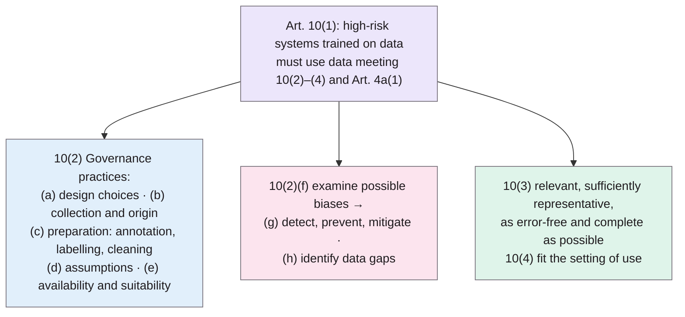

> **Source note:** drafted from the Zotero snapshot of the AI Act Service Desk page (saved 2 November 2026). Legislation has no page numbers, so citations are to paragraphs, e.g. Art. 10(2)(f). The page says its text is "based on the EUR-Lex consolidated version of the AI Act as at 27 July 2026", with passages marked "AMENDED" or "DELETED" by the **Digital Omnibus on AI**. For the report, cite the Official Journal text of Regulation (EU) 2024/1689 and say which version you used.
>
> **Zotero fix needed:** two duplicate entries with keys `article` and `articlea`. Keep one, give it a proper key (e.g. `eu2024aiact`), add the author "European Union", and delete the other.

## TL;DR
Article 10 sets the **data rules for high-risk AI systems**: training, validation and test data must be governed by documented practices, covering design choices, data origin, preparation, assumptions, and specifically **examination for biases** that could lead to discrimination prohibited under Union law, with **measures to detect, prevent and mitigate** them (Art. 10(2)(a)–(h)). Datasets must be "relevant, sufficiently representative, and to the best extent possible, free of errors and complete" (Art. 10(3)) and fit the setting of use (Art. 10(4)). In the consolidated version, **paragraph 5 is deleted** (the page points to the new Article 4a for processing special categories of personal data for bias detection), and paragraph 6 is amended (Art. 10(5)–(6)). For this project it's the legal hook: EvenGround supports the Art. 10(2)(f)–(g) bias examination duty, without claiming compliance.

**Analogy:** food hygiene rules for a restaurant kitchen. They don't tell you what to cook, but they require you to know where ingredients came from, how they were prepared, and to check for contamination before serving. Article 10 is that for training data, with bias as one of the contaminants.

## 1. What is the aim of the provision?
Part of Chapter III, Section 2 ("Requirements for High-Risk AI Systems"). It makes data quality and data governance a legal requirement for high-risk AI systems that are trained on data (Art. 10(1)). The Service Desk's own summary (not legally binding) says datasets must be "relevant, representative, and free of errors", governance must address "bias detection, and mitigation", and datasets must reflect the context of use.

## 2. What does it require?
- **10(1):** high-risk systems that train models on data must use training, validation and test sets meeting paragraphs 2–4 and Article 4a(1). (Amended.)
- **10(2):** data governance and management practices "appropriate for the intended purpose", concerning in particular:
  - (a) relevant design choices;
  - (b) data collection processes and origin, and for personal data the original purpose;
  - (c) data preparation: "annotation, labelling, cleaning, updating, enrichment and aggregation";
  - (d) assumptions about what the data "are supposed to measure and represent";
  - (e) availability, quantity and suitability of the data;
  - (f) "examination in view of possible biases that are likely to affect the health and safety of persons, have a negative impact on fundamental rights or lead to discrimination prohibited under Union law, especially where data outputs influence inputs for future operations";
  - (g) "appropriate measures to detect, prevent and mitigate possible biases identified according to point (f)";
  - (h) identification of data gaps or shortcomings and how to address them.
- **10(3):** "relevant, sufficiently representative, and to the best extent possible, free of errors and complete"; appropriate statistical properties, including for the persons or groups the system is used on; may be met per dataset or across a combination.
- **10(4):** account for the "geographical, contextual, behavioural or functional setting" of use.
- **10(5):** "Not present after the amendment" (DELETED). The page lists a new Article 4a, "Processing of special categories of personal data for bias detection and correction".
- **10(6):** for systems not trained on data, paragraphs 2–4 and Art. 4a(1) apply only to test data. (Amended.)
- Relevant recitals listed on the page: 66, 67, 68, 69, 70, 76, 115 (not read).

## 3. What are the key points?
- The bias duty is about **discrimination prohibited under Union law** and fundamental rights, not "bias" in general (10(2)(f)).
- It's a **process** duty (examine, detect, prevent, mitigate, document), not a numerical threshold.
- **Representativeness** is required "sufficiently", for the groups the system is used on (10(3)), which echoes source-level representation checks.
- It applies to **high-risk** systems (classified under Article 6 and Annex III), not to all AI.

## 4. What does it mean for practice?
Not from the text: interpretation is Claude's. Providers of high-risk systems need a documented, auditable record of how training data was examined for discriminatory bias and what was done about it. Tooling that produces such records supports the duty, but legal compliance depends on the whole system, its classification and the provider's processes.

## 5. What do I think it means?
*Claude's draft. Rewrite this in your own words when you verify.*

- **MET-01 cites 10(2)(f) and (g) correctly**, and they survive in the consolidated version. Add which version you used: the Service Desk text says it includes Digital Omnibus amendments as at 27 July 2026. If you cite the 2024 Official Journal text instead, paragraph 5 (special category data for bias detection) still exists there; in the amended version it's deleted and replaced by Article 4a.
- **Check Article 4a.** It's directly relevant ("special categories of personal data for bias detection and correction") and wasn't in the snapshot. Worth saving to Zotero; it may matter for ETH-02 if you ever process personal data about protected characteristics.
- **ARCH-02/ARCH-03's audit trail** maps to 10(2)(b) (origin), (c) (preparation including labelling and cleaning) and (h) (data gaps). A sentence linking each EvenGround record to these sub-points is a strong, concrete framing.
- **"Prohibited under Union law" vs the Irish grounds:** the Act refers to EU law; MET-01 uses Irish Equal Status grounds. They overlap (EU equality directives cover sex, race, religion, disability, age, sexual orientation) but Irish law adds family status, civil status and the Traveller community. Say the tool follows Irish law, which is broader, and that EU-law grounds are covered as a result. The EU directives are NOT FOUND IN SOURCE here; cite them separately if you make this argument.
- **Keep the "supports, does not guarantee compliance" wording** (MET-01 already does this).

Suggested metadata, one line each:
- `governance`, `data-curation`: legal requirement for data bias examination.
- `introduction`, `background`: motivation and regulatory context.
- `MET-01`, `ARCH-02`, `ARCH-03`, `ETH-02`: as above.

## Key numbers
- Eight governance points, (a)–(h), in Art. 10(2).
- Consolidated version as at 27 July 2026; paragraph 5 deleted, paragraphs 1 and 6 amended.

Quote (Art. 10(2)(g)): "appropriate measures to detect, prevent and mitigate possible biases identified according to point (f)".

## Concerns
- **Amended text:** the snapshot reflects Digital Omnibus changes; make sure the version you cite is the one in force when you submit.
- **Web page, not the Official Journal:** cite the legal text for the report.
- **Recitals not read;** they give the reasons behind the article.
- **Duplicate, badly keyed Zotero entries** (see source note).

## Follow-up
- Article 4a of the AI Act (processing special categories of personal data for bias detection and correction): save to Zotero and read.
