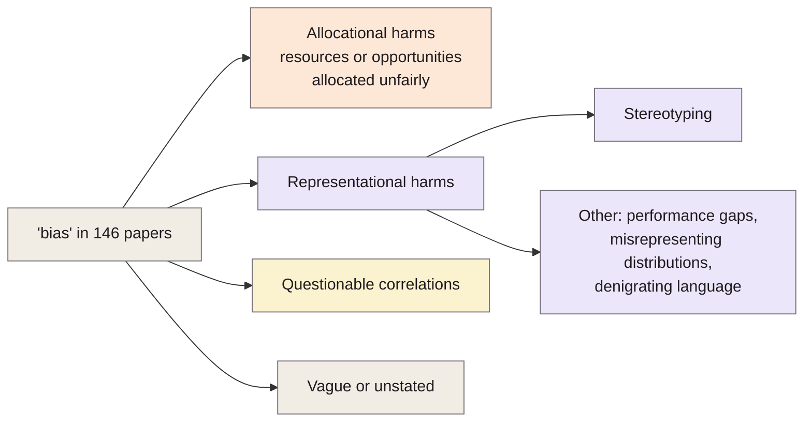
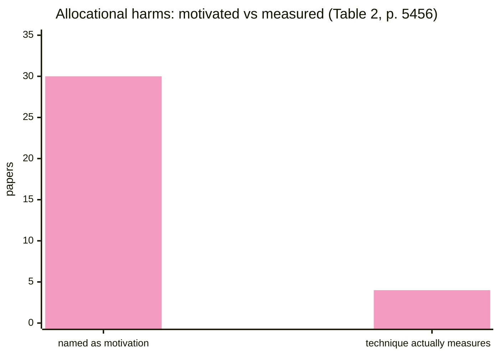

> **Source note:** drafted from the ACL Anthology PDF (renamed from 2020.acl-main.485.pdf). Page numbers are the printed proceedings pages, 5454–5476. The appendix (the list of 146 papers and Table 3) wasn't summarised.

## TL;DR
The authors read all **146** NLP papers on "bias" they could find (up to May 2020) and found that most never say what harm they mean: motivations are vague, inconsistent and lack normative reasoning, and the measurement techniques don't match the motivations (pp. 5454–5457). They make three recommendations: ground the work in research on **language and social hierarchies** and treat representational harms as harmful in their own right; **state explicitly what is harmful, in what ways, to whom, and why**; and centre the lived experiences of affected communities (p. 5458). For this project it's the reason DET-01 has a precise, written definition, and the paper the introduction can use to justify the "two levels, mention is not bias" framing.

**Analogy:** 146 doctors all diagnosing "illness" without saying which organ, what symptom or which patient. Some measure temperature, some blood pressure, and they can't compare notes. Blodgett et al. ask everyone to write the actual diagnosis on the chart.

Categories from pp. 5455–5456.

## 1. What is the aim of the paper?
A large body of NLP work analyses "bias", but most of it "fail[s] to engage critically with what constitutes 'bias' in the first place" (p. 5454). Analysing bias is *normative*: some system behaviours are judged harmful. But papers leave unstated what is harmful, in what ways, to whom and why. Even "racial bias" covers very different things, such as embeddings associating African-American names with unpleasant words, sentiment scores differing by name, and toxicity detectors scoring African-American English as more offensive (pp. 5454–5455).

The aim is to survey the field critically and propose a better path (p. 5455).

## 2. How did the authors carry out the research?
**Corpus (p. 5455).** All papers known to them analysing social "bias" in written-text NLP systems: an ACL Anthology search for "bias" or "fairness" before May 2020, then the citation graph in both directions, then a manual check of ICML, NeurIPS, AIES, FAccT, CHI, WWW and arXiv. Result: **146 papers**. The biggest groups are embeddings (54), coreference (20), surveys and frameworks (20), language modelling (17) and **hate speech detection (17)** (Table 1, p. 5455).

**Coding (pp. 5455–5456).** Each paper's *motivation* and *technique* were coded using the allocational/representational harms taxonomy (Barocas et al. 2017; Crawford 2017):
- **Allocational harms:** a system allocates resources (e.g. credit) or opportunities (e.g. jobs) unfairly.
- **Representational harms:** a system represents some groups less favourably, demeans them, or fails to recognise their existence. Split into *stereotyping* and *other* (performance differences, misrepresenting a group's share of the population, denigrating language).
- **Questionable correlations** between system behaviour and features of a group's language.
- **Vague or unstated**.
- **Surveys, frameworks and meta-analyses**.

## 3. What are the primary results?
**Counts (Table 2, p. 5456):**

| Category | Motivation | Technique |
|---|---|---|
| Allocational harms | 30 | 4 |
| Stereotyping | 50 | 58 |
| Other representational harms | 52 | 43 |
| Questionable correlations | 47 | 42 |
| Vague/unstated | 23 | 0 |
| Surveys, frameworks, meta-analyses | 20 | 20 |

Findings (pp. 5456–5458):
- **Motivations** are often multiple (33%), vague or absent (16%), or have no normative reasoning at all (32%), focusing only on system performance.
- Even clear motivations rarely say what harm, to whom.
- Papers on the same task conceptualise bias differently.
- **Allocational and representational harms are conflated** (16%): imagined downstream harms (e.g. CV filtering) are used to justify measuring something else, without measuring them.
- **Techniques aren't grounded outside NLP.** Stereotyping work is the exception: e.g. WEAT (Caliskan et al. 2017) draws on the Implicit Association Test.
- **Techniques don't match motivations:** 21% name allocational harms, only four measure them.
- **Narrow view of sources:** nearly all look at system predictions, many at datasets; few look at task definitions, annotation guidelines or metrics. An exception: annotators primed about dialect were less likely to label African-American English as offensive (Sap et al. 2019, p. 5458).

**Case study (pp. 5461–5462).** Work on African-American English (AAE) shows taggers, language identifiers and parsers work worse on AAE, and toxicity detectors score it as more offensive. But none of it engages with the literature on AAE, racial hierarchies or raciolinguistic ideologies. The authors argue the harm isn't just a performance gap: flagging AAE as offensive can lead to **"disproportionate removal of tweets"** containing it, shrink the online space where speakers can use it freely, and re-stigmatise it (p. 5461).

## 4. What do the authors think the results mean?
Three recommendations (p. 5458):
- **R1:** ground work in literature on language and social hierarchies; "Treat representational harms as harmful in their own right."
- **R2:** "Provide explicit statements of why the system behaviors that are described as 'bias' are harmful, in what ways, and to whom." Be forthright about the normative reasoning.
- **R3:** engage with the lived experiences of affected communities; interrogate the power relations between technologists and those communities.

Without grounding, researchers "risk measuring or mitigating only what is convenient to measure or mitigate, rather than what is most normatively concerning" (p. 5459). Language is how groups are labelled and stereotypes transmitted, which is why representational harms matter in their own right (pp. 5458–5459). Concrete questions include who data and annotation guidelines are written for, and whether a system shifts power towards censorship (pp. 5459–5462).

## 5. What do I think it means?
*Claude's draft. Rewrite this in your own words when you verify.*

- **DET-01 answers R2 directly.** Your working definition says what is harmful (portraying a group in a way that reinforces its lower social standing), in what ways (stereotyping, demeaning; under-representation, erasure, skewed association, exclusionary norms), and to whom (the nine Equal Status grounds). Say so explicitly in the introduction or methodology, citing this paper. It's the strongest single citation for having a definition at all.
- **The definition matches their taxonomy.** Their representational harms include stereotyping, denigrating language, misrepresenting a group's share of the population, and failing to recognise a group's existence (p. 5455). Those are your passage and source categories almost one-to-one: stereotyping, demeaning, under-representation, erasure.
- **"Mention is not bias" is an R1/R3 argument.** The AAE case study (p. 5461) is the same harm as Dixon and Dodge: a filter removes text by the group it's meant to protect. That's your tool's harm on the *other* side, and a reason EVAL-06 should measure what the gate removes, not just what it catches.
- **MET-01:** grounding the categories in Irish equality law rather than US benchmarks is a version of R1/R2: normative reasoning made explicit, in a stated legal frame.
- **They also say measuring only system predictions is narrow (p. 5457).** Your tool looks at training data upstream, which they list as one of the less-examined sources. A small point for related work.
- **R3 is your weak spot; be honest about it.** No community engagement (ETH-01 rules out participants). The threats-to-validity section (EVAL-06) and VAL-03 should name this, and the gap set's documented stereotype sources (McGinnity et al. 2017, @esri2017who) are a partial substitute: evidence from people's reported experience rather than the author's assumptions.
- **Don't over-claim allocational harm.** They criticise papers that justify measurement by imagined downstream harms that aren't measured (p. 5457). If the introduction mentions hiring or healthcare harms from biased LLMs, keep the claim to what EVAL-01 can actually show.

Suggested metadata, one line each:
- `governance`, `ethics`: a normative framework for bias work.
- `metrics`: the mismatch between motivations and measurements.
- `introduction`, `background`, `methodology`, `conclusion`: framing, the definition, the reasoning behind it, and limitations.
- `DET-01`, `MET-01`, `EVAL-06`, `VAL-03`: as above.

## Key numbers
- 146 papers surveyed, written text only, up to May 2020 (p. 5455).
- 54 on embeddings, 17 on hate speech detection (Table 1, p. 5455).
- Allocational harms: 30 papers motivated by them, 4 techniques (Table 2, p. 5456); 21% mention them, only four measure them (p. 5457).
- 33% state multiple motivations; 16% vague or none; 32% no normative reasoning (p. 5456).
- 16% conflate allocational and representational harms (p. 5457).

Quote (p. 5458): "Treat representational harms as harmful in their own right."

## Concerns
- **A position paper.** Its evidence is a coding of papers by the authors, without reported inter-coder agreement.
- **US-focused case study** (AAE, US racial hierarchies). The argument transfers; the examples don't directly.
- **Survey up to May 2020**, before large-scale LLM bias work.
- **R3 asks for things a solo FYP can't do** (community engagement, power relations). Cite it for R1 and R2, and acknowledge R3 as a limitation rather than claiming to meet it.

## Follow-up
From the reference list (pp. 5463–5476):
- Barocas, S., Crawford, K., Shapiro, A. and Wallach, H. (2017) "The problem with bias: allocative versus representational harms in machine learning", Proceedings of SIGCIS, Philadelphia. The origin of the allocational/representational distinction; useful if DET-01 cites the taxonomy at its source.
- Crawford, K. (2017) "The trouble with bias", keynote at NeurIPS. The other origin of the taxonomy; a talk, so cite carefully.
- Blodgett et al. (2021) "Stereotyping Norwegian salmon" (@blodgett2021stereotyping) applies this paper's critique to benchmarks.
