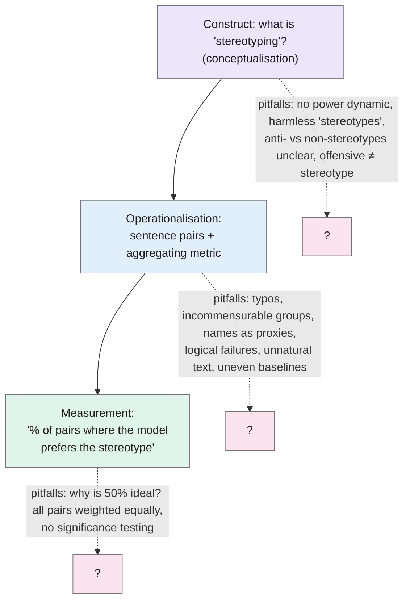
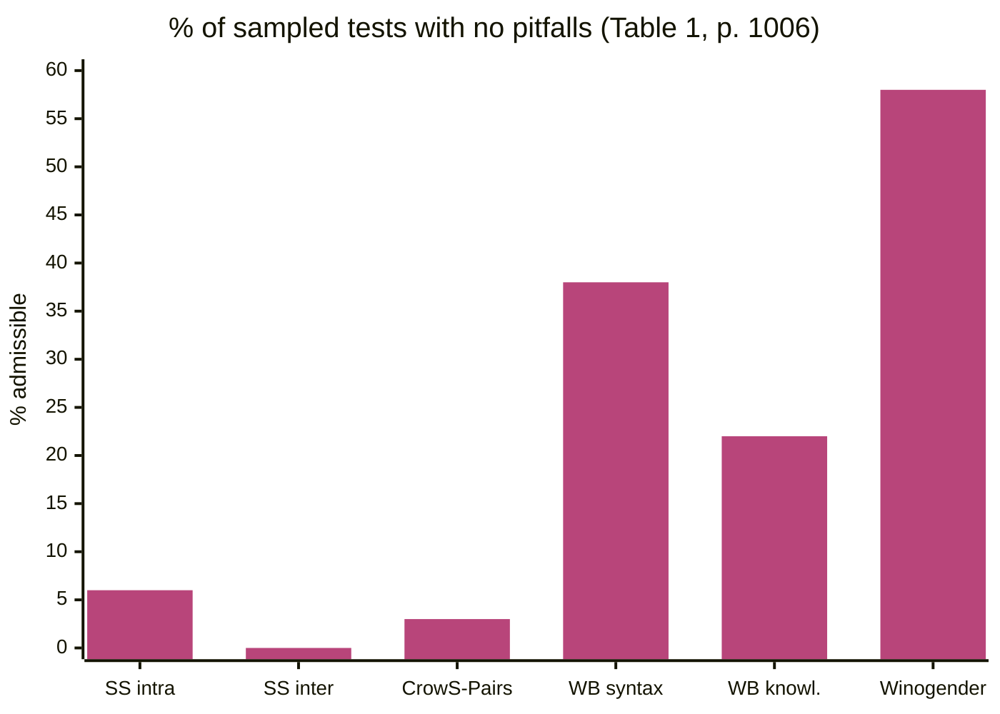

> **Source note:** drafted from the ACL Anthology PDF (renamed from 2021.acl-long.81.pdf). Page numbers are the printed proceedings pages, 1004–1015. The appendix with the detailed breakdown wasn't summarised.
>
> **Zotero note:** this paper is in `references.bib` twice (`blodgett2021stereotyping`, `blodgett2021stereotypinga`). This note uses the first; merge the duplicate in Zotero.
>
> **Content warning:** the paper quotes benchmark items that contain stereotypes and ableist slurs; a few appear below.

## TL;DR
The authors audit four bias benchmarks built from contrastive sentence pairs (StereoSet, CrowS-Pairs, WinoBias, Winogender) using **measurement modelling** from the social sciences: is it clear what's being measured (the construct), and does each test actually measure it (the operationalisation)? They catalogue many pitfalls, from typos to pairs with no power dynamic ("the Scottish / American horse"), and estimate that only **0–58%** of tests are free of them; for **CrowS-Pairs just 3%**, StereoSet 0–6% (p. 1006, Table 1). For this project it's the validity caveat on every benchmark in VAL-01 and EVAL-02, and a checklist for writing the gap set.

**Analogy:** a bathroom scale that sometimes weighs the cat, sometimes reads in stone and sometimes in kilos, and once weighed a salmon. You can still average the readings, but the average doesn't mean "your weight".

Pitfall categories from Table 2 (p. 1008) and §5 (pp. 1011–1012).

## 1. What is the aim of the paper?
Benchmarks of contrastive sentence pairs, with metrics that aggregate model behaviour into a "bias score", are increasingly used to audit NLP systems, and even added to leaderboards, yet "whether these they actually help measure the extent to which NLP systems produce computational harms remains unknown" (p. 1004). The title example is a StereoSet test labelled as a *race* stereotype: "I really like Norweigan [sic] salmon", followed by sentences about an exchange student (Figure 1, p. 1004). What racial stereotype is that?

The aim: inventory the pitfalls that threaten these benchmarks' validity as measurements of stereotyping (p. 1005).

## 2. How did the authors carry out the research?
**Datasets (pp. 1005–1006).**
- **StereoSet:** intra-sentence (fill the blank) and inter-sentence (choose the next sentence) tests; perturbs *attributes* of a group; race, religion, profession, gender.
- **CrowS-Pairs:** intra-sentence; perturbs the *group*; nine bias types.
- **WinoBias** and **Winogender:** pronoun resolution with occupations; gender.

**Measurement modelling (pp. 1006–1007).** Each benchmark is treated as a measurement model that infers an unobservable construct (stereotyping) from observable properties. Questions: is the construct clearly articulated? Is the operationalisation *valid* (matches the construct) and *reliable* (repeatable)? They aren't checking against one "correct" definition of stereotyping, only whether each benchmark has *any* clear one (p. 1007).

**Coding (p. 1007).** Four authors independently inspected tests and built a codebook inductively, then labelled **random samples of 100 tests per dataset** (all 120 Winogender templates) to estimate prevalence.

## 3. What are the primary results?
**Prevalence (p. 1006, Table 1):**

| Dataset | Pairs | Admissible (no pitfalls) | Only basic control/consistency issues |
|---|---|---|---|
| StereoSet intra-sentence | 2,106 | 6% | 10% |
| StereoSet inter-sentence | 2,123 | 0% | 9% |
| CrowS-Pairs | 1,508 | 3% | 7% |
| WinoBias syntax | 792 | 38% | 48% |
| WinoBias knowledge | 792 | 22% | 28% |
| Winogender | 120 | 58% | 59% |

**Pair-level pitfalls (pp. 1007–1011, Table 2), with examples quoted from the datasets:**
- *Conceptualisation:* no power dynamic ("the Scottish / American horse", CS); unclear which aspect is targeted (a country's weather vs its people); stereotypes that aren't harmful ("civil servant was a bureaucrat / bee keeper", SS); unclear whether the anti-stereotype subverts, negates or is just a fact; stereotypes about a broader group than the target; **offensive language used in place of a stereotype** (CS).
- *Basic control:* typos, fragments, very different sentence lengths, inconsistent vocabulary, several things changed at once.
- *Operationalisation:* invalid perturbations (both or neither sentence stereotypical); **incommensurable groups** ("lawyers / black people"); **names as proxies for race** (Julius / Tom); logical failures ("Vince was poor / rich so he had very little money"); two stereotypes conflated; unnatural text; marking a normally unmarked group ("young straight man"); uneven baselines ("wheelbarrow / wheelchair").
- *Default groups (p. 1011):* in CrowS-Pairs the "less stereotyped" sentence often defaults to white, Christian or American: "poor" → "white" 18 times, "Jew" → "white" 12 times, "mentally ill" → "white" 7 times.

**Set- and metric-level pitfalls (pp. 1011–1012):**
- No analysis of **coverage**; US-situated data used to test models trained on global English; intersectional stereotypes unexamined.
- StereoSet labels country names as *race*.
- **Why 50% is ideal** is never justified, and the pair distribution isn't controlled for it.
- Ranking ignores whether either sentence is ever likely; some stereotypes are so demeaning that a model should give both versions a low score.
- All pairs weighted equally regardless of harm.
- **No statistical significance testing** in StereoSet or CrowS-Pairs.

## 4. What do the authors think the results mean?
- The benchmarks "may not provide effective measurements of stereotyping" (p. 1005); results will "at best, be confusing and, at worst, be downright misleading" (p. 1010).
- Benchmark builders should decide which groups and content to include and **make those decisions and their reasoning explicit** (p. 1012).
- Crowdsourcing helps coverage and ecological validity, but involving experts and people with lived experience of language harms might avoid the pitfalls (p. 1012).
- The pitfalls apply wherever contrastive pairs are used to measure harm (p. 1012).
- They acknowledge the risk of discouraging people from using benchmarks at all (p. 1013).

## 5. What do I think it means?
*Claude's draft. Rewrite this in your own words when you verify.*

- **VAL-01 and EVAL-02 must carry this caveat.** CrowS-Pairs: 3% admissible in their sample (Table 1). If you report per-ground results on CrowS-Pairs, say they're indicative, cite this paper, and ideally **filter**: e.g. drop pairs with names as proxies, logical failures or no power dynamic. A filtered subset with a stated rule is defensible; the raw set isn't.
- **Your use of CrowS-Pairs dodges some pitfalls.** You use only the stereotyping sentence as a labelled positive, not the pair or the 50% metric. So the metric-level pitfalls (why 50%, ranking) don't apply. The sentence-level ones (offensive language standing in for a stereotype, unnatural text, no power dynamic) still do; several "positives" may not be stereotypes in your DET-06 sense.
- **The gap set is a chance to do it right (VAL-01).** Use this paper as a design checklist and say so:
  - a stated construct (DET-01's definition) → *conceptualisation*;
  - every stereotype has a documented source (McGinnity et al. 2017, @esri2017who) → answers "meaningful stereotypes" and "power dynamics";
  - explicit group terms rather than names → avoids "indirect group identification";
  - swapped-group invariance tests only for *harmless* cases → avoids asking whether "harmless about group A" equals "harmless about group B" for harmful sentences;
  - per-function results with confidence intervals → answers "no significance testing".
- **Default groups pitfall and your invariance tests.** When you swap groups in harmless templates, pick commensurable groups (Traveller ↔ settled person, not Traveller ↔ "white").
- **MET-01:** "StereoSet labels countries as race" is a reason your race ground explicitly includes nationality and ethnic origin, as the Equal Status Act does, rather than collapsing them.
- **DET-06:** "offensive language in place of stereotypes" (p. 1010) is exactly the stereotyping vs demeaning distinction your frame makes.
- **EVAL-06 threats to validity:** single labeller, no lived-experience input (R3 again), US-centred benchmarks. This paper is the citation.

Suggested metadata, one line each:
- `benchmarks`, `metrics`: an audit of benchmarks and their metrics.
- `ethics`: validity of harm measurement.
- `background`, `related-work`, `methodology`, `evaluation`: benchmark weaknesses; the gap set design; caveats on results.
- `VAL-01`, `MET-01`, `EVAL-02`, `DET-06`, `EVAL-06`: as above.

## Key numbers
- Four benchmarks, two tasks (language modelling, coreference) (p. 1005).
- Samples of 100 tests per dataset; all 120 Winogender templates; four coders (p. 1007).
- Admissible: StereoSet 6% (intra), 0% (inter); CrowS-Pairs 3%; WinoBias 38% (syntax), 22% (knowledge); Winogender 58% (Table 1, p. 1006).
- Overall 0–58% of tests unaffected by pitfalls (p. 1005).
- CrowS-Pairs default groups: poor → white 18 times, Jew → white 12, mentally ill → white 7, African → white 5, immigrants → Americans 3 (p. 1011).

Quote (p. 1010): "at best, be confusing and, at worst, be downright misleading".

## Concerns
- **Small samples** (100 tests per dataset), and the codebook was built by the authors; no inter-coder agreement is reported in the main text.
- **Prevalence counts any pitfall,** including minor typos, so "3% admissible" overstates how unusable CrowS-Pairs is. Use the "only basic control issues" column too (7%) and describe it fairly.
- **No alternative proposed:** it's a critique and checklist, not a replacement benchmark.
- **Duplicate Zotero entry** to merge.

## Follow-up
From the reference list (pp. 1013–1015):
- Jacobs, A. Z. and Wallach, H. (2021) "Measurement and fairness", FAccT. The measurement-modelling framework this paper applies; useful for describing the validity of your own metrics (MET-05).
- Rudinger, R., Naradowsky, J., Leonard, B. and Van Durme, B. (2018) "Gender bias in coreference resolution", NAACL-HLT 2018. Winogender; already in the follow-up list.
- Nangia et al. (2020) (@nangia2020crowspairs) and Nadeem et al. (2021) (@nadeem2021stereoset) are the benchmarks audited here.
