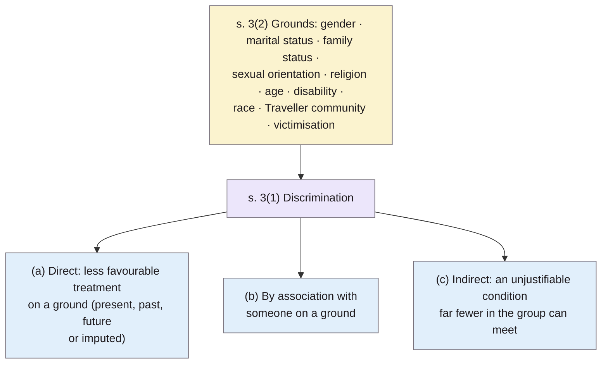

> **Source note:** drafted from the Zotero snapshot of the eISB page for section 3 (saved 2 November 2026). This is the **Act as enacted in 2000**, not the revised (amended) Act; the page links to a "Revised Act" that wasn't captured. Citations are to subsections, e.g. s. 3(2)(i).
>
> **Zotero fix needed:** the key `bookeisbelectronic` comes from the author field "Book (eISB), electronic Irish Statute". Change the item to a statute ("Equal Status Act 2000", Ireland, No. 8 of 2000) with a key like `equalstatusact2000`. The PDF saved alongside it as pdf (1).pdf / pdf.pdf should be renamed too.

## TL;DR
Section 3 defines **discrimination** for the Equal Status Act: treating someone **less favourably** than another person is, was or would be treated, on one of the **discriminatory grounds**, including grounds that are past, future or merely **imputed** (s. 3(1)(a)); discrimination **by association** (s. 3(1)(b)); and **indirect discrimination**, where an unjustifiable condition affects one group much more than others (s. 3(1)(c)). Section 3(2) lists the grounds: **gender, marital status, family status, sexual orientation, religion, age, disability, race** (race, colour, nationality, ethnic or national origin), **Traveller community**, and **victimisation**. For this project it's the legal source of MET-01's grounds; but this as-enacted text differs from the current law in ways that matter.

**Analogy:** the rules of a game define not just obvious fouls (direct discrimination), but also fouls on a teammate's friend (association) and rules that look fair but trip up one team far more than the other (indirect discrimination).

## 1. What is the aim of the provision?
To define, "for the purposes of this Act", when discrimination occurs and on which grounds (s. 3(1)–(2)). The Act itself governs discrimination in goods, services, accommodation and education (the rest of the Act; not in this snapshot).

## 2. What does it say?
**Discrimination, s. 3(1):**
- (a) on any discriminatory ground "which exists at present or previously existed but no longer exists or may exist in the future, or which is imputed to the person concerned, a person is treated less favourably than another person is, has been or would be treated";
- (b) a person "associated with another person" is treated less favourably by virtue of that association;
- (c) a person in a category sharing a common characteristic must comply with a condition they can't meet, "substantially more people outside the category than within it are able to comply", and the condition "cannot be justified as being reasonable in all the circumstances".

**Grounds, s. 3(2), "as between any two persons":**
- (a) "that one is male and the other is female" (gender ground);
- (b) different marital status;
- (c) family status;
- (d) sexual orientation;
- (e) religious belief, or having one vs not;
- (f) age, subject to s. 3(3);
- (g) disability;
- (h) "different race, colour, nationality or ethnic or national origins" (ground of race);
- (i) "that one is a member of the Traveller community and the other is not";
- (j) victimisation (having sought redress, been a witness, opposed unlawful acts, etc.).

**Other subsections:** s. 3(3) treating under-18s differently isn't age discrimination; s. 3(4) the Minister must review whether to add grounds within two years.

## 3. What are the key points?
- **Imputed grounds count** (s. 3(1)(a)): discrimination based on what someone is *assumed* to be.
- **Association counts** (s. 3(1)(b)).
- **Indirect discrimination** is defined by disproportionate impact plus lack of justification (s. 3(1)(c)).
- In this **as-enacted** text the gender ground is framed as "male" vs "female", and the second ground is **marital** status.

## 4. What does it mean for practice?
Not from the text: interpretation is Claude's. The grounds give a legally grounded list of protected characteristics in Ireland, which is broader than EU equality directives on family status, marital/civil status and the Traveller community.

## 5. What do I think it means?
*Claude's draft. Rewrite this in your own words when you verify.*

- **MET-01 cites s. 3(2) correctly for the list of grounds**, and correctly excludes victimisation (s. 3(2)(j)) as not a group identity.
- **MET-01's amendment claims need a different source.** It says civil status replaced marital status and housing assistance was added as a ground in 2016. Neither is in this as-enacted text (NOT FOUND IN SOURCE). Save the **Revised Act** (Law Reform Commission revised version on the eISB) or the amending Acts, and cite those.
- **Gender ground vs MET-01's non-binary inclusion.** As enacted, the gender ground is "one is male and the other is female" (s. 3(2)(a)). Check the revised wording; whatever it says, MET-01 should present non-binary inclusion as an *ethical* choice supported by Dev et al. (@dev2021harms), not as a statutory requirement unless the current text supports it.
- **"Ground of race" is broad** (race, colour, nationality, ethnic or national origin; s. 3(2)(h)). DET-06's target-ground field should say that nationality and ethnicity labels both map here, and that the **Traveller community is a separate ground** (s. 3(2)(i)), as MET-01 already treats it.
- **Imputed and associative discrimination are useful for DET-06 labelling rules:** a passage stereotyping someone *assumed* to be a Traveller, or someone's partner, still targets that ground.
- **Indirect discrimination (s. 3(1)(c))** is a nice analogy for source-level representation harms: no single passage is discriminatory, but the overall effect disadvantages a group. Use as an analogy, not a legal claim.

Suggested metadata, one line each:
- `governance`, `ethics`: legal basis for the grounds.
- `introduction`, `background`, `methodology`: motivation; grounds in MET-01; DET-06 target-ground labels.
- `MET-01`, `DET-06`, `VAL-01`: as above.

## Key numbers
- Ten grounds listed in s. 3(2)(a)–(j); nine are group identities (excluding victimisation).
- Age ground excludes under-18s (s. 3(3)).
- Ministerial review of grounds within two years (s. 3(4)).

Quote (s. 3(2)(i)): "that one is a member of the Traveller community and the other is not (the 'Traveller community ground')".

## Concerns
- **As-enacted text only;** later amendments (civil status, housing assistance, any change to the gender ground) aren't reflected.
- **Section 3 only;** scope of the Act (which services it covers) is in other sections.
- **Badly keyed Zotero entry** (see source note).

## Follow-up
- The revised (consolidated) Equal Status Act, linked from the eISB page as "Revised Act": save and use for the current grounds.
