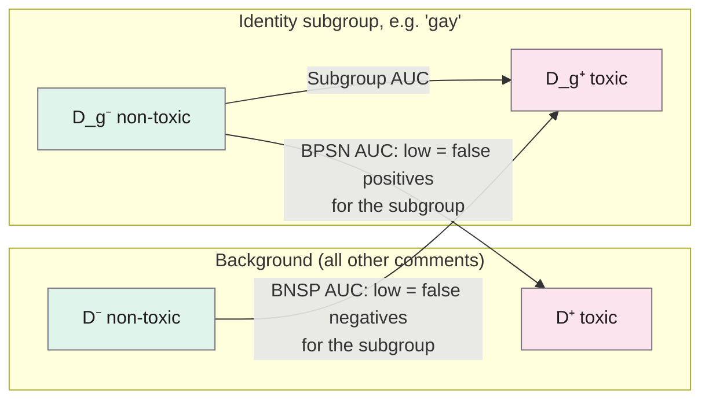
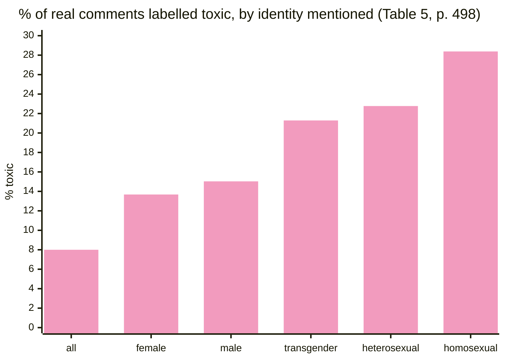

> **Source note:** drafted from the ACM PDF (renamed from 3308560.3317593.pdf). Page numbers are the printed proceedings pages, 491–500. The numeric results tables (Tables 3 and 6) are images in the PDF and their values weren't extracted, so this note only gives the numbers stated in the text.

## TL;DR
Jigsaw (the Perspective API team) propose **five threshold-free metrics** for "unintended bias": three AUCs that compare an identity subgroup with the rest of the data, and two Average Equality Gaps. They also release a test set of **1.8 million real comments**, 450,000 of them labelled for which identities they mention. Testing two versions of Perspective's toxicity model, they find that models push *non-toxic comments that discuss identities* towards toxic, most for groups that are attacked often (black, gay, Jewish), and that the bias fix in the newer model mainly helped short comments (pp. 497–499). For this project it's the metric toolkit behind MET-05's per-ground fairness and the origin of the dataset Detoxify's "unbiased" model was trained on.

**Analogy:** a single threshold metric is checking whether a sieve lets the right stones through at one hole size. The AUC metrics ask whether *any* hole size would sort the gay-related comments as well as everything else. If the harmless gay-related pebbles are as big as the background's real rocks, no hole size can save you: that's a low BPSN AUC.

Structure from Definition 1 and Table 1 (pp. 493–494).

## 1. What is the aim of the paper?
Toxicity models learn shortcuts and have been shown to associate names of frequently attacked groups ("gay", "muslim") with toxicity (p. 491). The authors define unintended bias as model performance that **varies across designated groups**, close to equality of odds (Hardt et al. 2016) (p. 491).

Two problems with existing measures:
- **Threshold-dependent metrics** (e.g. the Equality Gap, the difference in true-positive rates at one threshold) can change drastically with the threshold chosen, while real models output scores used at many thresholds (pp. 491–492).
- Their own earlier threshold-free metric (pinned AUC, from Dixon et al. 2018) is **not robust to different class balances between groups**, and a single number can hide different kinds of bias that cancel out (p. 492).

So the aim is a *suite* of threshold-free, imbalance-robust metrics that show *which kind* of bias is present, plus a large real test set (p. 492).

## 2. How did the authors carry out the research?
**The metrics (pp. 493–494).** Split the test set into background (D) and identity subgroup (D_g), each into negatives (−) and positives (+):

$$\text{Subgroup AUC} = \mathrm{AUC}(D_g^- + D_g^+)$$
$$\text{BPSN AUC} = \mathrm{AUC}(D^+ + D_g^-) \qquad \text{BNSP AUC} = \mathrm{AUC}(D^- + D_g^+)$$

- **Subgroup AUC:** how well the model separates toxic from non-toxic *within* the group.
- **BPSN** (background positive, subgroup negative): drops when the group's harmless comments score higher than other people's toxic ones → **false positives** for that group.
- **BNSP** (background negative, subgroup positive): drops when the group's toxic comments score lower than others' harmless ones → **false negatives**.

**Average Equality Gap (pp. 493–494).** Plot the subgroup's true-positive rate $x(t)$ against the background's $y(t)$ over every threshold $t$; the Positive AEG is the area between that curve and the diagonal:

$$\text{Positive AEG} = \int_0^1 \big(y(t) - x(t)\big)\,dt = \frac{1}{2} - \frac{\mathrm{MWU}(D_g^+, D^+)}{|D_g^+|\,|D^+|}$$

The Negative AEG is the same with true-negative rates. It ranges from −0.5 to 0.5; 0 is ideal (p. 494). If equality of opportunity holds at every threshold, AEG = 0 (Theorem 3.2).

**Why AUC (p. 493):** AUC is robust to imbalance between positives and negatives, and forcing one side of each AUC to come from the subgroup means its errors "cannot be drowned out" by other groups.

**Simulations (pp. 495–496, Table 2).** Seven made-up score distributions (A–G) show what each metric catches. A small score shift for the subgroup is caught *only* by the AEGs; a large one is caught by BPSN and the AEGs; extra variance without overlap (F) is caught by none.

**Data (pp. 496–497).**
- **Synthetic:** 77k template sentences, 50 identity terms, half toxic and half non-toxic (the set from Dixon et al. 2018).
- **Real:** 1.8 million online comments rated for toxicity with Perspective's guidelines; 450,000 also labelled by crowd raters for which identities are referenced, from a fixed list across gender, sexual orientation, religion, race or ethnicity and disability (Table 4, p. 497). Human identity labels catch references a keyword list would miss, like "same-sex marriage" (p. 496). Released under a Creative Commons licence (p. 497).

**Models (pp. 495–496).** Perspective TOXICITY@1 (known identity-word bias) and TOXICITY@6 (trained with the Dixon et al. 2018 mitigation: extra non-toxic data for identity terms).

## 3. What are the primary results?
- **Toxicity rates differ a lot by identity in real data (p. 498, Table 5):** 8.00% of all comments are toxic, but 15.03% of comments mentioning men, 13.68% women, 21.29% transgender, 22.77% heterosexual, **28.38% homosexual**. This imbalance is why imbalance-robust metrics are needed.
- **Synthetic set (p. 496):** TOXICITY@1 has low BPSN AUC for *homosexual*, *gay* and *lesbian* (and less so *transgender*, *heterosexual*): it gives high toxicity to harmless sentences with these words. TOXICITY@6 reduces this but doesn't remove it. Subgroup and BNSP AUCs are high everywhere: the model *can* separate within groups, and false negatives are rare.
- **AEG finds what AUC misses (p. 496):** *bisexual, trans, queer, black* have high BPSN AUC but high Negative AEG: their harmless comments score higher than others', just not high enough to swap places with toxic ones. TOXICITY@6 improved BPSN a lot but barely changed these AEGs.
- **Real data shows more bias than synthetic (p. 498),** but the worst groups agree across both.
- **Bias skews towards toxicity (p. 498):** non-toxic comments that discuss identity get pushed towards toxic, most for *black, homosexual_gay_or_lesbian* and *jewish*, least for *male, christian* and *asian*, "aligned with societal stereotypes".
- **The fix helped short comments only (pp. 498–499):** the mitigation added non-toxic training data mostly for short comments; TOXICITY@6 improved on short comments (<100 characters), but changed little on all comments. Groups with no added data (black, asian) didn't improve.

## 4. What do the authors think the results mean?
- A suite is needed because different metrics catch different biases; one number hides things (pp. 491–492, 495).
- If AUCs vary across groups, that "likely indicates a problematic bias"; AEG variation "may" indicate bias that isn't severe enough to cause mis-orderings. Which subtle variations count as harmful must be decided case by case (p. 495).
- Mitigation by adding non-toxic identity data works where data is added (short comments, specific terms) but doesn't automatically generalise (pp. 498–499).
- Further work: choosing thresholds that minimise unintended bias; comparing human identity labels with substring matching; a taxonomy of biases (p. 500).

## 5. What do I think it means?
*Claude's draft. Rewrite this in your own words when you verify.*

- **MET-05's fairness rows come from here.** BPSN AUC per ground is the threshold-free version of "false-positive rate per ground", exactly the "mention is not bias" failure. The master plan puts the full AUC suite in the appendix and the per-ground FPR in the main text; that's a sensible split.
- **The real-data finding is the background claim for DET-01:** harmless text that *discusses* identity is pushed towards toxic, most for groups that are attacked most (p. 498). That's "mention is not bias" in a large real dataset, not just templates.
- **"The fix only helped where data was added" is a warning for DET-03.** Your generated hard negatives are short template sentences. Borkan et al. found Perspective's equivalent fix helped short comments but not long ones (pp. 498–499). Your passages are up to 512 tokens. Test the hard-negatives ablation on *longer* passages too, not just HateCheck-length ones; that's a good EVAL-03 control.
- **MET-04 thresholds:** AEG catches a score shift that doesn't cross the threshold *yet*. If MET-04 tunes thresholds per deployment, report AEG so a reader knows bias may appear at other thresholds.
- **VAL-01 baseline:** the 1.8 million comments became the Civil Comments data that Detoxify's "unbiased" model was trained on. *(That link isn't stated in this paper; it's from the Detoxify documentation. Check before citing.)* Your preliminary study's finding that the unbiased model halved identity false positives but got *worse* at reporting sentences shows the limit of this paper's approach: it measures identity-term bias, not use versus mention.
- **Pick a test set where label balance differs by ground:** the paper's point about imbalance robustness (p. 493) applies directly, since your grounds will have very different numbers of positives.

**Illustrative, not from the paper:** imagine your detector scores harmless sentences about Travellers at 0.35 on average and harmless sentences about other groups at 0.10, while real stereotypes score 0.80. With a 0.5 threshold, the false-positive rate looks fine for both. The Negative AEG for Travellers would still be large, warning that a deployment with a 0.3 threshold would flag most harmless Traveller text.

Suggested metadata, one line each:
- `metrics`: the main contribution is a metric suite.
- `benchmarks`: the real-data test set with identity labels.
- `detector-model`: evidence about Perspective's identity bias and its mitigation.
- `background`, `related-work`, `methodology`: bias towards toxicity for discussed identities; prior bias metrics; the MET-05 plan.
- `MET-05`, `VAL-01`, `MET-04`, `DET-03`, `EVAL-03`: as above.

## Key numbers
- Five metrics: Subgroup AUC, BPSN AUC, BNSP AUC, Negative AEG, Positive AEG (Table 1, p. 494).
- AEG ranges from −0.5 to 0.5; 0 is optimal (p. 494).
- Synthetic test set: 77k examples, 50 identity terms, 50% toxic (p. 496).
- Real test set: 1,804,875 comments, toxicity-labelled; 450,000 identity-labelled (pp. 497–498).
- Toxic share: all 8.00%, male 15.03%, female 13.68%, transgender 21.29%, heterosexual 22.77%, homosexual 28.38% (Table 5, p. 498).
- Short comments: under 100 characters (p. 498).
- Simulation C (score shift with more positives): BPSN 0.76, AEGs 0.5, same as B, showing robustness to imbalance (Table 2, p. 496).

Quote (p. 498): "the models have a tendency to skew non-toxic comments that discuss identity towards toxicity".

## Concerns
- **Industry authors evaluating their own product** (Perspective). The metrics are general, but the results describe two specific model versions from 2018–19.
- **Numbers in Tables 3 and 6 are images;** check them on the PDF before citing any specific AUC.
- **Assumes reliable labels** (p. 491). Toxicity ratings of identity-related comments are themselves biased; the authors acknowledge this assumption.
- **Toxicity, not representational bias.** The metrics transfer to your labels; the results don't.
- **Identity list is US-centred** (Table 4): no Traveller community, civil or family status, age.
- **AUC-based fairness is threshold-free, but your gate isn't.** MET-05 still needs threshold-specific FPR for the decision the gate actually makes.
- **Licence:** the paper itself is CC BY-NC-ND 4.0 (p. 491); the dataset is "a Creative Commons license" without saying which (p. 497).

## Follow-up
From the reference list (p. 500):
- Garg, S., Perot, V., Limtiaco, N., Taly, A., Chi, E. H. and Beutel, A. (2018) "Counterfactual fairness in text classification through robustness", CoRR abs/1809.10610. Counterfactual token fairness, which the gap set's swapped-group invariance tests follow (VAL-01).
- Park, J. H., Shin, J. and Fung, P. (2018) "Reducing gender bias in abusive language detection", EMNLP 2018, pp. 2799–2804. False-positive and false-negative equality gaps, and debiasing by data augmentation.
- Mitchell, M. et al. (2019) "Model cards for model reporting", FAT* '19, pp. 220–229. Cited in DET-03 for the checkpoint model cards.
- Hardt et al. (2016) and Beutel et al. (2017) are already in the follow-up list.
