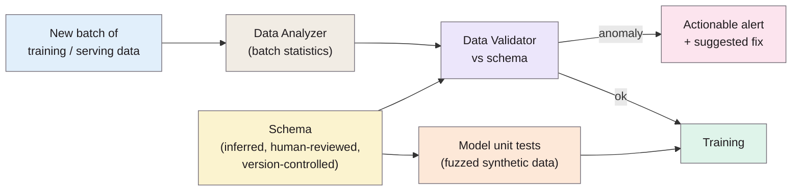

> **Source note:** drafted from the PDF in Zotero. The proceedings have no journal page numbers, so page numbers below are the PDF's pages, 1–10 for the main text. Appendices (schema details, Dirichlet-prior estimation) weren't summarised. The Zotero entry has no URL or DOI; add the MLSys proceedings link when you fix the entry.
>
> **Zotero fix needed:** this entry has the key `breckdata` because the year is missing in Zotero. Once fixed (likely key `breck2019data`), rename this file and update the decisions' `readings:` lists.

## TL;DR
Google's data validation system inside **TFX**, its end-to-end ML platform, checks the data going into ML pipelines the way tests check code (pp. 1–3). Hundreds of product teams use it on "trillions of training and serving examples per day, amounting to several petabytes" (p. 2). It has three checks: **single-batch validation** against a **schema** (the expected shape of the data), **inter-batch validation** for training/serving skew and drift, and **model unit tests** that fuzz the training code with schema-generated data (pp. 3–8). Design lessons: alerts must be **high-precision and actionable**, or engineers ignore them (p. 2); **χ² tests are too sensitive** at scale, so use an interpretable distance with a tunable threshold (pp. 6–7); the schema is **inferred, then reviewed by people and version-controlled** (p. 5). For this project it's the precedent for EvenGround as a validation step between data collection and training (CI-01, ARCH-02).

**Analogy:** the airport security scanner for a training pipeline. Every bag (batch) goes through before boarding (training). The scanner is useless if it beeps at everything, so it's tuned to beep rarely, and when it does, it shows exactly which item caused it.

Simplified from Figure 1 (p. 3).

## 1. What is the aim of the paper?
ML research focuses on algorithms, with "less attention in the equally important problem of monitoring the quality of data fed to machine learning" (abstract, p. 1). Data errors can "nullify any benefits" of better algorithms, and feedback loops (predictions becoming next day's training data) amplify small errors (p. 1). The authors argue for treating data "as a first-class citizen in ML pipelines, on par with algorithms and infrastructure" (p. 1), and describe the system they built and what they learned.

## 2. How did the authors carry out the research?
A systems paper describing a deployed system, with production statistics and case studies.

**Motivating example (pp. 1–2).** A serving-code bug pins a feature to −1 for some data; the model keeps working at lower accuracy, the bad data becomes training data, and the error persists. "−1" is a valid value, so nothing looks wrong.

**Checks (pp. 3–8).**
- *Single-batch (pp. 4–5):* a schema lists each feature's type, presence, value count and domain. Anomalies come with a description and a suggested schema edit. The schema is auto-inferred from data, then reviewed by engineers and stored in version control.
- *Inter-batch (pp. 6–7):* training/serving skew (feature skew, distribution skew, scoring/serving skew). Distribution distance uses

$$d_\infty(p, q) = \max_i |p_i - q_i|$$

  the largest change in probability for any value, chosen because it's easy to interpret ("allow changes of only up to 1%") and names a "culprit" value (p. 7).
- *Model unit testing (pp. 7–8):* generate synthetic examples from the schema (fuzz testing) to expose hidden assumptions in training code, e.g. a log transform on a feature that can be zero.

**Evaluation (pp. 8–10).** More than 700 production pipelines; 30 days of anomaly statistics (Table 1); unit test logs for one month; three case studies.

## 3. What are the primary results?
- **χ² is too sensitive (p. 7, Figure 5):** with 100 million N(0,1) points and 10,000 (0.01%) replaced by N(0,2) values, a χ² test at 1% would "needlessly fire an alert 7 out of 10 times".
- **Schemas evolve (p. 8, Figure 6):** most of the 700+ pipelines edited their schema, mostly up to five times.
- **Anomalies (Table 1, p. 9):** most common are new feature columns, unexpected string values and missing columns; teams fix most fired anomalies; unfixed ones are partly because humans "might miss or ignore the alert depending on their cognitive load".
- **Model unit tests (p. 9):** over 70% of pipelines had at least one; run over 80K times in a month; 6% failed.
- **Case studies (pp. 9–10):** Google Play found features always missing at serving but present in training; fixing the skew raised app installs on the main landing page by 2%. A video team fixed silently dropped features in two days, where similar issues had taken months. Some teams run the validator alone, without TFX training.

## 4. What do the authors think the results mean?
- Data validation catches errors early, saves engineering time and shifts teams "towards data-centric workflows" (abstract, p. 1).
- Alert design matters as much as detection: "on-calls tend to ignore alerts that are either spammy or not actionable, which can cause important errors to go unnoticed" (p. 2).
- Model quality checks aren't a substitute: errors on specific slices can leave "aggregate model metrics" looking fine (p. 2).
- They chose a restrictive schema language over arbitrary constraints so tooling could help users manage it (p. 10).

## 5. What do I think it means?
*Claude's draft. Rewrite this in your own words when you verify.*

- **CI-01 and ARCH-02 cite this accurately.** "Petabytes of data a day for hundreds of teams" matches pp. 1–2. One nuance: TFX validates data *quality and shape* (missing features, drift), not *content harms*. Say EvenGround applies the same pipeline pattern to a different kind of check.
- **Alert fatigue applies directly to CI-02 and MET-04.** If the gate flags too much, users will turn it off; that's their p. 2 and p. 5 point. It's a strong argument for MET-04 thresholds tuned for precision on the "block" decision and for showing the culprit passage (their "culprit value", p. 7).
- **Use their d∞ idea for MET-03 source-level shifts.** For representation shares across groups, "the largest change in any group's share vs the reference" is interpretable and tunable ("alert if any group's share moves more than 5 points"), and avoids χ² firing on trivial differences in big corpora (p. 7). Good citation for not using significance tests at scale.
- **Schema ≈ config (ARCH-07):** their schema is inferred, then reviewed, versioned and evolved with suggested edits (p. 5). That's the model for EvenGround's sources file and thresholds: commit them, review changes.
- **Slices matter:** their point that aggregate metrics hide slice-specific errors (p. 2) parallels reporting per-ground results (MET-05), not only overall scores.
- **Stand-alone use (p. 10)** supports ARCH-01's local app persona: teams who just want a report without a full pipeline.

Suggested metadata, one line each:
- `ci-cd`, `architecture`, `data-curation`: validation as a pipeline step; alert design.
- `background`, `related-work`, `methodology`: precedent for EvenGround's placement; gate design.
- `CI-01`, `ARCH-02`, `CI-02`, `MET-04`, `MET-03`: as above.

## Key numbers
- Hundreds of teams; trillions of examples and several petabytes per day (p. 2).
- χ² experiment: 100M points, 0.01% altered, false alert in 7 of 10 trials (p. 7).
- 700+ production pipelines analysed (p. 8).
- Model unit tests: >70% of pipelines, >80K runs a month, 6% failures (p. 9).
- Google Play: +2% app installs after fixing a skew (p. 9).
- Video team: two days to fix vs months previously (p. 10).

Quote (p. 2): "on-calls tend to ignore alerts that are either spammy or not actionable, which can cause important errors to go unnoticed."

## Concerns
- **Industry systems paper:** evidence is production statistics and anecdotes, not controlled comparisons.
- **Structured, tabular-style features;** no text content checks.
- **Google-scale context;** some lessons (petabytes, on-call engineers) don't transfer directly to a student tool.
- **Bad Zotero key, no URL** (see source note).

## Follow-up
None added: Schelter et al. (2018), Amazon's comparable data validation system, is mentioned on p. 10 if you need a second precedent.
