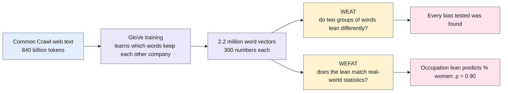
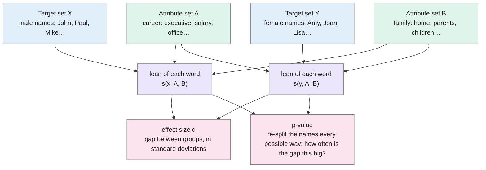
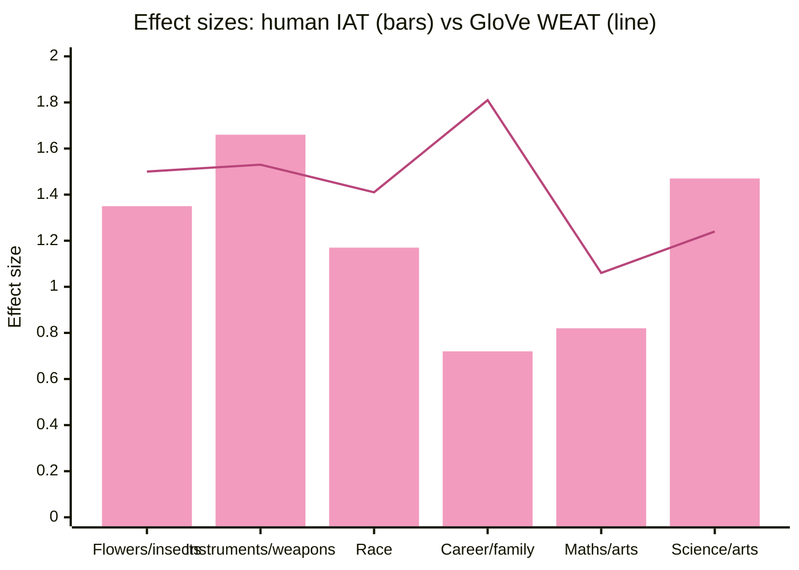
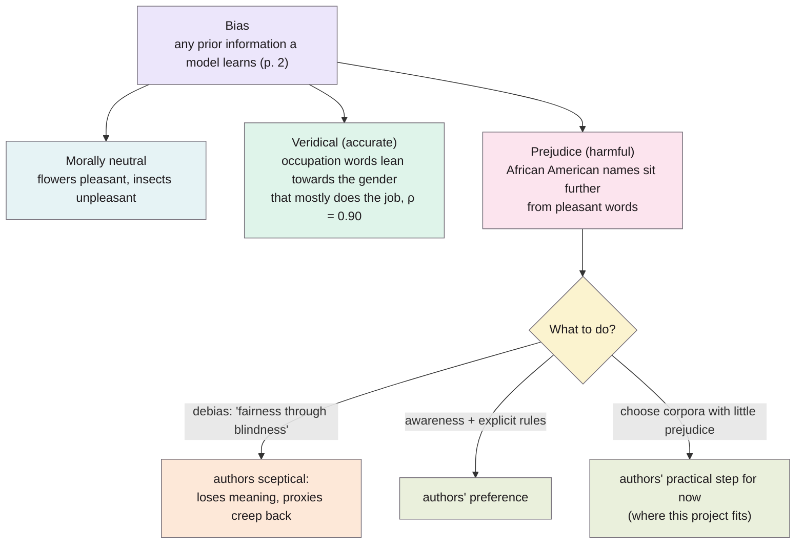
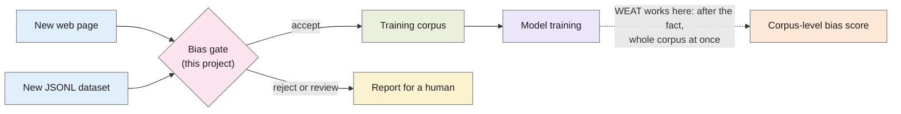

> **Source note:** this summary is drafted from the arXiv preprint (arXiv:1608.07187v4, 25 May 2017, 14 pages), not the published Science article. The preprint says on p. 1 that it is an early draft and asks readers to cite the published version. All page numbers below are **preprint pages**, and numbers may differ in the published version. Check them against the Science article (pp. 183–186) before citing.

## TL;DR
The authors took a standard word embedding (GloVe) trained on a huge crawl of ordinary web text and showed that it reproduces every human bias from psychology studies they tested, including racial and gender stereotypes, with large effect sizes. They also showed that the same embeddings track real-world statistics, such as the share of women in each occupation. For this project, it is strong evidence that web-scraped training text carries representational bias before any model is trained on it.

**Analogy:** the web is seawater and bias is the salt. GloVe didn't add any salt; it just evaporated the water and showed you what was already dissolved in it.

## 1. What is the aim of the paper?
To show that machine learning applied to everyday language picks up the same implicit biases that humans show, simply from the statistics of how words are used. The authors argue that this kind of bias comes from human culture itself, so transparency, diverse development teams and similar remedies can help but cannot be sufficient on their own (pp. 1–2). A second aim is methodological: to introduce two tests for measuring bias in word embeddings, the Word Embedding Association Test (WEAT) and the Word Embedding Factual Association Test (WEFAT) (p. 1).

**Analogy:** the Implicit Association Test (IAT) is a speed quiz for people: you're faster at pairing things your mind already links. WEAT runs the same quiz on a word embedding, except that "speed" becomes "distance". Words the model links sit closer together on its map. Same quiz, different contestant.

## 2. How did the authors carry out the research?
- **Data and model:** pre-trained GloVe embeddings from the largest corpus the GloVe authors provide, a Common Crawl web corpus of 840 billion tokens with 2.2 million distinct case-sensitive tokens, each a 300-dimensional vector (p. 9). They did not train their own embedding, to stay close to what real applications use (pp. 8–9).
- **WEAT:** compares two sets of target words (e.g. male and female names) against two sets of attribute words (e.g. career and family words) using cosine similarity. A permutation test gives a p-value, and the effect size is a normalised difference between the two target sets (p. 9).
- **Stimuli:** for each test they reused the exact word lists from the original psychology study rather than inventing their own (p. 2). Some low-frequency names were missing from the corpus and were removed, with the same number removed at random from the comparison group to keep the sets balanced (p. 4).
- **WEFAT:** checks whether each word's association score predicts a real-world property, using linear regression. They applied it to 2015 US Bureau of Labor Statistics occupation data and 1990 US census data on androgynous names (pp. 6–7, 9–10). Multi-word occupation names were collapsed to single words (e.g. "chemical engineer" to "engineer"), and the 20% of name vectors that were least "name-like" were removed (p. 10).
- **Robustness:** they repeated all WEAT and WEFAT experiments with a different embedding (word2vec trained on Google News) and say they found statistically significant effects there too (p. 9).

**Analogy:** a word embedding is a city map where every word has an address. GloVe builds the map by eavesdropping on the whole web and moving words that are often heard together onto the same street. Figure 3 (p. 8) shows the map really has structure: *man → woman*, *king → queen* and *brother → sister* all point the same way, like parallel streets.

### The maths (pp. 9–10)

Closeness on the map is the cosine of the angle between two word vectors (standard definition; the paper writes it as cos(a, b)):

$$\cos(\vec a,\vec b)=\frac{\vec a\cdot\vec b}{\lVert\vec a\rVert\,\lVert\vec b\rVert}$$

**WEAT.** How much one word $w$ leans towards attribute set $A$ rather than $B$:

$$s(w,A,B)=\operatorname{mean}_{a\in A}\cos(\vec w,\vec a)-\operatorname{mean}_{b\in B}\cos(\vec w,\vec b)$$

The test statistic adds up the lean of every word in target set $X$ and subtracts the lean of every word in target set $Y$:

$$s(X,Y,A,B)=\sum_{x\in X}s(x,A,B)-\sum_{y\in Y}s(y,A,B)$$

The p-value is the chance that a random equal-sized split $(X_i, Y_i)$ of all the target words beats the real split:

$$p=\Pr_i\big[s(X_i,Y_i,A,B)>s(X,Y,A,B)\big]$$

The effect size is the gap between the two groups' average lean, measured in standard deviations:

$$d=\frac{\operatorname{mean}_{x\in X}s(x,A,B)-\operatorname{mean}_{y\in Y}s(y,A,B)}{\operatorname{std\text{-}dev}_{w\in X\cup Y}\,s(w,A,B)}$$

**WEFAT.** For one set of target words $W$, each word's lean is normalised by how spread out its similarities to all the attribute words are. That score is then regressed against a real-world property $p_w$, such as the percentage of women in an occupation:

$$s(w,A,B)=\frac{\operatorname{mean}_{a\in A}\cos(\vec w,\vec a)-\operatorname{mean}_{b\in B}\cos(\vec w,\vec b)}{\operatorname{std\text{-}dev}_{x\in A\cup B}\cos(\vec w,\vec x)}$$

**Illustrative, not from the paper (toy numbers):** suppose *engineer* has an average cosine of 0.30 with the male words and 0.20 with the female words. Then $s(\text{engineer}, \text{male}, \text{female}) = 0.30 - 0.20 = +0.10$: it leans male. Do that for every career word and every family word, and the WEAT statistic asks whether careers lean male more than family words do, and whether that gap is bigger than a random shuffle would give.

The word lists in this diagram are from the career and family test (p. 5).

## 3. What are the primary results?
Every bias they looked for was found, with high effect sizes (p. 3). Each test below compares the original human study with the result in GloVe:

- **Morally neutral baselines.** Flowers vs insects with pleasant vs unpleasant: effect size 1.50 (original IAT 1.35) (p. 3). Musical instruments vs weapons: 1.53 (original 1.66) (p. 4).
- **Race.** European American names were closer to pleasant words than African American names: 1.41 (original 1.17) (p. 4). Using the names from Bertrand and Mullainathan's (2004) résumé study, the effect sizes were 1.50 and 1.28 with two different sets of pleasant and unpleasant words (p. 5).
- **Gender.** Female names were closer to family words and male names to career words: 1.81 (original 0.72) (p. 5). Female terms were closer to arts than to mathematics: 1.06 (original 0.82). Female terms were closer to arts than to science: 1.24 (original 1.47) (p. 6).
- **Real-world statistics.** How closely an occupation word sat to female words predicted the percentage of women in that occupation (correlation 0.90 across 50 occupations) (pp. 6–7). The same held for androgynous names and the percentage of people with that name who are women (correlation 0.84) (pp. 7–8).

Numbers from pp. 3–6. The authors warn that the two kinds of effect size don't mean the same thing (pp. 3, 9), so read this chart as "both find large effects", not "GloVe is more biased than people".

**Real-world use cases the paper gives (p. 11):**
- **Job applications.** The résumé study's names show the same pattern in GloVe as the real hiring experiment, where European American names got 50% more interview call-backs (p. 5).
- **Sentiment analysis.** A tool that scores movie reviews using these embeddings would rate a sentence higher if it mentioned a European American name instead of an African American one.
- **Machine translation.** Turkish has a gender-neutral pronoun, yet Google Translate turned "O bir doktor. O bir hemşire." into "He is a doctor. She is a nurse." For the 50 occupation words, the embedding's gender lean almost perfectly predicted which pronoun appeared.

## 4. What do the authors think the results mean?
- Bias is built into meaning itself: an algorithm that learns what words mean from human text will inevitably pick up human prejudices (pp. 10, 12). They use "bias" for any prior information and "prejudice" for the harmful kind. They argue that prejudice can only be identified by its negative consequences, so it can't be removed purely algorithmically and needs deliberate action based on knowledge of society (p. 2).
- Some of what the embeddings learn is simply accurate, such as the real gender make-up of occupations. Removing it would also remove useful information (p. 12).
- What counts as prejudice changes over time and between cultures, which makes it hard to specify algorithmically. They mention replicating stigma against mental illness compared with physical illness, though they do not report that result in this paper (p. 12).
- They are sceptical of "debiasing" embeddings, which they call "fairness through blindness". They prefer awareness, together with an explicit layer that stops prejudice being acted on (p. 12).
- As a concrete step for now, they suggest choosing training corpora with as little prejudice as possible, using tools like theirs to identify it (p. 12).

The three kinds of bias come from the abstract (p. 1) and the examples from pp. 3–7. The responses come from p. 12.

**Analogy:** debiasing an embedding is like blindfolding a new employee so they can't see who they're interviewing. The authors would rather the employee could see clearly and be trained in what not to act on.

## 5. What do I think it means?
*Claude's draft. Rewrite this in your own words when you verify.*

- **Supports the premise.** The bias is measured in a model trained on Common Crawl, the same kind of scraped web text that goes into LLM pretraining. That makes this strong evidence for "who said it's a problem": representational bias is already in the data before a model ever sees it.
- **The authors point at this project's tool.** Their own recommendation is to choose training corpora with as little prejudice as possible and to use measurement tools to find it (p. 12). That is close to what the CI gate does, so it is useful motivation for the introduction.
- **Not a per-source gate.** WEAT measures bias in an embedding trained on a whole corpus. It cannot score one new web page or dataset as it arrives, which is the gap this project fills. That contrast belongs in related work.
- **The definition matters (DET-01).** The paper separates harmful prejudice from accurate statistical facts. A detector that flags accurate facts (such as occupation statistics, or real sex differences in disease rates in medical text) would reject useful data. DET-01 needs a definition that draws this line.
- **Categories (MET-01).** Race and gender have established, citable word lists here. Mental-illness stigma is mentioned as another category that shows up in text.

**Analogy:** WEAT is a smoke alarm for the whole building. It tells you the corpus is smoky after everything has gone in. This project's gate is the bouncer at the door, checking each new source before it's let in.

**Illustrative, not from the paper:** imagine a scraped health forum where posts about women's chest pain keep sitting next to words like *anxious* and *overreacting*, and posts about men's next to *urgent* and *cardiac*. GloVe-style training would learn that lean exactly as it learned female ↔ family. The gate's job is to notice the pattern in that one source and flag it before it joins the corpus. Whether a given association is prejudice or an accurate clinical fact is precisely the DET-01 question.

Suggested metadata, one line each:
- `data-curation`: the paper's central claim is about bias in training corpora, and its main practical recommendation is to curate corpora.
- `metrics`: WEAT and WEFAT are bias measures with defined test statistics and effect sizes.
- `introduction`: motivation that bias is inherent in web text and that corpus selection is the authors' own suggested remedy.
- `background`: a heavily cited source showing the problem is real.
- `related-work`: WEAT as an existing way to measure bias in text, and why it is not a per-source gate.
- `DET-01`: the bias vs prejudice distinction, and veridical associations that should not be flagged.
- `MET-01`: race and gender categories, with standard word lists.

## Key numbers
All page numbers are **preprint** pages (arXiv:1608.07187v4).

- Pre-trained GloVe, Common Crawl corpus: 840 billion tokens, 2.2 million distinct case-sensitive tokens, 300-dimensional vectors (p. 9).
- The IAT effect sizes quoted are Cohen's *d*, where conventional small, medium and large values are 0.2, 0.5 and 0.8 (p. 3, footnote 1). The WEAT effect size has a maximum of 2.0 (p. 3, footnote 2).
- Flowers and insects: effect size 1.50, p < 10⁻⁷. Original IAT: 1.35, p = 10⁻⁸, 32 participants (p. 3).
- Musical instruments and weapons: 1.53, p < 10⁻⁷. Original: 1.66, p = 10⁻¹⁰ (p. 4).
- European American vs African American names, pleasantness: 1.41, p < 10⁻⁸. Original: 1.17, p = 10⁻⁶, 26 participants (p. 4).
- Bertrand and Mullainathan (2004) original study: nearly 5,000 résumés sent to 1,300 job adverts. European American candidates were 50% more likely to be offered an interview (p. 5).
- Résumé-study names in GloVe: 1.50, p < 10⁻⁴ (Greenwald et al. attributes); 1.28, p < 10⁻³ (Nosek et al. attributes) (p. 5).
- Career and family: 1.81, p < 10⁻³. Original: 0.72, p < 10⁻², 38,797 participants (p. 5).
- Mathematics and arts: 1.06, p = 10⁻². Original: 0.82, p < 10⁻², 28,108 participants (p. 6).
- Science and arts: 1.24, p = 10⁻². Original: 1.47, p = 10⁻²⁴, 83 participants (p. 6).
- Occupations and the percentage of women in them (WEFAT, 2015 BLS data, 50 occupations): Pearson ρ = 0.90, p < 10⁻¹⁸ (pp. 6–7).
- Androgynous names and the percentage of women with them (1990 census): ρ = 0.84, p < 10⁻¹³ (pp. 7–8).
- GloVe vs word2vec, gender association of occupation words: Pearson ρ = 0.88, Spearman ρ = 0.86 (p. 9).
- Google Translate, Turkish to English, the 50 occupation words: "he" in the majority of cases and "she" in about a quarter (p. 11).

Quote (p. 12): "eliminating bias is eliminating information; eliminating prejudice takes more thought"

## Concerns
- **Preprint, not the published version.** Page numbers, wording and possibly numbers may differ from the Science article. The title also differs ("…necessarily contain human biases" in the preprint). Get the published PDF through UL library access and re-check before citing.
- **Embeddings, not LLMs.** It studies 2014-era static word embeddings, not modern LLMs or the text itself. It shows the corpus contains bias as learned by a model, not which documents carry it.
- **Not comparable to the IAT.** The authors stress that WEAT p-values and effect sizes mean something different from the IAT's. The "subjects" are words, not people (pp. 3, 9). Don't present GloVe's larger effect sizes as "more biased than humans".
- **Small word sets.** Some tests use only 8 words per category (pp. 5–6), and low-frequency names were removed (pp. 4–5).
- **US-centric.** The names, census and labour statistics are all American, and the authors note the corpus may be disproportionately American (p. 3). Gender is treated as binary throughout.
- **Code not yet available.** The authors say they plan to release their code (p. 10).

## Follow-up
From the reference list (pp. 13–14):
- Bolukbasi, T. et al. (2016) "Man is to computer programmer as woman is to homemaker? Debiasing word embeddings" (arXiv:1607.06520). The debiasing approach this paper argues against.
- Barocas, S. and Selbst, A. D. (2014) "Big data's disparate impact", California Law Review. On bias entering indirectly through proxies.
- Greenwald, A. G., McGhee, D. E. and Schwartz, J. L. (1998) "Measuring individual differences in implicit cognition: the implicit association test". The original IAT, which WEAT is based on.
- Dwork, C. et al. (2012) "Fairness through awareness". The source of the "fairness through blindness" framing.
