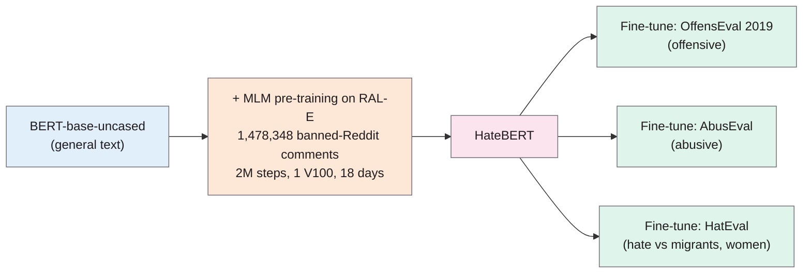

> **Source note:** drafted from the ACL Anthology PDF. Page numbers are the printed proceedings pages, 17–25. The cross-dataset tables (Tables 3–4) came out scrambled in text extraction, so only their direction of effect is reported, not individual cells.
>
> **Content warning:** the paper's appendix lists subreddit names containing slurs; none are reproduced here.

## TL;DR
HateBERT is **BERT-base-uncased with extra masked-language-model pre-training on about 1.5 million comments from Reddit communities banned for offensive, abusive or hateful content** (the RAL-E dataset, 2012–2015) (pp. 18–19). Fine-tuned on three English Twitter datasets (offensive language, abusive language, hate speech), it beats plain BERT on all three, and transfers better from general to more specific phenomena (pp. 19–20). The authors warn it is "an intrinsically biased pre-trained language model" (p. 21) and that its data is dominated by one subreddit (p. 21). For this project it's the "domain-adapted" extra baseline in DET-02.

**Analogy:** a general-purpose translator who then spends 18 days reading only the worst corners of a forum. They become much quicker at recognising insults in that dialect, and also start finishing your sentences with them.

Numbers from pp. 18–19 and footnote 6 (p. 21).

## 1. What is the aim of the paper?
General pre-trained models are trained on general language, which "highlights their limits with more domain-specific language varieties" (p. 17). Following domain models like BioBERT, FinBERT and LEGAL-BERT, the authors build a model adapted to abusive language in social media (p. 17). Contributions (p. 18): more evidence that further pre-training is a fast, cheap way to adapt a model; the release of HateBERT; and the release of RAL-E.

They also frame offensive, abusive and hate speech as differing in **specificity**: offensive language the most generic, hate speech the most specific, abusive in between (Figure 1, pp. 17–18). They argue that collapsing these into one binary label conflates portability with generalisability (p. 18).

## 2. How did the authors carry out the research?
**RAL-E (p. 18).** Lists of banned English subreddits from Reddit admin posts and Wikipedia, keeping communities banned for harassment, bullying, violence or hate. Comments taken from a public Reddit dump: **1,492,740 messages**, January 2012 to June 2015, 43.8M tokens, average 32.25 tokens. Only 1.2% of tokens are explicit offensive terms (Wiegand et al. lexicon, score ≥ 0.75), and only 260,815 messages contain one.

**Retraining (pp. 18–19).** 1,478,348 messages for MLM training, the rest held out. 100 epochs (almost 2 million steps), batch 64, up to 512 tokens, Adam, learning rate 5e-5, one Nvidia V100; it took **18 days** (footnote 6, p. 21). Vocabulary unchanged. Sanity check: with the template "[someone] is/are [MASK]", HateBERT fills in profanities and insults where BERT gives neutral words (Table 1, p. 19).

**Fine-tuning (p. 19; Appendix B, p. 25).** Same preprocessing and hyperparameters for BERT and HateBERT: learning rate 1e-5, 5 epochs, max sequence length 100, batch 32. Results averaged over 5 runs. Metric: macro-F1, as in the original tasks.

**Datasets (p. 19).**
- **OffensEval 2019:** 14,100 tweets; offensive = "any form of non-acceptable language (profanity) or a targeted offense".
- **AbusEval:** the same tweets re-annotated for abuse, which excludes isolated profanity and untargeted messages.
- **HatEval:** 13,000 tweets; hate only against migrants and women; other abuse is the negative class.

## 3. What are the primary results?
**In-dataset (Table 2, p. 20):**

| Dataset | BERT macro-F1 | HateBERT macro-F1 | Best previous |
|---|---|---|---|
| OffensEval 2019 | .803 ± .006 | .809 ± .008 | .829 (shared task) |
| AbusEval | .727 ± .008 | **.765 ± .006** | .716 (Caselli et al. 2020) |
| HatEval | .480 ± .008 | .516 ± .007 | .651 (shared task) |

- HateBERT is new state of the art on AbusEval; it would rank 4th on OffensEval and 6th on HatEval (p. 20).
- Gains affect both positive and negative classes (p. 20).

**Cross-dataset (Tables 3–4, p. 20):** HateBERT transfers better than BERT "especially when going from generic abusive language phenomena (i.e., offensive language) towards more specific ones", and has higher precision than BERT in those transfers "at a very low cost for Recall" (p. 20).

**Data skew (p. 21; Table A.1, p. 24):** RAL-E is heavily skewed: 1,465,531 of the 1,492,740 messages come from **one subreddit, r/fatpeoplehate** (about 98%, Claude's calculation from Table A.1). The authors acknowledge "a known issue concerning HateBERT is its bias toward the subreddit r/fatpeoplehate" (p. 21) and are collecting ~1.3M more messages to rebalance it.

## 4. What do the authors think the results mean?
- Further pre-training "is an effective and cheap strategy" for adapting models (p. 20).
- Cross-dataset results support the specificity view of abusive phenomena and the validity of the annotations (p. 20).
- **Ethics (pp. 21–22):** HateBERT "is an intrinsically biased pre-trained language model"; fine-tuned models inherit biases in the labelled data (citing Sap et al. 2019, @sap2019risk); such tools "must always be used under the supervision of humans"; current datasets lack the "context of occurrence of a message". RAL-E is released without usernames or subreddit names to protect privacy, since consent from users of banned communities is impractical.

## 5. What do I think it means?
*Claude's draft. Rewrite this in your own words when you verify.*

- **DET-02 is accurate** that HateBERT was retrained on over a million banned-Reddit posts (1,478,348, p. 18). Two corrections to the DET-02 table:
  - **Licence:** the paper doesn't state one (NOT FOUND IN SOURCE). Check the Hugging Face model card (`GroNLP/hateBERT`) before writing Apache-2.0.
  - **110M:** the paper only says BERT base-uncased (p. 18); 110M is BERT-base's usual size, so cite BERT for it, not this paper.
- **512 vs 100 tokens:** HateBERT was *pre-trained* with sequences up to 512 tokens (p. 19), but the paper *fine-tuned* with max length 100 (Table A.3, p. 25). For your passage-level scoring (ARCH-04), use 512 and say you departed from their fine-tuning setting.
- **Why it's a good "mention is not bias" test:** HateBERT's pre-training is ~98% one community's posts about weight, and its MLM associates "women are [MASK]" with insults (Table 1). If any model confuses identity *mentions* with harm, it should be this one, so its false-positive rate on neutral identity mentions is an informative contrast with ModernBERT and DeBERTa. State this hypothesis in DET-02 before running it.
- **Specificity matters for your labels too:** stereotyping and demeaning are closer to the "specific" end. Their finding that general → specific transfers better (p. 20) supports training on broader data (ToxiGen, SBIC) and then evaluating on your narrower gap set, not the reverse.
- **ARCH-05:** loads through Hugging Face Transformers like the other models.

Suggested metadata, one line each:
- `detector-model`, `benchmarks`: domain-adapted baseline and its benchmarks.
- `related-work`, `methodology`, `evaluation`: existing detectors; DET-02 baseline; FPR comparison.
- `DET-02`, `ARCH-05`: as above.

## Key numbers
- RAL-E: 1,492,740 messages, 43.8M tokens, Jan 2012–Jun 2015 (p. 18); 1,478,348 used for retraining (p. 18).
- r/fatpeoplehate: 1,465,531 messages (Table A.1, p. 24).
- Retraining: ~2M steps, batch 64, lr 5e-5, one V100, 18 days (pp. 19, 21).
- Fine-tuning: lr 1e-5, 5 epochs, max length 100, batch 32 (Table A.3, p. 25).
- Macro-F1, BERT → HateBERT: OffensEval .803 → .809; AbusEval .727 → .765; HatEval .480 → .516 (Table 2, p. 20).

Quote (p. 21): "HateBERT is an intrinsically biased pre-trained language model."

## Concerns
- **Small gains on two of three datasets** (OffensEval +0.006, within a standard deviation).
- **Pre-training data ~98% one subreddit,** acknowledged by the authors (p. 21); the released model may or may not be the rebalanced version.
- **Reddit pre-training, Twitter evaluation;** all English, 2012–2019 data.
- **No licence stated** in the paper.
- **Short workshop paper;** limited analysis of what the retraining changes.

## Follow-up
None added: Sap et al. (2019) is already summarised (@sap2019risk).
