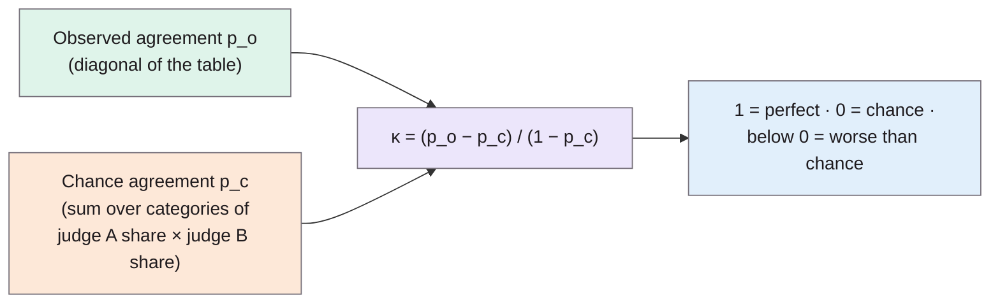

> **Source note:** drafted from the SAGE PDF (a scan). Page numbers are the journal's printed pages, 37–46. The equations were images and didn't survive text extraction; the formulas below are the standard forms of Cohen's kappa matching the paper's verbal definitions, so **check them against Equations 1 and 7 in the PDF**. Table 2 (the worked example) also didn't extract.
>
> **Zotero fix needed:** this entry has the key `coefficient` because author and date are missing in Zotero. Once fixed (likely key `cohen1960coefficient`), rename this file and update the decisions' `readings:` lists.

## TL;DR
When two judges sort the same items into unordered categories, **raw percentage agreement overstates reliability**, because some agreement happens **by chance** (pp. 37–38). And **χ² or the contingency coefficient measure association, not agreement**: in Cohen's example, judges who agree *less* than chance still get a "highly significant" χ² (p. 39). Cohen proposes **κ (kappa)**: the proportion of agreement left after removing chance agreement, $\kappa = (p_o - p_c)/(1 - p_c)$ (p. 40). It is 1 for perfect agreement, 0 for chance, negative for worse than chance (p. 41); he also gives its maximum given the judges' category totals, a standard error and confidence limits (pp. 42–44). For this project it's the statistic for the gap set's 20% blind re-labelling in VAL-01.

**Analogy:** two people flipping coins and "agreeing" on heads half the time. That's not shared judgement, it's luck. Kappa subtracts the luck before giving credit.

Definitions from pp. 39–41.

## 1. What is the aim of the paper?
In clinical and social psychology, often "the only useful level of measurement obtainable is nominal scaling", produced by a human "two-legged meter", so it matters whether judgements are reproducible (p. 37). The aim: "a coefficient to measure the degree of agreement in nominal scales, and to provide means of testing hypotheses and setting confidence limits for this coefficient" (p. 39).

## 2. How did the authors carry out the research?
A methodological paper with worked examples.

**Assumptions (p. 38):**
1. The units are independent.
2. The categories are independent, mutually exclusive and exhaustive.
3. The judges operate independently.

Also: no "correct" answer is assumed, judges are deemed equally competent, and all disagreements count equally (categories are unordered) (p. 38).

**Why not simpler measures (pp. 38–39).** In Table 1, observed agreement is $p_o = .29$ but chance agreement is $p_c = .35$. With N = 200, χ² = 64.59 (highly significant) and C = .49, because χ² "tests the null hypothesis with regard to association, not agreement"; it's inflated "by any departure from chance association, either disagreement or agreement" (p. 39).

**Kappa (p. 40).** Chance agreement uses each judge's own category proportions: for each category, multiply judge A's proportion by judge B's, then sum (e.g. .40 × .50 = .20 for category 1, p. 38).

$$\kappa = \frac{p_o - p_c}{1 - p_c}$$

"the proportion of chance-expected disagreements which do not occur" (p. 40). Compared with Scott's π, kappa doesn't assume the two judges distribute items across categories in the same way (pp. 40–41).

**Maximum kappa (p. 42).** If the judges' category totals differ, κ can't reach 1. $\kappa_M$ uses $p_{oM}$, the sum of the smaller of each pair of marginal proportions. For Table 1, $p_{oM} = .90$ and $\kappa_M = .85$. $1 - \kappa_M$ indicates "fuzziness of ... category boundaries", which training can reduce.

**Sampling (pp. 43–44).** An approximate standard error (treating $p_c$ as fixed, adequate for N > 100), normal-approximation confidence limits ($\kappa \pm 1.96\,\sigma_\kappa$ for 95%), and a test against κ = 0. The standard-error formula wasn't extracted; its standard form is

$$\sigma_\kappa \approx \sqrt{\frac{p_o(1 - p_o)}{N(1 - p_c)^2}}$$

(*check against Equation 7, p. 43*).

## 3. What are the primary results?
- **Limits (pp. 41–42):** κ = 0 at chance; upper limit +1 only with perfect agreement (which requires identical category totals); lower limit between 0 and −1 depending on the totals.
- **Relation to φ (p. 43):** for two categories with equal totals, κ equals the φ correlation.
- **Worked example (pp. 44–46):** κ = .492, maximum .831, 95% interval .384 to .600, and highly significant (p < .001).
- **Significance isn't the point (p. 44):** "to know merely that K is beyond chance is trivial since one usually expects much more than this in the way of reliability".

## 4. What do the authors think the results mean?
Kappa is "directly interpretable as the proportion of joint judgments in which there is agreement, after chance agreement is excluded" (summary, p. 46). Disagreement forced by different category totals "has the same negative consequences as disagreement not so forced—in short, it is disagreement" (p. 43), so κ, not κ/κ_M, is usually the right number.

## 5. What do I think it means?
*Claude's draft. Rewrite this in your own words when you verify.*

- **VAL-01 cites this correctly** for agreement on the 20% blind re-label. Report κ **with a 95% confidence interval** (p. 44), not just a point value, and not a significance test (p. 44 says that's trivial).
- **Intra-rater use stretches assumption 3.** Cohen's "judges operate independently" (p. 38) assumes two people. You're re-labelling your own items: memory can inflate agreement. The two-week gap and blind relabelling are the mitigation; say explicitly that you're applying Cohen's κ to two labelling *occasions*, and that it measures consistency in applying the rules (as DET-06 says), not validity.
- **Multi-label labels break assumption 2.** Categories must be "mutually exclusive" (p. 38), but MET-02 allows a passage to be both stereotyping and demeaning. So compute κ **per label** (stereotyping yes/no, demeaning yes/no) and separately for the context type (expresses, mentions, discusses, quotes, counters), which *is* mutually exclusive.
- **Use κ_M as a diagnostic.** If your two passes put different numbers of items in a category, κ_M shows how much disagreement comes from that shift; Cohen suggests it reveals fuzzy category boundaries (p. 42). That's useful evidence for refining DET-06's guidelines.
- **Rare labels:** with very few harmful items, κ is unstable and the normal approximation needs N > 100 (p. 43). Check your 20% sample is big enough, or report a bootstrap interval instead.
- **Interpretation thresholds** (e.g. Landis and Koch's "substantial" for 0.61–0.80) are **not** in this paper (NOT FOUND IN SOURCE); cite them separately if you use them.

Suggested metadata, one line each:
- `metrics`, `data-curation`: labelling reliability.
- `methodology`, `evaluation`: VAL-01 re-labelling; reporting κ.
- `VAL-01`, `DET-06`: as above.

## Key numbers
- Table 1: $p_o = .29$, $p_c = .35$; χ² = 64.59 with N = 200; C = .49 (pp. 37–39).
- Table 1 maximum: $p_{oM} = .90$, $\kappa_M = .85$ (p. 42).
- Worked example: κ = .492, κ_M = .831, 95% CI .384–.600 (p. 44).
- Normal approximation adequate for N > 100 (p. 43).

Quote (p. 39): "χ² tests the null hypothesis with regard to association, not agreement."

## Concerns
- **Two judges, nominal categories only;** no weighting of near-misses (Cohen's later weighted kappa is a different paper).
- **Scan with lost equations;** formulas here are standard forms, to be checked.
- **Kappa depends on category prevalence:** with skewed labels, κ can be low despite high raw agreement. Not discussed in the paper.
- **Bad Zotero key** (see source note).

## Follow-up
None added.
