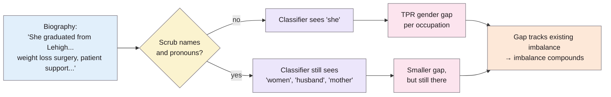
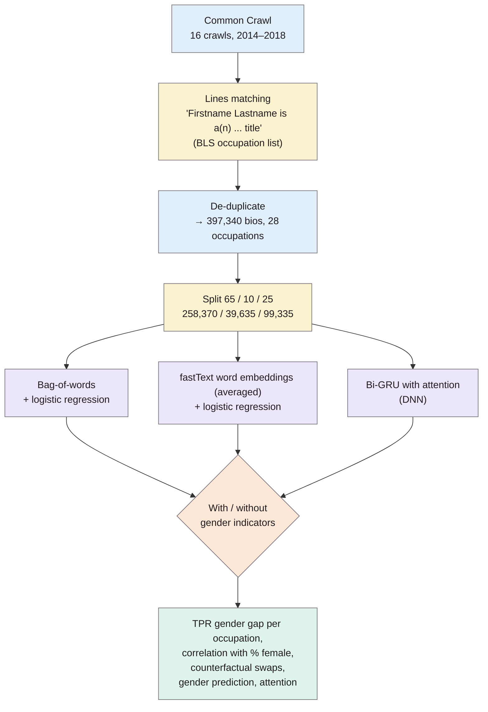

> **Source note:** drafted from the arXiv preprint (arXiv:1901.09451v1, 27 Jan 2019, 12 pages), which says it was accepted at ACM FAT* 2019. Its printed page numbers run 2–12 and match the PDF pages (page 1 has no number), so page numbers below are **arXiv pages 1–12**. The published version is pp. 120–128 and will paginate differently, so check against it before citing.

## TL;DR
The authors built **Bias in Bios**: 397,340 English online biographies from Common Crawl, each labelled with one of 28 occupations and a (binary, pronoun-inferred) gender. Occupation classifiers trained on it were more accurate for the majority gender in each job, and the size of that gap tracked how gender-imbalanced the job already was, so using the classifier for recruiting would **make the imbalance worse**. Deleting names and pronouns ("scrubbing") shrank the gaps but didn't remove them, because other words ("women", "husband", "mother") act as proxies for gender. For this project it's a ready-made benchmark for the downstream evaluation, and strong evidence that **removing obvious identity markers is not the same as removing bias**.

**The paper's own analogy (p. 1):** blind orchestra auditions put candidates behind a curtain, but the judges could still hear their shoes, so auditions also put down a carpet or asked candidates to take their shoes off. Scrubbing names and pronouns is the curtain; words like "women" and "husband" are the shoes.

The example biography is the paper's own (p. 3). The proxy words are from p. 7.

## 1. What is the aim of the paper?
Recruiters and automated hiring systems need to know someone's occupation, and online biographies are a common source, so machine learning is used to predict occupation from text (p. 1). The aim is a large-scale study of **gender bias in occupation classification**, focusing on *allocation harms* (who gets offered opportunities) that come from *semantic representation bias* (bias in how text is represented) (abstract, p. 1). Specifically:

1. build a large real-world dataset of biographies (p. 1);
2. measure gender bias in classifiers built on three representations, with and without explicit gender indicators (pp. 1, 3–4);
3. test whether the bias tracks existing gender imbalances in occupations, and so compounds them (p. 2);
4. find out what bias remains after "scrubbing" and which proxies the model uses (p. 1).

Two takeaways the authors state up front (p. 2): scrubbing explicit gender indicators is **not sufficient**, and even without them, TPR gender gaps correlate with existing imbalances, so classifiers may **compound** them.

## 2. How did the authors carry out the research?

Numbers from pp. 2–3.

- **Dataset (pp. 2–3):** lines starting with a name-like pattern (two capitalised words) followed by "is a(n) (xxx) *title*", where *title* is an occupation from the US Bureau of Labor Statistics Standard Occupation Classification. The 28 most frequent occupations were kept (some merged, e.g. "economics professor" → *professor*). Duplicates were removed by name and occupation. *Professor* is the most frequent (118,400 bios), *rapper* the least (1,406). Bios are 18–194 tokens, median 72. Code to rebuild the dataset is at aka.ms/biasbios (p. 3).
- **Gender (p. 1):** inferred as binary from pronouns, since bios are usually written in the third person. The authors call this "a simplification that fails to capture important aspects of gender and erases people who do not fit within its assumptions" (p. 1).
- **Task (p. 3):** predict the occupation named in the first sentence from the *rest* of the bio.
- **Three representations (pp. 3–4):** bag-of-words (BOW) and averaged fastText word embeddings (WE), each with one-vs-all L2-regularised logistic regression; and a bidirectional GRU with attention (DNN), trained end-to-end with cross-entropy.
- **Scrubbing (p. 4):** delete the first name and the words *he, she, her, his, him, hers, himself, herself, mr, mrs, ms*.
- **Analyses (pp. 4–7):**
  - TPR gender gap per occupation and its correlation with % female;
  - counterfactuals: swap gender indicators and see whether the prediction changes;
  - gender prediction from scrubbed bios, on a balanced subsample of 21 occupations × 2 genders × 1,000 bios = 42,000 (p. 6);
  - DNN attention weights to find proxy words (p. 7);
  - simulations of compounding over repeated hiring rounds (p. 7).

### The maths

**True positive rate and the gender gap (p. 4).** For gender $g$, the other gender $\sim g$, and occupation $y$:

$$\text{TPR}_{g,y} = P\big[\hat{Y}=y \mid G=g,\; Y=y\big] \qquad (9)$$

$$\text{Gap}_{g,y} = \text{TPR}_{g,y} - \text{TPR}_{\sim g,y} \qquad (10)$$

This is closely related to Hardt et al.'s **equality of opportunity** (p. 2): a fair classifier would have $\text{Gap}_{g,y}=0$.

**Compounding (p. 4).** Let $\pi_{g,y} = P[G=g \mid Y=y]$ be the share of people in occupation $y$ with gender $g$. If $g$ is under-represented ($\pi_{g,y}<0.5$) *and* the classifier is worse for them ($\text{Gap}_{g,y}<0$), then among the people the classifier correctly finds, $g$ is even rarer:

$$\text{Theorem 1:}\quad \pi_{g,y}<0.5 \;\wedge\; \text{Gap}_{g,y}<0 \;\Rightarrow\; P\big[G=g \mid Y=\hat{Y}=y\big] < \pi_{g,y} \qquad (11)$$

The proof is Bayes' theorem (p. 4):

$$\frac{P[G=g \mid Y=\hat{Y}=y]}{P[G=\sim g \mid Y=\hat{Y}=y]} = \frac{\pi_{g,y}\,\text{TPR}_{g,y}}{\pi_{\sim g,y}\,\text{TPR}_{\sim g,y}} < \frac{\pi_{g,y}}{\pi_{\sim g,y}} \qquad (13)$$

**Worked example from the paper (p. 5):** 14.6% of surgeons in the test split are women. The BOW classifier correctly identifies 71% of male surgeons but only 54.5% of female surgeons. So only **11.6%** of the surgeons it finds are women: 14.6% went in, 11.6% came out.

**Counterfactual flips (p. 5).** $\mathbb{S}_{g,(y^1,y^2)}$ is the set of bios of gender $g$, really in occupation $y^2$, that are predicted as $y^1$ as written but correctly as $y^2$ once gender indicators are swapped. $\Pi$ is that set as a share of all bios that are *only* correct after swapping:

$$\Pi_{g,(y^1,y^2)} = \frac{\lvert \mathbb{S}_{g,(y^1,y^2)} \rvert}{\lvert \mathbb{S}_{g,y^2} \rvert} \times 100\% \qquad (15)$$

*Note:* the printed definition in eq. (14) reads $\hat{y}_i = y^1,\ \hat{y}_i^{(g\leftrightarrow\sim g)} = y^2,\ y_i = y^2$. I've described it that way; the surrounding prose ("incorrectly predicted as having occupation $y^1$ … correctly predicted as having occupation $y^2$") agrees.

**The leaky pipeline simulation (p. 7).** Fit a line to gap vs share, then let the true positives at time $t$ be the candidate pool at time $t+1$:

$$\widehat{\text{Gap}}^{(t)}_{g,y} = \pi^{(t)}_{g,y}\,\beta_1 + \beta_0 \qquad (21)$$

$$\pi^{(t+1)}_{g,y} = \frac{\pi^{(t)}_{g,y}\,\text{TPR}^{(t)}_{g,y}}{\pi^{(t)}_{\sim g,y}\big(\text{TPR}^{(t)}_{g,y} + \text{Gap}^{(t)}_{g,y}\big) + \pi^{(t)}_{g,y}\,\text{TPR}^{(t)}_{g,y}} \qquad (22)$$

**Analogy:** a sieve that lets slightly fewer red marbles through than blue. Pour once and you barely notice. Pour the output back through the same sieve ten times and the red marbles almost vanish. That's Fig. 6 (p. 7), where a 10% / 90% starting split drifts further apart over ten rounds.

## 3. What are the primary results?

**Overall accuracy barely changes with scrubbing (Fig. 2, p. 4).** Roughly 0.80 (BOW), 0.79 (WE) and 0.84 (DNN), with and without indicators. The paper gives these only as a bar chart, so these values are read from the figure.

**The gap tracks the gender balance of the job (Fig. 3, p. 4; Fig. 4, p. 5).** Women-dominated jobs (model, dietitian, nurse, paralegal, interior designer) have positive gaps (better for women); men-dominated jobs (rapper, surgeon, DJ, pastor, software engineer) have negative gaps (worse for women). Correlation between gap and % female:

```mermaid
%%{init: {"themeVariables": {"xyChart": {"plotColorPalette": "#8FB8DE, #8FD1B0"}}}}%%
xychart-beta
  title "Correlation of TPR gender gap with % female: with (blue) vs without (green) gender indicators"
  x-axis ["Bag-of-words", "Word embeddings", "DNN"]
  y-axis "Correlation" 0 --> 1
  bar [0.85, 0.86, 0.82]
  bar [0.74, 0.71, 0.74]
```

Values from the Fig. 4 caption (p. 5). Scrubbing lowers the correlation, but it stays above 0.7 for every representation.

**Swapping gender changes predictions (p. 5).** Swapping gender indicators changes the predicted occupation for 5.5% of test bios (BOW), 12.2% (WE) and 4.6% (DNN). The biggest flips for BOW (Tables 1–2, p. 6):

| Gender | Predicted as written ($y^1$) | Correct after swap ($y^2$) | $\Pi$ |
|---|---|---|---|
| Men | attorney | paralegal | 7.1% |
| Men | architect | interior designer | 4.7% |
| Men | professor | dietitian | 4.3% |
| Men | photographer | interior designer | 3.5% |
| Men | teacher | yoga teacher | 3.3% |
| Women | model | rapper | 14.7% |
| Women | teacher | pastor | 8.5% |
| Women | professor | software engineer | 6.5% |
| Women | professor | surgeon | 4.8% |
| Women | **physician** | **surgeon** | 3.8% |

Read the last row as: some women surgeons are labelled *physician* until their bio uses male pronouns.

**Scrubbing doesn't remove gender (p. 6).** On the balanced scrubbed subsample, gender is still predictable at 65.5% (BOW) and 68.2% (DNN), above the 50% chance level. Fig. 5 (p. 6) shows that many words correlate with gender (e.g. *women, husband, mother, actress, children* for female; *man, chairman, guy, football* for male), so deleting them all "would not be feasible".

**The DNN finds proxies (p. 7).** Words with the most attention in the gender classifier, consistently across runs: *women, husband, mother, woman, female*. Without explicit indicators, the occupation classifier puts **more** attention on *women* across all occupations (Fig. 8, p. 8), which suggests it's using it as a stand-in for gender.

**Surprise in the appendix (pp. 10–11):** a DNN trained *without* gender indicators pays *much more* attention to "she" when it appears at test time, because the word embeddings already encode gender even for words the classifier never saw in training.

## 4. What do the authors think the results mean?
- Occupation classifiers have significant TPR gender gaps across all three representations, and because the gaps correlate with existing imbalances, they can **compound** them, especially when people meet such classifiers repeatedly (p. 8). If the existing imbalance comes from past injustice, this is a form of **indirect discrimination** (p. 5).
- Scrubbing is an empirical case where fairness improves with almost no accuracy cost (p. 8), but it is not enough: gender is still predictable, gaps remain for some occupations, and the correlation with imbalance remains (p. 8).
- The remaining bias reflects differences in how men's and women's bios are written, possibly self-presentation or different specialisations within a job (p. 8).
- **Future work (p. 8):** mitigating TPR gaps and compounding in recruiting; studying race and socioeconomic bias, which "it is likely that they exist" (p. 8), if group-membership data is available.

## 5. What do I think it means?
*Claude's draft. Rewrite this in your own words when you verify.*

- **Benchmark for the downstream experiment (VAL-01, EVAL-02).** Bias in Bios is public, large, and comes with a clean per-group metric (TPR gap) and a clean summary (correlation with % female). Fine-tune or probe a model trained on filtered vs unfiltered data and compare the gaps. It's also what kumar2025detecting used, so it's an expected benchmark. It covers **gender only** (MET-01).
- **Medical relevance.** Seven of the 28 occupations in Fig. 1 (p. 3) are healthcare jobs: physician, surgeon, nurse, dentist, dietitian, chiropractor and psychologist (plus personal trainer and yoga teacher on the fitness side). The female-surgeon numbers (14.6% in → 11.6% out, p. 5) and the physician → surgeon flip (Table 2) are vivid, citable medical-workforce examples for the introduction or background.
- **Scrubbing is not de-biasing (DET-01).** If your detector or your recommendations assume "remove gendered words / names and the text is neutral", this paper is the counter-evidence: proxies remain (p. 6–7). Your definition of representational bias has to be about *associations in context*, not a word list. (It fits with Barocas & Selbst on proxies, already in follow-up.yml.)
- **Metrics (MET-05).** TPR gap per group, plus correlation of gaps with the base rate, is a neat pair: one says *how unfair*, the other says *whether it compounds*.
- **Counterfactual swaps (EVAL-02, EVAL-04).** Swapping gender words and seeing whether the output changes is a cheap causal test, for the detector and for downstream models. The authors are careful to say this asks "what if the bio used other-gender indicators", not "what if the person were the other gender" (p. 5).
- **Attention as explanation (UI-02, EVAL-04).** Fig. 7 (p. 7) highlights the words a model leaned on, which is the kind of view non-technical users might find helpful. *Not from the paper:* whether attention weights are faithful explanations is contested, so check this against the EVAL-04 follow-ups (ERASER, the disagreement problem) before relying on it.
- **Compounding as a feedback loop.** *My interpretation, not the paper's claim:* the paper's loop is hiring rounds, but the same maths applies whenever a model's outputs become the next model's training data, e.g. LLM-generated text ending up in future web crawls. That's a motivation for checking sources *before* they enter training.

**Illustrative, not from the paper:** a medical training set built from staff profiles might contain "Dr. Patel is a surgeon" mostly about men and "Dr. Patel is a nurse" mostly about women. Remove the pronouns and a model can still learn the pattern from "her husband", "mother of two" or "women's health". That's the shoe-sound problem in a clinical corpus.

Suggested metadata, one line each:
- `benchmarks`: introduces the Bias in Bios dataset (397,340 bios, 28 occupations).
- `metrics`: TPR gender gap and its correlation with occupational gender balance.
- `data-curation`: built from Common Crawl with pattern filters; shows scrubbing sensitive words isn't enough.
- `impact-evaluation`: a downstream measure (TPR gaps) and a compounding simulation.
- `background`: evidence that NLP classifiers on real text have gender bias that harms people in a high-stakes setting.
- `related-work`: the source of a widely used benchmark; classifier-side bias, not data filtering.
- `methodology`: TPR gap, counterfactual swaps and proxy analysis as evaluation methods.
- `evaluation`: a candidate benchmark and metric for the downstream experiment.
- `DET-01`: proxies mean bias isn't just explicit identity words.
- `MET-01`: covers binary gender only; race and socioeconomic status left for future work.
- `MET-05`: TPR gap per group (equality of opportunity) and correlation with base rate.
- `VAL-01`: Bias in Bios as a candidate benchmark.
- `EVAL-02`: TPR gaps and gender-swap counterfactuals as output-side measures.
- `EVAL-04`: attention weights and counterfactuals as attribution tools.
- `UI-02`: per-word attention highlighting as an explanation display (Fig. 7).

## Key numbers
All page numbers are **arXiv pages** of 1901.09451v1.

- 397,340 biographies, 28 occupations, from 16 Common Crawl crawls (2014–2018) (pp. 2–3).
- Professor 118,400 bios (most); rapper 1,406 (least); 18–194 tokens, median 72 (p. 3).
- Splits: 258,370 train (65%), 39,635 validation (10%), 99,335 test (25%) (p. 3).
- Scrubbed words: first name, he, she, her, his, him, hers, himself, herself, mr, mrs, ms (p. 4).
- Accuracy roughly 0.80 / 0.79 / 0.84 for BOW / WE / DNN, same with and without indicators (Fig. 2, p. 4; read from the chart).
- Surgeons: 14.6% women; TPR 71% men vs 54.5% women; 11.6% of true positives women (p. 5).
- Gap vs % female correlation, with / without indicators: BOW 0.85 / 0.74, WE 0.86 / 0.71, DNN 0.82 / 0.74 (Fig. 4, p. 5).
- Predictions changed by gender swap: BOW 5.5%, WE 12.2%, DNN 4.6% (p. 5).
- Largest flips: men attorney → paralegal 7.1%; women model → rapper 14.7%, physician → surgeon 3.8% (Tables 1–2, p. 6).
- Gender predicted from scrubbed bios: BOW 65.5%, DNN 68.2% (balanced subsample of 42,000 bios, 21 occupations) (p. 6).
- Proxy candidates: women, husband, mother, woman, female (p. 7).
- Dataset code: aka.ms/biasbios (p. 3).

Quote (p. 1): scrubbing "is like introducing a curtain—the sounds made by the candidates' shoes remain."

## Concerns
- **arXiv preprint, not the FAT* published version.** Page numbers and wording may differ from pp. 120–128.
- **Binary gender inferred from pronouns** (p. 1). The authors flag this themselves; it excludes non-binary people and misgenders anyone whose bio doesn't match.
- **Gender only.** No race, age or other groups (p. 8), so on its own it can't cover MET-01.
- **Not representative.** People with online bios differ from the workforce, and the dataset isn't all bios online (p. 3). Bios may not be self-written (p. 2), so "how women present themselves" is uncertain.
- **Occupation classification, not language modelling.** It measures a classifier's errors, not stereotypes an LLM generates. Using it for LLMs needs an adapted protocol (e.g. prompting or fine-tuning for occupation prediction), which you'd have to design and justify.
- **The occupation count doesn't add up across figures.** The text and Fig. 1 say 28 occupations, but Figs. 8, 10 and 14 also show acupuncturist, massage therapist, real estate broker, landscape architect and magician, which aren't in Fig. 1. Possibly a different version of the dataset; worth checking against the published version.
- **Few headline numbers are tabulated.** Accuracies and per-occupation gaps are only in charts; WE gender-prediction accuracy isn't given (p. 6).
- **No confidence intervals or significance tests** on the correlations or the counterfactual percentages; Fig. 4's shaded bands aren't explained.
- **Attention as explanation** is the authors' method for finding proxies; its faithfulness isn't tested here.
- **Data licensing** of the scraped bios isn't discussed; check terms before redistributing any of it (ETH-02).
- **Industry co-authors** (Microsoft Research, LinkedIn), in a paper about recruiting.

## Follow-up
From the reference list (p. 12):
- Zhao, J., Wang, T., Yatskar, M., Ordonez, V. and Chang, K.-W. (2018) "Gender bias in coreference resolution: Evaluation and debiasing methods", arXiv:1804.06876. WinoBias; another output-side gender test for EVAL-02.
- Rudinger, R., Naradowsky, J., Leonard, B. and Van Durme, B. (2018) "Gender bias in coreference resolution", arXiv:1804.09301. Winogender; same use.
- Garg, N., Schiebinger, L., Jurafsky, D. and Zou, J. (2018) "Word embeddings quantify 100 years of gender and ethnic stereotypes", PNAS 115(16), E3635–E3644. Background on bias in text over time, including ethnicity.
- Dwork, C. and Ilvento, C. (2018) "Fairness under composition", arXiv:1806.06122. Why fair parts don't make a fair pipeline; relevant to chaining a filter and a model.
- Already in follow-up.yml and also cited here: Barocas & Selbst (proxies), Hardt et al. (equality of opportunity), Bolukbasi et al., Blodgett & O'Connor, Dwork et al. (fairness through awareness); and dixon2018measuring, already summarised.
