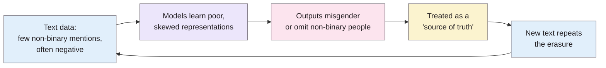

> **Source note:** drafted from the ACL Anthology PDF. Page numbers are the printed proceedings pages; the main paper is pp. 1968–1977, the rest is references and appendices (full survey, extra embedding analyses), which weren't summarised.
>
> **Content warning:** the paper reports derogatory word associations for trans and non-binary terms; they're described, not reproduced, here.

## TL;DR
Most NLP gender-bias work treats gender as binary (he/she, man/woman), which **erases non-binary people** (p. 1968). The authors explain gender identity, pronouns (singular they, neopronouns like xe and ze) and lexical gender (pp. 1969–1970); survey **19 non-binary people familiar with AI** about harms in NER, coreference and machine translation (pp. 1971–1972); and show the technical roots: neopronouns are barely in training text, have meaningless embeddings, and BERT **misgenders even when the right pronoun is given in context** (accuracy 0.0 for xe and ze, 0.521 for they, vs 0.861 for he) (pp. 1973–1976). The two named harms are **misgendering** and **erasure** (pp. 1970–1971). For this project it's why MET-01's gender category includes non-binary identities.

**Analogy:** a form with two tick boxes, "M" and "F". People who fit neither either tick one that's wrong (misgendering) or leave it blank and vanish from the records (erasure). Language models trained on text written with that form in mind inherit both problems.

The "cycle of non-binary erasure" from p. 1971.

## 1. What is the aim of the paper?
Gender-bias research in NLP "primarily treat[s] gender as binary, which can perpetuate harms such as the cyclical erasure of non-binary gender identities" (abstract, p. 1968). Attempts to add non-binary data to binary datasets are well-intentioned but risk treating non-binary people as one third category (p. 1968). The aim: explain the complexity of gender and language, ask non-binary people about harms, and show how GloVe and BERT capture and perpetuate those harms (pp. 1968–1969).

## 2. How did the authors carry out the research?
**Concepts (pp. 1969–1970).** Gender *identity* (how a person experiences their gender) vs gender *expression* vs *sex*. Pronouns can't be mapped one-to-one to gender: not all non-binary people use they/them, and some use several sets. Chosen names may be unusual or single letters. Lexical gender: "Mx.", "partner". The English-based framework doesn't capture non-Western non-cis identities (p. 1969).

**Survey (pp. 1971–1972).** Anonymous, unpaid, optional questions, IRB-exempt. Respondents tried AllenNLP demos of NER, coreference and translation and answered non-leading questions about possible harms. **19 respondents**; 84.2% use they/them; all but two white; 63.2% live in the US. The authors call this a limitation and treat the survey as a pilot of the design (p. 1971).

**Technical analysis (pp. 1973–1976).**
- *Data:* pronoun counts in English Wikipedia (March 2021, 4.5B tokens).
- *GloVe:* nearest neighbours of pronouns; occupation cosine similarities; WEAT with pleasant/unpleasant attributes, binary vs non-binary terms.
- *BERT:* neopronouns are out of vocabulary; classifiers to tell singular from plural "they"; masked-pronoun templates like "[Alex] went to the hospital for [their] appointment. [MASK] was feeling sick." over 919 gender-neutral names.

## 3. What are the primary results?
- **Survey (p. 1972):** for all three tasks, over 84% of respondents could think of harmful outcomes for non-binary people; misgendering was the common concern; machine translation was seen as most severe. Examples (Table 1, p. 1973): NER tagging neopronouns as non-person entities; coreference linking "they" to "the team" instead of the person; translation turning an accepted Thai term for trans people into a derogatory English one.
- **Social media (p. 1972):** respondents said "LGBTQ+ social media content is automatically flagged at higher rates", while models "can fail to identify hateful language targeted at non-binary people".
- **Barriers (p. 1972):** tainted examples (scraped text is hegemonic and often negative), limited features (annotators miss non-binary identities), sample size disparities (non-binary data "discarded as 'outliers'").
- **Data skew (p. 1973):** Wikipedia has over 15M "he", 4.8M "she", 4.9M "they" (mostly plural), 4.5K "xe", 7.4K "ze", 2.9K "ey". "Xe" is mostly a company name and "ze" mostly Polish.
- **GloVe (p. 1974):** xe and ze's nearest neighbours are acronyms and Polish words (Table 2). WEAT score 0.916 shows binary terms associated with pleasant words and non-binary/trans terms with unpleasant ones; nearest neighbours of "transman"/"transwoman" include "dishonest", "careless", "unkind", "arrogant".
- **BERT they singular vs plural (p. 1975):** a classifier trained on singular-vs-plural "they" reached 67.7%, vs 83.3% for "he" vs plural "they".
- **BERT misgendering (Table 5, p. 1976):** given the possessive pronoun, predicting the subject pronoun:

| Pair | Accuracy | Mean probability |
|---|---|---|
| his → he | 0.861 | 0.670 |
| her → she | 0.785 | 0.600 |
| their → they | 0.521 | 0.391 |
| xir → xe | 0.0 | 1.1e-05 |
| zir → ze | 0.0 | 1.9e-04 |

## 4. What do the authors think the results mean?
- Biases against non-binary people "cannot be treated merely as a corollary of those associated with binary gender" (p. 1970).
- Treating non-binary genders as "a monolithic third category ... is counter-productive and perceived as harmful" (p. 1976).
- Fixes "cannot simply be a quick fix or patch, but must rely on a bottom-up approach involving affected persons", plus monitoring over time, transparent reporting of performance for non-binary people, and recourse with human intervention (p. 1976).

## 5. What do I think it means?
*Claude's draft. Rewrite this in your own words when you verify.*

- **MET-01 cites this accurately** for "treating gender as binary erases non-binary people". The stronger line to quote is p. 1976 on the "monolithic third category": it argues against a single "non-binary" template slot.
- **VAL-01 gap set, concrete implications:**
  - Include **singular they** and at least one neopronoun in neutral-mention cases ("Sam said they would bring the forms"). If the detector flags these, that's an FPR finding on exactly the harm this paper describes.
  - Include neutral mentions of trans and non-binary people (their survey: LGBTQ+ content "flagged at higher rates", p. 1972). That's your "mention is not bias" test applied to gender identity.
  - Tokenisation: neopronouns are out of vocabulary for BERT (p. 1974). Check how ModernBERT's tokenizer splits "xe"/"xem"; it explains odd results if they occur.
- **Equal Status Acts:** the gender ground in Irish law is defined in the Act, not by this paper. Check the wording in the Acts (NOT FOUND IN SOURCE here) before claiming non-binary people are explicitly covered; the paper supports the *ethical* reason to include them.
- **ETH-01 and VAL-01 positionality:** "involving affected persons" (p. 1976) is the same epistemic point as Kirk et al. (@kirk2022handling). You can't run a survey, so say so as a limitation and anchor non-binary cases in documented sources.

Suggested metadata, one line each:
- `ethics`, `benchmarks`, `data-curation`: harms of binary gender; test-case design; data skew.
- `background`, `related-work`, `methodology`: why gender includes non-binary; gap-set cases.
- `MET-01`, `VAL-01`, `ETH-01`: as above.

## Key numbers
- 19 survey respondents; over 84% saw harms for each task (pp. 1971–1972).
- Wikipedia: "he" 15M+, "she" 4.8M, "they" 4.9M, "xe" 4.5K, "ze" 7.4K, "ey" 2.9K (p. 1973).
- WEAT 0.916 (p. 1974).
- BERT pronoun accuracy: he 0.861, she 0.785, they 0.521, xe and ze 0.0 (Table 5, p. 1976).

Quote (p. 1976): "considering non-binary genders as a monolithic third category (i.e. male, female, and gender-neutral) is counter-productive and perceived as harmful".

## Concerns
- **Small, homogeneous survey:** 19 respondents, nearly all white and US/Western-based (p. 1971).
- **Older models:** GloVe and BERT-base; tokenisers and training data have changed since.
- **English and Western-centric** framework, acknowledged (p. 1969).
- **Doesn't test hate-speech or toxicity detectors directly;** the flagging claim is from survey responses, not measured.

## Follow-up
None added: Cao and Daumé III (2020) on gender-inclusive coreference is relevant background, but not needed for a detector project.
