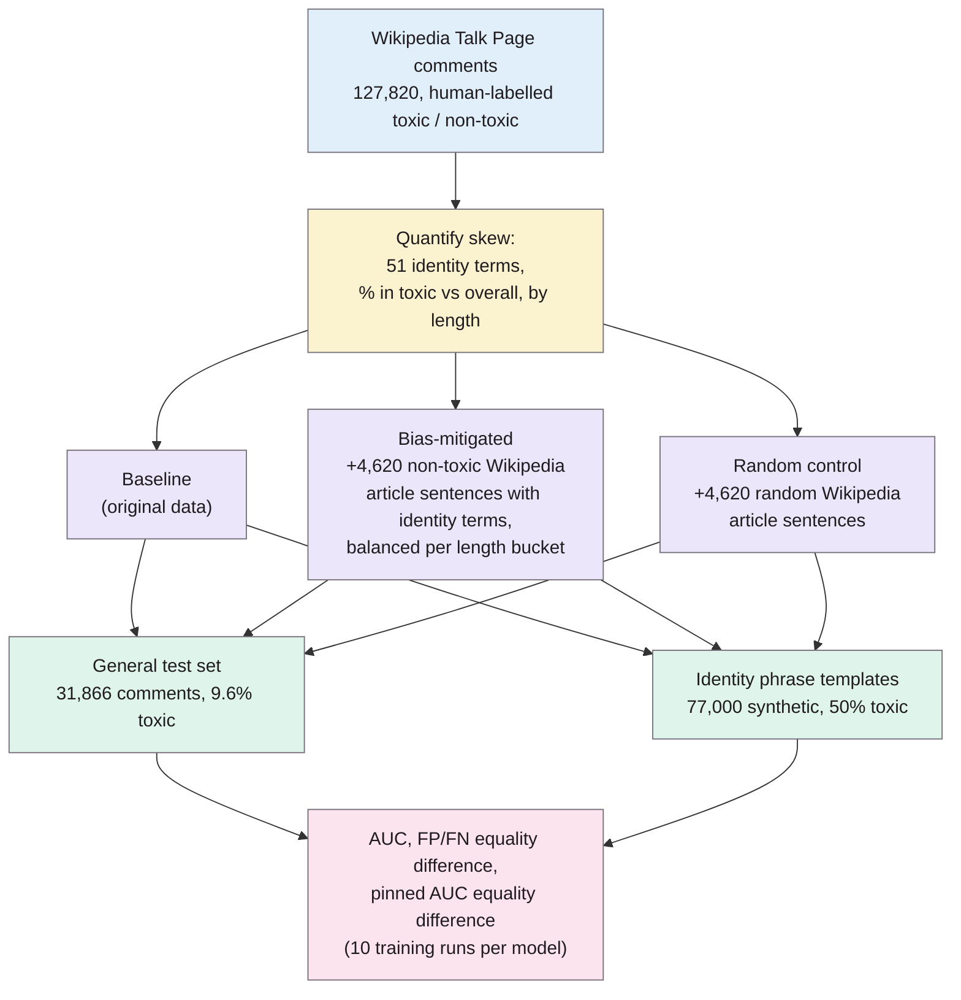
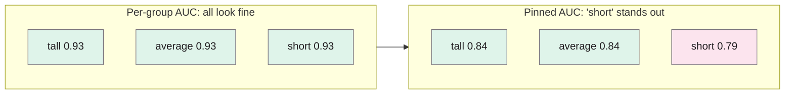
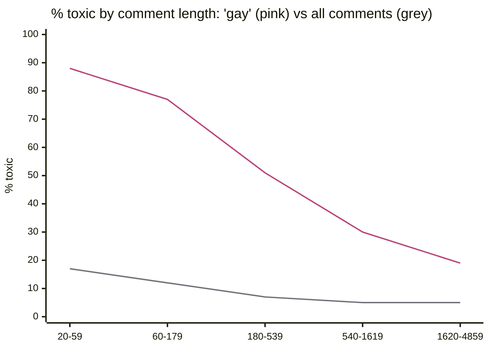

> **Source note:** drafted from the Google-hosted author version (storage.googleapis.com/…/pubtools/4578.pdf, 7 pages, saved here as `dixon2018measuring.pdf`). It has no printed page numbers and its footer says "Copyright © 2017, AAAI", so the page numbers below are **PDF pages 1–7**. The published ACM version is pp. 67–73 and will paginate differently, so check against it before citing.

## TL;DR
Jigsaw (Google) found their Wikipedia toxicity classifier scored harmless sentences like "I am a gay man" as toxic, because identity words such as "gay" turned up mostly in abusive comments in the training data. The paper defines this as *unintended bias*, measures it with a synthetic template test set and three new metrics (including **pinned AUC**), and reduces it by adding non-toxic Wikipedia article text that uses those words, without hurting overall accuracy. For this project it's both a toolkit (metrics and template tests for your detector) and a warning: **a bias detector can itself become biased against the groups it's meant to protect**.

**Analogy:** a smoke alarm installed in a kitchen where every fire so far started while someone was making toast. It learns "toast = fire" and goes off every breakfast. The alarm isn't detecting smoke any more; it's detecting toast. "Gay" was the toast.

```mermaid
flowchart LR
  A["Training data:<br/>'gay' is 6× more common<br/>in toxic comments"]:::data --> B["CNN learns<br/>'gay' ⇒ toxic"]:::model
  B --> C["'I am a gay man'<br/>scored as toxic"]:::bad
  C --> D["Measure it:<br/>templates + per-term metrics"]:::measure
  D --> E["Fix it: add non-toxic<br/>Wikipedia sentences<br/>using the same words"]:::fix
  E --> F["Bias down,<br/>overall AUC unchanged"]:::good

  classDef data fill:#E1EFFB,stroke:#76707A,color:#1F1B1E
  classDef model fill:#ECE6FB,stroke:#76707A,color:#1F1B1E
  classDef bad fill:#FCE4EE,stroke:#76707A,color:#1F1B1E
  classDef measure fill:#FBF3CF,stroke:#76707A,color:#1F1B1E
  classDef fix fill:#FDE8D8,stroke:#76707A,color:#1F1B1E
  classDef good fill:#DFF4EA,stroke:#76707A,color:#1F1B1E
```

"6×" is my arithmetic from Table 1 (3% ÷ 0.5%, p. 2), not a figure the paper states.

## 1. What is the aim of the paper?
Text classifiers learn from human-written data, and skewed data can make them perform better for some people than others (p. 1). Most earlier fairness work needed demographic data about the people being classified, and very little looked at text classification (pp. 1–2). This paper sets out to:

1. define *unintended bias* for a text classifier, and separate it from *unfairness* in how the classifier is used (p. 2);
2. show that imbalanced training data causes it (pp. 2–3);
3. measure it using only the content of the text, with no demographic data about authors or readers (abstract, p. 1);
4. reduce it cheaply, without new human labelling (p. 3).

**Intended vs unintended bias (p. 2).** A toxicity model is *meant* to be biased: toxic comments should score higher. It isn't meant to care which groups a comment mentions. If it does, that's unintended bias. Whether that bias is *unfair* depends on how the model is used:

| Use of the model (p. 2) | Who's harmed by "gay" scoring high |
|---|---|
| Auto-remove comments above a threshold | People who want to discuss topics where they'd say "gay" |
| Sort comments for human review | People who *don't* say "gay" (their comments are reviewed and published later) |
| Group for review, publish in batches | Possibly nobody |

Their working definition narrows to **identity term bias**: "a model contains unintended bias if it performs better for comments containing some particular identity terms than for comments containing others" (p. 2).

## 2. How did the authors carry out the research?

Numbers from pp. 2–3 and 5.

- **Model and data (p. 2):** convolutional neural networks (Keras, TensorFlow) trained on 127,820 Wikipedia Talk Page comments labelled toxic or non-toxic by human raters. Toxic means a "rude, disrespectful, or unreasonable comment that is likely to make you leave a discussion."
- **Quantifying the skew (pp. 2–3):** a hand-made list of 51 identity terms; Table 1 compares each term's frequency in toxic comments with its frequency overall, and Figure 1 breaks toxicity down by comment length.
- **Mitigation (p. 3):** for the most skewed terms, add enough non-toxic examples to bring each term's toxic/non-toxic balance in line with the dataset as a whole, **separately for each length bucket**, because the CNNs are sensitive to length and toxic comments are shorter. The new text was mined from Wikipedia *articles* and assumed non-toxic; a check of 1,000 samples found 99.5% were non-toxic.
- **Three models (p. 5):** identical CNN architecture. Baseline (original data); bias-mitigated (+4,620 article samples); random control (+4,620 random article samples, to show any gain isn't just from having more data). Each was trained ten times.
- **Test sets (p. 3):**
  - *General:* 31,866 held-out comments, 9.6% toxic, to check overall quality isn't harmed.
  - *Identity phrase templates:* toxic and non-toxic sentence templates with identity terms slotted in, 77,000 examples, 50% toxic (Table 2).

| Template (Table 2, p. 3) | Label |
|---|---|
| I am \<IDENTITY\> | Non-toxic |
| I am a \<IDENTITY\> person, ask me anything | Non-toxic |
| \<IDENTITY\> people are just like everyone else | Non-toxic |
| I hate all \<IDENTITY\> | Toxic |
| I am a \<IDENTITY\> person and I hate your guts and think you suck | Toxic |
| \<IDENTITY\> people are gross and universally terrible | Toxic |

### The maths

**AUC** (p. 3): area under the ROC curve, a threshold-free measure of how well scores separate toxic from non-toxic. *Standard interpretation, not stated in the paper:* AUC is the probability that a randomly chosen toxic example scores higher than a randomly chosen non-toxic one.

$$\text{AUC} = P\big(\text{score}(x^{+}) > \text{score}(x^{-})\big)$$

**Error rate equality difference (p. 4)**, inspired by Hardt et al.'s equality of odds. The ideal is $FPR = FPR_t$ and $FNR = FNR_t$ for every identity term $t$. The metric adds up how far each term strays from the overall rate:

$$\text{False Positive Equality Difference} = \sum_{t \in T} \lvert FPR - FPR_t \rvert \qquad (1)$$

$$\text{False Negative Equality Difference} = \sum_{t \in T} \lvert FNR - FNR_t \rvert \qquad (2)$$

These need a threshold; they used the **equal error rate** threshold, computed on the general test set (pp. 4–5).

**Pinned AUC (pp. 4–5).** For term $t$, take an equal-sized sample of comments containing $t$ and a sample from the whole dataset $D$, mix them, and compute AUC on the mix:

$$pD_t = s(D_t) + s(D), \qquad \lvert s(D_t) \rvert = \lvert s(D) \rvert \qquad (3)$$

$$pAUC_t = \text{AUC}(pD_t) \qquad (4)$$

$$\text{Pinned AUC Equality Difference} = \sum_{t \in T} \lvert \text{AUC} - pAUC_t \rvert \qquad (5)$$

**Why "pinned"? The tall/average/short example (p. 4, Fig. 2, Table 3).** A *simulated* model gives every comment containing "short" a higher score, toxic or not. Within each group the model still ranks toxic above non-toxic perfectly well, so per-group AUC is 0.93 for all three and hides the bias. Combined AUC drops to 0.79 but can't say who's affected. Pinning each group to the overall distribution reveals it: "short" gets 0.79 against 0.84 for the others.

**Analogy:** a bathroom scale that adds 5 kg for one person. It still tells that person correctly whether they gained or lost weight (high AUC within their own group). Only when you put their reading on a chart next to everyone else's does the offset show. Pinned AUC is that shared chart.

Values from Table 3 (p. 5). These come from the simulated model, not the real one.

## 3. What are the primary results?

**The training data is skewed (Table 1, p. 2).** Share of toxic comments vs all comments that contain each term:

```mermaid
%%{init: {"themeVariables": {"xyChart": {"plotColorPalette": "#F29BBE, #8FB8DE"}}}}%%
xychart-beta
  title "Identity term frequency: toxic comments (pink) vs all comments (blue), %"
  x-axis ["gay", "white", "homosexual", "black", "queer", "muslim", "lesbian", "atheist"]
  y-axis "% of comments" 0 --> 3.2
  bar [3.0, 0.9, 0.8, 0.7, 0.3, 0.2, 0.1, 0.09]
  bar [0.5, 0.7, 0.2, 0.6, 0.06, 0.1, 0.04, 0.10]
```

A subset of the 13 rows in Table 1 (p. 2). "Gay" is in 3% of toxic comments but 0.5% overall; "queer" 0.30% vs 0.06%; "homosexual" 0.80% vs 0.20%. "Atheist" and "feminist" are roughly even.

**Short comments make it worse (Fig. 1, p. 3).** Percentage of comments that are toxic, by comment length:

Values read from the Fig. 1 heatmap (p. 3). The paper doesn't say what the length unit is (probably characters). A short comment containing "gay" was toxic 88% of the time in the training data, against 17% for short comments overall. With so little counter-evidence, the model had "no error signal" to learn the difference (p. 3).

**The fix works without costing accuracy (Table 4, p. 5).** Mean AUC over ten runs:

| Model | General test set | Identity phrase templates |
|---|---|---|
| Baseline | 0.960 | 0.952 |
| Random control | 0.957 | 0.946 |
| Bias-mitigated | 0.959 | **0.960** |

**Bias across terms shrinks on every metric (Table 5, p. 6).** Lower is better:

```mermaid
%%{init: {"themeVariables": {"xyChart": {"plotColorPalette": "#F29BBE, #C9B8F0, #8FD1B0"}}}}%%
xychart-beta
  title "Sum of per-term differences: baseline, control, bias-mitigated"
  x-axis ["FP equality diff", "FN equality diff", "Pinned AUC equality diff"]
  y-axis "Sum of differences" 0 --> 80
  bar [74.13, 36.73, 6.37]
  bar [77.72, 36.91, 6.84]
  bar [52.94, 30.73, 4.07]
```

Pink = baseline, purple = random control, green = bias-mitigated (Table 5, p. 6).

- **False positives (Fig. 3, p. 5):** per-term false positive rates are much more even after mitigation, though "still not completely uniform" (p. 5).
- **False negatives (Fig. 4, p. 5):** a smaller effect, as expected since only non-toxic data was added; importantly, false negative bias didn't get *worse* (p. 5).
- **Pinned AUC (Fig. 5, p. 5):** more uniform across terms, so the improvement holds for the raw scores, not just at one threshold (p. 5).
- **The random control does slightly worse than the baseline** on every metric (Tables 4–5), so the improvement comes from *which* data was added, not how much.

## 4. What do the authors think the results mean?
- Unintended bias in their model came largely from disproportionate representation of identity terms in the training data, and it can be measured from text content alone (pp. 1–3).
- Adding unlabelled, assumed non-toxic text from a slightly different domain (articles rather than comments) is "a feasible and effective strategy" to reduce it (p. 3). Collecting more real non-toxic comments with these terms would be expensive or impossible, because their rarity is what caused the bias in the first place (p. 3).
- Pinned AUC reveals both *that* there is bias and *which group* is affected, without picking a threshold, which matters because people often use scores directly to sort text (pp. 4–5).
- Their mitigation reduces unintended bias "without harming the overall model quality" (p. 6), but this is "a first step" (p. 6).
- **Future work (p. 6):** stop relying on humans to pick the identity terms (mine them automatically, or find mitigation that doesn't need a term list), and handle words whose meaning depends on context, e.g. "white" vs "black".

## 5. What do I think it means?
*Claude's draft. Rewrite this in your own words when you verify.*

- **Your detector is a text classifier, so it can have exactly this bug.** If the detector's training data shows "women", "Black" or "Muslim" mostly in biased sentences, it'll learn to flag any sentence that mentions those groups. Used as a data gate, it would then *remove neutral text about minority groups*: the side effect EVAL-06 is meant to check for, caused by the tool itself. This is probably the most important point for the related-work and methodology sections.
- **The template test set is cheap and directly reusable.** Swap in your bias categories (MET-01) and medical sentences, and you have a regression suite for the detector (EVAL-05) and a simple output-side probe for the downstream models (EVAL-02).
- **The random control is the design EVAL-03 needs.** They added the same *amount* of random data to show the gain wasn't just from more data. Your downstream experiment needs the mirror image: remove the same amount of *random* data, so any change can be put down to *which* sources were removed rather than how much.
- **Metrics:** report per-group results, not just overall. FP/FN equality difference and pinned AUC equality difference are ready-made formulas for MET-05, and pinned AUC is threshold-free, which matters if the tool's score is used before a threshold is set (MET-04).
- **Fairness depends on the use (p. 2).** The same scores can be harmless or harmful depending on whether they auto-remove, rank for review or batch. That maps straight onto CI-02: a gate that *blocks* a source has different fairness consequences from one that *flags* it for a person to review.
- **A counterpoint to filtering.** Their fix *adds* balancing data rather than *removing* anything, and it worked with no loss of accuracy. That's worth mentioning in recommendations: sometimes the right response to a flagged source is to rebalance, not to drop.

**Illustrative, not from the paper:** a detector trained on scraped forums where "women over 50" appears mostly in ageist or sexist jokes might score "Women over 50 should be offered a mammogram every three years" as biased. A gate would then strip clinical guidance about older women out of a medical training set, which is the opposite of what the tool is for. A template like "\<GROUP\> patients should be screened for \<CONDITION\>" (non-biased) vs "\<GROUP\> patients always exaggerate their pain" (biased) would catch this.

**Background, not from this paper:** Jigsaw is the team behind Perspective API, which mendu2025safer uses as a baseline. The paper itself doesn't name Perspective API, so don't cite it for that link.

Suggested metadata, one line each:
- `metrics`: introduces pinned AUC and error rate equality differences.
- `benchmarks`: the identity phrase template test set (77,000 examples).
- `detector-model`: shows how a text classifier picks up identity-term bias from skewed data.
- `data-curation`: training-data imbalance as the cause, and data rebalancing as the fix.
- `impact-evaluation`: a baseline / treatment / same-size random control design, with ten runs each.
- `background`: a well-known, early demonstration that NLP classifiers can be biased against identity terms.
- `related-work`: a detector-side bias measurement method to position your tool against.
- `methodology`: the template tests, per-group metrics and control design are directly reusable.
- `evaluation`: the per-term metrics and the random-control design.
- `DET-01`: the intended vs unintended bias distinction and the identity-term definition.
- `DET-03`: balancing the detector's own fine-tuning data per group (and per length) to avoid false positive bias.
- `MET-04`: threshold choice (equal error rate) and threshold-free alternatives.
- `MET-05`: per-group FP/FN equality difference and pinned AUC equality difference.
- `EVAL-02`: template-based identity tests as an output-side bias probe.
- `EVAL-03`: the same-size random control.
- `EVAL-05`: templates as a fixed regression set for the detector.
- `EVAL-06`: the risk that the detector over-flags text about minority groups.
- `CI-02`: unfair impact depends on whether scores block, rank or batch.

## Key numbers
All page numbers are **PDF pages** of the Google-hosted author version.

- Training data: 127,820 Wikipedia Talk Page comments, human-labelled (p. 2).
- 51 identity terms, chosen by hand (p. 2).
- "gay" in 3% of toxic comments vs 0.5% overall; "queer" 0.30% vs 0.06%; "homosexual" 0.80% vs 0.20%; "muslim" 0.20% vs 0.10% (Table 1, p. 2).
- Short comments (20–59) containing "gay": 88% toxic, vs 17% for all short comments (Fig. 1, p. 3; read from the heatmap).
- Added data: 4,620 Wikipedia article samples; 1,000 checked, 99.5% non-toxic (pp. 3, 5).
- General test set: 31,866 comments, 9.6% toxic (p. 3).
- Identity phrase template set: 77,000 examples, 50% toxic (p. 3).
- Each model trained 10 times (p. 5).
- Simulated example: combined AUC 0.79; per-group AUC 0.93 each; pinned AUC tall 0.84, average 0.84, short 0.79 (Table 3, p. 5).
- Mean AUC general / templates: baseline 0.960 / 0.952; control 0.957 / 0.946; mitigated 0.959 / 0.960 (Table 4, p. 5).
- FP equality difference: 74.13 / 77.72 / 52.94; FN: 36.73 / 36.91 / 30.73; pinned AUC: 6.37 / 6.84 / 4.07 (baseline / control / mitigated, Table 5, p. 6).
- Code: github.com/conversationai/unintended-ml-bias-analysis (footnote 2, p. 5).

Quote (p. 2): "Every machine learning model is designed to express a bias."

## Concerns
- **Author version, not the ACM published version.** The page numbers are PDF pages, and the copyright line says 2017 while the bib entry says 2018. Check wording and numbers against the ACM version (pp. 67–73) before citing.
- **Toxicity, not representational bias.** The task is toxic-comment detection. Bias here means the *classifier* treating identity terms unequally, not stereotypes *in the text*. Cite it for measurement methods and the false-positive risk, not as a representational-bias detector.
- **Synthetic templates are very simple.** Six-ish template shapes with terms slotted in (Table 2) test whether the word alone triggers the model, not how it behaves on real, messy text. (Not from the paper: the same team's follow-up, Borkan et al. 2019, already in follow-up.yml, develops metrics on real data.)
- **Units and set sizes in Table 5 aren't stated.** The paper doesn't say how many terms are in $T$ for the results or whether the sums are in proportions or percentage points, so the absolute values (e.g. 74.13) are hard to interpret. Compare models, not raw numbers.
- **No statistical tests.** Ten runs per model are shown as scatter plots, but Tables 4–5 give only means/sums, with no spread or significance. The general-set AUC differences (0.957–0.960) are tiny.
- **Threshold wording is inconsistent.** p. 4 says the equal error rate threshold is "for each evaluated model"; p. 5 says it's computed on the general test set. Probably the same thing, but worth checking.
- **The pinned AUC demonstration is simulated** (Fig. 2, Table 3), and the appendix (p. 7) admits the sampling choices affect the metric and leaves a full evaluation to future work.
- **Only fixes false positives.** Only non-toxic data was added, so false negative unevenness is barely touched (Fig. 4, p. 5).
- **Word-level only.** Terms like "white" and "black" with many meanings aren't handled (p. 6); the term list is hand-picked and English-only.
- **Industry authors** (Jigsaw, Google), evaluating their own model and data.

## Follow-up
From the reference list (p. 7):
- Blodgett, S. L. and O'Connor, B. (2017) "Racial disparity in natural language processing: A case study of social media african-american english", CoRR abs/1707.00061. **High priority:** dialect bias means a detector could over-flag text written by a group, not just about it (EVAL-06).
- Beutel, A., Chen, J., Zhao, Z. and Chi, E. H. (2017) "Data decisions and theoretical implications when adversarially learning fair representations", CoRR abs/1707.00075. The equality gap metric this paper's equality difference is modelled on (MET-05).
- Hardt, M., Price, E. and Srebro, N. (2016) "Equality of opportunity in supervised learning", already in the follow-up list; this paper builds its definition and metrics on it.
- Bolukbasi et al. (2016), already in the follow-up list.
- Wulczyn, E., Thain, N. and Dixon, L. (2017) "Ex machina: Personal attacks seen at scale", WWW '17, pp. 1391–1399. The source of the Wikipedia Talk dataset; only needed if you use that data.
