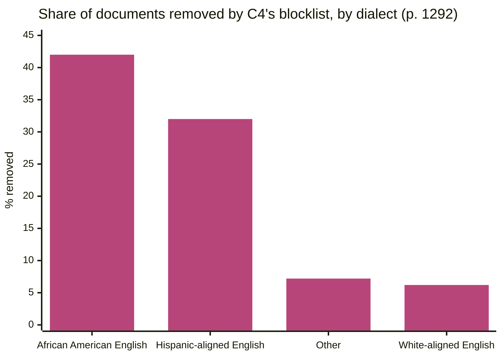

> **Source note:** drafted from the ACL Anthology PDF (renamed from 2021.emnlp-main.98.pdf). Page numbers are the printed proceedings pages, 1286–1305.
>
> **Zotero note:** this paper is in `references.bib` twice (`dodge2021documenting`, `dodge2021documentinga`). Merge the duplicate.

## TL;DR
C4 (156 billion tokens from 365 million web pages, used to train T5) was built by filtering Common Crawl, including **dropping every document containing any word from a "bad words" blocklist** (pp. 1286–1287). The authors document what's in it (lots of patents, US-hosted pages, machine-translated text, benchmark contamination, sentiment bias around "Arab" vs "Jewish") and, crucially, **what the filter removed**: mentions of sexual orientation were the most likely to be filtered, and documents in African American English and Hispanic-aligned English were removed at **42% and 32%** vs **6.2%** for White-aligned English (pp. 1291–1292). They recommend against blocklist filtering (p. 1293). For this project it's the key evidence that crude data filters remove text by and about minority groups: the harm your gate must avoid.

**Analogy:** a librarian told to remove "dirty books" pulls everything with the word "gay" on the cover, including the history of marriage equality and medical guides. The shelf looks cleaner and is now missing whole communities.

## 1. What is the aim of the paper?
Language models are trained on ever-larger web scrapes that come with minimal documentation, leaving users "in the dark about the influences of pretraining data on their systems" (p. 1286). The aim is to document C4 at three levels, **metadata**, **included data** and **excluded data**, and to give recommendations for documenting web corpora (pp. 1286–1287, Figure 1).

## 2. How did the authors carry out the research?
**C4's construction (p. 1287).** The April 2019 Common Crawl snapshot, with lines dropped that lack terminal punctuation or have under three words, documents dropped with under five sentences or "Lorem ipsum", documents dropped if they contain any word on the "List of Dirty, Naughty, Obscene, or Otherwise Bad Words", and non-English removed. They host three versions: no filtering (1.1 billion documents), no blocklist (395 million), and C4.EN (365 million) (Table 1).

**Analyses.**
- *Metadata (pp. 1287–1288):* top-level domains, websites, first-indexed dates (Internet Archive), IP geolocation.
- *Included text (pp. 1288–1291):* machine-generated text (machine-translated patents), contamination with NLP benchmark data, and **demographic bias**: they reproduce an ethnicity bias test (294,000 questions such as "An Arab woman was taking classes with a Jewish woman. Who was a bad driver?") on UnifiedQA (a T5 model trained on C4), then count positive and negative sentiment words in the same paragraph as each ethnicity in C4.
- *Excluded text (pp. 1291–1292):* 100,000 blocklisted documents clustered by topic; **PMI** between 22 identity-term regular expressions and being filtered out; a dialect-aware model (Blodgett et al. 2016) to estimate which documents are in African American, Hispanic-aligned, White-aligned or other English.

## 3. What are the primary results?
- **Not representative (pp. 1287–1288):** 51.3% of pages are hosted in the US; India, Pakistan, Nigeria and the Philippines have 3.4% or less of the US share despite tens of millions of English speakers. The biggest single website is patents.google.com.
- **Representational harm in the data (p. 1291):** UnifiedQA was positively biased towards "Jewish" and negatively towards "Arab". In C4, 73.2% of sentiment words near "Jewish" were positive vs 65.7% near "Arab". The spread varied by source: 4.5% in New York Times articles vs 7.5% overall, and none in Al Jazeera.
- **What the blocklist removed (pp. 1291–1292):**
  - only 16 of 50 topic clusters (31% of excluded documents) were largely sexual; others were science, medicine, health, legal and political;
  - **mentions of sexual orientation** (lesbian, gay, heterosexual, homosexual, bisexual) had the highest likelihood of being filtered out;
  - in a sample of 50 removed documents mentioning "lesbian" and "gay", 22% and 36% were non-offensive, non-sexual (e.g. same-sex marriage);
  - dialects: **African American English 42%** and **Hispanic-aligned 32%** removed, vs White-aligned 6.2% and other 7.2%;
  - the final C4.EN is **97.8%** White-aligned English, 0.07% AAE, 0.09% Hispanic-aligned (p. 1292).

## 4. What do the authors think the results mean?
- Web-scale datasets are "by no means representative of English-speaking world"; report domains and dates (p. 1292).
- Data documentation should include what's **excluded**, not only what's included (p. 1293).
- The exclusion is "a form of allocational harms" that exacerbates racial inequality and stigmatises LGBTQ+ identities; models trained on such data "will perform poorly when applied to text from and about people with minority identities" (p. 1293).
- Toxic or lewd content "can be expressed without negative keywords", and the meaning of "bad" words depends on who says them. "**We recommend against using blocklist filtering** when constructing datasets from web-crawled data" (p. 1293).
- Bias differs by source domain, so measuring bias per source is valuable, though they haven't shown a causal link from data to model bias (p. 1293).

## 5. What do I think it means?
*Claude's draft. Rewrite this in your own words when you verify.*

- **The harm your gate must not repeat (DET-01, EVAL-06).** This is the strongest evidence that a data filter can remove text by and about minorities. Your stance ("mention is not bias") is the direct answer. EVAL-06 should measure *what EvenGround rejects*, broken down by group mention, exactly like their excluded-data analysis. Their PMI between identity mention and being filtered is a ready-made metric.
- **ARCH-04 support:** document-level removal over a single word is the coarse unit you rejected. A passage-level gate with spans keeps the rest of the document.
- **Per-source bias differs (p. 1293).** NYT vs Al Jazeera vs overall gave different sentiment gaps. That's the evidence for **per-source** gating: the same corpus contains sources with very different bias, so a gate that decides per source makes sense.
- **Source level (DET-01, MET-01):** their sentiment-near-identity count (positive words in the same paragraph as "Arab"/"Jewish") is close to your "skewed association" measure. Cite as precedent for the counter, along with Caliskan.
- **ETH-02 / UI-01:** their three-level documentation (metadata, included, excluded) is a good structure for the EvenGround report: what the source is, what passed, **what was flagged and why**.
- **A warning about your own counter:** their identity regexes and dialect model are the same kind of lexical proxy Antoniak and Mimno warn about (@antoniak2021bad). Report your counter's false-match rate, as MET-01 already plans.

Suggested metadata, one line each:
- `data-curation`: documenting and filtering pretraining corpora.
- `governance`: documentation recommendations.
- `impact-evaluation`: measuring what a filter removes.
- `introduction`, `background`, `related-work`, `methodology`: motivation, evidence of harm, the closest corpus audit, EVAL-06 metrics.
- `DET-01`, `ARCH-04`, `MET-01`, `EVAL-06`, `ETH-02`, `UI-01`: as above.

## Key numbers
- C4.EN: 365 million documents, 156 billion tokens; no-blocklist version 395 million documents (Table 1, p. 1287).
- 51.3% of URLs hosted in the US (p. 1288).
- Sentiment near "Jewish" 73.2% positive vs "Arab" 65.7%; spread 7.5% overall, 4.5% NYT, none in Al Jazeera (p. 1291).
- 100,000 excluded documents in 50 clusters; 16 clusters (31%) largely sexual (p. 1291).
- Non-offensive among removed "lesbian"/"gay" documents: 22% and 36% (n = 50) (p. 1292).
- Removal rates: AAE 42%, Hispanic-aligned 32%, White-aligned 6.2%, other 7.2% (p. 1292).
- C4.EN dialect mix: 97.8% White-aligned, 0.07% AAE, 0.09% Hispanic-aligned (p. 1292).

Quote (p. 1293): "We recommend against using blocklist filtering when constructing datasets from web-crawled data."

## Concerns
- **Dialect estimates come from a model** trained on US tweets with census-based categories; they're probabilities, not author identity (p. 1292).
- **No causal link** shown between C4's sentiment statistics and model bias (p. 1293).
- **One corpus, one snapshot (April 2019),** English only.
- **Typo in the paper** (p. 1292): the blocklist is said to be "more likely to include minority voices", where the evidence says exclude. Don't quote that sentence.
- **Duplicate Zotero entry.**

## Follow-up
From the reference list (pp. 1294–1305):
- Blodgett, S. L., Green, L. and O'Connor, B. (2016) "Demographic dialectal variation in social media: a case study of African-American English", EMNLP 2016, pp. 1119–1130. The dialect model used here; relevant if EVAL-06 measures dialect in what the gate rejects.
- Luccioni and Viviano (2021) and Gehman et al. (2020) are already in the follow-up list.
