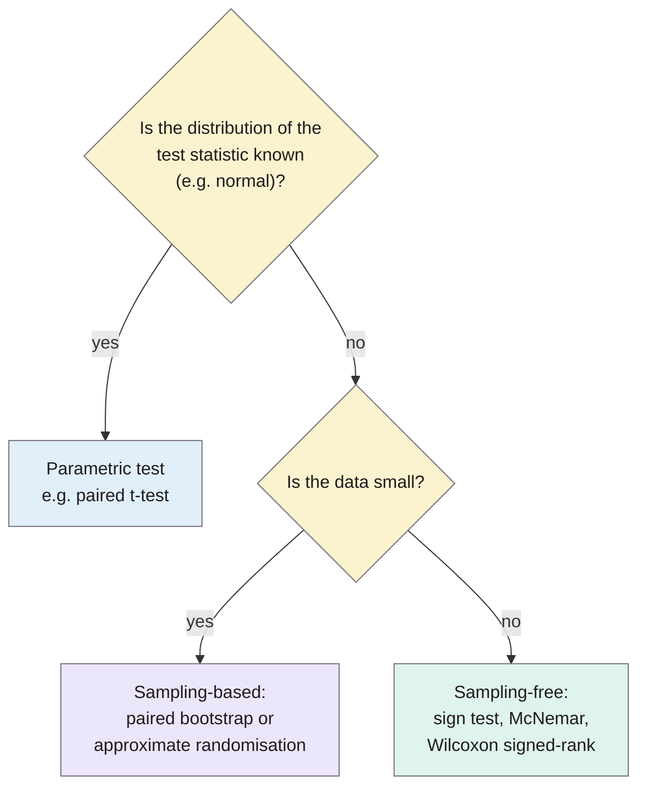
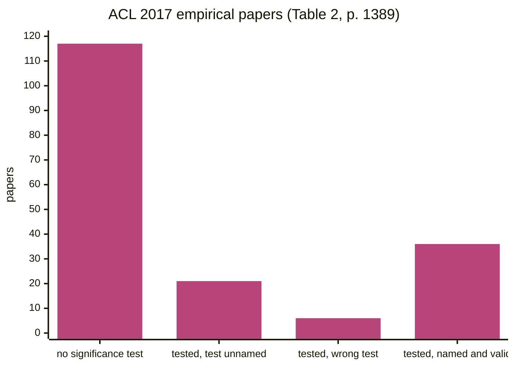

> **Source note:** drafted from the ACL Anthology PDF (renamed from P18-1128.pdf). Page numbers are the printed proceedings pages, 1383–1392. This paper isn't in the master plan's reference list; it fits MET-05's "every comparison is tested for significance".

## TL;DR
NLP papers lean heavily on comparisons ("our model beats the baseline"), yet of 180 empirical ACL 2017 long papers only **63 tested significance**, 21 of those didn't name the test, and 6 used the wrong one (p. 1389). The authors explain p-values and test families, then give a **decision tree** for choosing a test: parametric if the test statistic's distribution is known; otherwise a sampling-based test (bootstrap or permutation) for small data, or a sampling-free test (sign, McNemar, Wilcoxon) for large data (pp. 1386–1388). Open problems: NLP test items aren't independent, and cross-validation complicates testing (p. 1390). For this project it's the reference for choosing McNemar vs paired bootstrap in MET-05 and EVAL-03.

**Analogy:** two archers each shoot 100 arrows and one scores slightly higher. Was it skill or wind? A significance test asks how often a gap that big would appear if the archers were equally good. Which test depends on how you score the arrows: hit or miss (McNemar), points per arrow (t-test or Wilcoxon), or a score you can't easily model (bootstrap).

The decision tree is Figure 1 (p. 1388).

## 1. What is the aim of the paper?
NLP results sections emphasise comparisons between algorithms across datasets, so "we better be sure that our results are not coincidental" (p. 1383). NLP has its own evaluation measures (BLEU, ROUGE, F-score) whose distributions matter for test choice, and its own data properties, so an NLP-specific guide is needed (p. 1384). The aim: explain the concepts, give a practical test-selection protocol, survey the most relevant tests, and audit current practice (p. 1384). It deals with a **single comparison** of two algorithms, not many comparisons across datasets (p. 1383).

## 2. How did the authors carry out the research?
**Framework (p. 1384).** For algorithms A and B on dataset X with measure M:

$$\delta(X) = M(A, X) - M(B, X), \qquad H_0: \delta(X) \le 0, \quad H_1: \delta(X) > 0$$

$$p = \Pr(\delta(X) \ge \delta_{\text{observed}} \mid H_0)$$

Reject $H_0$ if $p < \alpha$. Type I error: rejecting a true null; Type II: failing to reject a false one; choose a test that bounds Type I at α with the most power (p. 1385).

**Test survey (pp. 1386–1388).**
- *Parametric:* **paired t-test**, justified for averages (accuracy, per-sentence scores) by the Central Limit Theorem; F-score, BLEU and ROUGE aren't averages, so normality shouldn't be assumed (p. 1386). Normality can be checked with Shapiro–Wilk, Kolmogorov–Smirnov or Anderson–Darling (p. 1386).
- *Sampling-free non-parametric:* **sign test**; **McNemar's test** for paired binary outcomes, using the 2×2 table of where the two classifiers agree and disagree, with a χ² distribution given enough disagreements (Cochran's Q for more classes); **Wilcoxon signed-rank**, more powerful than the sign test (p. 1387).
- *Sampling-based non-parametric:* **permutation / approximate randomisation**, and the **paired bootstrap** (sampling with replacement). More powerful but computationally heavy; bootstrap is "less effective for small test sets" (p. 1388).

**Survey (pp. 1388–1390).** All 196 ACL 2017 long papers (180 empirical) and 37 TACL 2017 papers (33 empirical).

## 3. What are the primary results?
**Measures used (Table 1, p. 1385):** F-scores in 39.8% of ACL 2017 papers, accuracy 34.2%, precision/recall 22.5%.

**Significance practice (Table 2, p. 1389):**

| | ACL 2017 | TACL 2017 |
|---|---|---|
| Empirical papers | 180 | 33 |
| Don't report significance | 117 | 15 |
| Report significance | 63 | 18 |
| …but don't name the test | 21 | 3 |
| …and use the wrong test | 6 | 0 |
| Should correct for multiple comparisons | 110 | 19 |
| Do correct | 3 | 4 |

*The last bar (36) is my arithmetic: 63 − 21 − 6.*

- **Wrong tests (footnote 3, p. 1389):** a t-test on a measure that isn't an average; a t-test on categorical outcomes; a bootstrap on a small test set.
- **Most common test in ACL 2017:** the t-test (17 papers), "that assumes the data is i.i.d and that the test statistics are normally distributed", often not true in NLP (p. 1390; Table 3, p. 1389).
- **"Significant" misused** as a synonym for "important" or "substantial" in many papers (p. 1390).

## 4. What do the authors think the results mean?
- Significance testing "is often ignored or misused" in NLP (p. 1383); there's a "disturbing reality" in top venues (p. 1389).
- **Open issue 1, dependent observations (p. 1390):** tests assume independent test items, but NLP test sets contain sentences from the same article, author or debate. The impact is hard to quantify; collaboration with statisticians is needed.
- **Open issue 2, cross-validation (p. 1390):** folds overlap and aren't independent; they propose computing p-values per fold and using replicability analysis (Dror et al. 2017).
- Keep "significant" for its statistical meaning (p. 1390).

## 5. What do I think it means?
*Claude's draft. Rewrite this in your own words when you verify.*

- **MET-05's test choice is consistent with their tree.** Detector vs Detoxify on the same items with binary flags → **McNemar** (p. 1387). Difference in F1 (not an average) → **paired bootstrap** or approximate randomisation, not a t-test (pp. 1386–1388). Cite this for both choices. It would be worth adding this paper to the MET-05 "Why" alongside the existing reasons.
- **Small gap-set cells need care.** About 12 cases per function per ground is small. Their footnote calls a bootstrap on a small test set a misuse (p. 1389), and McNemar's χ² approximation needs enough disagreements (p. 1387). For those cells, use the **exact** McNemar (binomial) version, or pool across grounds and report per-function results as descriptive only. That matches the master plan's "framed as diagnostic".
- **Dependence is a real issue for you.** Template-generated items (gap set, HateCheck, Dixon-style identity templates) share templates, so they aren't independent; SBIC has three annotations per post. Their open issue 1 (p. 1390) is the citation for a threats-to-validity sentence; a *cluster* bootstrap (resampling templates or posts rather than items) is a reasonable fix to mention.
- **DET-03 three seeds:** comparing checkpoints across seeds is like their cross-validation problem (p. 1390). Report mean and spread, and test on the pooled per-item predictions rather than treating seeds as independent samples.
- **EVAL-03 multiple comparisons:** comparing per ground (nine), per function (six) and per backend multiplies tests. Only 3 of 110 ACL papers that needed it corrected for multiplicity (p. 1389–1390). Use Bonferroni or Holm for the headline per-ground claims.
- **Wording:** keep "significant" for statistical significance in the report (p. 1390).

Suggested metadata, one line each:
- `metrics`: significance testing for evaluation measures.
- `impact-evaluation`: EVAL-03 controls and statistics.
- `methodology`, `evaluation`: the statistical plan and how results are reported.
- `MET-05`, `MET-06`, `EVAL-03`, `DET-03`: as above.

## Key numbers
- ACL 2017: 196 long papers, 180 empirical; 63 report significance; 21 don't name the test; 6 use a wrong test (Table 2, p. 1389).
- TACL 2017: 37 papers, 33 empirical; 15 don't report significance; all named tests valid (p. 1389).
- Multiple comparisons: 3 of 110 ACL papers and 4 of 19 TACL papers corrected (pp. 1389–1390).
- t-test the most used test in ACL 2017 (17 papers) (Table 3, p. 1389).
- F-scores used in 39.8% of ACL 2017 papers (Table 1, p. 1385).

Quote (p. 1383): "we better be sure that our results are not coincidental".

## Concerns
- **Opinion/theoretical paper** (p. 1383); the survey is one year of two venues.
- **The decision tree is simplified:** "small data → bootstrap" sits awkwardly with "bootstrap on a small test set is wrong" (pp. 1388–1389). Their line between "small" and "large" isn't defined. Explain your own choice rather than citing the tree as settling it.
- **Doesn't cover confidence intervals** directly, though MET-05 reports bootstrap CIs; cite Efron and Tibshirani (1994) for those.
- **Not in the master plan yet;** decide whether to cite it in MET-05.

## Follow-up
From the reference list (pp. 1391–1392):
- Berg-Kirkpatrick, T., Burkett, D. and Klein, D. (2012) "An empirical investigation of statistical significance in NLP", Proceedings of EMNLP-CoNLL. How significance relates to effect size and test-set size in NLP.
- Koehn, P. (2004) "Statistical significance tests for machine translation evaluation", Proceedings of EMNLP. The classic NLP paired-bootstrap paper.
- Efron, B. and Tibshirani, R. J. (1994) *An introduction to the bootstrap*, CRC Press. The standard reference for MET-05's bootstrap confidence intervals.
