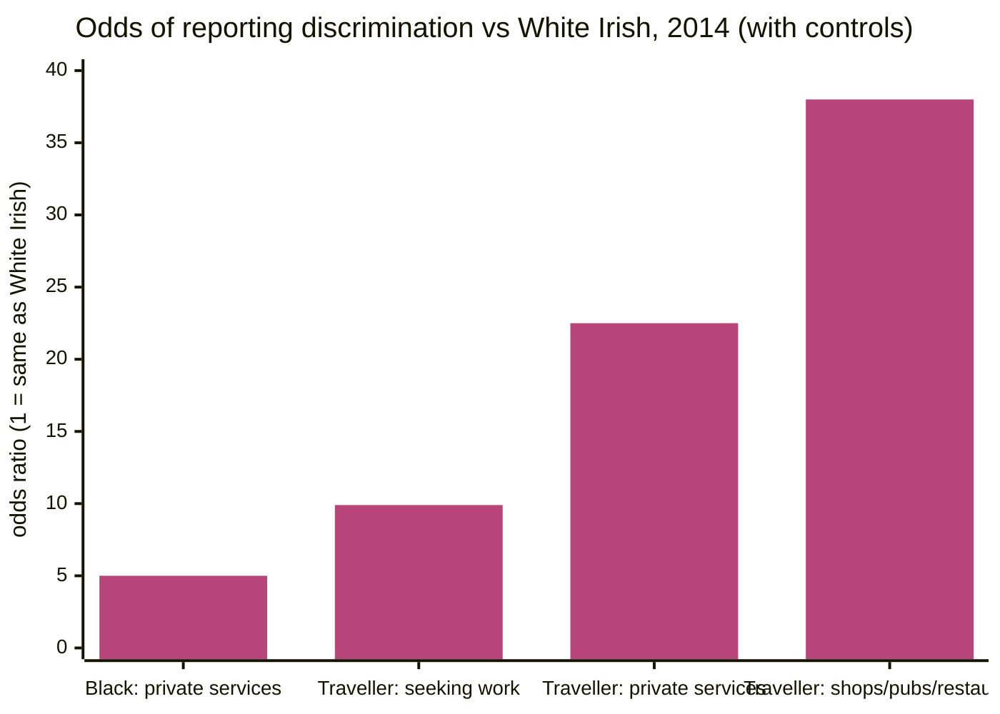

> **Source note:** drafted from the ESRI PDF (saved as "BKMNEXT342 (1).pdf"; rename it to the citekey). Page numbers are the report's printed page numbers (executive summary iii–v, main text 1–46), not PDF pages. The appendix tables weren't summarised except where the text cites them.
>
> **Zotero note:** the bib entry lists "ESRI" four times as an author alongside McGinnity, Grotti, Kenny and Russell, so it will render as "ESRI et al." In Zotero, delete the "ESRI" author entries (keep ESRI as the institution) so it cites as McGinnity et al. (2017), as the master plan does. The citekey will probably change too; update this file's name if it does.

## TL;DR
A nationally representative survey of almost **15,000 adults** in Ireland (CSO, 2014), compared with identical surveys in 2004 and 2010, asked whether people had experienced discrimination, as defined in Irish law, in the last two years, in work and in services (pp. iii, 1, 11). **12%** reported some discrimination (p. iii). Controlling for other characteristics, **Irish Travellers** stand out: about **ten times** the odds of White Irish of reporting discrimination when seeking work, and **over 22 times** in private services such as shops, pubs and restaurants (pp. iv, 35–37). But the survey included only **55 Travellers** (p. 11, footnote 22). For this project it's the Irish evidence that the Equal Status grounds, and the Traveller community in particular, matter (MET-01), and a starting point for documenting the gap set (VAL-01).

**Analogy:** a national weather station network that measures rain everywhere, but has only a handful of gauges in one county. The readings there are dramatic and consistent with local reports, but each one carries more uncertainty.

Traveller figures: 9.90 (Table 5.1, p. 32), 22.50 (Table 5.2, p. 37), "38 times" (p. 36, from a model not shown). The Black private-services bar is the text's "almost five times" (p. 36), rounded; check Table 5.2 for the exact value.

## 1. What is the aim of the paper?
To measure who experiences discrimination in Ireland, in which situations, and how this changed between 2004 (boom), 2010 (recession) and 2014 (early recovery) (pp. iii, 2). Discrimination is understood as being treated differently "because of who they are", and matters because it violates the right to equal treatment, contributes to inequality, harms health and well-being, and threatens social cohesion (pp. iii, 1). Three questions: how much discrimination there is in each domain; which groups experience most; and how this has changed (p. 2).

## 2. How did the authors carry out the research?
**Data (pp. 11–12).** The Equality module of the CSO's Quarterly National Household Survey (QNHS), Q3 2014: just under 15,000 adults aged 18+, interviewed directly (no proxies), from a large random sample of private households. Identical modules in 2004 and 2010.

**The question (pp. 11–12, Box 1.1).** Respondents get a prompt card defining discrimination as in Irish law: treated less favourably because of gender, marital status, family status, age, disability, "race" (skin colour or ethnic group), sexual orientation, religious belief or membership of the Traveller community; being treated worse for other reasons (qualifications, income limits, queues) doesn't count. Questions refer to the last two years and to nine specific domains: the workplace, looking for work, shops/pubs/restaurants, financial services, education, housing, health, transport, other public services.

**Groups (pp. 12–13).** Seven "equality groups": gender; age; disability; Traveller or not; ethnic/national group; religion; marital and family status. **No sexual orientation data** (p. 12). Gender is recorded as male/female only (footnote 7, p. 2). Travellers: only 55 respondents, so no separate rates; they are merged with White Irish for descriptive rates but separately identified in the models; not identified at all in 2004 and 2010 (pp. 11, 13).

**Models (pp. 13–15).** Logistic regression of reporting discrimination on group membership, controlling for education, economic status, housing tenure, region (and sector, occupation etc. for work), giving **odds ratios** relative to a reference group (e.g. White Irish). The authors call these "conservative estimates", since controls like education may themselves reflect discrimination (p. 15).

## 3. What are the primary results?
- **Overall (p. iii):** 12% reported discrimination in the last two years: seeking work 7%, workplace 5%, private services 5%, public services 3%.
- **By group, 2014 (pp. iv, 32–37; Table 6.1, p. 43):**
  - **Women:** more workplace discrimination; no difference elsewhere.
  - **Age:** older workers (45–64) more in seeking work; older adults less in private services.
  - **Black** respondents: more in the workplace and in public and private services (almost five times White Irish in private services).
  - **Asian:** more in private services (three times).
  - **White non-Irish:** no difference from White Irish in 2014.
  - **Irish Travellers:** odds ratio **9.90** for seeking work (Table 5.1, p. 32), **22.50** for private services (Table 5.2, p. 37), **38 times** in shops, pubs and restaurants (p. 36), and four times for "other public services" such as social welfare (footnote 52, p. 36). Too few Travellers in work to model the workplace (p. iv).
  - **Minority religions:** somewhat higher in the workplace and services.
  - **Never-married lone parents:** more in public and private services.
  - **Disability:** higher in all domains.
- **Over time (pp. iv–v):** overall stable; recruitment discrimination rose (just under 6% to over 7% in 2014); private services fell (7% to under 5%).
- **Corroboration (p. 6):** the All Ireland Traveller Health Study (2008, 1,604 Travellers) found 61% reported ever being discriminated against when served in a pub, restaurant or shop, 56% when seeking accommodation, 55% when seeking work. An Irish field experiment found applicants with Irish names over twice as likely to be invited to interview as those with non-Irish names (McGinnity and Lunn 2011).

## 4. What do the authors think the results mean?
- Discrimination "varies significantly across equality groups, and is high in multiple domains among minority ethnic groups (Black, Asian and especially Irish Travellers), minority religions and those with a disability" (p. 44).
- The Traveller results are "not surprising" and consistent with education, health and employment evidence; but because Travellers are a small group, "the number of cases limited what we could present", and they're often not identified in surveys at all (pp. 45, v).
- Self-reports rely on respondents' interpretation, but the patterns are consistent with other Irish and international evidence (p. 44).
- Policy: monitor outcomes across groups; add ethnic identifiers to administrative data; recent changes (marriage equality, recognition of Traveller ethnicity) are positive, but rights "cannot be taken for granted" (pp. v, 45–46).

## 5. What do I think it means?
*Claude's draft. Rewrite this in your own words when you verify.*

- **MET-01's Irish grounding is well supported** by this report: the prompt card itself defines discrimination by the Equal Status grounds (Box 1.1, p. 12), and Travellers show the largest gaps of any group (p. 44). It's the right citation for "the grounds match measured discrimination in Ireland".
- **Wording fix for MET-01's "Why".** The master plan says Travellers were "about ten times more likely ... and over 22 times more likely". The report uses that phrasing too (pp. iv, 35–36), but the figures are **odds ratios** from regression with controls, and the Traveller sample is **55 people** (p. 11). Suggest: "Travellers had about ten times the odds of White Irish respondents of reporting discrimination when seeking work, and over 22 times in private services (McGinnity et al. 2017), although the survey included only 55 Travellers." This is more accurate and an examiner can't pick at it.
- **For the gap set (VAL-01), this documents *discrimination*, not *stereotypes*.** It shows *where* Travellers, lone parents and others are treated unfairly (shops, pubs, recruitment, housing), not *what beliefs* are held about them. The master plan says each gap-set stereotype starts "from McGinnity et al. (2017)". That works for showing the ground matters, but the stereotype *content* needs other sources: e.g. the All Ireland Traveller Health Study (2010) and Watson, Kenny and McGinnity (2017), both cited here (follow-up below), or Irish attitudes surveys. Worth sorting before writing the gap set.
- **Civil and family status are measurable here:** never-married lone parents report more discrimination in services (p. iv). That's documented evidence for the family-status function of the gap set (e.g. stereotypes about lone parents and welfare).
- **Sexual orientation and gender identity aren't measured** (pp. 2, 12). For those grounds cite other sources; don't stretch this report.
- **Representation evidence (DET-01, EVAL-06):** "Irish Travellers ... are often not identified in surveys" (p. v) is an Irish example of *erasure* in data, the source-level harm DET-01 defines. A good line for the introduction or for the source-level motivation.
- **The definition card is a nice model for UI-02 / DET-06 wording:** it says what counts and gives examples of what doesn't (qualifications, queues). Your labelling guideline does the same with "mention is not bias".

Suggested metadata, one line each:
- `governance`, `ethics`: Irish equality law and evidence of discrimination.
- `benchmarks`: the documented basis for the gap set.
- `introduction`, `background`, `methodology`: why the Irish grounds; erasure in data; gap-set sources.
- `MET-01`, `VAL-01`, `DET-01`, `EVAL-06`: as above.

## Key numbers
- Just under 15,000 adults, Q3 2014; identical modules 2004 and 2010 (pp. iii, 11).
- 55 Travellers surveyed in 2014 (footnote 22, p. 11).
- 12% reported discrimination in the last two years; seeking work 7%, workplace 5%, private services 5%, public services 3% (p. iii).
- Travellers vs White Irish, odds ratios with controls: seeking work 9.90 (Table 5.1, p. 32); private services 22.50 (Table 5.2, p. 37); shops/pubs/restaurants 38 times (p. 36); other public services four times (footnote 52, p. 36).
- Black vs White Irish: almost five times in private services; three times in public services (p. 36).
- All Ireland Traveller Health Study: 61% (pubs/shops), 56% (accommodation), 55% (seeking work), n = 1,604 (p. 6).
- Recruitment discrimination: just under 6% (2004, 2010) to over 7% (2014) (p. iv).

Quote (p. 45): "the number of cases limited what we could present in this report".

## Concerns
- **Very small Traveller sample (55):** the odds ratios will have wide confidence intervals (not reported in the text). State the sample size whenever you cite them.
- **Self-reported** discrimination, subject to awareness and interpretation (p. 44); recruitment discrimination may be under-reported because it happens "behind closed doors" (p. 44).
- **No sexual orientation data; binary gender** (pp. 2, 12).
- **2014 data,** before recognition of Traveller ethnicity (2017) and other changes.
- **Discrimination, not representation in text.** Don't cite it as evidence about language or stereotypes in training data.
- **Author field in Zotero** needs fixing (see top).

## Follow-up
From the reference list (pp. 47–52):
- Watson, D., Kenny, O. and McGinnity, F. (2017) *A social portrait of Travellers in Ireland*, Dublin: ESRI. Outcomes for Travellers in education, health, employment; a likely source for documented Traveller stereotypes and disadvantage (VAL-01 gap set).
- All Ireland Traveller Health Study Team (2010) *All Ireland Traveller Health Study. Our Geels. Summary of findings*, Dublin: UCD School of Public Health and Population Science. Large Traveller sample (1,604) with discrimination experiences by domain.
- McGinnity, F. and Lunn, P. (2011) "Measuring discrimination facing ethnic minority job applicants: an Irish experiment", Work, Employment and Society, 25(4), pp. 693–708. An Irish field experiment; objective evidence to pair with self-reports.
