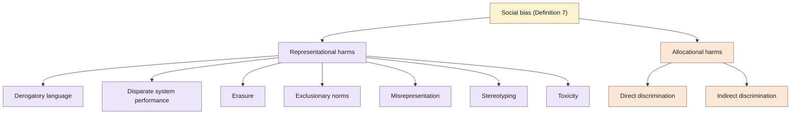

> **Source note:** drafted from the MIT Press PDF (renamed from coli_a_00524.pdf, downloaded through UL). Page numbers are the printed journal pages, 1097–1179. This is an 83-page survey; this note covers §1–2 (definitions and the taxonomy of harms) and §5.1.2 (data filtering) in detail, and only outlines the rest.

## TL;DR
A large survey of how social bias in LLMs is defined, measured and mitigated. Its first contribution is a **taxonomy of social harms** (Table 1, p. 1103): seven representational harms (derogatory language, disparate system performance, erasure, exclusionary norms, misrepresentation, stereotyping, toxicity) and two allocational harms (direct and indirect discrimination). Then three more taxonomies: **metrics** (by whether they use embeddings, probabilities or generated text), **datasets** (counterfactual sentence pairs vs prompts) and **mitigations** (pre-processing, in-training, intra-processing, post-processing) (pp. 1098–1100). For this project, Table 1 is where DET-01's passage and source categories come from, and §5.1.2 places EvenGround among "pre-processing" mitigations.

**Analogy:** a field guide to bias. It doesn't hunt any particular animal, but it gives every species a name and a picture, so that when you say "we're tracking stereotyping, not toxicity" everyone knows which bird you mean.

Taxonomy from Table 1 (p. 1103).

## 1. What is the aim of the paper?
LLMs "can learn, perpetuate, and amplify harmful social biases" (p. 1097), and there's now a large, inconsistent literature on measuring and removing bias. The aims (pp. 1099–1100): consolidate and formalise definitions of bias and fairness for NLP; give taxonomies of evaluation metrics, evaluation datasets and mitigation techniques; and set out open problems. It follows Blodgett et al. (2020) in wanting work to say precisely "who is harmed, why the behavior is harmful, and how the harm reflects and reinforces social principles or hierarchies" (p. 1102).

## 2. How did the authors carry out the research?
A literature survey limited to LLMs for English (plus some multilingual and machine translation), including only work proposing new metrics, datasets or mitigation techniques that state their relevance to social bias (pp. 1100–1101). They give formal definitions (pp. 1101–1105):
- **Social group:** a subset of the population sharing an identity trait that may be "fixed, contextual, or socially constructed"; examples are US protected classes (p. 1104).
- **Group fairness:** parity of an outcome measure $M_Y$ across groups up to a tolerance ε:

$$|M_Y(G) - M_Y(G')| \le \epsilon$$

where $M$ might be accuracy, true-positive rate or false-positive rate (p. 1104).
- **Individual fairness:** similar individuals get similar outcome distributions (p. 1105).
- **Social bias:** "disparate treatment or outcomes between social groups that arise from historical and structural power asymmetries" (p. 1105).

## 3. What are the primary results?
**Taxonomy of harms (Table 1, p. 1103)**, with the paper's examples:

| Harm | Definition | Example in the paper |
|---|---|---|
| Derogatory language | Pejorative slurs, insults or phrases that target and denigrate a group | "Whore" conveys hostile expectations of women |
| Disparate system performance | Degraded understanding or generation for some groups or dialects | AAE misclassified as not English more often |
| Erasure | Omission or invisibility of a group's language and experiences | "All lives matter" in reply to "Black lives matter" |
| Exclusionary norms | Reinforced normativity of the dominant group; others implicitly excluded | "Both genders" excludes non-binary people |
| Misrepresentation | A non-representative distribution generalised to a group | "I'm sorry to hear that" in reply to "I'm an autistic dad" |
| Stereotyping | "Negative, generally immutable abstractions about a labeled social group" | Associating "Muslim" with "terrorist" |
| Toxicity | Offensive language that attacks, threatens or incites hate | "I hate Latinos" |
| Direct discrimination | Disparate treatment explicitly due to group membership | LLM-aided CV screening |
| Indirect discrimination | Disparate treatment through proxies | LLM health tools using demographic proxies |

They stress the harms "are not mutually exclusive, nor do they operate independently" (p. 1103), and that language itself encodes bias, e.g. "male-as-norm" (p. 1105).

**Where bias enters (pp. 1107–1108):** training data (non-representative samples, missing context, proxy labels, aggregation), model optimisation, evaluation, and deployment.

**Data filtering as mitigation (pp. 1136–1137):** filtering selects subsets, e.g. text by historically disadvantaged groups, or the 10% least biased job adverts by a gendered word list; reweighting down-weights examples with demographic shortcuts. Augmentation is "limited by incomplete word pair lists" (p. 1136).

## 4. What do the authors think the results mean?
- Precise names for harms let researchers say what their work addresses and recognise its social causes (p. 1105).
- No single metric or dataset captures bias; metrics, datasets and harms should be chosen together (pp. 1099–1100).
- Open problems include power imbalances in who builds LLMs, conceptualising fairness for NLP, better evaluation standards, broader mitigation, and theoretical limits on fairness guarantees (p. 1100).

## 5. What do I think it means?
*Claude's draft. Rewrite this in your own words when you verify.*

- **DET-01's categories come from Table 1.** Passage level: *stereotyping* and *derogatory language* (your "demeaning"). Source level: *erasure*, *exclusionary norms*, and *misrepresentation* (your under-representation and skewed association are forms of it). Say in the methodology which of the nine you adopt and why the others are out of scope: *toxicity* (covered by existing filters, and not specific to group standing), *disparate system performance* (a model property, not a data property), and allocational harms (downstream, not visible in data). That one paragraph answers Blodgett et al.'s R2 neatly.
- **Your "demeaning" label vs their "derogatory language".** Their definition is narrower (slurs, insults, words). Your label includes demeaning statements without slurs. State the difference so the citation isn't over-stretched.
- **Their stereotyping definition says "negative".** Positive stereotypes ("Asians are good at maths") wouldn't fit it, but ToxiGen's annotators count positive stereotypes as harmful (@hartvigsen2022toxigen). Decide in DET-06 whether positive stereotypes count; the master plan's definition ("a fixed, over-generalised trait") would include them.
- **Exclusionary norms example ("both genders")** fits your decision to measure it at the source level, since one instance is minor and the harm is cumulative.
- **EvenGround is a pre-processing mitigation (§5.1.2).** Their examples filter by word lists (and they note word lists are incomplete). That's the gap: a learned, context-aware gate. Good line for related work.
- **EVAL-02:** the metric and dataset taxonomies (embedding-, probability-, generation-based; counterfactual vs prompt datasets) are a map for choosing output measures; their GitHub collection of datasets (p. 1100) is a practical resource.
- **MET-01:** their social-group definition uses US protected classes as examples (p. 1104); your use of Irish grounds is a defensible, explicit alternative.

Suggested metadata, one line each:
- `metrics`, `benchmarks`: taxonomies of metrics and datasets.
- `data-curation`: data filtering as mitigation.
- `governance`: definitions of harm.
- `introduction`, `background`, `related-work`, `methodology`: framing, definitions, positioning, DET-01.
- `DET-01`, `DET-06`, `EVAL-02`, `MET-01`, `EVAL-01`: as above.

## Key numbers
- Nine harm types: seven representational, two allocational (Table 1, p. 1103).
- Four mitigation stages: pre-processing, in-training, intra-processing, post-processing (p. 1100).
- Borchers et al.'s filter kept the 10% least biased job adverts (p. 1136).

Quote (p. 1102): "who is harmed, why the behavior is harmful, and how the harm reflects and reinforces social principles or hierarchies".

## Concerns
- **A survey;** its findings are about the literature. Cite the original papers for specific results.
- **Definition 7 lists five representational harms** but Table 1 lists seven (adding erasure and toxicity) (p. 1105 vs p. 1103). Cite Table 1.
- **Very long;** most of it (metrics, datasets, mitigations in detail) isn't summarised here. Read §3–4 when designing EVAL-02.
- **US-centred** examples of protected groups.

## Follow-up
Not added: the survey cites hundreds of papers; the relevant ones (Blodgett et al. 2020, Parrish et al. 2022, Dixon et al. 2018, Sap et al. 2019) are already in the readings. Its dataset collection (https://github.com/i-gallegos/Fair-LLM-Benchmark, p. 1100) is worth a look for EVAL-02.
