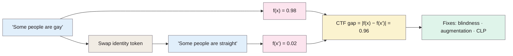

> **Source note:** drafted from the ACM PDF (open access, CC BY-NC-SA 4.0, p. 219). Page numbers are the printed proceedings pages, 219–226. Figure 1 (TPR/TNR plot) wasn't transcribed.

## TL;DR
A toxicity classifier said "Some people are gay" was **98%** likely toxic and "Some people are straight" **2%** (p. 219). The paper defines **counterfactual token fairness (CTF)**: swap one identity word for another and the score shouldn't move (pp. 220–221). It tests three training fixes: **blindness** (replace identity words with an IDENTITY token), **counterfactual augmentation** (add swapped copies to the training set) and **counterfactual logit pairing (CLP)** (penalise the gap between a sentence's logit and its swapped copy's) (pp. 221–222). Blindness and CLP close the gap with no loss of overall AUC, but **some swaps shouldn't give equal scores** ("asymmetric counterfactuals", e.g. stereotypes about a vulnerable group), and forcing equality there costs true positives (pp. 221, 223–224). For this project it's the method behind VAL-01's swapped-group invariance tests.

**Analogy:** a spellchecker for prejudice. Change one word, "gay" to "straight", "Muslim" to "Christian", and if the alarm level jumps, the alarm is reacting to *who* is mentioned, not *what* is said. But it's not a blind rule: "that's so gay" really is different from "that's so straight".

Scores from Table 5 (p. 226); the 0.96 gap is Claude's arithmetic.

## 1. What is the aim of the paper?
Group fairness (e.g. equal false-positive rates across groups, as in Dixon et al.) doesn't catch the case where **nearly identical sentences about different groups get different predictions** (p. 219). The authors ask the counterfactual question: "How would the prediction change if the sensitive attribute referenced in the example were different?" (p. 219). They want a tractable metric for this in text, and training methods that improve it without hurting accuracy or group fairness (p. 220).

## 2. How did the authors carry out the research?
**Definitions (p. 221).** A classifier $f$ is counterfactually fair with respect to a counterfactual generator $\Phi$ and tolerance $\epsilon$ if

$$|f(x) - f(x')| \le \epsilon \quad \forall x \in X,\ x' \in \Phi(x)$$

For CTF, $\Phi_A$ swaps every pair of identity tokens $a, a' \in A$ appearing in $x$.

**Asymmetric counterfactuals (p. 221).** Some swaps *should* change the score: "That's so gay" vs "That's so straight"; or "stereotyping, where one group is more vulnerable than another". "Requiring equal predictions across such cases can inadvertently harm the more vulnerable group." Their heuristic: asymmetric cases mostly occur in *toxic* comments, so they measure CTF mainly on **non-toxic** examples (p. 222).

**Methods (pp. 221–222).**
- *Blindness:* replace all identity tokens with IDENTITY. Guarantees zero gap but can't tell groups apart and can't handle multi-word swaps ("Christians go to church" / "Jews go to temple").
- *Counterfactual augmentation:* add swapped copies with the same label.
- *CLP:* add a penalty on logit differences, sampling one counterfactual per example:

$$\sum_{x \in X} J(f(x), y) + \lambda \sum_{x \in X} \mathbb{E}_{x' \sim \text{Unif}[\Phi(x)]} |g(x) - g(x')|$$

where $g$ is the logit and $f = \sigma(g)$. *CLP_nontoxic* applies the penalty only to non-toxic examples.

**Metric (p. 222).**

$$\text{CF GAP}_\Phi(x) = \mathbb{E}_{x' \sim \text{Unif}[\Phi(x)]} |f(x) - f(x')|$$

averaged over examples with valid counterfactuals, **restricted to inputs of at most ten tokens** (short substitutions are more likely to be logical). Group fairness measured as TPR and TNR gaps averaged over identity-term pairs (equality of odds, Hardt et al., @hardt2016equality).

**Setup (p. 222).** CNNs trained on 160K Kaggle Wikipedia toxicity comments; CTF and group fairness measured on a **private** comment dataset with more identity terms, plus Dixon et al.'s synthetic templates ("NAME is a ADJECTIVE"). 50 identity terms from Dixon et al.: 35 for training, 12 held out, 3 bigrams for evaluation only. Ten runs per model, averaged.

## 3. What are the primary results?
**CTF gap on training terms (Table 1, p. 223):**

| Model | Non-toxic eval | Synthetic non-toxic | Synthetic toxic |
|---|---|---|---|
| Baseline | 0.140 | 0.180 | 0.061 |
| Blindness | 0.000 | 0.000 | 0.000 |
| CF augmentation | 0.127 | 0.226 | 0.022 |
| CLP, λ = 1 | 0.007 | 0.015 | 0.007 |
| CLP, λ = 5 | 0.002 | 0.004 | 0.004 |

- **Held-out identity terms (Table 2, p. 223):** much weaker. Baseline 0.091; CLP λ = 5 best at 0.076; blindness 0.090, i.e. **no generalisation** to words it wasn't told about.
- **Accuracy (p. 223):** test AUC 0.962–0.964 for all methods: no cost.
- **Group fairness (Table 3, p. 224):** methods that shrink the CTF gap improve TNR (fewer false positives) but lower TPR. Baseline TNR/TPR gaps 0.084/0.082; CLP λ = 5: 0.041/0.112; augmentation and CLP λ = 0.05 improve both slightly.
- **Toxic examples (Table 4, p. 226):** CLP λ ≥ 1 also pushes the gap on *toxic* examples below 0.03, which "unfortunately means that they end up equating predictions for asymmetric counterfactuals" (p. 223).
- **Error analysis (p. 224):** of 83 toxic comments the baseline got right and CLP λ = 5 got wrong, an author judged **27 to be asymmetric counterfactuals**; of 20 the reverse way, none.
- **Side effect (p. 224; Table 5, p. 226):** "Some people are straight" rises from 0.02 to 0.14 under CLP and to 0.61 under blindness. Equalising can mean pulling the advantaged group *up*.

## 4. What do the authors think the results mean?
- Models with good overall accuracy can do badly on CTF (p. 224).
- CLP matches blindness on training terms and generalises better to unseen terms, with no accuracy cost, but with a TPR/TNR trade-off (p. 224).
- "Better heuristics must be designed for identifying cases with asymmetric counterfactuals": excluding toxic comments isn't enough, e.g. non-toxic "black power" becomes likely toxic as "white power" (p. 224).
- Token swaps are limited: polysemy, multiple references to a group and multi-word identities need better counterfactual generation (p. 224).

## 5. What do I think it means?
*Claude's draft. Rewrite this in your own words when you verify.*

- **VAL-01 matches their design choice exactly:** swapped-group variants only for **harmless** cases, with the label staying "none". That's their "measure CTF on non-toxic examples" heuristic (p. 222). Cite both the method and the reason (asymmetric counterfactuals, p. 221).
- **Don't swap harmful items.** Your harm labels are stereotyping and demeaning, which are the textbook asymmetric case ("stereotyping, where one group is more vulnerable", p. 221). A stereotype about Travellers swapped to a group with no such stereotype isn't an equivalent sentence. State this explicitly in VAL-01.
- **Their "black power"/"white power" caveat applies to you:** some harmless sentences become harmful after a swap. Check swapped variants by hand, or restrict swaps to neutral templates.
- **Use their metric for MET-05:** report the mean CTF gap on swapped harmless cases, plus separately on held-out groups (their Table 2 shows training-term gaps can look perfect while unseen terms don't improve). A natural held-out group for you: one Equal Status ground you never put in training templates.
- **Short inputs:** they only score inputs of ≤ 10 tokens because longer swaps get illogical (p. 222). Your passages are longer; keep invariance templates short.
- **DET-03 option, not a requirement:** CLP is a cheap add-on loss if the baseline shows a large swap gap. But note the trade-off (TPR drops, "straight" rises), so it's a mitigation to evaluate, not a free win.

Suggested metadata, one line each:
- `metrics`, `benchmarks`, `detector-model`: counterfactual fairness metric, invariance tests, training fix.
- `related-work`, `methodology`, `evaluation`: fairness definitions; VAL-01 invariance tests; MET-05 metric.
- `VAL-01`, `MET-05`, `DET-03`: as above.

## Key numbers
- "Some people are gay" 0.98 vs "Some people are straight" 0.02, baseline (p. 219; Table 5, p. 226).
- Baseline CTF gap, non-toxic eval: 0.140; CLP λ = 5: 0.002 (Table 1, p. 223).
- Held-out terms: 0.091 baseline vs 0.076 best (Table 2, p. 223).
- AUC 0.962–0.964 for all models (p. 223).
- 50 identity terms: 35 train, 12 held out, 3 bigrams (p. 222).
- 27 of 83 newly missed toxic comments were asymmetric counterfactuals (p. 224).

Quote (p. 221): "Requiring equal predictions across such cases can inadvertently harm the more vulnerable group."

## Concerns
- **Evaluation data is private** (p. 222), so fairness results can't be reproduced.
- **CNN models (2018),** not transformers.
- **Single-token swaps only;** illogical swaps and polysemy acknowledged (p. 224).
- **Asymmetry judged by one author** in the error analysis (p. 224).
- **US identity terms** (Dixon et al.'s list).

## Follow-up
None added: Dixon et al. (2018) and Hardt et al. (2016) are already in the reading list or follow-up list.
