> **Source note:** drafted from the CACM PDF (renamed from 3458723.pdf). Page numbers are the printed magazine pages, 86–92. The appendix (an example datasheet for Pang and Lee's polarity dataset) is online only and wasn't summarised.

## TL;DR
Electronic components come with a datasheet; ML datasets usually come with nothing. The authors propose that every dataset ship with a **datasheet**: answers to 57 questions grouped by the dataset's life cycle, from *motivation* through *composition*, *collection*, *preprocessing*, *uses* and *distribution* to *maintenance* (pp. 86, 88–91). It helps creators reflect and consumers choose datasets wisely; it's deliberately **not automated**, because the point is reflection (p. 88). For this project it's the template for ETH-02's dataset registry, one datasheet per dataset (including the gap set and generated hard negatives).

**Analogy:** a food label for data. It doesn't make the food healthy, but you can see the ingredients, where they came from, the allergens and the use-by date before you eat it.

```mermaid
flowchart LR
  M["Motivation<br/>why, who, who funded"]:::a --> C["Composition<br/>instances, labels, splits, noise,<br/>sensitive or offensive content"]:::b
  C --> CO["Collection<br/>how, who, when, consent,<br/>ethical review"]:::c
  CO --> P["Preprocessing / labelling<br/>raw data kept? software?"]:::d
  P --> U["Uses<br/>past uses; what it should<br/>NOT be used for"]:::e
  U --> D["Distribution<br/>licence, third-party restrictions"]:::f
  D --> MA["Maintenance<br/>who, errata, updates, versions"]:::a

  classDef a fill:#ECE6FB,stroke:#76707A,color:#1F1B1E
  classDef b fill:#E1EFFB,stroke:#76707A,color:#1F1B1E
  classDef c fill:#DFF4EA,stroke:#76707A,color:#1F1B1E
  classDef d fill:#FBF3CF,stroke:#76707A,color:#1F1B1E
  classDef e fill:#FDE8D8,stroke:#76707A,color:#1F1B1E
  classDef f fill:#FCE4EE,stroke:#76707A,color:#1F1B1E
```

The seven sections and their order are from pp. 88–91.

## 1. What is the aim of the paper?
A dataset's characteristics "fundamentally influence a model's behavior": models fail when deployment doesn't match training data, and can "reproduce or amplify unwanted societal biases reflected in training datasets" (p. 86). Yet "there is currently no standardized process for documenting machine learning datasets" (p. 86). The aim: a standard set of documentation questions and a workflow (p. 86).

Two audiences (pp. 86–87):
- **creators:** reflect on creating, distributing and maintaining a dataset, including assumptions, risks and harms;
- **consumers:** have the information to choose appropriate datasets and avoid misuse.

Secondary audiences include policy makers, journalists and people whose data is included; a secondary aim is reproducibility (p. 87).

## 2. How did the authors carry out the research?
A design paper, not an experiment. Over about two years (p. 88):
1. Drafted questions from the authors' own experience.
2. Tested them by writing datasheets for two well-documented datasets (Labeled Faces in the Wild; Pang and Lee's polarity dataset).
3. Gave them to product teams at two large US tech companies and watched where they failed.
4. Posted a draft on arXiv (March 2018) and collected feedback from dozens of researchers, practitioners and policy makers.
5. Had **lawyers** review the questions.

Changes this produced (p. 88): questions reworded to discourage yes/no answers; a "Uses" section added; a separate "Legal and Ethical Considerations" section removed and its questions moved into the life-cycle stages, because teams answered them more readily there; questions explicitly asking about **regulatory compliance removed**, replaced by factual questions that don't require creators to make legal judgements.

## 3. What are the primary results?
The result is the question set itself (pp. 88–91), **57 questions** in seven sections. Ones most relevant here:

| Section | Example questions (number) |
|---|---|
| Motivation | Purpose and gap filled (1); who created it (2); who funded it (3) |
| Composition | What instances represent (5); sample or complete, and is it representative (7); labels (9); recommended splits (12); errors, noise, redundancies (13); relies on external resources that may change (14); content that may be offensive or cause anxiety (16); subpopulations identified (17); identifiable individuals (18); sensitive data such as race, sexual orientation, religion (19) |
| Collection | How acquired and validated (21–22); sampling strategy (23); who collected it and how they were paid (24); timeframe (25); ethical review (26); consent and notification (27–30); data protection impact analysis (31) |
| Preprocessing | What was done (33); is the raw data kept (34); is the software available (35) |
| Uses | Past uses (37); other tasks (39); anything that might cause unfair treatment, e.g. stereotyping (40); tasks it should **not** be used for (41) |
| Distribution | Licence or terms of use (46); third-party restrictions (47); export or regulatory restrictions (48) |
| Maintenance | Who maintains it (50); errata (52); updates (53); retention limits (54); older versions (55); contributions (56) |

Key guidance:
- Composition questions are GDPR-aware (p. 88). "Any dataset containing text that was written by people relates to people" (p. 89).
- Not all questions apply; skip those that don't, but answer as many as possible rather than skipping the datasheet (p. 88).
- "The process of creating a datasheet is not intended to be automated" (p. 88).

**Impact (pp. 91–92):** academic datasets released with datasheets; Microsoft, Google and IBM piloting them; follow-ups including model cards (Mitchell et al. 2019), data cards, factsheets and the Dataset Nutrition Label; Partnership on AI guidance.

## 4. What do the authors think the results mean?
- Datasheets can increase transparency and accountability, mitigate unwanted societal biases, improve reproducibility and help people choose the right dataset (p. 87).
- **Challenges (p. 92):** organisations must adapt the questions to their workflows; dynamic datasets are hard (update the datasheet with each version); datasheets "do not provide a complete solution to mitigating unwanted societal biases", partly because identifying bias often needs demographic labels that may not be available for privacy reasons; datasets about people may need experts from anthropology, sociology and science and technology studies; and datasheets take time.
- Overall, "the benefits to the machine learning community outweigh the costs" (p. 92).

## 5. What do I think it means?
*Claude's draft. Rewrite this in your own words when you verify.*

- **ETH-02 is a direct application.** One datasheet per dataset, following these seven sections, plus the extra fields the master plan adds (source URL, version, retrieval date, checksum, decisions that use it). Cite this for the design and say which questions you added.
- **Automation vs reflection.** They say datasheet *creation* shouldn't be automated (p. 88). ETH-02's `npm run check` only checks that a datasheet exists and the checksum matches. That's fine and worth stating: the check enforces the habit, the writing stays manual.
- **Question 41, "tasks it should not be used for"** is where CrowS-Pairs' own instruction ("should not be used to train", @nangia2020crowspairs) goes. Similarly, question 16 (offensive content) is where the content warnings for SBIC, HateCheck and CAD go.
- **The gap set's datasheet (VAL-01):** Q24 (who created it: the author alone, unpaid), Q26 (ethical review: none needed, supervisor confirmation, ETH-01), Q17 (subpopulations: civil status, family status, Traveller community), Q40 (stereotypes included on purpose, each with a documented source).
- **Generated hard negatives (DET-03)** count as a dataset too: Q21 (data "indirectly inferred/derived", i.e. generated from templates) and Q33–35 (the template script is the "software").
- **Bias in Bios (ETH-02 Part 2):** Q18 (identifiable individuals) and Q19 (sensitive data) are exactly why names are stripped. Write that in its datasheet.
- **A link to the tool itself (UI-01, ARCH-03):** EvenGround's source report answers some composition questions automatically (group representation, offensive content found). That suggests a framing: *the tool helps people fill in Q16, Q17 and Q40 for their own training data.* Keep it modest, given their point about not automating documentation, but it's a nice line for the deliverable or future work.
- **Their limitation is your motivation:** datasheets document bias but don't detect it, and detecting it often needs demographic labels (p. 92). A passage-level detector and source-level counter are one way to supply that, without labels about individuals.

Suggested metadata, one line each:
- `governance`, `ethics`: documentation and accountability for data.
- `data-curation`: dataset documentation practice.
- `related-work`, `methodology`, `deliverable`: documentation as related work; the dataset registry; the tool's reports as partial documentation.
- `ETH-02`, `DET-03`, `VAL-01`, `UI-01`, `ARCH-03`: as above.

## Key numbers
- 57 questions in seven sections (pp. 88–91).
- About two years of development; draft posted on arXiv on 23 March 2018 (p. 88).
- Tested on two datasets and with product teams at two US technology companies; reviewed by lawyers (p. 88).

Quote (p. 88): "The process of creating a datasheet is not intended to be automated."

## Concerns
- **A proposal, not an evaluation.** No evidence here that datasheets actually reduce bias or misuse; the impact section lists adoption, not outcomes.
- **US industry framing,** although the GDPR is considered.
- **Long:** 57 questions for each of about ten datasets is real work. The authors accept that not every question applies (p. 88); plan which sections are mandatory for your registry so it stays feasible.

## Follow-up
From the reference list (pp. 92–93):
- Holstein, K., Vaughan, J., Daumé, H., Dudík, M. and Wallach, H. (2019) "Improving fairness in machine learning systems: What do industry practitioners need?", CHI 2019. What practitioners need from fairness tools; useful for the personas and VAL-03.
- Bender and Friedman (2018) "Data statements for NLP" and Mitchell et al. (2019) "Model cards" are already in the follow-up list.
