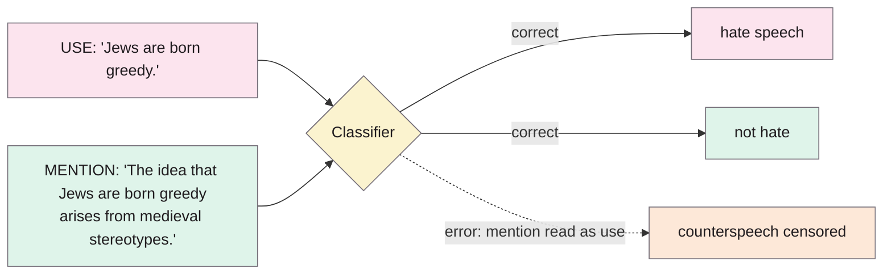
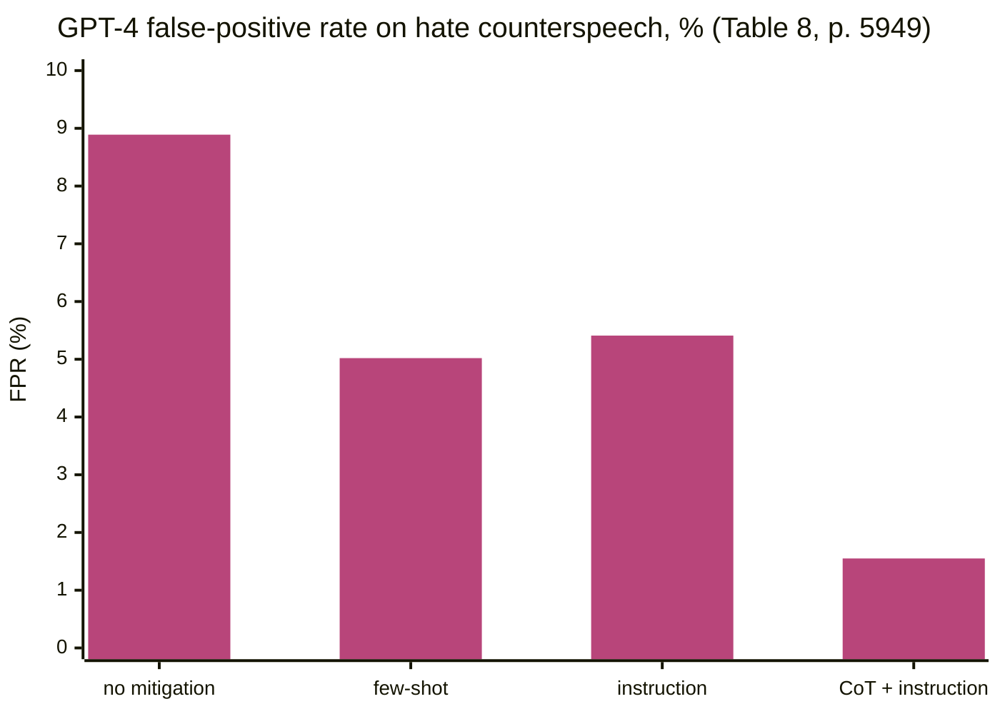

> **Source note:** drafted from the ACL Anthology PDF (renamed from 2024.naacl-long.331.pdf). Page numbers are the printed proceedings pages, 5942–5959.
>
> **Content warning:** the paper's examples include hate speech and the counterspeech that quotes it.

## TL;DR
*Using* words states something ("Jews are born greedy"); *mentioning* them talks about the words ("The idea that Jews are born greedy arises from medieval stereotypes"). Counterspeech nearly always mentions the harmful phrase it answers. The authors show that GPT-3.5, GPT-4, Perspective and other classifiers often can't tell the difference, so they **flag counterspeech as hate speech or misinformation**, and that this failure causes the downstream errors (pp. 5942–5947). A prompt that explains the distinction, with worked examples and step-by-step reasoning, cut GPT-4's false-positive rate on counterspeech by **83%** for hate speech while barely touching true hate (p. 5949). For this project it's the core citation for "mention is not bias" and for DET-04's prompt design.

**Analogy:** a librarian who removes every book containing a swear word removes the dictionary of slang and the history of the civil rights movement too. Mention is quoting the word to examine it; use is saying it.

Example from Figure 1 and Table 1 (pp. 5942–5943).

## 1. What is the aim of the paper?
The use–mention distinction is old in philosophy of language but barely studied in NLP (p. 5942). It matters for counterspeech, reporting, education, law and personal testimony, all of which mention harmful language (p. 5942). Misclassifying counterspeech "erases opportunities to rectify false narratives" and risks "further censoring those already most affected by harmful language" (p. 5943). Hypotheses (p. 5943):
- **H1:** models fail to distinguish use from mention in counterspeech;
- **H2:** this failure affects hate speech and misinformation detection;
- **H3:** what's "permissible" depends on identity terms and stance strength;
- **H4:** teaching the distinction improves downstream performance.

Mention is defined following Wilson (2010): a token that refers to a property of the token itself; they focus on attributed language (quotes) and words referred to as words (p. 5944).

## 2. How did the authors carry out the research?
**Tasks (p. 5945).** Task 1: classify text as *use* or *mention*. Task 2: hate speech or misinformation detection on the same texts. The key metric is the **false-positive rate on counterspeech**, which the authors call "the censorship rate".

**Data (p. 5945).** Paired (harmful statement, counterspeech) data: expert-written hate counterspeech from Chung et al. (2021) and Fanton et al. (2021); misinformation counterspeech from He et al. (2023). Across 1,826 pairs the counterspeech shares on average 3.44 words with the statement it answers (longest common substring).

**Models (pp. 5945–5946).** GPT-3.5-instruct, GPT-3.5-turbo and GPT-4 (zero-shot prompts); for Task 2 also Perspective (insult, toxicity, identity attack), a ToxiGen HateBERT model, a RoBERTa hate-speech model and a RoBERTa fake-news model.

**Mitigations (pp. 5948–5949).** For GPT-4: few-shot examples of use and mention; an instruction defining the distinction and saying mention doesn't make text harmful; and "CoT + mitigation", which adds step-by-step reasoning where step 1 decides use vs mention and step 2 classifies.

## 3. What are the primary results?
- **H1 (Table 2, p. 5946):** GPT-4 still read mentions as use 20.00% of the time for hate speech and 23.44% for misinformation.
- **H2, hate speech (Table 3, p. 5946):** false-positive rate on counterspeech:

| Model | FPR on counterspeech (%) |
|---|---|
| gpt-3.5-instruct | 25.56 |
| ToxiGen HateBERT | 24.44 |
| Perspective identity attack | 21.11 |
| Perspective toxicity | 20.00 |
| RoBERTa hate speech | 17.78 |
| gpt-3.5-turbo | 11.11 |
| GPT-4 | 8.89 |

- **Errors propagate (Table 4, p. 5947):** GPT-4's downstream error on counterspeech was 15.78% when it got use/mention wrong vs 4.54% when it got it right (χ², p < 10⁻⁵ for all three GPT models).
- **H3, identity terms (Table 5, p. 5947):** gpt-3.5-turbo's false-positive rate varied by target: Jewish 14.15%, people of colour 9.09%, Muslims 6.80%, LGBT+ 6.77%, others under 5%. "Systems treat the mere mention of certain identity terms as impermissible".
- **Quotation marks make it worse (Table 7, p. 5948):** counterspeech with quotes was flagged more often, e.g. GPT-4 hate speech 28.57% with quotes vs 7.23% without.
- **Stance strength helps:** counterspeech with strong words like "fake", "lying", "misleading" was misclassified less (Table 6, p. 5948).
- **H4 (Table 8, p. 5949):**

CoT + mitigation: −82.61% FPR (hate) and −59.06% (misinformation), with true-positive rate on real hate down only 2.99% and 2.62%.

## 4. What do the authors think the results mean?
- Many known lexical biases (swear words, identity terms, dialect) "are indicative of inadequate ability to make a use-mention distinction" (p. 5950).
- Even GPT-4 is "very sensitive to shallow lexical biases" (p. 5950).
- Treatment of mentioned language "should instead be explicitly encoded" in classification, as their prompt does (p. 5950).
- Cautions (p. 5950): counterspeech isn't always benign (it can be used to harass), and mention can veil real intent; preventing censorship of counterspeech might let some harm through.
- Limitations (p. 5951): only off-the-shelf classifiers, no fine-tuning ("fine-tuning with more examples could help"), no human ratings, and only counterspeech-related mention.

## 5. What do I think it means?
*Claude's draft. Rewrite this in your own words when you verify.*

- **The theoretical anchor for DET-01's stance.** "Mention is not bias" is the use–mention distinction applied to stereotyping. Cite the Wilson definition (p. 5944) when defining "mentions / quotes / counters" in DET-06.
- **DET-04's prompt is this paper's mitigation.** The master plan's prompt (definitions, explicit rule, worked hard-negative examples) matches their "mitigation + few-shot". Their best result added **step-by-step reasoning with use/mention decided first** (p. 5948). Consider that for DET-04: ask the API to decide the context type before the harm label. That also gives you the DET-06 context field for free.
- **DET-03 is the untested half of their future work.** They tested prompting only and say fine-tuning "could help further" (p. 5951). Your hard-negatives checkpoint is a fine-tuning test of their claim. That's a nice framing for the contribution.
- **Quotation marks (ARCH-04):** quoted counterspeech is flagged *more* (Table 7). Your splitter keeps quotes with their reporting sentence; the stance test should report quoted vs unquoted counters separately, as they do.
- **Strong stance helps classifiers, subtle disagreement hurts (Table 6).** Write gap-set "countered" cases at varied strengths, including mild ones ("that's not really fair to lone parents"), or results will look better than reality.
- **New training data candidates (DET-03):** their expert-written counterspeech datasets (Chung et al.; Fanton et al. "Multi-Target CONAN") are paired with the hate they answer. That fixes CAD's problem (counter speech that only makes sense with the thread, @vidgen2021introducing): here the counterspeech quotes the hate itself (3.44 shared words on average).
- **Their caution belongs in EVAL-06:** counterspeech form can veil harm (p. 5950). A detector that learns "quotes = safe" could be gamed. Add a gap-set case where the "quote" frame is a pretext.

Suggested metadata, one line each:
- `detector-model`, `benchmarks`, `metrics`: failure analysis and mitigation for detectors; FPR on counterspeech.
- `background`, `related-work`, `methodology`: the stance, prior evidence, prompt and training design.
- `DET-01`, `DET-03`, `DET-04`, `DET-06`, `ARCH-04`, `VAL-01`: as above.

## Key numbers
- 1,826 statement–counterspeech pairs; average 3.44 shared words (p. 5945).
- GPT-4 reads mentions as use: 20.00% (hate), 23.44% (misinformation) (Table 2, p. 5946).
- Counterspeech FPR: Perspective toxicity 20.00%, ToxiGen HateBERT 24.44%, GPT-4 8.89% (hate); GPT-4 10.21% (misinformation) (Table 3, p. 5946).
- GPT-4 downstream error 15.78% when use/mention wrong vs 4.54% when right (Table 4, p. 5947).
- gpt-3.5-turbo FPR by target: Jewish 14.15%, Muslims 6.80%, LGBT+ 6.77% (Table 5, p. 5947).
- With quotes vs without (GPT-4, hate): 28.57% vs 7.23% (Table 7, p. 5948).
- CoT + mitigation: FPR −82.61% (hate), −59.06% (misinformation); TPR −2.99% and −2.62% (Table 8, p. 5949).

Quote (p. 5947): "systems treat the mere mention of certain identity terms as impermissible".

## Concerns
- **Small evaluation sets** for some conditions (±7–10 point standard errors in Table 3 for hate speech).
- **Hate speech and misinformation, not stereotyping;** counterspeech is mostly expert-written, cleaner than web text.
- **Prompting with temperature 1** and one-token answers (p. 5946); results may vary by run.
- **Models of 2023;** current ones may differ.

## Follow-up
From the reference list (pp. 5952–5959):
- Fanton, M., Bonaldi, H., Tekiroğlu, S. S. and Guerini, M. (2021) "Human-in-the-loop for data collection: a multi-target counter narrative dataset to fight online hate speech", ACL 2021. Expert counterspeech paired with the hate it answers; a strong candidate for DET-03's "counters" examples.
- Chung, Y.-L., Kuzmenko, E., Tekiroğlu, S. S. and Guerini, M. (2019) "CONAN – counter narratives through nichesourcing: a multilingual dataset of responses to fight online hate speech", ACL 2019, pp. 2819–2829. The original CONAN dataset.
- Van Aken, B., Risch, J., Krestel, R. and Löser, A. (2018) "Challenges for toxic comment classification: an in-depth error analysis", Proceedings of the 2nd Workshop on Abusive Language Online, pp. 33–42. Early evidence that quoted toxic phrases cause false positives.
