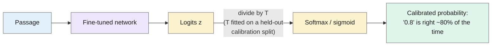

> **Source note:** drafted from the PMLR PDF (renamed from guo17a.pdf). The PDF has no printed page numbers, so page numbers below are **PDF pages 1–10** (the proceedings pages are 1321–1330, so PDF page *n* is proceedings page 1320 + *n*; check before citing). The supplementary material (Sections S1–S4) wasn't summarised.

## TL;DR
Modern deep networks are more accurate than older ones but **overconfident**: when a ResNet says 90%, it's right much less than 90% of the time (pp. 1–2). The authors show miscalibration grows with depth, width and Batch Normalization and shrinks with weight decay, and compare post-hoc fixes. The winner is the simplest: **temperature scaling**, one parameter $T$ that divides the logits before the softmax, fitted on a validation set. It doesn't change any prediction, only the confidence (pp. 6–8). For this project it's the method behind MET-02's "calibrated probability" and the source of MET-05's expected calibration error (ECE) and reliability diagram.

**Analogy:** a weather forecaster who says "90% chance of rain" on days it rains only 60% of the time. Temperature scaling is the editor who learns to turn every forecast down by the same amount, so "90%" means 90% again, without changing which days the forecaster calls rainy.

## 1. What is the aim of the paper?
Classifiers in decision pipelines must be accurate *and* indicate when they're likely to be wrong; a self-driving car should rely on other sensors when the network is unsure, and a medical system should hand over to a doctor (p. 1). Calibrated confidence also helps interpretability and lets outputs be combined with other probabilistic models (p. 1). Networks from around 2005 were well calibrated on binary tasks, but the authors "discover with great surprise that modern neural networks are no longer well-calibrated" (p. 2). The aim: understand why, and find what fixes it (p. 2).

## 2. How did the authors carry out the research?
**Definition (p. 2).** Perfect calibration:

$$P(\hat{Y} = Y \mid \hat{P} = p) = p, \quad \forall p \in [0,1]$$

e.g. of 100 predictions made with confidence 0.8, 80 should be correct.

**Measures (pp. 2–3).** Group predictions into $M$ equal-width confidence bins $B_m$.
- **Reliability diagram:** accuracy against confidence per bin; perfect calibration is the diagonal.
- **Expected calibration error:**

$$\text{ECE} = \sum_{m=1}^{M} \frac{|B_m|}{n}\,\big|\text{acc}(B_m) - \text{conf}(B_m)\big|$$

- **Maximum calibration error** (MCE): the largest gap over bins, for high-risk uses.
- **Negative log-likelihood** (NLL), an indirect measure.

**What causes miscalibration (pp. 3–4, Figures 2–3).** ResNets on CIFAR-100 with varying depth, width, Batch Normalization and weight decay.

**Calibration methods (pp. 4–6),** all post-processing on a held-out validation set, assuming train, validation and test come from the same distribution:
- binning methods: histogram binning, isotonic regression, Bayesian Binning into Quantiles;
- **Platt scaling** for binary models: $\hat{q}_i = \sigma(a z_i + b)$;
- multiclass extensions: matrix scaling, vector scaling, and **temperature scaling**:

$$\hat{q}_i = \max_k \sigma_{SM}(z_i / T)^{(k)}$$

with one scalar $T > 0$ fitted by minimising NLL on validation data. $T > 1$ softens the probabilities; $T = 1$ leaves them unchanged. Because dividing by $T$ doesn't change which class is largest, **accuracy is unchanged** (p. 6).

**Experiments (p. 7).** Vision: Birds, Cars, ImageNet, CIFAR-10/100, SVHN with ResNets, Wide ResNets, DenseNets. Text: 20 Newsgroups and Reuters (deep averaging networks), Stanford Sentiment Treebank binary and fine-grained (TreeLSTMs). ECE with 15 bins.

## 3. What are the primary results?
- **Modern networks are overconfident (pp. 1–2, Figure 1):** on CIFAR-100, a 5-layer LeNet's average confidence matches its accuracy; a 110-layer ResNet's is much higher than its accuracy.
- **Causes (pp. 3–4):** calibration error grows with depth and width; Batch Normalization worsens it even when accuracy improves; less weight decay worsens it, and calibration keeps improving with more weight decay after accuracy has peaked.
- **Why (p. 4, Figure 3):** networks keep lowering NLL after they classify almost every training example correctly, by becoming more confident. On CIFAR-100, test error fell from 29% to 27% *while* NLL overfit: "the network learns better classification accuracy at the expense of well-modeled probabilities".
- **Typical ECE is 4–10%** before calibration (p. 7).
- **Temperature scaling wins on vision and is comparable on text (p. 7, Table 1).** It even beats vector and matrix scaling, which are more general: "network miscalibration is intrinsically low dimensional" (p. 7).

**Text datasets, ECE % (Table 1, p. 6):**

| Dataset | Uncalibrated | Histogram binning | Isotonic | Temperature scaling |
|---|---|---|---|---|
| 20 News | 8.02 | 3.60 | 5.52 | 4.11 |
| Reuters | 0.85 | 1.75 | 1.15 | 0.91 |
| SST binary | 6.63 | 1.93 | 1.65 | 1.84 |
| SST fine-grained | 6.71 | 2.09 | 1.65 | 2.56 |

```mermaid
%%{init: {"themeVariables": {"xyChart": {"plotColorPalette": "#F29BBE, #B8457A"}}}}%%
xychart-beta
  title "ECE % before vs after temperature scaling, text tasks (Table 1, p. 6)"
  x-axis ["20 News", "Reuters", "SST binary", "SST fine"]
  y-axis "ECE (%)" 0 --> 9
  bar [8.02, 0.85, 6.63, 6.71]
  bar [4.11, 0.91, 1.84, 2.56]
```

- **CIFAR-100 ResNet-110 (SD) (Figure 4, p. 8):** ECE 12.67 uncalibrated → 0.96 with temperature scaling (2.46 histogram binning, 4.16 isotonic).
- **Practical (p. 8):** temperature scaling is by far the fastest (a one-dimensional convex problem, about 10 iterations) and the easiest to implement. Binning methods can change predictions and hurt accuracy. Matrix scaling overfits with many classes.

## 4. What do the authors think the results mean?
- Overfitting in modern networks shows up in the *probabilities* rather than the classification error (p. 4).
- "On most datasets, temperature scaling – a single-parameter variant of Platt Scaling – is surprisingly effective at calibrating predictions" (p. 1), and calibration "is best corrected by simple models" (p. 8).
- When a dataset is already well calibrated (Reuters), post-processing may be unnecessary (p. 7).

## 5. What do I think it means?
*Claude's draft. Rewrite this in your own words when you verify.*

- **MET-02 needs a binary version.** Temperature scaling in this paper is for one *softmax* over classes. Your harm outputs are two independent *sigmoids*. The equivalent is a temperature per label, $\sigma(z/T)$, or Platt scaling, $\sigma(az + b)$, which the paper describes for binary models (p. 5). Say "temperature scaling applied to each sigmoid separately (one $T$ per label)" in the method, so the examiner doesn't think you're using the multiclass version on a multi-label problem.
- **DET-04 is consistent:** the API backend uses Platt scaling on verbalised confidence. Both are post-hoc calibration from this family. Cite this paper for both.
- **Calibration split (DET-03, MET-05):** they require a held-out validation set and *assume it matches the test distribution* (p. 4). Your detector will score sources from very different distributions (web text, books). So calibration on the SBIC/ToxiGen calibration slice is only guaranteed in-distribution. Report ECE separately on the out-of-distribution sets (HateCheck, gap set); that's a stronger, more honest result.
- **MET-05:** use their ECE definition and 15 bins, plus a reliability diagram; note that a reliability diagram hides how many samples are in each bin (p. 2), so show the histogram too, like their Figure 1. Note that ECE with many empty bins is noisy on small sets (16-item preliminary study, 70-item gap set grounds); state bin count and n.
- **MET-04 and DET-05:** thresholds (0.5 accept/reject, 0.3–0.7 uncertain band, 0.4 disagreement gap) only mean the same thing across checkpoints and backends if scores are calibrated. That's the master plan's argument, and this paper is the support.
- **Text results are less dramatic than vision.** On 20 News, histogram binning beat temperature scaling (3.60 vs 4.11), and isotonic beat it on SST (Table 1). Your claim should be "temperature scaling is simple and effective", not "best". A quick comparison with isotonic regression on the calibration split would be a cheap extra row in MET-05.
- **Calibration doesn't change accuracy (p. 6),** so it can't change F1 or PR-AUC; it only changes threshold behaviour and ECE. Worth one sentence in the method so readers don't expect accuracy gains.

**Illustrative, not from the paper:** if the uncalibrated detector gives 0.95 to 1,000 passages and only 700 truly stereotype, a 0.9 reject threshold silently rejects 300 harmless passages. After temperature scaling, those passages might score around 0.7, landing in the review band instead.

Suggested metadata, one line each:
- `metrics`: ECE, MCE, reliability diagrams.
- `detector-model`: post-hoc calibration of the detector.
- `methodology`, `evaluation`: the score definition and the calibration results.
- `MET-02`, `MET-05`, `MET-04`, `DET-04`, `DET-05`, `DET-03`: as above.

## Key numbers
- Typical ECE before calibration: 4–10% (PDF p. 7).
- CIFAR-100 ResNet-110 (SD): ECE 12.67 → 0.96 with temperature scaling (Figure 4, PDF p. 8).
- Text ECE uncalibrated → temperature scaling: 20 News 8.02 → 4.11; SST binary 6.63 → 1.84; SST fine 6.71 → 2.56; Reuters 0.85 → 0.91 (Table 1, PDF p. 6).
- ECE computed with M = 15 bins (Table 1, PDF p. 6).
- CIFAR-100 test error dropped from 29% to 27% while NLL overfit (PDF p. 4).
- Temperature found in about 10 conjugate-gradient iterations (PDF p. 8).

Quote (PDF p. 2): "modern neural networks are no longer well-calibrated".

## Concerns
- **Vision-heavy;** only four text datasets, none for bias or toxicity, and pre-transformer models (DANs, TreeLSTMs). ModernBERT's calibration may differ; measure it rather than assume.
- **Multiclass softmax setting;** binary/multi-label sigmoid outputs need the per-label variant.
- **Same-distribution assumption** for the validation set (PDF p. 4).
- **ECE depends on binning,** and the authors note their Reuters result may be affected by the split or binning scheme (PDF p. 7).
- **No DOI** in Zotero; the PMLR URL is fine for UL Harvard.

## Follow-up
From the reference list (PDF pp. 9–10):
- Platt, J. et al. (1999) "Probabilistic outputs for support vector machines and comparisons to regularized likelihood methods", Advances in Large Margin Classifiers, 10(3), pp. 61–74. The original Platt scaling, used for the API backend in DET-04.
- Niculescu-Mizil, A. and Caruana, R. (2005) "Predicting good probabilities with supervised learning", ICML, pp. 625–632. Older networks were well calibrated; also introduces reliability diagrams for classifiers.
- Naeini, M. P., Cooper, G. F. and Hauskrecht, M. (2015) "Obtaining well calibrated probabilities using Bayesian binning", AAAI, p. 2901. The source of ECE and MCE.
