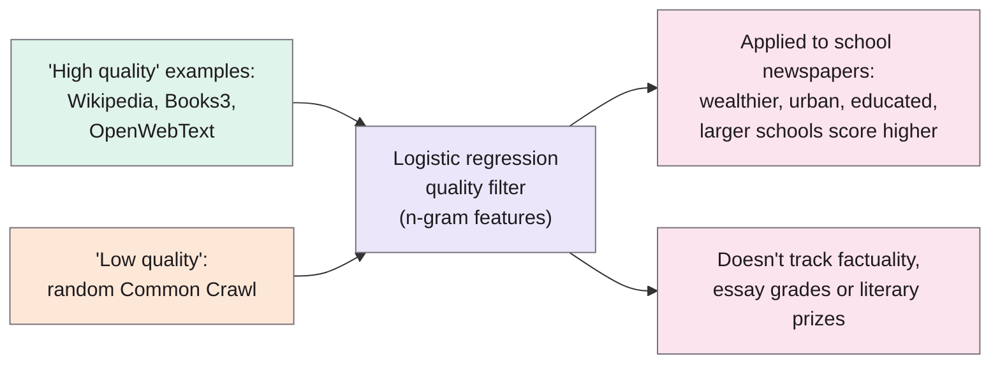
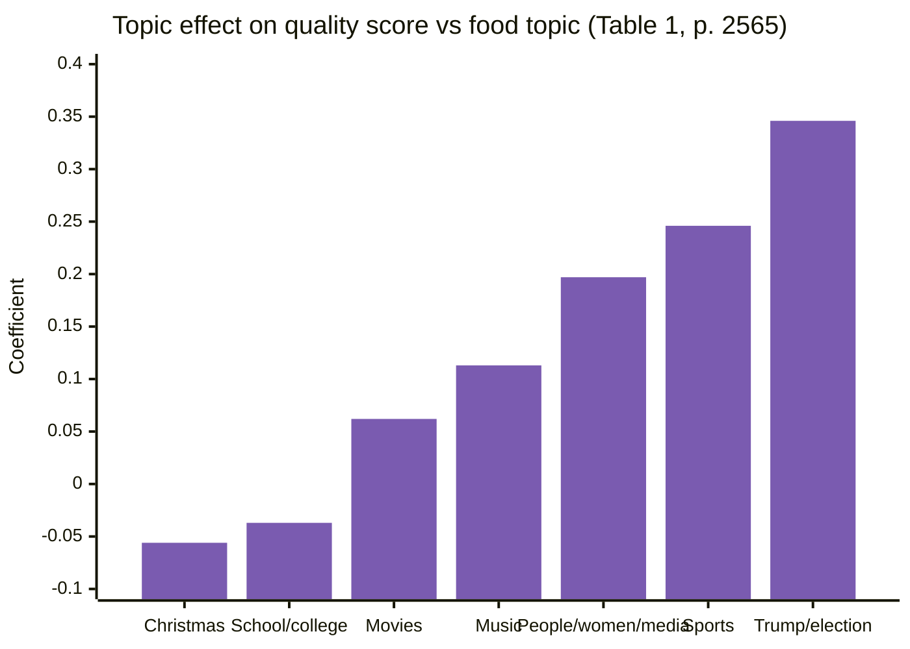

> **Source note:** drafted from the ACL Anthology PDF. Page numbers are the printed proceedings pages; the main paper is pp. 2562–2570, the rest is references and appendices (not summarised).

## TL;DR
GPT-3's training data was selected by a **"quality filter"**: a logistic regression classifier trained to tell Wikipedia, books and popular web text (positive) from random Common Crawl (negative) (p. 2565). The authors re-implemented it and ran it on **910K US high school newspaper articles** from 1,410 schools (p. 2565). It scored articles from **larger schools in wealthier, more educated, urban areas** higher, even after controlling for each other (pp. 2566–2567). It also **didn't match other notions of quality**: no difference between factually reliable and unreliable news, weak correlation with TOEFL essay grades, and it disfavoured Pulitzer-winning poetry and drama (pp. 2567–2568). Their point: every filter encodes a **language ideology** about whose language counts (pp. 2562–2563). For this project it's one of the DET-01 examples of filtering removing more than intended.

**Analogy:** a bouncer told to let in "people who look like our regulars". The regulars all came from one part of town, so the bouncer ends up checking postcodes, not behaviour, and turns away a poet while waving in a well-dressed liar.

Setup from p. 2565; findings pp. 2565–2568.

## 1. What is the aim of the paper?
Quality filtering is "often treated as a relatively neutral preprocessing step", but it "necessarily implies a value judgment" about which text belongs in training data (p. 2562). Since language varies with social and demographic variables, the authors ask "whose language will be excluded" (p. 2562). They borrow the sociolinguistic term **language ideology**: "common (but often unspoken) presuppositions, beliefs, or reflections about language that justify its social use and structure" (p. 2563).

## 2. How did the authors carry out the research?
**Motivation (pp. 2563–2564).** The usual "high quality" sources come from narrow author groups: Wikipedia has a persistent gender gap among editors and urban and Anglo-American bias; Books3 is dominated by prolific American and British genre authors; in OpenWebText, 1% of 311K domains contribute 75% of documents.

**Dataset (pp. 2564–2565).** US SCHOOL NEWS: 1.95M articles scraped from 2,483 schools' newspaper sites using a common WordPress template; after filtering (2010–2019 high school articles, schools with ≥ 100 articles) **910K articles, 1,410 schools, 1,329 ZIP codes**, all US states. Linked to Census and National Center for Education Statistics data.

**Filter (p. 2565).** Re-implemented from Brown et al. (2020) in scikit-learn: hashing vectoriser, whitespace tokens; positives 80M tokens each of OpenWebText, Wikipedia and Books3; negatives 240M tokens of Common Crawl. Held-out F1 90.4% (accuracy 91.7%). Output: $P(\text{high quality})$ per document.

**Analyses.**
- *Document level (p. 2565):* regression of quality score on LDA topics, pronoun use and length, for 10K opinion pieces (Table 1).
- *Demographics (pp. 2566–2567):* regression of each school's average score on % rural, % adults with degrees, log median home value, log school size, student:teacher ratio, school type; N = 968 schools (Table 2).
- *Other notions of quality (pp. 2567–2568):* 9.9K / 7.7K articles from high / low factuality news outlets; 12.1K TOEFL essays with official grades; Pulitzer-winning books.

## 3. What are the primary results?
- **Topic and style (Table 1, p. 2565):** compared with a food topic, articles about Trump and the 2016 election score about 35 points higher, sports about 25 points higher. A first or second person pronoun lowers the score by about 5 points; doubling length raises it by about 9 (pp. 2565–2566).
- **Demographics (Table 2, pp. 2566–2567):** home value, parental education, school size, public status and urban location all have significant positive associations. Individually modest: a 14-point rise in % urban, a 17-point rise in % graduates, doubling home values or quadrupling school size each add about **1 point** of average quality score. Combined, they "account for large differences" between wealthy urban and poorer rural areas (p. 2567). R² is 0.140 (p. 2566).
- **Factuality (p. 2568):** no difference between high and low factuality news (Kolmogorov–Smirnov p = 0.085); "many factually unreliable news articles are considered high quality".
- **TOEFL (p. 2568):** essay grade correlates weakly (Pearson r = 0.12); the essay *prompt* predicts the score far better; prompts inviting personal experience score lower.
- **Literature (p. 2568):** Pulitzer winners in poetry and drama are disfavoured relative to non-fiction and fiction (Figure 3).

## 4. What do the authors think the results mean?
- The filter "reinforces a language ideology that text from authors of wealthy, urban, and educated backgrounds is more valuable for inclusion" (p. 2567).
- "There is no simple, universal standard for what should be considered high quality text" (p. 2568); "there is no truly general-purpose corpus" (p. 2563).
- Recommendations (p. 2569): document inclusion criteria and reasons for sources; deploy tests showing the effects of filters; intentionally curate under-represented voices and genres; more nuanced exclusion criteria; check what's excluded; standard checks for inclusion bias; possibly abandon the idea of a general-purpose corpus.
- Related (p. 2569): bad-word filtering "disproportionately excludes language about and by non-dominant groups" (citing Dodge et al. 2021, @dodge2021documenting); Perspective API's behaviour aligns with annotators who perceive African-American dialects as more toxic (citing Sap et al.).

## 5. What do I think it means?
*Claude's draft. Rewrite this in your own words when you verify.*

- **DET-01 cites this accurately:** "a GPT-3-style quality filter favoured writing from wealthier, urban schools" matches pp. 2566–2567. Be careful with strength: individual effects are about 1 percentage point each (p. 2567), and the model explains only a small share of variance (R² 0.14). Say "systematically favoured", not "strongly".
- **Your tool is also a filter, so this is a warning about your own tool.** A detector that removes "biased" passages from training data is a value-laden selection step. Their suggestion that "a collection of tests could also be deployed (and improved over time) to give a clear understanding of the implications of different choices of filters" (p. 2569) is literally what EVAL-01 does. Quote it in EVAL-01's motivation.
- **EVAL-01, a concrete check to add:** report *what* your filter removes at the chosen threshold, not just how much: by context type (mention, quote, counter-speech) and, if possible, by dialect or register. That's their "interrogation of what text is being excluded" (p. 2569).
- **The "mention is not bias" stance:** the filter's dislike of first-person writing and personal experience (pp. 2565–2566, 2568) parallels your worry about penalising people describing experiences of discrimination. Same family of harm.
- **Not a detector paper:** the filter here is a style/source classifier, not a harm classifier. Use it as an analogy for unintended exclusion, not as evidence about bias detectors.

Suggested metadata, one line each:
- `data-curation`, `ethics`, `impact-evaluation`: filtering side effects; what to check in EVAL-01.
- `background`, `related-work`, `analysis`: why filtering isn't neutral.
- `DET-01`, `EVAL-01`: as above.

## Key numbers
- 910K articles, 1,410 schools, 1,329 ZIP codes (p. 2565); 968 schools in the regression (p. 2566).
- Filter held-out F1 90.4%, accuracy 91.7% (p. 2565).
- Trump/election topic +35 points vs food; sports +25; first/second person pronoun −5; doubled length +9 (pp. 2565–2566).
- About 1 point per 14-point rise in % urban, 17-point rise in % graduates, doubled home value, or quadrupled school size (p. 2567).
- Factuality: no difference, KS p = 0.085 (p. 2568). TOEFL: r = 0.12 (p. 2568).
- OpenWebText: 1% of 311K domains give 75% of documents (p. 2564).

Quote (p. 2562): "Although quality filtering is often treated as a relatively neutral preprocessing step, it necessarily implies a value judgment".

## Concerns
- **Re-implementation,** not OpenAI's actual filter (p. 2565).
- **US high school newspapers only;** demographics at ZIP/county level, from a single time point (p. 2567).
- **Small effect sizes and low R²;** the authors acknowledge this (p. 2567).
- **A quality filter, not a toxicity or bias filter;** the analogy to your tool is indirect.

## Follow-up
None added: Dodge et al. (2021) is already summarised (@dodge2021documenting).
