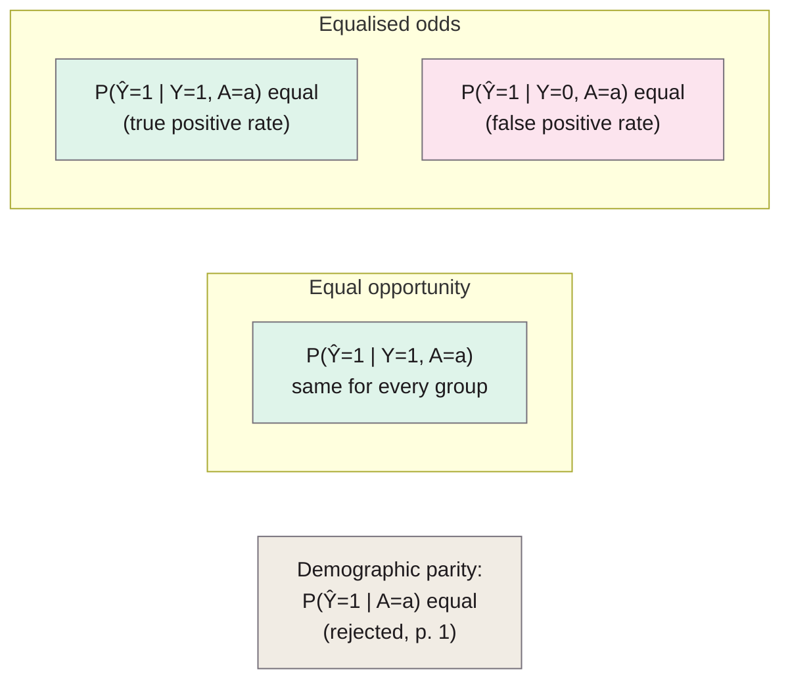
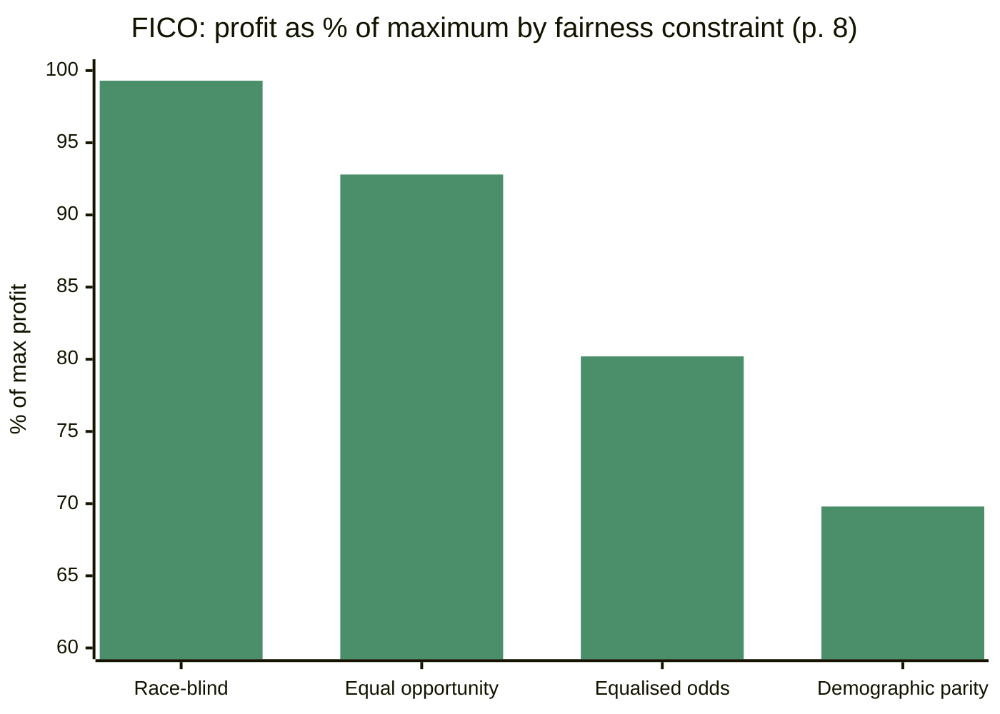

> **Source note:** drafted from the NeurIPS proceedings PDF (from Zotero storage). The proceedings version has no journal page numbers, so page numbers below are the PDF's own pages, 1–9. The authors "strongly encourage" reading the longer arXiv version (arXiv:1610.02413), which wasn't used here (p. 2).

## TL;DR
Two common fairness ideas fail: **"fairness through unawareness"** (ignore the protected attribute) fails because other features encode it, and **demographic parity** (equal positive rates for each group) both permits unfair outcomes and wastes accuracy (p. 1). The paper proposes **equalised odds** (equal true positive *and* false positive rates across groups) and its relaxation **equal opportunity** (equal true positive rates only) (pp. 2–3). Both can be achieved **after training**, by choosing (possibly randomised) per-group thresholds on any score, without retraining (pp. 3–5). A FICO credit-score case study compares the options (pp. 7–8). For this project it's the definition behind MET-05's "true-positive rate per ground".

**Analogy:** a smoke alarm installed in every flat of a building. Equal opportunity asks: when there's a real fire, does every flat's alarm go off equally often? Equalised odds also asks: when someone's just making toast, does every flat get false alarms equally often?

Definitions 2.1 and 2.2 (pp. 2–3).

## 1. What is the aim of the paper?
Machine learning increasingly affects decisions covered by anti-discrimination law, but "a vetted methodology for avoiding discrimination against protected attributes in machine learning is lacking" (p. 1). The aim: a "simple, interpretable, and easily checkable" criterion for non-discrimination that, unlike demographic parity, still allows a perfect predictor, and a way to achieve it from any learned predictor (p. 2).

## 2. How did the authors carry out the research?
**Why existing ideas fail (p. 1).**
- *Unawareness:* "ineffective due to the existence of redundant encodings", i.e. other features predict the protected attribute.
- *Demographic parity:* allows accepting qualified people in one group and random people in another as long as rates match; and rules out the ideal predictor when the outcome is correlated with the group.

**Definitions (pp. 2–3).** With prediction $\hat{Y}$, true outcome $Y$ and protected attribute $A$:

Equalised odds: $\hat{Y}$ independent of $A$ given $Y$, which in the binary case is

$$\Pr\{\hat{Y}=1 \mid A=0, Y=y\} = \Pr\{\hat{Y}=1 \mid A=1, Y=y\}, \quad y \in \{0,1\}$$

i.e. equal true positive rates ($y = 1$) and equal false positive rates ($y = 0$). It "enforces both equal bias and equal accuracy in all demographics, punishing models that perform well only on the majority" (p. 3).

Equal opportunity: only the $y = 1$ ("advantaged outcome") equality,

$$\Pr\{\hat{Y}=1 \mid A=0, Y=1\} = \Pr\{\hat{Y}=1 \mid A=1, Y=1\}$$

a weaker notion that allows better utility (p. 3).

Both are **oblivious**: they depend only on the joint distribution of $(Y, A, \hat{Y})$ or $(Y, A, R)$, not on the features or the model's form (p. 3).

**Post-processing (pp. 3–5).** From a score $R$, plot a ROC curve per group. Equalised odds requires each group to sit at the same (FPR, TPR) point, which may need **different thresholds per group, randomised between two thresholds**; the best achievable is bounded by the **worst group's ROC curve** (pp. 5–6). Equal opportunity only needs points on the same horizontal line (same TPR), so no randomisation is needed if ROC curves are continuous (p. 6).

**Theory (pp. 6–7).** An optimal equalised odds predictor can be derived from the Bayes optimal score, so training without constraints and then post-processing is justified (Corollary 4.3), with a bound on the loss if the score is only approximately optimal (Theorem 4.5).

## 3. What are the primary results?
**FICO case study (pp. 7–8).** US credit scores (300–850), default = 90+ days unpaid within 18–24 months, protected attribute race (Asian, white non-Hispanic, Hispanic, Black). False positives (loans to defaulters) cost 82/18 times false negatives. Profit as a share of the unconstrained maximum (p. 8):

| Constraint | Share of max profit |
|---|---|
| Race-blind single threshold | 99.3% |
| Equal opportunity | 92.8% |
| Equalised odds | 80.2% |
| Demographic parity | 69.8% |

- Per-group ROC curves differ, showing "the majority (white) group is classified more accurately than other[s]" (p. 7).
- The proposed definitions give thresholds between max-profit/race-blind and demographic parity (p. 7).

## 4. What do the authors think the results mean?
- The measure fixes demographic parity's conceptual flaws and "is fully aligned with the central goal of supervised machine learning, that is, to build higher accuracy classifiers" (p. 8).
- It shifts "the burden of uncertainty in classification from the protected class to the decision maker", incentivising better features and data for every group (p. 2).
- Caveat (p. 8): it needs reliable labels, and "the measurement of the target variable might in itself be unreliable or biased. Domain-specific scrutiny is required".
- Concurrent work (Kleinberg et al.) shows a score can't be both calibrated within each group and satisfy an equalised-odds-like criterion unless it's perfect (p. 2).

## 5. What do I think it means?
*Claude's draft. Rewrite this in your own words when you verify.*

- **MET-05 uses this correctly, with one translation to state.** In Hardt, $Y = 1$ is the *advantaged* outcome (getting a loan). In your detector, $Y = 1$ is "harmful text", and the "group" $A$ is the **ground the text is about**, not the author. So "equal opportunity" in MET-05 means equal recall of harmful text across grounds: harm about Travellers is caught as often as harm about women. Say this explicitly; examiners may know the loan version.
- **Equal FPR is the other half, and it's your "mention is not bias" test.** Equal false positive rate on harmless text across grounds ($y = 0$) is exactly "neutral mentions of Travellers aren't flagged more than neutral mentions of other groups". Reporting both TPR and FPR per ground means you're checking **equalised odds** (pp. 2–3). Worth naming.
- **MET-04, per-ground thresholds:** they show fairness can be fixed by per-group thresholds (pp. 4–5). For your tool that would mean different thresholds depending on which group is mentioned, which is awkward to explain to users (UI-01) and to justify. Recommend: report per-ground TPR/FPR at a single threshold, and mention per-group thresholding as a possible mitigation, not a default.
- **MET-02 tension:** per-sigmoid temperature scaling gives calibration overall. Kleinberg et al.'s result (cited p. 2) means you can't generally have per-group calibration *and* equalised odds. One sentence in the threats to validity.
- **Label reliability caveat (p. 8)** applies directly: your "harmful" labels come from SBIC/ToxiGen/CAD annotators and your own gap set labels, which may themselves be biased (cf. @sap2019risk).
- **Small groups:** per-ground rates on a small gap set will have wide uncertainty. Add confidence intervals (Mitchell et al., @mitchell2019model, p. 224 of theirs).

Suggested metadata, one line each:
- `metrics`, `ethics`: fairness definitions for per-ground evaluation.
- `background`, `methodology`, `evaluation`: fairness concepts; MET-05 metrics; per-ground results.
- `MET-05`, `MET-04`, `MET-02`: as above.

## Key numbers
- FICO profit share: race-blind 99.3%, equal opportunity 92.8%, equalised odds 80.2%, demographic parity 69.8% (p. 8).
- FICO loss ratio: false positive 82/18 times as costly as false negative (p. 7).
- FICO range 300–850; four race groups (p. 7).

Quote (p. 3): "Equalized odds thus enforces both equal bias and equal accuracy in all demographics, punishing models that perform well only on the majority."

## Concerns
- **Short conference version;** the authors point to the arXiv paper for limitations, including a non-identifiability result for all oblivious criteria (p. 2).
- **Binary attributes and outcomes** in most of the presentation; you have many grounds.
- **Assumes the joint distribution is known** (ignores finite-sample effects, p. 3), which doesn't hold for a small gap set.
- **Credit scoring example, US race categories;** the text-detection translation is yours, not theirs.

## Follow-up
None added: Kleinberg, Mullainathan and Raghavan (2016) on inherent trade-offs is relevant but optional; Dwork et al. (2012) "Fairness through awareness" is background only.
