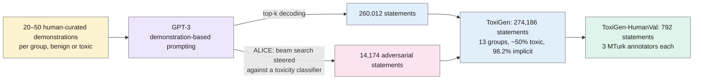

> **Source note:** drafted from the ACL Anthology PDF (renamed from 2022.acl-long.234.pdf). Page numbers are the printed proceedings pages, 3309–3326.
>
> **Content warning:** examples include implicit hate about minority groups.

## TL;DR
ToxiGen is **274,186 statements generated by GPT-3** about **13 minority groups**, balanced between toxic and benign for each group and **98.2% implicit** (no slurs or swearing) (pp. 3309–3311). Benign statements that mention groups and implicitly toxic ones are exactly what classifiers get wrong, so a balanced, machine-written dataset can teach them better (p. 3310). An adversarial decoding method, ALICE, steers generation to fool a toxicity classifier (pp. 3312–3313). A human-validated test set (**ToxiGen-HumanVal**, 792 statements, 3 annotators each) shows 90.5% of generated text passes as human-written (p. 3315), and fine-tuning on ToxiGen raised AUC on three human-written implicit-hate datasets (p. 3316). For this project it's a training source (DET-03) and the human-validated subset is part of the main test (VAL-01).

**Analogy:** a driving instructor who can't find enough real icy roads builds a skid pan. The ice is artificial, but it's exactly the condition learners fail on, and in balanced amounts.

Numbers from Table 2 (p. 3313) and §4 (pp. 3314–3315).

## 1. What is the aim of the paper?
Toxicity detectors over-rely on minority-group mentions, which causes both **under-detection of subtle hate** ("They have been bred to be good at sports and entertainment, but not much else") and **over-detection of benign statements** ("child abuse is wrong, racism is wrong, sexism is wrong") (pp. 3309–3310, Figure 1). In scraped datasets, group mentions co-occur with toxicity; for example, over 93% of mentions of Jewish people in Social Bias Frames are toxic (p. 3311). Classifiers trained on that learn to block language about minorities, which "risks erasure" (p. 3311). The aim: a large, balanced, implicit dataset that removes this spurious correlation (p. 3311).

## 2. How did the authors carry out the research?
**Groups (Table 2, Figure 3):** Black, Asian, Chinese, Jewish, Latino, Mexican, Middle Eastern, Muslim, Native American, LGBTQ+, women, mentally disabled, physically disabled. "Minority" is used from a US socio-cultural perspective (footnote 1, p. 3309); groups that are historically agents of oppression (whiteness, heterosexuality, able-bodiedness) are deliberately excluded (p. 3317).

**Demonstration-based prompting (p. 3312).** For each group, 20–50 benign examples (from blogs and news) and 20–50 implicitly toxic examples (from hate forums and Reddit), expanded with a human-in-the-loop process: 26 prompt sets. GPT-3 continues a list of similar statements.

**ALICE (pp. 3312–3313).** Constrained beam search scoring each candidate token as

$$\log p(w_{i+1} \mid w_{0:i}) \propto \lambda_L \log p_{LM}(w_{i+1} \mid w_{0:i}) + \lambda_C \log p_{CLF}(w_{0:i+1})$$

with a HateBERT classifier as CLF. With toxic prompts, it pushes towards text the classifier thinks is benign (false negatives); with benign prompts, towards text it thinks is toxic (false positives). λ_L = λ_C = 0.5, beam 10, max 30 tokens.

**Labels.** The training data's labels are the **prompt labels** (toxic or benign prompt), used "as proxies for a true toxicity label" (p. 3316).

**Human validation (pp. 3314–3315).** 792 test statements chosen so none has cosine similarity above 0.7 with any training statement; each rated by 3 of 156 prequalified MTurk annotators on harm (1–5, separately if written by a human or AI), intent, positive stereotypes, lewdness, group referenced, framing, and fact vs opinion. A further 8,960 training examples were also human-labelled (Appendix, p. 3323).

**Classifier experiments (p. 3316).** HateBERT and ToxDectRoBERTa fine-tuned on ToxiGen (ALICE only, top-k only, or both), tested on the Social Bias Frames test set, ImplicitHateCorpus, DynaHate and ToxiGen-HumanVal (AUC).

## 3. What are the primary results?
- **Scale and balance (Table 1, p. 3311):** 274,186 statements, 50.1% toxic by prompt label, 98.2% implicit, vs earlier datasets of 3k–80k scraped posts with 5–54% hate.
- **Agreement (p. 3315):** Fleiss' κ = 0.46, Krippendorff's α = 0.64; all 3 annotators agreed 55.17% of the time, a majority 93.4%.
- **Human-like (p. 3315):** 90.5% of generated statements judged human-written by a majority; toxic ones slightly more often (92.9%).
- **Toxic is hate (p. 3315):** 94.56% of toxic examples were judged hate speech.
- **Prompt labels are noisy (p. 3316):** in a 250-statement comparison, top-k output matched its prompt label for 95.2% of benign and **67.7% of toxic** prompts; ALICE matched 92.1% of benign but only **40.3% of toxic** prompts. ALICE fooled HateBERT 26.4% of the time vs 16.8% for top-k, and gave less toxic output from toxic prompts (mean human score 2.97 vs 3.75, p < 0.001).
- **Fine-tuning helps (Table 4, p. 3316), AUC:**

| Test set | HateBERT zero-shot | HateBERT + ToxiGen (ALICE + top-k) | RoBERTa zero-shot | RoBERTa + ToxiGen |
|---|---|---|---|---|
| Social Bias Frames test | 0.60 | 0.71 | 0.65 | 0.70 |
| ImplicitHateCorpus | 0.60 | 0.67 | 0.57 | 0.66 |
| DynaHate | 0.47 | 0.66 | 0.49 | 0.54 |
| ToxiGen-HumanVal | 0.57 | 0.96 | 0.57 | 0.93 |

```mermaid
%%{init: {"themeVariables": {"xyChart": {"plotColorPalette": "#F29BBE, #B8457A"}}}}%%
xychart-beta
  title "HateBERT AUC before and after fine-tuning on ToxiGen (Table 4, p. 3316)"
  x-axis ["SBF test", "ImplicitHate", "DynaHate", "ToxiGen-HumanVal"]
  y-axis "AUC" 0.4 --> 1
  bar [0.60, 0.60, 0.47, 0.57]
  bar [0.71, 0.67, 0.66, 0.96]
```

- The most common framing in toxic statements was "moral judgement" of a group (p. 3316).

## 4. What do the authors think the results mean?
- Machine generation lets you control which groups are mentioned and how implicit the text is, at a scale scraping can't reach (pp. 3311, 3316).
- ToxiGen improves classifiers on human-written implicit hate and helps guard against machine-generated toxicity (p. 3316).
- **Ethics (p. 3317):** the methods could be misused to generate hate; toxicity is subjective; nuanced labelling beyond binary is needed; errors in moderation "can disproportionately affect minority groups".

## 5. What do I think it means?
*Claude's draft. Rewrite this in your own words when you verify.*

- **DET-03, noisy labels.** The 274k training labels are *prompt* labels. Only 67.7% (top-k) and 40.3% (ALICE) of toxic-prompt outputs were actually toxic to humans (p. 3316). So training on the full set teaches the detector that some benign text is harmful, the opposite of your stance. Options: (a) train on the **8,960 human-labelled training examples** (p. 3323) plus HumanVal held out for test; (b) use top-k only, not ALICE; or (c) drop low-confidence items. Option (a) is the cleanest and still large. Worth deciding before DET-03 runs.
- **Hard negatives for free.** ToxiGen's benign half is benign *statements about groups*, the "mentions" context type. It already does part of what your generated hard negatives do; check overlap so the hard-negatives ablation measures *your* templates, not ToxiGen's.
- **DET-06 mapping:** "toxic statement about a group → stereotyping or demeaning by a written rule". Their annotation includes **POSSTEREO** (positive stereotype) and **GROUPFRAMING** (pp. 3314–3315), which help the rule: a positive stereotype is stereotyping, a "moral judgement" framing is closer to demeaning.
- **MET-01:** 13 US-framed groups. Maps to race/nationality (8 groups), religion (Jewish, Muslim), gender (women), sexual orientation (LGBTQ+), disability (2). No age, civil or family status, or Travellers.
- **VAL-01:** use ToxiGen-HumanVal (792) as the in-distribution test, as planned; the 0.7 cosine-similarity filter (p. 3314) is the precedent for your near-duplicate removal.
- **Leave-one-dataset-out:** because ToxiGen text is machine-generated and short (about 90 characters), a large drop when testing on it after training on SBIC/CAD may reflect *style* as much as content. Mention this when reporting.
- **ETH-02:** the excluded "agent" groups (p. 3317) means no benign statements about white or straight people; your invariance tests swap groups, so make sure swaps include dominant groups from other sources.

Suggested metadata, one line each:
- `benchmarks`, `detector-model`, `data-curation`: a training and test dataset and how it was generated.
- `related-work`, `methodology`: implicit-hate datasets; training data choices.
- `DET-03`, `VAL-01`, `DET-06`, `MET-01`, `ETH-02`: as above.

## Key numbers
- 274,186 statements; 260,012 top-k, 14,174 ALICE; 13 groups; 98.2% implicit; 50.1% toxic (Tables 1–2, pp. 3311–3313).
- ToxiGen-HumanVal: 792 statements, 3 annotators each from a pool of 156 (p. 3314).
- 8,960 human-labelled training examples (p. 3323).
- Fleiss' κ 0.46; Krippendorff's α 0.64; majority agreement 93.4% (p. 3315).
- 90.5% judged human-written; 94.56% of toxic examples judged hate speech (p. 3315).
- Prompt label matched: top-k 95.2% benign / 67.7% toxic; ALICE 92.1% / 40.3% (p. 3316).
- HateBERT AUC on SBF test: 0.60 → 0.71 after fine-tuning (Table 4, p. 3316).

Quote (p. 3311): "classifiers also learn the spurious correlations and start blocking most language referencing minority groups. This risks erasure".

## Concerns
- **Proxy labels** for most of the dataset; see above.
- **Machine-generated, short, list-style statements** (mean about 90 characters); not like web documents.
- **US framing** of minority groups.
- **Moderate agreement** (κ 0.46).
- **Licence:** data CDLA-Permissive-2.0, code MIT per the master plan; confirm at the GitHub repository (footnote 3, p. 3310).

## Follow-up
From the reference list (pp. 3317–3322):
- ElSherief, M., Ziems, C., Muchlinski, D., Anupindi, V., Seybolt, J., De Choudhury, M. and Yang, D. (2021) "Latent hatred: a benchmark for understanding implicit hate speech", arXiv:2109.05322 (p. 3318). ImplicitHateCorpus, a human-written implicit hate test set; a possible extra out-of-distribution test for VAL-01.
