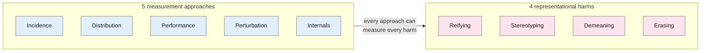

> **Source note:** drafted from the AAAI PDF (from Zotero storage). Page numbers are the printed proceedings pages, 14277–14285. Figure 1 (the 5 × 4 grid of example measurements) came out as a column dump; examples are quoted cell by cell only where unambiguous.

## TL;DR
About image tagging (the labels a vision system attaches to photos), but the argument is general. The authors sort existing "fairness" measurements into **five approaches**: incidence-, distribution-, performance-, perturbation- and internals-based (pp. 14278–14279). They name **four representational harms**: **reifying**, **stereotyping**, **demeaning** and **erasing** social groups, plus a related individual harm, denying people the ability to **self-identify** (pp. 14280–14281). Every approach can measure every harm, so **"no single measurement approach is definitive"**, and you can't tell from the method which harm a study meant to measure; state it explicitly (pp. 14281–14282). Finally, **mitigations conflict**: removing group-related content can reduce one harm and cause erasure (p. 14282). For this project it supports DET-01's harm categories and the "mention is not bias" stance.

**Analogy:** five instruments in a doctor's bag (thermometer, stethoscope, blood test, X-ray, scan) and four illnesses. Each instrument can pick up signs of every illness, so writing "we used a thermometer" doesn't tell anyone what you were looking for. You have to name the illness first.

From pp. 14278–14282 and Figure 1.

## 1. What is the aim of the paper?
Problematic image tagging (gender classifiers, performance gaps, stereotypes) is often called "unfair", "biased" or "discriminatory", but "it can be difficult to identify the full range of normative values at stake" (p. 14277). The aim is "to bring greater structure and precision" to discussions of these harms and the measurements used for them (p. 14277). Like Blodgett et al. (2020) (@blodgett2020language) for NLP, they find measurement approaches often have "unclear normative motivations" (p. 14280).

## 2. How did the authors carry out the research?
A conceptual analysis of prior work that self-identifies as measuring "unfairness", "bias" or "discrimination", quantitative approaches only (pp. 14277–14278).

**Background (p. 14278).** Image tags are meant for human consumption (alt text, photo search), so they shape "what—and who—is important and how they deserve to be described". Following Barocas et al. (2017): *allocational* harms deprive groups of resources; *representational* harms affect "the understandings, beliefs, and attitudes that people hold about particular social groups". Vision and NLP systems mostly cause the latter.

**Five measurement approaches (pp. 14278–14279).**
1. *Incidence-based:* do pre-identified problematic tags, images or pairings occur? (E.g. the "gorillas" tag on a photo of Black people.) Requires knowing in advance what's problematic, and the list can never be complete.
2. *Distribution-based:* compare distributions of tags or groups, against a reference or across groups.
3. *Performance-based:* compare accuracy across groups.
4. *Perturbation-based:* change aspects of the input and see if tags change; includes **invariance tests** with semantically similar pairs depicting different groups.
5. *Internals-based:* saliency maps; whether representations encode group membership.

## 3. What are the primary results?
**Four harms (pp. 14280–14281).** Representational harms reproduce "harmful social hierarchies"; they "are not harms to specific individuals; they relate to the standings of particular social groups" (p. 14280).
- **Reifying:** treating socially constructed groups as natural and fixed, e.g. binary gender classification assumes gender is visible and binary (p. 14280).
- **Stereotyping:** "over-generalized beliefs about social groups that reproduce harmful social hierarchies"; e.g. female doctors tagged "nurse"; men tagged by profession, women by appearance, which is harmful "even if these tags are correctly applied" (p. 14280).
- **Demeaning:** suggesting a group is "less worthy of respect"; overt epithets, or tags harmful only in pairing ("gorilla"), or trivialising a group's traditions ("costume" for religious wedding clothing) (pp. 14280–14281).
- **Erasing:** failing to recognise a group or things bound up with its identity, e.g. not tagging "person" for people wearing hijabs, or tagging suffragists marching as "people, walking, street", which "fail[s] to acknowledge the injustices" (p. 14281).
- **Denying self-identification:** an individual harm that can lead to all four (p. 14281).

**Mapping (pp. 14281–14282).** Worked in detail for stereotyping: an incidence test ("girly", "boyish" applied at all), a distribution test (professions vs appearance tags by gender), a performance test (accuracy of "doctor" by gender), a perturbation test (similar CEO photos of different genders), an internals test (saliency when misgendering). Conclusion: "no single measurement approach is definitive"; "many different approaches should be used"; and "we therefore recommend explicitly stating the type of harm of interest" (pp. 14281–14282).

**Tensions (p. 14282).**
- Removing group tags reduces reifying but can cause erasure; naming groups can bring "much needed recognition of the injustices they have suffered".
- Systems that remove "problematic" content can erase groups: "when Tumblr banned 'adult content,' they also ended up removing posts from queer communities and sex-positive communities".
- Forcing equal tag distributions across groups to fix stereotyping "can be seen as a denial of the role that membership in particular social groups plays in people's lived experiences—a form of erasure" (pp. 14282–14283).
- The intended use decides which mitigation fits: a social media tagger might drop tags to avoid stereotyping, while an alt-text tool for blind users might judge erasure worse than occasional wrong tags (p. 14283).

## 4. What do the authors think the results mean?
- Measurement choices don't reveal intent; researchers must name the harm they target (p. 14282).
- Different measurements reveal "different facets of each type of harm" (p. 14281, citing Jacobs and Wallach 2021).
- Mitigating one harm can cause another; "the scenario in which an image tagging system is intended to be used can (at least partially) determine the appropriateness of different mitigations" (p. 14283).
- The list of harms isn't exhaustive (p. 14280).

## 5. What do I think it means?
*Claude's draft. Rewrite this in your own words when you verify.*

- **DET-01's categories line up with this taxonomy.** Passage level: stereotyping and demeaning (their definitions on pp. 14280–14281 match yours almost word for word). Source level: erasure. Cite Katzman alongside Gallegos et al. (@gallegos2024bias) as the source of the categories. Their **reifying** harm isn't in DET-01; add a sentence saying why it's out of scope (it's about systems that *assign* group labels, which your detector doesn't do to people).
- **Their main recommendation is DET-01's whole premise:** "explicitly stating the type of harm of interest" (p. 14282) = Blodgett's call, which DET-01 already cites. Katzman gives a second, more recent citation.
- **"Mention is not bias" has a direct precedent:** Tumblr's adult-content filter removed queer communities' posts (p. 14282). Same failure as the C4 blocklist (@dodge2021documenting). Add it to DET-01's list of examples.
- **MET-05 and EVAL-02: use several measurement types.** Your plan already mixes them: performance-based (per-ground TPR/FPR), perturbation-based (swapped-group invariance, VAL-01 via @garg2019counterfactual), distribution-based (source-level shares). Say so with their vocabulary; it shows the evaluation is deliberately multi-angle.
- **Erasure caveat for EVAL-01:** filtering "biased" passages can itself erase groups. Report how many mentions of each group survive filtering, not just harm rates.

Suggested metadata, one line each:
- `ethics`, `metrics`, `benchmarks`: harm taxonomy; measurement approaches.
- `background`, `related-work`, `methodology`, `evaluation`: definitions; DET-01 categories; multi-approach evaluation.
- `DET-01`, `MET-05`, `EVAL-02`: as above.

## Key numbers
- Five measurement approaches; four representational harms plus self-identification (pp. 14278–14281).
- No numerical results: this is a conceptual paper.

Quote (p. 14282): "without explicit reasoning, it is not possible to infer from the use of a particular measurement approach which type of harm was intended to be measured."

## Concerns
- **About image tagging,** not text; the transfer to text is yours (though they draw the NLP parallel themselves, p. 14280).
- **Conceptual, not empirical:** no measurements run.
- **Not exhaustive,** stated by the authors (p. 14280).
- **Two-column extraction was jumbled** around pp. 14282–14283 (the tensions section is split across the references); check the quotes there against the PDF when verifying.

## Follow-up
None added: the concurrent image captioning study (Wang et al. 2022) is out of scope for a text project.
