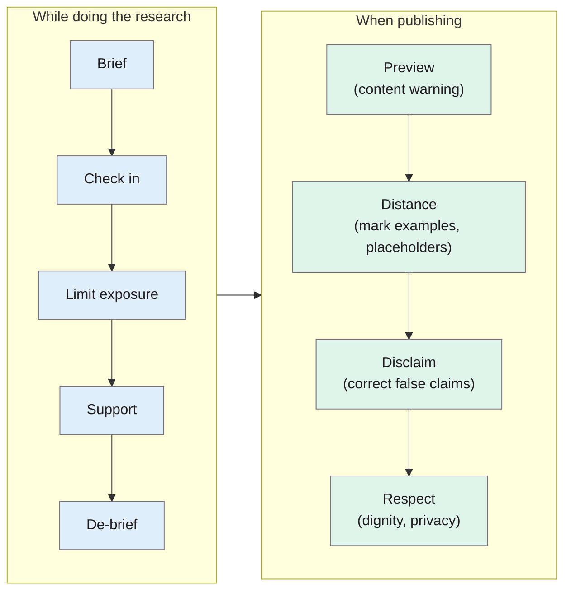

> **Source note:** drafted from the ACL Anthology PDF (renamed from 2022.findings-emnlp.35.pdf). Page numbers are the printed proceedings pages, 497–510. The completed HarmCheck examples in Appendix A weren't summarised.

## TL;DR
Researchers who work with hate speech, misinformation or stereotypes handle content that can harm three groups: **people represented in the data**, **people working with the data** (curators, annotators, researchers) and **people reading the research** (pp. 497, 500). The authors give practical guidelines for handling such text during research (**brief, check in, limit exposure, support, de-brief**) and for publishing it (**preview, distance, disclaim, respect**), plus advice on protecting yourself from harassment, and a documentation checklist, **HarmCheck** (pp. 501–504). For this project it's the source of ETH-01's content warnings and placeholders, and a reminder that a solo labeller needs to look after themselves.

**Analogy:** a chemistry lab has safety protocols for handling poisons: gloves, fume hood, labels, a buddy system. The authors argue harmful text is a hazardous material too, and deserves the same kind of protocol (p. 501).

Guidelines from §3 (pp. 501–503).

## 1. What is the aim of the paper?
Text can cause harm, but how to handle, present and discuss harmful text safely "remains an unresolved issue in the NLP community" (p. 497). Careless presentation perpetuates negative portrayals and distresses readers; careless protocols take an emotional toll on researchers; and researchers risk being seen as endorsing the content (p. 497). Avoiding such research altogether isn't an option, because harmful content is a feature of many datasets and of the world (p. 497). The aim: a framework for the risks and practical guidelines, plus a checklist (p. 498).

## 2. How did the authors carry out the research?
A position and guidance paper, drawing on research ethics, journalism and the authors' experience. Its framework has three axes (pp. 497–500):
1. **Type of harm:** hate speech, misinformation, abuse, negative stereotypes, and so on. Whether content actually harms depends on context, history, source, target and audience (p. 498).
2. **Sought vs unsought:** harmful content collected deliberately (e.g. building a hate speech classifier) vs encountered unexpectedly (e.g. in scraped training data) (p. 499).
3. **Who is at risk:** data subjects, data handlers, and readers (p. 500).

## 3. What are the primary results?
**Who is harmed (p. 500).**
- *Data subjects:* through "hyper-visibility" (too many negative portrayals) and "hypo-visibility" (erasure of a group's experience), which make each other worse when a group is both rare and badly portrayed.
- *Data handlers:* vicarious trauma, especially for annotators with repeated exposure; reputational risk to authors if examples are taken out of context.
- *Readers and reviewers:* distress; reviewers may object to unjustified examples.

**Who decides what's harmful (p. 499):** those on the receiving end of harm have the epistemic prerogative; privileged researchers are poorly placed to judge (the "privilege hazard").

**Guidelines during research (pp. 501–502).** Brief (understand risks; avoid working solo, or at least review prior work); check in regularly; **limit** exposure (e.g. dummy data while building pipelines, masking harmful words); **support** (mental health services); de-brief.

**Guidelines for publishing (pp. 502–503).**
- *Preview:* a clear content warning **at least a page before** any harmful examples; don't put harmful content on the first page.
- *Distance:* minimal examples; visually mark them; **placeholders** like "that [IDENTITY] is a [SLUR]".
- *Disclaim:* for misinformation, state the true claim next to the false one; give provenance (platform and date).
- *Respect:* protect dignity and privacy, e.g. remove identifying details.

**Protecting yourself (pp. 503–504).** Real examples of researchers harassed after publishing on gender bias and misogyny; inform your institution, reduce personal information online, be selective with press.

**HarmCheck (p. 504).** A documentation checklist (content warnings, distancing, disclaimers, respect, risk-of-harm protocol) to fill in like a data statement or model card.

**Filtering caution (p. 501):** crudely removing language that "could be considered offensive (e.g., any use of potentially reclaimed terms, such as 'sex' or 'gay')" risks excluding whole communities (citing Dodge et al. 2021).

## 4. What do the authors think the results mean?
Harmful text should be treated like hazardous material, with routine protocols rather than ad hoc decisions (p. 501). Assessing harm is "a reflective, contextual and ongoing process" (p. 499). HarmCheck is "a starting point for a broader conversation", not a compliance form (p. 504).

## 5. What do I think it means?
*Claude's draft. Rewrite this in your own words when you verify.*

- **ETH-01 (paper presentation):** content warning at least a page before examples; placeholders for slurs and targets; examples visually marked; minimal examples. The master plan has this; cite Kirk for each specific practice.
- **ETH-01 (your own welfare): the part the plan doesn't yet cover.** You label the gap set **alone**, writing stereotypes and demeaning sentences about real groups, and then re-label 20% later. Their guidance: limit exposure (write templates with placeholders first, fill groups in by script), take breaks, and know where support is (UL Student Counselling). One line in ETH-01 or the methodology covers it, and it reads well to an examiner.
- **VAL-01:** "those on the receiving end ... hold the epistemic prerogative to define harm" (p. 499). You're labelling stereotypes about Travellers and lone parents without lived experience; that's a threat to validity to state, and another reason to anchor each case in a documented source.
- **UI-01 and UI-02 (the tool's report):** the report shows flagged spans to data reviewers, which is exposing them to harmful text. Apply their publishing advice to the UI: a content note at the top, spans shown in a muted style, optionally collapsed by default. Nice, specific design point for UI-02.
- **ETH-02:** removing identifiers from examples (Twitter handles etc.) is already in ETH-02; this is the citation.
- **DET-01:** their filtering caution (p. 501) is another voice for "mention is not bias".

Suggested metadata, one line each:
- `ethics`, `governance`: research ethics for harmful text.
- `methodology`: ethics section of the method.
- `ETH-01`, `ETH-02`, `VAL-01`, `UI-01`, `UI-02`: as above.

## Key numbers
- Three axes: harm type, sought vs unsought, who is at risk (p. 497).
- Content warning at least a page before harmful examples (p. 498).
- Four publishing techniques: preview, distance, disclaim, respect (p. 502).

Quote (p. 501): "Filtering, while well-motivated, must be cautiously approached because it can censor and erase marginalised experiences."

## Concerns
- **Guidance, not evidence;** no evaluation of whether the practices reduce harm.
- **Written for teams and labs;** some advice (check-ins, de-briefs) needs adapting for a solo project.

## Follow-up
None added.
