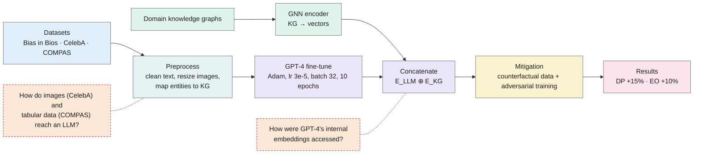
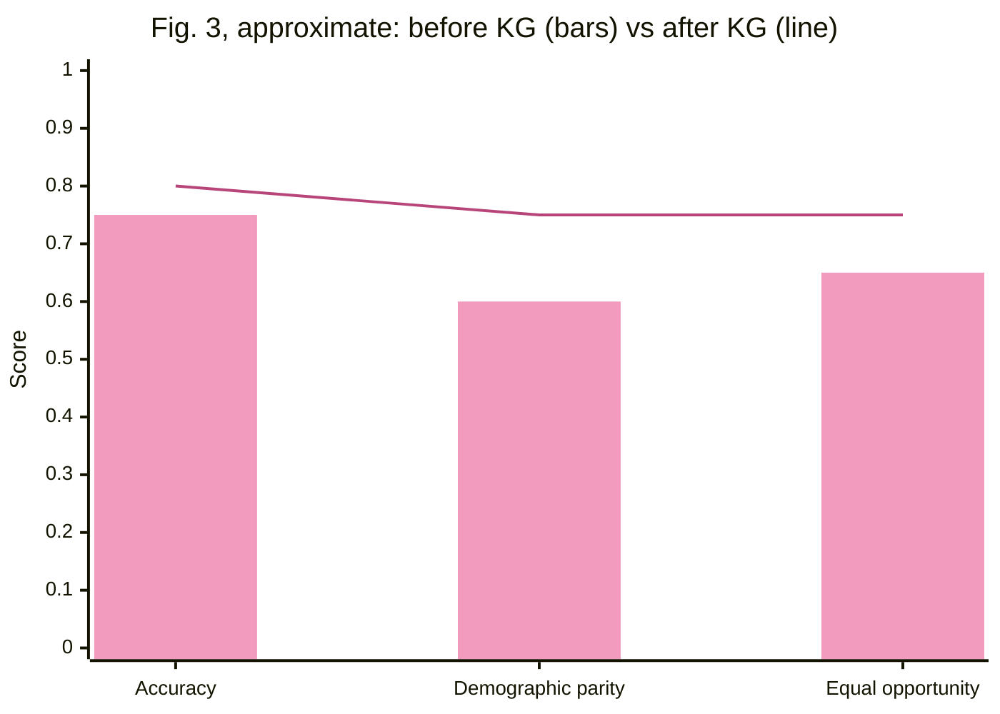
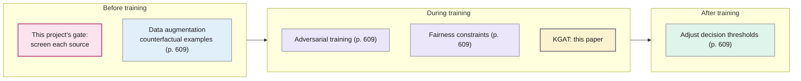

> **Reading health warning:** the paper's claims are much stronger than its evidence. The method is described only loosely, the datasets named in the abstract don't match the ones in the method section, and the results are four percentages with no baselines or definitions. Use it for its literature overview and as a contrast, not as evidence that knowledge graphs reduce bias. Details under Concerns.

## TL;DR
The authors propose Knowledge Graph-Augmented Training (KGAT): add structured facts from a knowledge graph (KG) to an LLM during fine-tuning, so the model leans on balanced, curated knowledge instead of biased patterns in web text. They report that demographic parity improved by 15% on Bias in Bios and equal opportunity by 10% on COMPAS. However, the setup is too thinly described to check. For this project, it is mainly a contrast: it tries to fix bias **inside the model**, after biased data has already gone in, while this project stops biased data **before** training.

**Analogy:** if biased web text is a muddy river feeding a reservoir, this paper adds a clean spring (the knowledge graph) to dilute the mud once it's already in the reservoir. This project is a filter on the river before it reaches the reservoir.

## 1. What is the aim of the paper?
LLMs inherit, and can amplify, biases in their internet-sourced training data (gender, racial, ideological and others). That matters most in high-stakes uses such as healthcare, finance and law (p. 608). The authors argue that traditional fixes (data augmentation, adversarial training, fairness algorithms) struggle with the complex nature of LLM bias and may lack context. Their aim is to show that injecting domain-specific knowledge from knowledge graphs into LLM training reduces biased output while also improving performance (p. 608).

## 2. How did the authors carry out the research?
The method section (pp. 611–612) is short. As described:

- **Datasets:** Bias in Bios (gender stereotypes in biographies), CelebA (face attributes) and ProPublica COMPAS (recidivism prediction) (p. 611). The **abstract** instead names Gender Shades, Bias in Bios and FairFace (p. 608).
- **Preprocessing:** text normalisation, image resizing, data cleaning, and mapping entities to domain-specific knowledge graphs (p. 611).
- **Knowledge graph integration:** KGs were encoded as vectors with graph neural networks (GNNs) and joined to the LLM's embeddings by concatenation, through multi-head attention (p. 612).
- **Training:** "GPT-4 was fine-tuned on preprocessed datasets" (p. 612) with the Adam optimiser, learning rate 3 × 10⁻⁵, batch size 32 and 10 epochs, then fine-tuned further with the knowledge graphs (p. 612).
- **Bias detection:** "tools like the Bias Evaluation Corpus" plus demographic parity and equal opportunity (p. 612).
- **Mitigation:** data augmentation with counterfactual examples, and adversarial training (p. 612).

The dashed orange boxes are questions the paper doesn't answer. They're my reading of the gaps, not claims the paper makes.

### The maths (pp. 611–612)
The "Theoretical review" (pp. 610–611) collects standard formulas. None of them is new, and the paper doesn't show how each is used in its experiments, but they're a handy reference.

**Demographic parity (1):** a positive prediction is equally likely whatever the group $A$:

$$P(\hat Y = 1 \mid A = a) = P(\hat Y = 1 \mid A = b) \quad \forall a, b \in \mathcal{A}$$

**Equal opportunity** is used in the results but never written out. The standard definition, from Hardt et al. (2016), which the paper cites as [22], requires equal true-positive rates. *Not from this paper:*

$$P(\hat Y = 1 \mid A = a, Y = 1) = P(\hat Y = 1 \mid A = b, Y = 1)$$

**Analogy:** demographic parity says every group gets invited to interview at the same rate. Equal opportunity says every group's *qualified* candidates get invited at the same rate.

**Graph convolution (2):** each node in the knowledge graph updates itself by averaging its neighbours' features:

$$\mathbf h_v^{(l+1)} = \sigma\!\left(\sum_{u \in \mathcal N(v)} \frac{1}{c_{vu}} \mathbf W^{(l)} \mathbf h_u^{(l)}\right)$$

**Attention (3):** the transformer's attention, where KG embeddings would be fed into $Q$, $K$ and $V$:

$$\operatorname{Attention}(Q,K,V) = \operatorname{softmax}\!\left(\frac{QK^\top}{\sqrt{d_k}}\right)V$$

**Adversarial debiasing (4):** the main model learns its task while a rival model tries to guess the sensitive attribute from it. $\lambda$ sets how hard the main model works to fool the rival:

$$\min_\theta \max_\phi \; \mathcal L_{\text{primary}}(\theta) - \lambda \mathcal L_{\text{adversary}}(\theta, \phi)$$

**Analogy:** a student (the model) writes essays while a detective (the adversary) tries to guess the student's gender from them. The student is rewarded for essays the detective can't crack.

**Causal adjustment (5):** the effect of setting $X$, averaged over confounders $Z$. The citation here is broken and prints as "[?]" (p. 611):

$$P(Y \mid do(X)) = \sum_Z P(Y \mid X, Z)\, P(Z)$$

**Integration (p. 612):** the LLM and KG embeddings are concatenated:

$$\mathbf E_{\text{integrated}} = \mathbf E_{\text{LLM}} \oplus \mathbf E_{\text{KG}}$$

## 3. What are the primary results?
Stated on p. 612 (results and conclusion):
- **Bias in Bios:** demographic parity "increased by 15%", accuracy improved by 5%.
- **COMPAS:** equal opportunity "increased by 10%", racial bias "reduced by 7%".
- **CelebA:** no results reported.

Fig. 3 (p. 612) shows a before-and-after bar chart without saying which dataset it's for. Read off the chart, the values are approximately:

These are my estimates from the figure (p. 612), not numbers the paper states. They roughly match the text's +5, +15 and +10, which suggests the percentages are percentage points. The paper never says so.

**Real-world use cases the paper mentions (pp. 608–610)**, all citing other work rather than its own results:
- **Healthcare:** medical knowledge graphs reducing bias in diagnostic suggestions [13].
- **Finance:** knowledge graphs for fairer credit scoring and fraud detection [15].
- **Law:** fairer case-outcome prediction [16].

## 4. What do the authors think the results mean?
- KGAT "can effectively reduce biases while also enhancing overall model performance" (p. 612). They see knowledge graphs as giving the model verified, balanced knowledge to rely on instead of biased patterns in unstructured text (pp. 608, 610).
- They present it as scalable and ready for "sensitive and high-stakes applications" (p. 608).
- They acknowledge two challenges: an incomplete or biased knowledge graph can introduce new biases, and aligning large knowledge graphs with LLMs is computationally expensive (pp. 609–610).
- For future work they suggest better integration techniques, knowledge graphs that update dynamically, explainable AI built on knowledge graphs, and interdisciplinary collaboration (p. 610).

The mitigation families come from the paper's literature overview (p. 609). Placing this project's gate is my addition.

## 5. What do I think it means?
*Claude's draft. Rewrite this in your own words when you verify.*

- **Useful as a contrast for related work.** It is a clear example of model-side mitigation: biased data goes in, then a fix is bolted on during fine-tuning. The paper itself says LLM bias "mainly originates" from internet training data (p. 608), which supports going upstream and fixing the data first.
- **Its own caveat applies to this project too.** An incomplete or biased knowledge graph can introduce new biases (p. 609). Likewise, a bias detector trained on a skewed label set can wave through, or wrongly flag, some groups. That's worth remembering for DET-03 and VAL-02.
- **A lesson for evaluation (MET-05).** Reporting "+15%" with no baseline, metric definition, variance or test set is exactly what a marker would criticise. This project's evaluation should state absolute values, how each metric is defined, and on what data.
- **Pointers worth following.** Bias in Bios (De-Arteaga et al. 2019) is a real gender and occupation dataset that may be useful for VAL-01. Read the original rather than relying on this paper's description.
- **For the literature review:** it's a 2025 IEEE conference paper, so check the conference's CORE ranking before giving it weight. If you cite it at all, cite it critically.

**Illustrative, not from the paper:** for a medical case study, a KGAT-style fix would mean wiring a medical ontology into the model so it "knows" the clinical facts. This project instead asks whether a scraped page about, say, pain management describes some patient groups in a dismissive or stereotyped way, and stops that page before it becomes training data. The two approaches could complement each other, but they answer different questions.

Suggested metadata, one line each:
- `metrics`: it defines demographic parity and uses equal opportunity, the standard group-fairness metrics.
- `benchmarks`: it names Bias in Bios, CelebA and COMPAS as bias datasets.
- `related-work`: an example of model-side (in-training) bias mitigation, to contrast with data-side screening.
- `VAL-01`: it points to Bias in Bios as a candidate dataset. Check the original paper for its licence and weaknesses.

## Key numbers
- Bias in Bios: demographic parity +15%, accuracy +5% (p. 612).
- COMPAS: equal opportunity +10%, racial bias −7% (p. 612).
- Training: Adam optimiser, learning rate 3 × 10⁻⁵, batch size 32, 10 epochs (p. 612).
- Fig. 1, gender split of Bias in Bios as plotted: roughly 60% male, 35% female, 5% other (p. 612; my estimate from the chart).
- Fig. 2, racial split of COMPAS as plotted: roughly 45% Caucasian, 40% African-American, 10% Hispanic, with small Asian and Other bars (p. 612; my estimate from the chart).
- Fig. 3 before and after: see the chart above (p. 612; my estimates).

Quote (p. 612): "GPT-4 was fine-tuned on preprocessed datasets"

## Concerns
- **The method can't be reproduced as written.** It says GPT-4 was fine-tuned with Adam and its embeddings concatenated with GNN outputs (p. 612), but it doesn't explain how GPT-4's internals were accessed or modified. No code, model versions or KG sources are given.
- **The datasets don't match.** The abstract names Gender Shades, Bias in Bios and FairFace (p. 608). The method uses Bias in Bios, CelebA and COMPAS (p. 611). Two of these (CelebA, COMPAS) are images and tabular data, and the paper doesn't explain how an LLM was applied to them. No CelebA result is reported.
- **The results are thin.** Four percentages with no baseline values, no definition of "racial bias reduced by 7%", no variance, no significance testing and no description of the test set (p. 612). Fig. 3 doesn't say which dataset it shows.
- **"Increased" demographic parity is ambiguous.** Parity is usually measured as a gap that should shrink. The paper doesn't say what number went up.
- **The "Other" bar in Fig. 1** (about 5%) is worth checking against the original Bias in Bios paper [34] to see whether that dataset has a third gender category.
- **Editing problems:**
  - a paragraph titled "Conclusion:" appears inside the introduction (p. 609)
  - "KGTA" appears for "KGAT" (p. 608)
  - leftover markdown asterisks in "**Attention Mechanism**" (p. 611)
  - a broken "[?]" citation (p. 611)
  - [23] is described as threshold adjustment after training (p. 609), but its title in the reference list is about data preprocessing (p. 613)
- **Industry authors** (Intute AI) and no stated funding or code availability.

## Follow-up
From the reference list (p. 613). These are more useful than the paper itself:
- De-Arteaga, M. et al. (2019) "Bias in bios: a case study of semantic representation bias in a high-stakes setting", Proceedings of the ACM on Human-Computer Interaction, 3(CSCW) [34]. The original Bias in Bios dataset, a candidate for VAL-01.
- Hardt, M., Price, E. and Srebro, N. (2016) "Equality of opportunity in supervised learning", NeurIPS [22]. The source of the equal opportunity metric.
- Zhao, J. et al. (2017) "Men also like shopping: reducing gender bias amplification using corpus-level constraints" [5]. On models amplifying bias beyond the training data.
- Ravfogel, S. et al. (2020) "Nullifying unwanted biases with adversarial training", ICML 2020 [21] (title as printed in this paper's reference list; check it). Adversarial removal of protected attributes.
- Caliskan, A., Bryson, J. J. and Narayanan, A. (2017) [3]. Already summarised: `caliskan2017semantics`.
