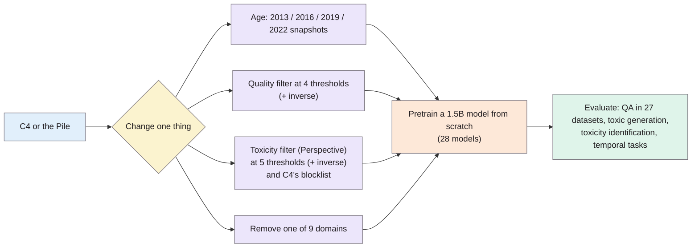

> **Source note:** drafted from the ACL Anthology PDF (renamed from 2024.naacl-long.179.pdf). Page numbers are the printed proceedings pages, 3245–3276. The long appendix (to p. 3276) wasn't summarised beyond what the main text cites.
>
> **Zotero note:** `longpre2024largescale` (the dataset licensing audit in Nature Machine Intelligence) is a different paper; the master plan cites this one.

## TL;DR
The authors pretrained **28 language models of 1.5 billion parameters from scratch**, each on C4 or the Pile changed in one way: data from a different year, a quality or toxicity filter at different strengths, or one source domain removed (pp. 3245–3247). Findings (pp. 3246, 3250–3252): a mismatch in data age hurts and isn't fixed by fine-tuning; **toxicity filtering trades less toxic generation for worse toxicity identification and worse general performance**; quality filtering helps most tasks (but increases toxic generation); diverse sources (web, books) matter most. For this project it's the main precedent for EVAL-01 (train on filtered vs unfiltered data and measure what changes) and the warning that removing data has costs (EVAL-06).

**Analogy:** a chef testing ingredients by cooking 28 versions of the same dish, each with one ingredient changed. Taking out everything "spicy" makes a milder dish, but it also makes the chef worse at recognising spice, and the dish loses flavour.

Design from Figure 1 and §2 (pp. 3245–3247).

## 1. What is the aim of the paper?
Pretraining data design is "critically underdocumented and often guided by empirically unsupported intuitions" (p. 3245). Model developers rarely say *why* they chose their curation steps or *what effect* they had, leaving a "documentation debt" (p. 3245). The aim: systematically test three common choices: when data was collected, content filtering (toxicity and quality), and domain composition (p. 3246).

## 2. How did the authors carry out the research?
**Data (pp. 3246–3247).** C4 and the Pile, deduplicated.
- *Age:* four C4 versions from Common Crawl in 2013, 2016, 2019, 2022.
- *Domains:* the Pile's 22 sources grouped into 9 (Common Crawl, OpenWebText, books, Wikipedia, legal, social, biomedical, academic, code); each removed in turn.
- *Quality filter:* PaLM/GLaM's proprietary classifier (0 = high quality, 1 = low); remove documents above 0.975, 0.95, 0.9, 0.7; plus an inverse filter removing the highest-quality documents.
- *Toxicity filter:* **Perspective API** toxicity at thresholds 0.95, 0.9, 0.7, 0.5, 0.3; an inverse filter removing the *least* toxic documents; and C4's original "bad words" n-gram filter.

**Models (pp. 3246–3247).** Decoder-only, 1.5B parameters ("LM-XL"), pretrained from scratch on each variant, then fine-tuned for evaluation.

**Evaluation (p. 3247, Table 1).** Toxic generation: RealToxicityPrompts and the Representational Bias benchmark from PaLM. Toxicity identification: Social Bias Frames, DynaHate, ToxiGen. Question answering: 27 datasets from MRQA and UnifiedQA in domain groups. Temporal: five datasets with time annotations.

## 3. What are the primary results?
- **Age (p. 3246):** performance drops when evaluation data is newer *or* older than the pretraining data; fine-tuning doesn't remove this, and larger models are more affected.
- **Quality filtering (p. 3250–3251):** improves nearly all tasks (toxicity identification by about 2%, most QA categories by 1–6%) despite removing over 10% of the data; toxicity identification was still improving at a threshold where 55% of the data had been removed. Unexpectedly, both quality and *inverse* quality filters increased toxic generation.
- **Toxicity filtering (p. 3251):** "a trade-off between toxicity identification and toxic generation": heavily filtered models generate the least toxic text but are worst at identifying toxicity; QA tasks unrelated to toxicity also suffer (perhaps because less data). The **inverse** toxicity filter gave the best toxicity identification on every dataset.
- **Domains (pp. 3251–3252, Figure 5):** removing Common Crawl (27% of the data), books or OpenWebText hurt the most; removing a broad source can hurt a domain's QA more than removing that domain's own source; the best models trained on all sources. Web and books also contribute most to toxic generation (p. 3252).

## 4. What do the authors think the results mean?
- Treat dataset curation policy "as a form of hyperparameter" (p. 3252).
- Filtering "requires non-trivial normative decisions that affect the biases of their datasets and thus their models" (p. 3253).
- Since toxic generation can be reduced afterwards (instruction tuning, steerable decoding), "pretraining should target toxicity identification rather than curbing toxic generation" (p. 3253).
- "One size filter does not fit all"; develop targeted filters for the task (p. 3246).
- Report the temporal distribution of pretraining data (p. 3252).
- **Limitations (pp. 3253–3254):** English only; each experiment run once (no repeats, for cost); "quality" and "toxicity" mean only what the classifiers say, and those classifiers are imperfect; black-box APIs like Perspective may change over time and aren't reproducible.

## 5. What do I think it means?
*Claude's draft. Rewrite this in your own words when you verify.*

- **EVAL-01 design template.** One variable changed at a time, a filtered vs unfiltered comparison, and a **threshold sweep** (several filter strengths) are exactly the design EVAL-01 needs. Copy the structure: unfiltered baseline, EvenGround-filtered at 2–3 thresholds, and a control.
- **EVAL-03 controls:** they note the toxicity filter's QA losses "may be due to the overall decrease in training data" (p. 3251). That's why EVAL-03's "random removal of the same amount of data" control matters. They didn't run it; you can.
- **Scale reality check (EVAL-01).** 28 × 1.5B-parameter models is far beyond an FYP budget. A realistic version: fine-tune or continue pretraining a small model on filtered vs unfiltered data, and say clearly that this is a smaller-scale version of their design. Also: they ran each experiment once (p. 3253); with small models, you can afford three seeds and do better on that point.
- **EVAL-06 side effect, in numbers.** Toxicity filtering made models worse at *identifying* toxicity. The bias equivalent: a heavily filtered model may be worse at recognising stereotypes (e.g. in a classification or QA task). EVAL-02/EVAL-06 should measure both "generates fewer stereotypes" and "still recognises stereotypes", not only the first.
- **ARCH-04:** their filters are document-level; your passage-level gate removes less, which the master plan argues reduces the trade-off. You can't cite this paper as showing that, only as showing the trade-off exists for document-level filters.
- **DET-04 and MET-06:** their point that black-box APIs are irreproducible (p. 3254, citing Pozzobon et al. 2023) supports recording the API model version and date in every run, as the master plan does.
- **Mention-not-bias link:** the C4 blocklist was one of their toxicity filters; Dodge et al. (@dodge2021documenting) show what it removes.

Suggested metadata, one line each:
- `impact-evaluation`: the main precedent for filtered-vs-unfiltered training.
- `data-curation`: effects of curation choices.
- `background`, `methodology`, `evaluation`, `analysis`: why filtering matters, EVAL design, side effects, interpretation.
- `EVAL-01`, `EVAL-02`, `EVAL-03`, `EVAL-06`, `ARCH-04`, `DET-04`: as above.

## Key numbers
- 28 models, 1.5B parameters each, pretrained from scratch (pp. 3245–3246).
- C4 snapshots: 2013, 2016, 2019, 2022 (p. 3247).
- Pile grouped into 9 domains; 27 QA datasets (p. 3247).
- Toxicity thresholds 0.95, 0.9, 0.7, 0.5, 0.3; quality thresholds 0.975, 0.95, 0.9, 0.7 (p. 3247).
- Quality filtering: toxicity identification +2%, QA +1–6%, despite removing 10%+ of data; still improving at 55% removed (pp. 3250–3251).
- Common Crawl is 26.9% of the Pile data; books and OpenWeb 6.9% each (p. 3252).

Quote (p. 3253): "Deciding on how much and what kind of text to filter out requires non-trivial normative decisions that affect the biases of their datasets and thus their models."

## Concerns
- **Toxicity, not bias.** The filters are Perspective toxicity and quality, not representational bias; the RepBias benchmark appears only as an outcome.
- **Single runs** per configuration (p. 3253): small differences may be noise.
- **Proprietary quality filter** (PaLM's), not reproducible.
- **Huge compute;** not a design you can copy at scale.

## Follow-up
From the reference list (pp. 3254–3262):
- Pozzobon, L. A., Ermis, B., Lewis, P. and Hooker, S. (2023) "On the challenges of using black-box APIs for toxicity evaluation in research", ICLR 2023 Workshop on Trustworthy and Reliable Large-Scale Machine Learning Models (p. 3258). Perspective's scores change over time; relevant to using Detoxify vs Perspective as a baseline and to DET-04 reproducibility.
- Gehman et al. (2020) RealToxicityPrompts is already in the follow-up list.
