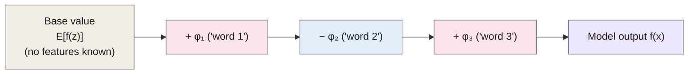

> **Source note:** drafted from the arXiv v2 PDF (25 November 2017), the version in Zotero. Page numbers are the arXiv PDF pages, 1–10. The paper appeared at NIPS 2017, but the proceedings PDF wasn't used; cite the proceedings version in the report and check page numbers against it. The supplementary material (proofs, Max SHAP algorithm) wasn't available.

## TL;DR
SHAP (**SH**apley **A**dditive ex**P**lanations) explains a single prediction by giving each input feature a number, $\phi_i$, saying how much it pushed the output up or down from a baseline (pp. 1–2, 5). The authors show six existing methods (**LIME**, DeepLIFT, layer-wise relevance propagation and three Shapley-value methods) all share one form, an **additive** explanation model (pp. 2–3), and prove that **only one** solution of that form satisfies three properties: local accuracy, missingness and consistency. That solution is the **Shapley value** from cooperative game theory (p. 4). They give faster estimators (**Kernel SHAP**, Deep SHAP) and user studies where SHAP matched human explanations better than LIME or DeepLIFT (pp. 5–9). For this project it's the attribution method in the preliminary study behind UI-02 and EVAL-04.

**Analogy:** splitting a restaurant bill fairly among friends who ordered shared dishes. Shapley's rule: for every possible order in which people could have joined the table, see how much each person's arrival added to the bill, then average. Everyone pays their average marginal contribution, and the shares add up exactly to the total.

The idea of Figure 1 (p. 5): attributions take you from the base value to the actual output. Word labels are illustrative, not from the paper.

## 1. What is the aim of the paper?
Accurate modern models (ensembles, deep networks) are hard to interpret, and many explanation methods have been proposed, but "it is often unclear how these methods are related and when one method is preferable over another" (abstract, p. 1). The aim: a unified framework that shows how methods relate, which properties a good attribution should have, and better ways to compute it (pp. 1–2).

## 2. How did the authors carry out the research?
**Explanation model (p. 2).** Treat an explanation as a simpler model $g$ of the original model $f$ near one input, over *simplified* binary inputs $z' \in \{0,1\}^M$ (feature present or absent). **Additive feature attribution** methods use

$$g(z') = \phi_0 + \sum_{i=1}^{M} \phi_i z'_i$$

They show LIME, DeepLIFT, layer-wise relevance propagation, Shapley regression values, Shapley sampling values and Quantitative Input Influence all fit this form (pp. 2–3).

**Three properties (p. 4).**
1. *Local accuracy:* the attributions add up to the model's output: $f(x) = \phi_0 + \sum_i \phi_i x'_i$.
2. *Missingness:* a feature absent from the input gets zero attribution.
3. *Consistency:* if a model changes so a feature's contribution increases or stays the same, its attribution shouldn't decrease.

**Theorem 1 (p. 4).** Only one additive explanation satisfies all three:

$$\phi_i(f, x) = \sum_{z' \subseteq x'} \frac{|z'|!\,(M - |z'| - 1)!}{M!}\,\big[f_x(z') - f_x(z' \setminus i)\big]$$

the Shapley value. So methods not based on Shapley values "violate local accuracy and/or consistency" (p. 4).

**SHAP values (pp. 4–5).** Shapley values of the conditional expectation $f_x(z') = E[f(z) \mid z_S]$. Exact computation is hard; approximations often assume **feature independence** and/or **model linearity** (Equations 11–12, p. 5).

**Estimators (pp. 5–7).**
- *Kernel SHAP:* LIME's weighted linear regression with a specific "Shapley kernel" weighting instead of LIME's heuristic one, which recovers Shapley values (Theorem 2, p. 6). Model-agnostic.
- *Linear SHAP, Low-order SHAP, Max SHAP* (p. 6–7).
- *Deep SHAP:* DeepLIFT-style back-propagation using Shapley values for each component (p. 7).

**Experiments (pp. 8–9).** Sample efficiency vs LIME and Shapley sampling on decision trees; Mechanical Turk user studies on two simple models (a sickness score, and a "max" profit-sharing story); MNIST digit explanations.

## 3. What are the primary results?
- **Efficiency (p. 8, Figure 3):** Kernel SHAP reaches accurate estimates with fewer model evaluations than Shapley sampling; LIME's values "can differ significantly from SHAP values".
- **Human intuition (p. 8, Figure 4 p. 9):** "much stronger agreement between human explanations and SHAP than with other methods" (most common answer among 30 and 52 participants).
- **MNIST (p. 9, Figure 5):** masking the 20% of pixels each method says matter most, to turn an 8 into a 3, changed log-odds most for SHAP and the Shapley-adjusted DeepLIFT.
- **Software:** released as the `shap` package (footnote 1, p. 1).

## 4. What do the authors think the results mean?
- There is "a unique solution in this class that adheres to desirable properties"; this "thread of unity ... is an encouraging sign that common principles about model interpretation can inform the development of future methods" (p. 9).
- Next steps: faster model-specific estimators "that make fewer assumptions", interaction effects (p. 9).

## 5. What do I think it means?
*Claude's draft. Rewrite this in your own words when you verify.*

- **Your preliminary finding fits the paper's own caveats.** UI-02/EVAL-04 report that SHAP ranked identity-word effects well (Spearman ≥ 0.92 with counterfactual swaps) but **overstated their size**. The guarantees here are about *properties* (local accuracy, consistency), not about matching a counterfactual effect. And practical estimators assume **feature independence** (p. 5), which words in a sentence violate. *Possible explanation, Claude's inference, not from the paper:* removing a word to a background/mask value isn't the same as swapping it for another group's word, so magnitudes can differ from your swap test. Say this in EVAL-04.
- **Local accuracy is useful for the report:** attributions sum to the score's distance from the base value (p. 4), so UI-02 can say "these words account for most of this score". But since sizes were overstated, the decision to **highlight spans, not show numbers** is sensible.
- **Kernel SHAP is LIME with a principled kernel** (pp. 5–6). That explains why SHAP and LIME rankings agree reasonably but their *agreement* is no use as a correctness check (your AUC 0.46): they share the same additive form and similar perturbations, so they can be wrong together. Cite p. 6 for this.
- **Cost:** Kernel SHAP needs many model evaluations per explanation (p. 8). For CI-03's performance budget, explanations should be computed only for flagged passages, not every passage.
- **Their human-intuition study is tiny and on toy models** (p. 9), so don't cite it as evidence SHAP explanations help non-technical reviewers; that's VAL-03's job.

Suggested metadata, one line each:
- `usability`, `metrics`: explanations for flagged items; faithfulness checks.
- `background`, `related-work`, `methodology`, `evaluation`: XAI background; UI-02 design; EVAL-04 tests.
- `UI-02`, `EVAL-04`: as above.

## Key numbers
- Unifies six existing methods (p. 1).
- Three properties: local accuracy, missingness, consistency (p. 4).
- User studies: 30 and 52 participants (Figure 4, p. 9).
- MNIST: 20% of pixels masked; 50k samples for SHAP and LIME (p. 9).

Quote (p. 4): "methods not based on Shapley values violate local accuracy and/or consistency".

## Concerns
- **Theory assumes feature independence in practice** (p. 5); text features are not independent.
- **User studies on toy models** with Mechanical Turk workers (pp. 8–9).
- **No text experiments** in the paper.
- **"Missing" features need a baseline** (background data or mask); the choice changes the values and isn't discussed for text.
- **arXiv version** used; check page numbers against the NIPS proceedings.

## Follow-up
None added: LIME (@ribeiro2016why) is the next reading.
