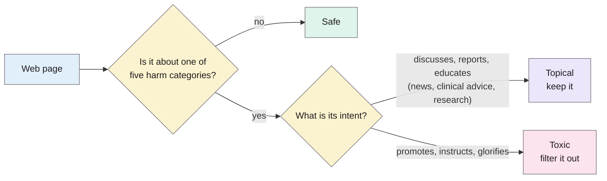
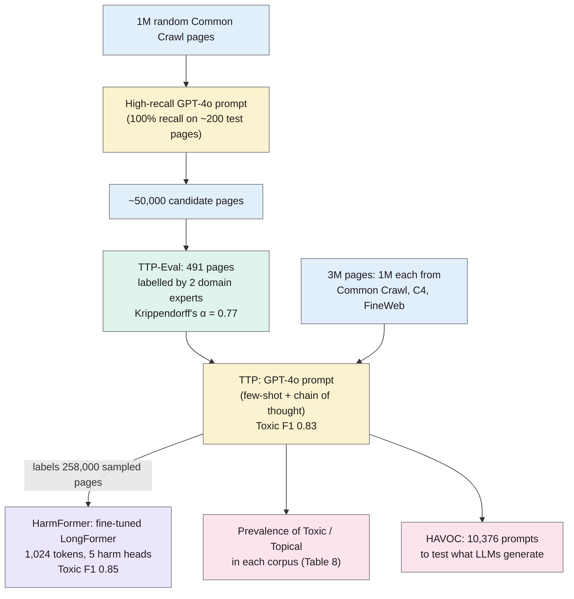
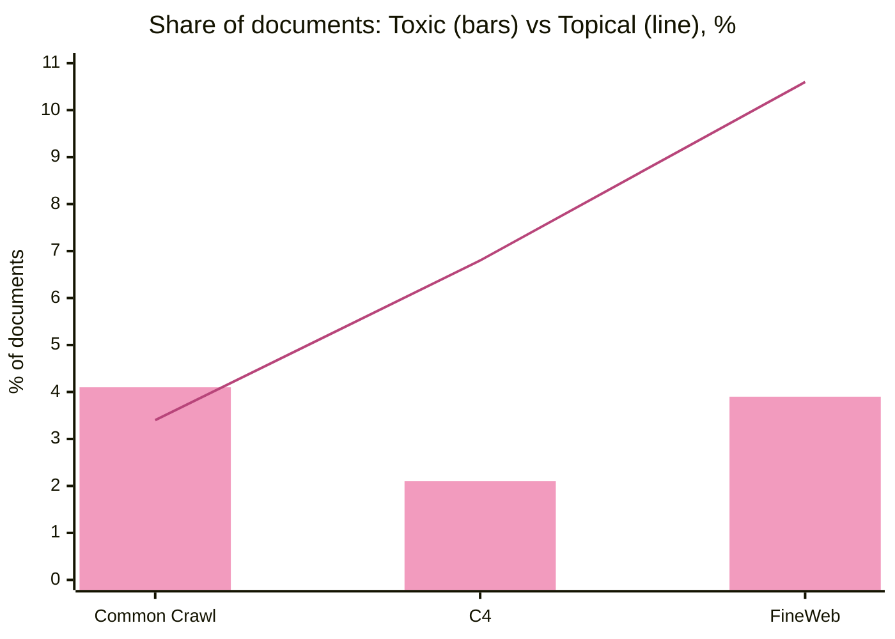

> **Source note:** drafted from the arXiv version (arXiv:2505.02009v3, 12 Aug 2025, 9 pages), which says it was accepted to the IJCAI 2025 main conference. The PDF has no printed page numbers, so the page numbers below are **PDF pages 1–9**. The published IJCAI version (pp. 466–474, according to your earlier source review) will have different page numbers. Check against it before citing.

## TL;DR
Microsoft researchers measured harmful content in three web corpora used for LLM pretraining (Common Crawl, C4 and FineWeb). They built a taxonomy that separates *Toxic* text (harmful intent) from *Topical* text (discussing a harmful subject, e.g. news or medical advice), and trained a long-document classifier, HarmFormer, to filter it (F1 0.85). For this project, it's the closest existing tool: a pretraining-data filter that tries not to throw away useful text. However, it targets toxicity and harm, not representational bias, and it filters whole corpora rather than gating each new source.

**Analogy:** a keyword blocklist is a bouncer who turns away anyone carrying a knife, including the chef. This paper trains a bouncer to ask *why* you're carrying it: "Toxic" is the person planning harm, and "Topical" is the chef, the surgeon and the journalist writing about knife crime.

The three dimensions and five categories are from pp. 2–3 and Table 1 (p. 3).

## 1. What is the aim of the paper?
LLMs are pretrained on web-scale corpora (Common Crawl, C4, FineWeb) that contain hate speech, misinformation, explicit material and biased narratives, which then show up in model outputs (p. 1). Existing moderation tools (keyword blocklists, HateBERT, Perspective API) have three problems, according to the authors (pp. 1–2):

1. They work on sentences, so they handle long web pages badly.
2. They're binary (safe vs toxic), so they can't tell harmful intent from useful discussion. A medical article on suicide prevention gets flagged because it contains "self-harm" (p. 1).
3. They generalise poorly across harm categories such as misinformation and conspiracy theories.

The aim is to measure harmful content in these corpora, and to build tools that filter harmful *intent* while keeping topical discussion (pp. 1–2).

## 2. How did the authors carry out the research?

Numbers from pp. 3–4 and 6.

- **Taxonomy (p. 3, Table 1):** five harm categories (Hate & Violence, Ideological Harm, Sexual Content, Illegal Activities, Self-Inflicted Harm), each split into a Topical and a Toxic dimension, with Safe for everything else.
- **TTP-Eval (p. 3):** the evaluation set. 1 million random Common Crawl pages were filtered by a high-recall GPT-4o prompt to about 50,000 candidates. 491 pages were sampled from those and labelled independently by two in-house experts, each with over five years' experience, then reconciled. Agreement was Krippendorff's α = 0.77.
- **TTP (pp. 3–4):** a GPT-4o prompt using few-shot examples and chain-of-thought, refined on the evaluation set.
- **HarmFormer (p. 4):** TTP labelled 3 million pages (1 million each from Common Crawl, C4 and FineWeb). 258,000 were sampled with balanced classes, split 90:5:5, and used to fine-tune several transformers. The best was LongFormer with 1,024-token context and five classification heads, one per harm category, each choosing Safe, Topical or Toxic. It was trained with batch size 16, learning rate 2e-5, AdamW and 3 epochs.
- **Comparisons:**
  - Perspective API, with text chunked into 500-character pieces and the maximum score taken at a 0.4 threshold (p. 4)
  - other LLMs given the same prompt: R1-Llama 32B, Gemini 2 Flash and Gemma 2 27B (p. 4)
  - Llama Guard 3, on OpenAI's moderation test set of 1,158 non-toxic and 522 toxic texts (p. 5)
- **HAVOC (p. 6):** 10,376 web snippets, each split into a prefix and suffix, given to six base models: Gemma 2 2B, 9B and 27B, Llama 3.2 1B and 3B, and Mistral 7B. Each model generated 200 tokens with greedy decoding, and TTP labelled the results.

### The maths
The paper reports precision, recall and F1 throughout but doesn't write them out. *Standard definitions, not from the paper:*

$$P=\frac{TP}{TP+FP}\qquad R=\frac{TP}{TP+FN}\qquad F_1=\frac{2PR}{P+R}$$

**Analogy:** precision asks "of the pages we threw out, how many deserved it?" and recall asks "of the pages that deserved it, how many did we catch?" A filter with high recall and low precision throws out the chef with the knife-wielder.

**HAVOC's leak types (p. 6),** where $\ell(\cdot)$ is TTP's label:

$$\text{Provocative leak: } \ell(\text{prefix})=\text{Toxic} \;\wedge\; \ell(\text{prefix}+\text{generation})=\text{Toxic}$$

$$\text{Passive leak: } \ell(\text{prefix})=\text{Topical} \;\wedge\; \ell(\text{generation})=\text{Toxic}$$

$$\text{Neutral leak: } \ell(\text{prefix})=\text{Safe} \;\wedge\; \ell(\text{prefix}+\text{generation})=\text{Toxic}$$

The paper words these in prose. These are my formal versions of the definitions on p. 6.

## 3. What are the primary results?

**How much harmful content is in the corpora (p. 7, Table 8):**

Values from Table 8 (p. 7). The text on p. 5 gives slightly different decimals (2.11%, 3.44%, 6.81%, 10.63%).

- Toxic content is 2.1–4.1% of documents, and Topical content 3.4–10.6% (pp. 3, 7). Common Crawl is the most toxic (4.1%), driven by sexual content (2.2%) (p. 5).
- C4 and FineWeb have less toxic content because their quality filters remove pages with hate and sexual keywords. The paper says the remaining toxic share is still notable, giving figures of 0.45% and 0.29% without saying exactly which measure they are (p. 5). Their filters also skew what's left: proportionally more news, health and law, and fewer shopping sites (pp. 5–6, Fig. 2).
- **Classifier quality on the Toxic dimension:** TTP precision 0.87, recall 0.79, F1 0.83 (p. 4, Table 3). Perspective API: 0.80, 0.51 and 0.63 (p. 4, Table 4). HarmFormer (LongFormer, 1,024 tokens): 0.88, 0.81 and 0.85 (p. 4, Tables 5–6).
- **Per category, HarmFormer is uneven (p. 4, Table 6):** F1 ranges from 0.91 for Sexual down to 0.51 for Hate & Violence. The authors put the Hate & Violence errors down mostly to "reporting" pages, which describe hate without endorsing it (pp. 3–4).
- **On OpenAI's moderation set (p. 5, Table 7):** TTP F1 0.80, HarmFormer 0.73, Llama Guard 0.66–0.70, Perspective 0.66. Perspective still has the highest precision (0.82, against HarmFormer's 0.64).
- **HAVOC:** 26.7% of generations across the six models were harmful (p. 2). Given a toxic prefix, models "leaked" toxic text 76% of the time (p. 6; Table 10, p. 7).

**Real-world examples from the paper:**
- A Qwen2 model asked about self-harm methods gave dangerous, actionable answers despite safety fine-tuning (p. 1, Fig. 1).
- A medical article about suicide prevention would be flagged as toxic by keyword filters (p. 1). This is exactly the false positive a medical case study must avoid.
- Self-Inflicted harm content in the corpora is 91% extreme dieting and suicidal ideation (p. 5).

## 4. What do the authors think the results mean?
- Current curation practice doesn't separate harmful intent from socially important discussion. Keyword-based filtering removes valuable context, and the gaps it leaves risk spreading bias and toxicity into LLM training (p. 5).
- Intent-aware, long-document filtering such as HarmFormer gives a more nuanced way to remove harm while keeping topical material (pp. 5–6).
- They describe their tools as clearly better than existing ones across long and short texts (p. 5).
- **Future work:** train a model on the filtered data and measure how dataset purity affects behaviour, compared with a model trained on unfiltered data (p. 7). They also want multilingual coverage and culture-specific harms.
- **A caution from their related work (p. 2):** removing too much can make model outputs more toxic, not less, citing Longpre et al. (2024).

## 5. What do I think it means?
*Claude's draft. Rewrite this in your own words when you verify.*

- **The closest comparison for the whole project.** This is a learned pretraining-data filter with a taxonomy, an expert-labelled evaluation set, a prompt-based LLM labeller and a small fine-tuned model. Your tool has the same shape. The differences are your gap: it targets **toxicity and harm**, not **representational bias**, and it filters a corpus in bulk rather than acting as a per-source gate in CI for a small team. Related work should say this directly.
- **Topical vs Toxic is a ready-made answer to the DET-01 worry.** Caliskan et al. warn that removing accurate associations removes information. This paper puts the same idea into practice: discussion of a harmful subject is kept, and only harmful intent is filtered. A bias detector needs the equivalent, e.g. *describing* a health disparity versus *stereotyping* a group. The medical suicide-prevention example (p. 1) maps straight onto the medical case study.
- **Architecture and backend choices (DET-02, DET-04, ARCH-04):**
  - **API plus small model:** their pipeline is a GPT-4o prompt to label data, then a small fine-tuned model to run at scale. That's the same "commercial API backend plus local model" pair as your objective 2, and evidence that the pattern works.
  - **Long documents:** LongFormer at 1,024 tokens beat 512-token models by about 2 F1 points (p. 4). That's relevant if you score per document rather than per sentence.
- **Labelling (DET-06, VAL-02):** two experts, a disagreement discussion, and Krippendorff's α reported. That's a model for the medical labelled sample, at a feasible size (491 pages).
- **Evaluation (MET-05, EVAL-01, EVAL-06):**
  - **Metrics:** per-category precision, recall and F1 are the expected reporting.
  - **Downstream impact:** the paper's future work, training on filtered vs unfiltered data, is EVAL-01. This paper hasn't done it, which is worth saying in your report.
  - **Side effects:** the Longpre et al. (2024) warning that aggressive filtering can backfire is the side effect EVAL-06 should check for.

**Illustrative, not from the paper:** a scraped patient forum post saying "women's heart attack symptoms are often dismissed as anxiety" is *Topical*: it describes a bias, and a model should learn it. A post saying "women with chest pain are usually just being hysterical" is the representational-bias equivalent of *Toxic*. A keyword filter can't tell them apart, because both mention women, chest pain and anxiety. That's the gap your detector has to close.

Suggested metadata, one line each:
- `data-curation`: a large-scale audit of pretraining corpora and a filter for them.
- `detector-model`: TTP (prompt) and HarmFormer (fine-tuned LongFormer) are detector designs to compare against.
- `benchmarks`: TTP-Eval and HAVOC, plus the OpenAI moderation set and RealToxicityPrompts as comparisons.
- `impact-evaluation`: HAVOC measures model outputs, and the future work is the filtered-vs-unfiltered training experiment.
- `background`: evidence that web corpora used for pretraining contain harmful content (2.1–4.1% toxic).
- `related-work`: the closest comparable tool; the gap is bias vs toxicity, and per-source gating vs bulk filtering.
- `methodology`: a model for the labelling, evaluation and API-then-small-model approach.
- `DET-01`: Topical vs Toxic as a model for separating description from stereotype.
- `DET-02`: LongFormer at 1,024 tokens as a candidate base model.
- `DET-04`: a GPT-4o prompt as a labelling backend.
- `DET-06`: an expert labelling procedure with an agreement score.
- `ARCH-04`: document-level scoring of long web pages vs sentence-level tools.
- `MET-05`: per-category precision, recall and F1.
- `VAL-02`: the size and procedure of an expert-labelled evaluation set.
- `EVAL-01`: their stated future work is the downstream experiment.
- `EVAL-06`: the over-filtering warning (Longpre et al. 2024).

## Key numbers
All page numbers are **PDF pages** of arXiv:2505.02009v3.

- Toxic content 2.1–4.1% of web corpora; Topical 3.4–10.6% (p. 3; Table 8, p. 7).
- Common Crawl 4.1% toxic (2.2% sexual); C4 2.1%; FineWeb 3.9% (Table 8, p. 7). Topical: C4 6.8%, FineWeb 10.6%, Common Crawl 3.4% (Table 8, p. 7).
- Sexual content is 78% of Common Crawl's toxic content; Ideological harm is 46% of toxic content across datasets; Self-Inflicted harm is 91% extreme dieting and suicidal ideation; hacking is 33% and smuggling 47% of Illegal (p. 5).
- TTP-Eval: 491 pages, two experts, Krippendorff's α = 0.77 (p. 3).
- High-recall prompt: 100% recall on about 200 pages; it cut 1 million pages to about 50,000 candidates (p. 3).
- TTP, Toxic dimension: P 0.87, R 0.79, F1 0.83 (Table 3, p. 4).
- Perspective API on TTP-Eval: P 0.80, R 0.51, F1 0.63. R1-Llama 32B with the same prompt: F1 0.06 (Table 4, p. 4).
- HarmFormer (LongFormer, fine-tuned, 1,024 tokens): P 0.88, R 0.81, F1 0.85. Hate-BERT before fine-tuning: F1 0.39 (Table 5, p. 4).
- HarmFormer F1 by category: Sexual 0.91, Self-Inflicted 0.88, Illegal 0.76, Ideological 0.61, Hate & Violence 0.51 (Table 6, p. 4).
- Training data: 3 million pages labelled by TTP, 258,000 sampled, split 90:5:5 (p. 4).
- OpenAI moderation set (1,158 non-toxic, 522 toxic): TTP F1 0.80, HarmFormer 0.73, Perspective 0.66 (Table 7, p. 5).
- HAVOC: 10,376 prefixes; 26.7% overall harmful generation; provocative leak 76.23%, passive 12.31%, neutral 9.64% (p. 2; Table 10, p. 7).

Quote (p. 7): "evaluate the impact of dataset purity on model behavior and performance"

## Concerns
- **arXiv version, not the IJCAI published version.** The page numbers are PDF pages, and wording or numbers may differ in the proceedings.
- **Harm, not representational bias.** The taxonomy covers toxicity, extremism, sexual content, illegal activity and self-harm. Bias only comes up in passing, as part of Ideological harm and of Topical discussion (pp. 1, 5). Don't cite this as a bias detector.
- **GPT-4o's labels are the ground truth for most of the pipeline.** HarmFormer is trained on TTP's labels, and HAVOC's leaks are judged by TTP too. Only the 491-page TTP-Eval set is human-labelled. So HarmFormer learns GPT-4o's judgements, and HAVOC's leak rates use the same judge.
- **The superiority claim is too strong (p. 5).** On OpenAI's set, HarmFormer's precision (0.64) is well below Perspective API's (0.82). It wins on F1 through higher recall, which, for a filter, means throwing out more good text.
- **The data split doesn't add up.** 258,000 samples split 90:5:5 is described as 253,000 training plus 14,000 development plus 14,000 test samples (p. 4). That's 281,000.
- **Small evaluation set, uneven categories.** TTP-Eval is 491 pages. Hate & Violence F1 is only 0.51 (Table 6), the category closest to bias against groups.
- **English only;** culture-specific harms aren't covered (p. 7).
- **Release not confirmed.** The authors say TTP and HAVOC are shared on GitHub (footnote 3, p. 1), but no URL is given in this version. Check the IJCAI version or search for the repository.
- **Industry authors** (Microsoft), and no downstream training experiment yet (p. 7).

## Follow-up
From the reference list (pp. 8–9):
- Longpre, S. et al. (2024) "A pretrainer's guide to training data: Measuring the effects of data age, domain coverage, quality, & toxicity", NAACL 2024, pp. 3245–3276. **High priority:** a study of how filtering pretraining data affects models, the closest precedent for EVAL-01 found so far.
- Gehman, S., Gururangan, S., Sap, M., Choi, Y. and Smith, N. A. (2020) "RealToxicityPrompts: Evaluating neural toxic degeneration in language models", Findings of EMNLP 2020, pp. 3356–3369. An output-side benchmark for EVAL-02.
- Luccioni, A. and Viviano, J. (2021) "What's in the box? an analysis of undesirable content in the Common Crawl corpus", ACL-IJCNLP 2021 (Volume 2: Short Papers), pp. 182–189. Background on what's in web corpora.
- Parmar, J. et al. (2024) "Data, data everywhere: A guide for pretraining dataset construction", EMNLP 2024, pp. 10671–10695. Where filtering sits in real pipelines.
- Jansen, T. et al. (2022) "Perplexed by quality: A perplexity-based method for adult and harmful content detection in multilingual heterogeneous web data". An alternative filtering approach.
- Dodge, J. et al. (2021), already in the follow-up list.
