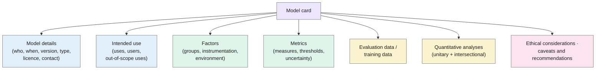

> **Source note:** drafted from the ACM PDF. Page numbers are the printed proceedings pages, 220–229. The charts inside the two example cards (Figures 2–3) weren't transcribed.

## TL;DR
Trained models are released with almost no information about where they work and where they fail (p. 220). The authors propose **model cards**: short (one to two page) documents shipped with a model that state what it is, what it's for and not for, and how well it performs **broken down by groups and conditions**, including intersections (pp. 220–221). The card has nine sections (Figure 1, p. 222): model details, intended use, factors, metrics, evaluation data, training data, quantitative analyses, ethical considerations, caveats and recommendations. Two worked examples: a smile detector and **Perspective API's toxicity classifier**, whose v1 performed poorly for "lesbian", "gay" and "homosexual" (pp. 225–227). For this project it's the template for the model card each DET-03 checkpoint ships with.

**Analogy:** the leaflet in a medicine box. Not just "it works", but who it's for, who shouldn't take it, the side effects, and the trial results for different groups of patients, because drugs once tested only on men led to women being overdosed (p. 221).

Sections from Figure 1 (p. 222).

## 1. What is the aim of the paper?
"Currently, there are no standardized documentation procedures to communicate the performance characteristics of trained machine learning ... models" (p. 220). Systematic biases in face detection, criminal justice and toxicity detection were only exposed after deployment, by affected users (p. 220). Model cards complement Datasheets for Datasets (@gebru2021datasheets): datasheets describe the data, model cards the trained model (pp. 220–221). The aim is to "standardize ethical practice and reporting" so stakeholders can compare models on fairness as well as accuracy (p. 221).

## 2. How did the authors carry out the research?
A proposal paper: it defines the sections with prompts for each (pp. 222–225), motivates them with stakeholders (practitioners, developers, policymakers, organisations, impacted individuals; pp. 221–222), and demonstrates two cards (pp. 225–227).

**Key section guidance.**
- *Intended use (p. 223):* primary uses, primary users, and **out-of-scope uses**, "inspired by warning labels on food and toys" (e.g. "not for use on text examples shorter than 100 tokens").
- *Factors (pp. 223–224):* groups (including intersectional), instrumentation, environment; say which factors are *relevant* and which were actually *evaluated*, and why they differ.
- *Metrics (p. 224):* which measures and why; **decision thresholds and why chosen**, ideally with "a threshold slider" in digital cards; how uncertainty is estimated (e.g. average of 5 runs, cross-validation). For classifiers: FPR, FNR, false discovery and false omission rates, noting which were prioritised. Equal FNR across groups = equality of opportunity; equal FNR and FPR = equalised odds (citing Hardt et al., @hardt2016equality).
- *Confidence (p. 224):* disaggregated metrics need confidence intervals.
- *Evaluation data (p. 224):* public where possible; include **challenging cases**, not only typical ones; **synthetic data** can cover groups that real data misses.
- *Training data (p. 225):* if it can't be shared, at least give distributions over groups.
- *Ethical considerations (p. 225):* sensitive data, effects on human life, mitigations, risks and harms, fraught use cases.
- *Groups (p. 222):* use self-identified labels, or label them clearly as *perceived*.

## 3. What are the primary results?
**Smile detector (CelebA; p. 225, Figure 2 p. 226).** Much higher false discovery rate for older men; men overall have higher false negative rate. Card notes: not suitable for emotion detection; gender labels binary; no skin-type data; 95% bootstrap confidence intervals; all metrics at 0.5 threshold.

**Perspective TOXICITY (p. 225, Figure 3 p. 227).**
- Intended use: supporting human moderation and feedback to authors; "**Not intended for fully automated moderation**"; not for judging specific individuals.
- Factors: identity terms for frequently attacked groups (sexual orientation, gender identity, race).
- Metric: pinned AUC (Dixon et al. 2018) per identity group.
- Evaluation data: synthetic Identity Phrase Templates, chosen because real data has disproportionate toxicity aimed at specific groups.
- Results: **v1 performed poorly for "lesbian", "gay" and "homosexual"**; v5 improved after bias mitigation. This shows "the drastic ways that models can change over time" and why a card should be updated with each release (p. 225).

## 4. What do the authors think the results mean?
- Model cards "provide a way to inform users about what machine learning systems can and cannot do, the types of errors they make" (p. 221).
- Cards should accompany a model "after careful review has determined that the foreseeable benefits outweigh the foreseeable risks" (p. 228).
- Limits (p. 228): a card is only as honest as its author; it's "unlikely ... that model cards could be standardized or formalized to a degree needed to prevent misleading representations", so they're "one transparency tool among many", alongside third-party audits, adversarial testing and user feedback.

## 5. What do I think it means?
*Claude's draft. Rewrite this in your own words when you verify.*

- **DET-03's model card can follow Figure 1 directly.** Map your content to their sections:
  - *Factors:* the Equal Status grounds (relevant) vs the grounds you could actually test (evaluated), with the reason for any gap (p. 224). E.g. family status may be relevant but thinly covered in the gap set.
  - *Metrics:* PR-AUC, FPR on neutral mentions, calibration error (MET-05), with confidence intervals (p. 224).
  - *Decision thresholds:* state the default thresholds and why (MET-04). Their "threshold slider" idea (p. 224) fits UI-01's report.
  - *Evaluation data:* the gap set is exactly their "challenging cases" plus "synthetic data" recommendation (p. 224).
  - *Training data:* share of generated (ToxiGen) examples, as DET-03 already says.
  - *Out-of-scope uses:* not for judging individual authors; not for automated removal without review; English and Irish context only.
- **The Perspective card's intended use matches yours:** "supporting human moderation", "not intended for fully automated moderation" (Figure 3, p. 227). That's the same position as CI-02 and DET-05 (human review). Cite it.
- **Version the card:** Perspective v1 vs v5 (p. 225) is the argument for one card per checkpoint, which DET-03 already plans.
- **Name the limitation:** you write your own card, which they warn can mislead (p. 228). Mitigation: the gap set and code are public, so results can be checked.

Suggested metadata, one line each:
- `governance`, `metrics`, `ethics`: model documentation; disaggregated metrics; intended use.
- `methodology`, `deliverable`, `evaluation`: model card as a deliverable; per-ground evaluation.
- `DET-03`, `MET-04`, `MET-05`, `UI-01`: as above.

## Key numbers
- Model cards: one to two pages (p. 220); nine sections (Figure 1, p. 222).
- FDA required clinical trial results disaggregated by age, race and gender from 1998 (p. 221).
- Smile card: all error rates between 0.04 and 0.14 at the 0.5 threshold; 95% bootstrap CIs (Figure 2, p. 226).

Quote (Figure 3, p. 227): "Not intended for fully automated moderation."

## Concerns
- **Proposal, not evaluation:** no study of whether cards change decisions (future work, p. 228).
- **Self-reported:** relies on the integrity of the author (p. 228).
- **Toxicity example uses US identity terms** and synthetic templates only, as its own caveat says (p. 227).
- **Google authors documenting a Google/Jigsaw product.**

## Follow-up
None added: Dixon et al. (2018) is already in the follow-up list.
