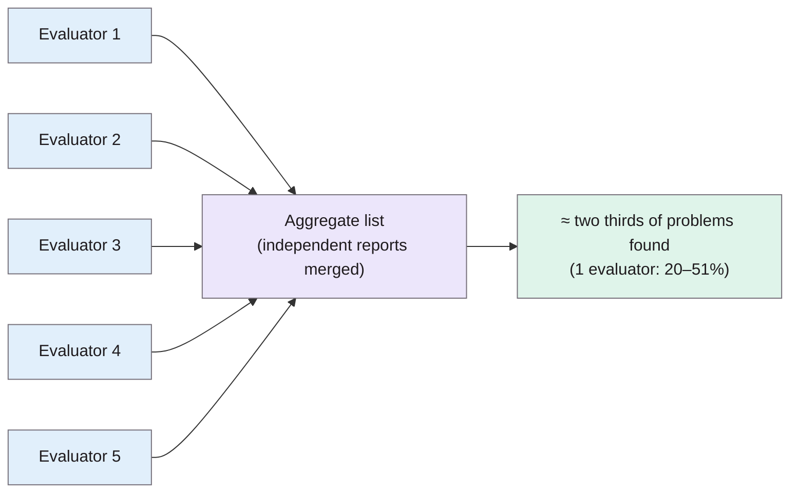

> **Source note:** drafted from the ACM PDF, a 1990 scan with OCR errors. Page numbers are the printed proceedings pages, 249–256. Tables 2–4 (per-experiment and per-aggregate numbers) didn't survive extraction, so only figures stated in the running text are used; check those tables in the PDF.

## TL;DR
Heuristic evaluation means people look at an interface and judge it against a short list of usability principles; the authors use **nine heuristics** (p. 249). In **four experiments** with students and industry professionals, a **single evaluator found only 20–51% of known problems** on average (abstract, p. 249; p. 252). But different evaluators find **different** problems, even poor evaluators sometimes find hard ones (p. 254), so **pooling 3–5 independent evaluators** finds far more: about two thirds with five, with diminishing returns around ten (p. 255). For this project it's the reason ETH-01 lists "one evaluator finds only part of the problems" as a threat to validity for VAL-03.

**Analogy:** proofreading. One proofreader misses half the typos, and not always the hard ones. Three or four independent proofreaders catch most of them, because each misses *different* typos. Let them proofread together and they start missing the same ones.

Numbers from pp. 249 and 255.

## 1. What is the aim of the paper?
There are four ways to evaluate an interface: formal analysis, automatic checks, empirical tests with users, and heuristic judgement (p. 249). In practice most evaluations are heuristic, because teams lack time or expertise for user tests (only 6% of Danish software companies used thinking aloud, p. 249), yet "almost nothing is known about this kind of evaluation" (p. 249). The aim: test how well heuristic evaluation works in practice.

## 2. How did the authors carry out the research?
**Nine heuristics (Table 1, p. 249):** simple and natural dialogue; speak the user's language; minimise user memory load; be consistent; provide feedback; provide clearly marked exits; provide shortcuts; good error messages; prevent errors.

**Four experiments (pp. 250–251).** Evaluators wrote reports listing usability problems; reports were scored against the authors' list of known problems (which grew when evaluators found problems the authors had missed).

| Experiment | Interface | Evaluators | Known problems |
|---|---|---|---|
| 1. Teledata | Danish videotex system, 10 screen dumps | 37 CS students (had the heuristics lecture) | 52 |
| 2. Mantel | One-page specification of a phone lookup system | 77 readers of *Computerworld*, mostly industry professionals, no lecture | 30 |
| 3. Savings | Live voice-response banking line | 34 CS students | 48 |
| 4. Transport | Live voice-response bus information line | the same 34 students | 34 |

**Aggregation (pp. 254–255).** Monte Carlo: random groups of 1 to 30 evaluators, 5,000–9,000 random aggregates per size, counting the union of problems found.

## 3. What are the primary results?
- **Individuals do poorly (p. 252):** average share of problems found was 51%, 38%, 26% and 20% in the four experiments; "even in the best case only half of the problems were found".
- **Consistency across tasks is weak (p. 251):** the same students' performance on Savings vs Transport correlated with $R^2 = 0.33$ (p < 0.01).
- **Not a simple ladder of difficulty (p. 254):** poor evaluators sometimes found hard problems and good evaluators missed easy ones (Figure 3).
- **Voice interfaces were hardest (p. 253):** messages disappear as soon as they're spoken, so there's nothing to study at leisure.
- **Few false positives (p. 253):** a false positive was usually raised by only one evaluator.
- **Aggregates work (p. 255):** the curve rises steeply from one to about five evaluators, flattens from five to ten, with diminishing returns around ten. Five evaluators should find "about two thirds"; even for the hardest interface, five found over half.
- **Independence matters (p. 255):** evaluators should work independently and only then compare, since working together "might tend to bias each other".

## 4. What do the authors think the results mean?
- "Heuristic evaluation is difficult and ... one should not rely on the results of having a single person look at an interface" (p. 255).
- Recommendation: **three to five evaluators**, with any extra resources spent on other methods (p. 255); don't rely on heuristic evaluation alone, supplement with thinking aloud (p. 254).
- Advantages: cheap, intuitive, no advance planning, usable early (p. 255). Disadvantages: doesn't suggest fixes, is "biased by the current mindset of the evaluators" and rarely produces breakthroughs (p. 255).
- Limits: only small interfaces tested; usability experts were not tested but are probably better than the average evaluator (pp. 251, 254).

## 5. What do I think it means?
*Claude's draft. Rewrite this in your own words when you verify.*

- **ETH-01 cites this correctly:** one evaluator finds only part of the problems (20–51%, p. 249). That's the threat to validity for VAL-03 if you evaluate your own UI alone. Stronger still: you're the designer, so you have the "current mindset" bias they mention (p. 255).
- **Practical mitigation for VAL-03:** recruit two or three classmates to do *independent* heuristic evaluations (p. 255), against the ARCH-01 persona tasks, then merge. Even three gets most of the benefit of the steep part of the curve. If that's not possible, say so and supplement with a cognitive walkthrough or a short think-aloud session (p. 254).
- **Which heuristics:** the paper's nine are the original 1990 list. Nielsen later revised them into the better-known ten heuristics, but that's a different source, so if you use the ten, cite that one (NOT FOUND IN SOURCE here).
- **Report format (UI-01):** "speak the user's language" and "good error messages" map straight onto the non-technical staff persona and the confidence wording in MET-02.
- **Don't over-claim:** the paper measured problems *found*, not whether they were real problems for users (validity discussed on pp. 251–252). Same caveat for your evaluation.

Suggested metadata, one line each:
- `usability`: heuristic evaluation method and its limits.
- `methodology`, `evaluation`: VAL-03 design; threats to validity.
- `VAL-03`, `ETH-01`, `ARCH-01`: as above.

## Key numbers
- Nine heuristics (Table 1, p. 249).
- Individual evaluators found 20–51% of problems on average (p. 249); 51%, 38%, 26%, 20% across the four experiments (p. 252).
- Evaluators: 37, 77, 34, 34; known problems: 52, 30, 48, 34 (pp. 250–251).
- Consistency between two interfaces: $R^2 = 0.33$ (p. 251).
- Five evaluators ≈ two thirds of problems; diminishing returns around ten; recommend three to five (p. 255).

Quote (p. 255): "one should not rely on the results of having a single person look at an interface."

## Concerns
- **1990 interfaces** (videotex, voice response lines), very different from a web report.
- **Mostly students,** not usability experts; experts may do better (p. 251).
- **"Known problems" lists** were made by the authors and grew during the study.
- **OCR'd scan:** some numbers in the extracted text were garbled (e.g. the 51% appears as "$l%"); check against the PDF.

## Follow-up
None added.
