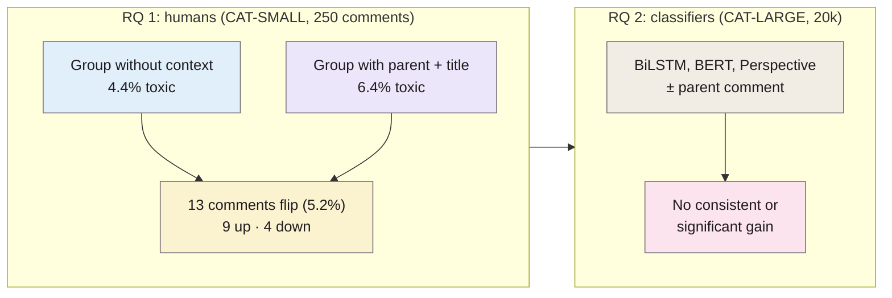

> **Source note:** drafted from the ACL Anthology PDF. Page numbers are the printed proceedings pages, 4296–4305. The hyperparameter appendix (B) wasn't summarised.
>
> **Content warning:** the paper's example comments (Tables 1–2) include slurs and insults; none are reproduced here.

## TL;DR
Two questions about Wikipedia Talk Page comments (p. 4296): **(1) does seeing the previous ("parent") comment change how humans label toxicity?** Yes, but only for a small slice: on 250 comments labelled by two separate crowd groups, **13 (5.2%) flipped label** when context was shown, 9 becoming toxic (3.6%) and 4 becoming non-toxic (1.6%) (p. 4300). **(2) does giving a classifier the parent comment make it better?** No: across BiLSTM, BERT and Perspective variants made context-aware in several ways, **no consistent or significant improvement** (pp. 4302–4303). The authors blame the rarity of context-sensitive comments, not the idea of context itself. For this project it's the evidence behind ARCH-04's "context matters, but test it" stance.

**Analogy:** overhearing "yeah, you would say that" in a café. Usually you don't need the earlier sentence to know whether it's rude, but once in twenty times you do. A model trained on mostly the easy nineteen never learns what to do with the twentieth.

Numbers from pp. 4299–4300.

## 1. What is the aim of the paper?
Most toxicity datasets show annotators a comment on its own, so models trained on them ignore conversational context (p. 4296). "Even basic statistics on how often context affects the perceived toxicity of online posts have not been published" (p. 4296). The two research questions (pp. 4296–4297):
- **RQ 1:** how often does context change perceived toxicity, and how often does it amplify or mitigate it?
- **RQ 2:** does making classifiers context-aware improve them, and how can it be done?

Toxicity is defined as "a rude, disrespectful, or unreasonable comment that is likely to make you leave a discussion" (footnote 1, p. 4296, quoting Wulczyn et al. 2017).

## 2. How did the authors carry out the research?
**Context** is limited to the parent comment and the discussion title; including more preceding comments made workers ignore the context altogether (p. 4299). Context-aware annotators were also asked "Was the parent comment less, more, or equally toxic?" to make them read it (p. 4299; Appendix A, p. 4305).

**CAT-SMALL (RQ 1, p. 4299).** 250 random Wikipedia Talk comments, 10–400 characters, thread depth 2–5. Two **mutually exclusive** crowd groups on Figure Eight: GN (no context, 23 workers) and GC (parent + title, 19 workers) (p. 4300); three judgements per comment per group. Scores averaged and rounded to toxic / non-toxic.

**CAT-LARGE (RQ 2, p. 4300).** 20k different random comments: 10k labelled without context (CAT-LARGE-N), 10k with (CAT-LARGE-C), three workers each; groups not mutually exclusive (286 and 196 workers), so it was much faster. Krippendorff's α: 0.72 (N) and 0.70 (C) (p. 4300; printed as "0.72%" in the text, given as 72% and 70% in Appendix A, p. 4305).

**Classifiers (pp. 4300–4302).**
- Context-insensitive: BiLSTM; BERT-base (top three layers unfrozen); BERT-CCTK (BERT fine-tuned on 100k Civil Comments first); Perspective API.
- Context-aware: CA-BiLSTM-BiLSTM (second BiLSTM encodes the parent); CA-BiLSTM-BERT (BERT on target, BiLSTM on parent; two BERTs didn't fit on their GPU); CA-SEP-BERT (parent [SEP] target into one BERT); CA-CONC (feed Perspective and BERT-CCTK the concatenated text at test time only).
- To counter class imbalance, the output bias is initialised to the prior log-odds (p. 4301, footnote 9 on p. 4302), which worked better than under-sampling:

$$b = \log\frac{T}{N}$$

where $T$ and $N$ are the numbers of toxic and non-toxic training comments.

**Evaluation (p. 4302).** ROC AUC, 5-fold Monte Carlo cross-validation (60/20/20 stratified splits), always tested on CAT-LARGE-C labels (assumed more reliable). Significance by stratified shuffling, P < 0.01, 10,000 repetitions (footnote 10, citing Dror et al. 2018, @dror2018hitchhikers).

## 3. What are the primary results?
- **RQ 1, CAT-SMALL (pp. 4299–4300):** toxicity ratio 4.4% without context vs 6.4% with (one-sided Wilcoxon–Mann–Whitney, P < .01). Per comment: 9 more toxic with context (3.6%), 4 less toxic (1.6%), **13 changed (5.2%)**.
- **RQ 1, CAT-LARGE (p. 4300):** toxicity ratio 0.6% without context vs 1.5% with (P < .001). Can't count flips here, because the groups labelled different comments.
- **RQ 2 (Table 5, p. 4303):** ROC AUC (%) on context-labelled test data:

| Model | No context | With context |
|---|---|---|
| BiLSTM @N | 56.48 | CA-BiLSTM-BiLSTM @N 56.13 |
| BERT @N | 75.94 | CA-BiLSTM-BERT @N 74.60; CA-SEP-BERT @N 73.29 |
| Perspective | 79.27 | CA-CONC-Perspective 81.89 |
| BERT-CCTK | 78.08 | CA-CONC-BERT-CCTK 81.69 |

  The concatenation gains for Perspective and BERT-CCTK weren't statistically significant (p. 4302). Training on context-aware labels (@C) gave no consistent gain over out-of-context labels (@N) either (p. 4302).
- **Bigger external training data mattered more than context:** Perspective and BERT-CCTK were best (p. 4302).

```mermaid
%%{init: {"themeVariables": {"xyChart": {"plotColorPalette": "#4A7FB0, #B8457A"}}}}%%
xychart-beta
  title "ROC AUC: without vs with parent comment (Table 5, p. 4303)"
  x-axis ["BiLSTM", "BERT (SEP)", "Perspective", "BERT-CCTK"]
  y-axis "ROC AUC (%)" 50 --> 85
  bar [56.48, 75.94, 79.27, 78.08]
  bar [56.13, 73.29, 81.89, 81.69]
```

Blue: without context; pink: with context. Differences are within the standard errors (±1.4 to ±3.9).

## 4. What do the authors think the results mean?
- Context has "a statistically significant effect on toxicity annotation, but this effect is seen in only a narrow slice (5.2%)" (p. 4303).
- The lack of classifier improvement "seems to be related to the fact that context-sensitive comments are infrequent" (p. 4303): too few to learn from, and too few to matter at test time.
- So the field needs **larger datasets annotated in context** (pp. 4296, 4297).
- Limitations they state (p. 4303): context was only the parent comment (models didn't even get the title, footnote 11); comments were randomly sampled, and context may matter more for particular topics, sarcasm, or comments about frequently targeted communities.

## 5. What do I think it means?
*Claude's draft. Rewrite this in your own words when you verify.*

- **ARCH-04 cites this accurately.** "About 5% of posts received the opposite label without context" matches 13/250 = 5.2% (p. 4300). Be precise that it's from a 250-comment sample, and that 3.6% went *up* and 1.6% went *down*.
- **Their limitation is your use case.** They say context may matter more for comments that "reference communities that are frequently the target of online abuse" (p. 4303). That's exactly the gap set and the "mention is not bias" cases (quotes, counter-speech). So ARCH-04's choice to score passages, not isolated sentences, is a reasonable bet; the paper doesn't refute it, it just didn't test those cases. The planned comparison of passage vs sentence scoring on the stance test is the right response.
- **DET-03 and CAD counter-speech:** CAD's counter-speech examples need the parent post to make sense; this paper shows a naive [SEP] concatenation didn't help *on random data*, so report whether context helps specifically on the counter-speech and quote subsets, not just overall.
- **Imbalance trick:** initialising the output bias to $\log(T/N)$ is a cheap, citable technique for DET-03 if harmful passages are rare in training.
- **Annotation:** their extra "was the parent more or less toxic?" question is a neat trick to force context reading; worth considering for your own gap-set labelling instructions.

Suggested metadata, one line each:
- `detector-model`, `data-curation`, `benchmarks`: context in labelling and in classifiers.
- `background`, `methodology`, `evaluation`: why context matters; ARCH-04 design; passage vs sentence comparison.
- `ARCH-04`, `DET-03`: as above.

## Key numbers
- CAT-SMALL: 250 comments; 13 flipped (5.2%), 9 up (3.6%), 4 down (1.6%) (p. 4300).
- Toxicity ratio: 4.4% → 6.4% (CAT-SMALL, P < .01, p. 4299); 0.6% → 1.5% (CAT-LARGE, P < .001, p. 4300).
- CAT-LARGE: 10k + 10k comments; α = 0.72 (N), 0.70 (C) (p. 4300).
- Best ROC AUC: CA-CONC-Perspective 81.89 ± 2.79; Perspective alone 79.27 ± 2.87 (Table 5, p. 4303).

Quote (p. 4296): "we also find no evidence that context actually improves the performance of toxicity classifiers".

## Concerns
- **Very low toxicity rate** (1.5% in CAT-LARGE-C) means few toxic test examples per fold, hence large standard errors; "no significant difference" partly reflects low power.
- **Narrow context:** parent comment only; models never saw the title.
- **Random sampling** under-represents the context-heavy cases (quotes, sarcasm, identity discussions) your project cares about most.
- **Wikipedia Talk Pages only;** English; crowd workers from seven English-speaking countries (Appendix A, p. 4305).
- **Partly funded by Google,** which runs Perspective (p. 4303).

## Follow-up
None added.
