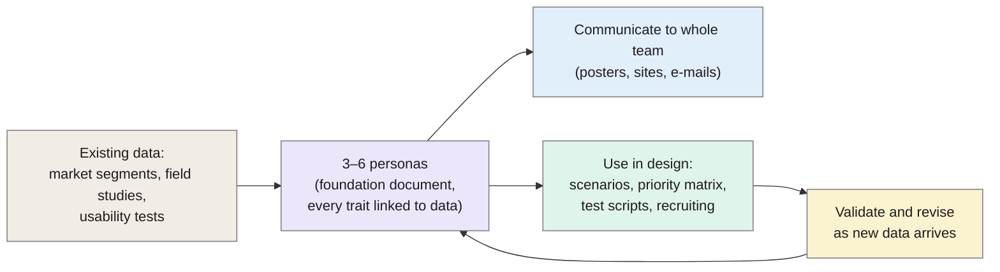

> **Source note:** drafted from the ACM PDF. Page numbers are the paper's own page numbers, 1–15, matching the proceedings range. Figures 2–3 (posters) are deliberately blurred in the original to hide proprietary detail.

## TL;DR
An experience report from Microsoft: how two teams built and used **personas** (fictional but data-based users) for MSN Explorer and Windows (pp. 1–2). They extend Alan Cooper's method by grounding personas in **market and user research**, linking every trait to data in a "foundation document", keeping the set to **3–6 personas**, and using them across the whole team and development cycle (pp. 4–8). They explain **why** personas work using **theory of mind**: people are very good at predicting the behaviour of characters they know, so a familiar persona is "generative" in a way a bare scenario isn't (pp. 11–12). Benefits are reported from experience, **not formally measured** (p. 9). For this project it's the basis for ARCH-01's three personas and VAL-03's persona-based tasks.

**Analogy:** a TV character you've watched for years. Tell a fan "she just got a new job" and they can predict how she'll react without being told. A one-line scenario ("an accountant opens a memo") gives you nothing to extrapolate from.

Process from pp. 4–8.

## 1. What is the aim of the paper?
To describe a practical persona method refined over three years at Microsoft, and to "outline the psychological theory that explains why Personas are more engaging than design based primarily on scenarios" (abstract, p. 1). Personas "provide a conduit for conveying a broad range of qualitative and quantitative data, and focus attention on aspects of design and use that other methods do not" (p. 1).

## 2. How did the authors carry out the research?
A practitioner case study of two projects (pp. 1–2):
- **MSN Explorer** (2000, ~10 months; personas built in ~2 months by one full-time and a few part-time people, using only existing research; four personas).
- **Windows** (from 2001, ongoing; 22-person persona team; six personas; creation and validation in ~3 months).

**Problems with earlier persona-like efforts (p. 3):** characters weren't believable ("designed by committee (not based on data)"); poorly communicated (a CV-style poster); no guidance on how to use them; little management support.

**Their process (pp. 4–8):**
- Start from large market segmentation studies, enrich priority segments with field studies, interviews and focus groups; keep to **3 to 6 personas** (p. 5).
- Mark audiences you *don't* design for with "anti-Personas" (p. 5).
- Affinity sessions to group findings across studies, then write narratives; aim for "every statement in our Personas generated from or related to user data or observation" (p. 5).
- A **foundation document** per persona with copious footnotes linking traits to research (pp. 5–6).
- "Sanity check" site visits with real users who match the persona (p. 6).
- Use: a **feature × persona weighted priority matrix** scoring each feature −1 to +2 per persona (pp. 7–8); persona walk-through scenarios in every spec (p. 8); recruiting usability participants by persona and reporting findings by persona (p. 8).

## 3. What are the primary results?
- **Benefits (pp. 9–10):** strong user focus; the whole team, from executives to developers, discusses the product in persona terms; personas make assumptions about users **explicit** ("Why are we building this feature?"). "Alan cannot use the search tool" is more immediate than "a subset of participants had problems" (p. 10). A tester felt he found "the right kind" of problems when testing as a persona (p. 10).
- **No formal measurement:** "we have not tried to formally measure the impact of our Personas" (p. 9).
- **Risks (p. 11):** choosing the wrong set; reusing personas beyond their purpose; marketing vs development needs; "Persona mania": "Personas are not a panacea. They should augment and enhance", not replace other user-centred methods or evaluation.

## 4. What do the authors think the results mean?
- **Theory of mind (pp. 11–12):** people constantly predict others' behaviour from partial knowledge; well-crafted personas tap this, so they "are generative: Once fully engaged with them, you can almost effortlessly project them into new situations. In contrast, a scenario covers just what it covers" (p. 12).
- Personas complement scenarios, task analysis, contextual design and participatory design rather than replace them (pp. 12–14).
- **Sociopolitical side (p. 14):** each persona has a gender, age, race, family situation and background, which surfaces assumptions: "If one populated a Persona set with middle-aged white males, it would be obvious that this is a mistake." But "Persona use does require decision-making. It isn't a science."

## 5. What do I think it means?
*Claude's draft. Rewrite this in your own words when you verify.*

- **ARCH-01's wording needs softening.** It says personas "make design teams engage with users' needs better than scenarios alone, and surface needs other methods miss". The paper *argues* this from theory of mind and experience but says it hasn't measured impact (p. 9). Suggested: "Pruitt and Grudin (2003) argue that personas engage teams more than scenarios alone and surface needs other methods miss".
- **Your personas should be data-based, or say they aren't.** Their main warning is personas "designed by committee (not based on data)" (p. 3). For a student project, a light version is enough: a short foundation note per persona citing where its traits come from (e.g. the dataset documentation papers, @gebru2021datasheets, or job descriptions of ML data curators). Otherwise list "personas are assumption-based" as a limitation.
- **Three personas is within their 3–6 range** (p. 5). An **anti-persona** would sharpen scope: e.g. "a moderator removing individual users' posts" is who EvenGround is *not* for, which ties to model card out-of-scope uses (@mitchell2019model).
- **VAL-03:** their practice of recruiting test participants by persona and reporting findings by persona (p. 8) is how to structure the heuristic evaluation and walkthrough: one walkthrough per persona task, findings grouped by persona.
- **UI-01:** their feature × persona priority matrix (pp. 7–8) is a quick, citable way to decide which report features to build first.
- **Fits the project's values:** their point that persona demographics make assumptions visible (p. 14) is a nice link to the bias theme. Vary your personas' backgrounds deliberately.

Suggested metadata, one line each:
- `usability`: persona method.
- `methodology`, `project-plan`: ARCH-01 personas; VAL-03 tasks; UI-01 prioritisation.
- `ARCH-01`, `VAL-03`, `UI-01`: as above.

## Key numbers
- 3 to 6 personas recommended (p. 5).
- MSN Explorer: 4 personas, ~2 months to create; Windows: 6 personas, 22-person team, ~3 months (pp. 2, 5).
- Windows persona user panel: 5,000 people (p. 8).
- Priority matrix scores: −1, 0, +1, +2, weighted by market share (p. 7).

Quote (p. 12): "Well-crafted Personas are generative: Once fully engaged with them, you can almost effortlessly project them into new situations. In contrast, a scenario covers just what it covers."

## Concerns
- **Experience report, no controlled evaluation;** benefits are subjective (p. 9).
- **Large-company context** (budgets, 22-person team, promotional posters) far from a solo project.
- **Theory of mind argument is plausible, not tested** here.
- **Authors are persona advocates at Microsoft.**

## Follow-up
None added: Cooper (1999), *The Inmates Are Running the Asylum*, is the origin of the method if you need it.
