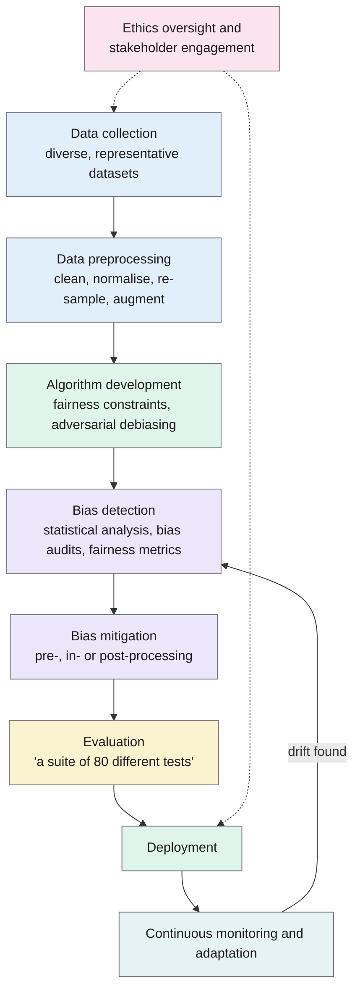
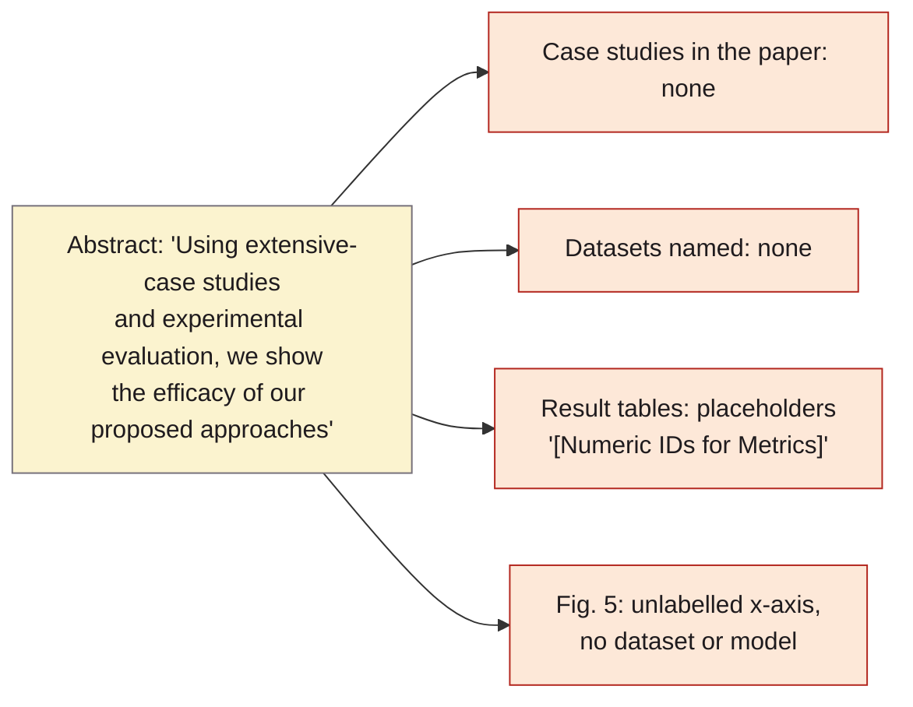
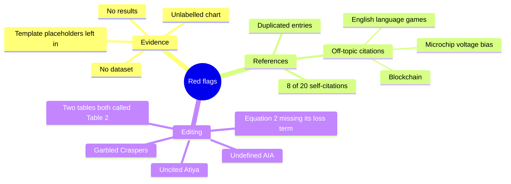

> **Reading health warning: probably don't cite this.** The abstract promises "extensive case studies and experimental evaluation", but the paper contains no experiment, dataset or result. Its "simulation parameters" table still has unfilled template placeholders (p. 7), and much of its related work and reference list is unrelated to AI bias (pp. 3, 8). It's included here as a pilot and as a lesson in spotting weak sources. Details under Concerns.

## TL;DR
A general overview of where bias enters AI systems (data, model design, opacity) and the usual families of fixes (re-sampling, fairness constraints, adversarial debiasing, post-processing, audits, ethics oversight). It wraps them in a lifecycle diagram running from data collection to continuous monitoring. It claims to show these methods work, but presents no evidence. For this project, the only usable idea is the shape of a bias-aware pipeline, with explicit "bias report" and "data quality issue" steps, and better sources make the same point.

**Analogy:** it's a glossy estate agent's brochure: lovely floor plans and mood photos, but when you turn up there's no house.

## 1. What is the aim of the paper?
To explore methods for identifying and fixing bias in AI algorithms, so that their outcomes are fair and ethical (p. 1). The authors say bias can enter at any stage: from historical bias in training data, from design choices such as optimising only for accuracy, and from opaque models that are hard to challenge (p. 1). They also aim to argue for interdisciplinary collaboration between AI researchers, ethicists, sociologists, legal experts and affected communities (pp. 1–2, 4).

## 2. How did the authors carry out the research?
The paper describes a framework rather than a study. Its proposed lifecycle (Fig. 1, p. 4; Fig. 2, p. 6) is:

The stages and the ethics links follow Fig. 1 (p. 4). The "80 different tests" are mentioned once and never described (p. 5).

Other parts of the "method":
- **Roles** (Fig. 3, p. 6): a data scientist works with an AI/ML engineer, a fairness auditor, a domain expert, an ethics officer, a legal expert and a UX specialist.
- **Transparency steps** (the first "Table 2", p. 6): data quality check → preprocessing → bias detection → bias mitigation → re-evaluate fairness → generate a "BiasReport" → label the model "FairModel" or report failure → report insufficient data quality.
- **Evaluation:** "case studies representing real-world AI applications" in healthcare, finance and criminal justice (p. 4). None of these case studies appears in the paper.

### The maths (pp. 5–6)
Five equations are given. They're reproduced as printed, with notes on what they presumably mean.

**(1) Data collection balance:**

$$D_{\text{balanced}}=\frac{\sum_{k=1}^{N} D_k}{N}$$

As printed, this is just the average of $N$ datasets. It doesn't measure balance across groups.

**(2) Fairness constraint in the objective function**, printed as "minimized + λ·F". The loss term is missing. *My guess at what was intended, not from the paper:* $\min_\theta \; \mathcal L(\theta) + \lambda F(\theta)$, where $F$ is a fairness penalty and $\lambda$ sets how much fairness costs.

**(3) Demographic parity**, the gap in positive-prediction rates between groups $a$ and $a'$, given context $C$:

$$DP=\big|P(Y^{*}\mid A=a, C)-P(Y^{*}\mid A=a', C)\big|$$

**(4) Equal opportunity**, the gap in prediction rates between groups, for people whose true label is $y$:

$$EO=P(Y^{*}\mid Y=y, A=a, C)-P(Y^{*}\mid Y=y, A=a', C)$$

**(5) Ongoing monitoring:** the model at time $t$ is the previous model plus a change in bias, $\Delta B$:

$$M_t=M_{t-1}+\Delta B$$

None of the five is used anywhere in the paper.

**Analogy:** demographic parity asks whether each group gets the same share of "yes" answers. Equal opportunity asks whether each group's deserving cases get the same share of "yes" answers. Equation (3) is the first idea written as a gap, and equation (4) is the second.

## 3. What are the primary results?
There are no results in the usual sense.
- "Table 2: Simulation Parameter" (p. 7) lists parameter *types*, not values. Two entries are literally "[Numeric IDs for Metrics]" and "[Numeric ID for Method]".
- Tables 3 and 4 (p. 7) describe the *format* of possible results (e.g. "1 (Yes) / 0 (No)", "[0-1 Scale]", "T-test / Mann-Whitney U") without filling any in.
- Fig. 5 (p. 7) plots accuracy, fairness, computational overhead and model complexity on a 0–100% scale over an unlabelled x-axis, with no dataset, model or units.

The claim is from the abstract (p. 1), and the evidence boxes come from pp. 4–7.

**Real-world examples the paper mentions (pp. 1–2)**, mostly without citations:
- **Hiring:** a model trained on historical hiring data favouring men over equally qualified women.
- **Face recognition:** higher error rates for people with darker skin, because they are under-represented in training data.
- **Criminal justice:** predictive policing that worsens existing racial bias.
- **Healthcare:** biased models widening health disparities.
- **Finance:** loan approvals stereotyping particular socio-economic areas.

For the hiring example, `caliskan2017semantics` gives a properly sourced version (the résumé study, p. 5 there).

## 4. What do the authors think the results mean?
- Bias is multi-faceted and arises "from biased training data all the way back to flawed model assumptions" (p. 7). Re-sampling, correction algorithms and fairness constraints together give a typology of fixes (p. 7).
- They say their case studies and experiments "demonstrate the efficacy" of these methods (p. 7), which the paper doesn't support.
- Continuous monitoring and transparency are needed because AI, data and social norms keep changing (pp. 4–5, 7).
- Future work (p. 7): study how bias shifts over time, context-aware bias detection, more real data, and how AI affects human bias in healthcare and criminal justice.

## 5. What do I think it means?
*Claude's draft. Rewrite this in your own words when you verify.*

- **Probably not citable.** A marker checking sources (the "contextualisation" rubric rewards "credible, current material") would count this against you. If you mention it at all, use it as an example of the thin "framework" literature, not as evidence.
- **One idea worth keeping, from better sources.** Its pipeline has explicit **"data quality issue"** and **"bias report"** steps that can block a model (first Table 2, p. 6). That's the same shape as this project's gate: score, then accept, reject or report. Find a credible source for this lifecycle view before relying on it for ARCH-02, UI-01 or CI-02.
- **The fairness metrics belong to classifiers.** Demographic parity and equal opportunity compare a classifier's predictions across groups. This project scores *text* before any classifier exists, so these metrics don't apply directly. That's a useful point to make explicitly when you settle MET-02 and MET-05.
- **A good lesson for the literature search.** Three readings in, two have been weak. It's worth filtering harder at the "save to Zotero" step. Check the venue's CORE ranking, whether the paper reports real results, and whether its references are on topic.

**Analogy:** reading this paper is like reading the table of contents of a fairness textbook. It names every chapter but contains none of them.

The red flags are all from the paper (pp. 3–8); the details are under Concerns.

Suggested metadata, one line each:
- `governance`: the paper's main substance is process: oversight roles, audits, bias reports and monitoring.
- Sections: none suggested, because it isn't strong enough to cite. Add `related-work` if you decide to mention it critically.
- Decisions: none linked. The pipeline idea relates to ARCH-02, UI-01 and CI-02, but use a better source for those.

## Key numbers
The paper contains almost no numbers. What there is:
- 5 equations, none applied (pp. 5–6).
- "a suite of 80 different tests", not described further (p. 5).
- 20 references (p. 8). By my count, 8 have Rajawat as an author ([10]–[15], [19], [20]), and [8]/[9] and [14]/[15] are duplicates.
- Related work: Sukumar et al. (2024) report their strategies are "four times more effective" than baseline procedures for facial emotion recognition (p. 3). That's their claim, reported second-hand here.

Quote (p. 5): "rigorous testing is carried out using a suite of 80 different tests"

## Concerns
- **No evidence for its main claim.** The abstract says experiments show efficacy (p. 1), but there are no datasets, models or results. The results tables are templates with placeholders (p. 7).
- **The related work is mostly off-topic.** Table 1 (p. 3) compares papers on game-based English learning [6], AR/VR and blockchain jobs [7], Wi-Fi positioning [8], [9] and web personalisation [10]. None of these is about AI bias.
- **The references are off-topic too.** [4] is about "negative bias temperature instability" in transistors (an electrical meaning of "bias"), but it's cited for surveillance face recognition (p. 3). [13] and [16]–[20] are about cryptography, blockchain and security (p. 8). This looks like references matched on keywords.
- **Citation mismatch.** The text discusses "Wu et al. (2024)" and causal modelling on German Credit (p. 3), but no Wu appears in the reference list. The closest match, [5], is by Hui and Lau.
- **Heavy self-citation.** 8 of 20 references include the first author (p. 8).
- **Editing problems:**
  - "I combine by saying" (p. 2)
  - "AIA" is never defined (p. 4)
  - "Atiya notes" with no citation (p. 5)
  - "Craspers are trained" (p. 5)
  - two different tables both called "Table 2" (pp. 6–7)
  - equation (2) is missing its loss term (p. 5)
- **Venue.** The 2024 ARIIA conference has an augmented reality and industrial automation focus. Check its standing before giving the paper any weight.

## Follow-up
Only one cited paper looks worth a glance:
- Mandhala, V. N., Bhattacharyya, D. and Midhunchakkaravarthy, D. (2022) "Need of mitigating bias in the datasets using machine learning algorithms", ACCAI 2022 [1]. It's about dataset bias, which is on topic, but check its quality first.

Better next reads come from the earlier notes, for example De-Arteaga et al. (2019) "Bias in bios" (via `kumar2025detecting`) and Bolukbasi et al. (2016) (via `caliskan2017semantics`).
