> **Source note:** drafted from the ACM PDF. Page numbers are the printed proceedings pages, 1135–1144. Bar-chart values in Figures 6–9 came out of extraction unlabelled; only values the text states are used.

## TL;DR
**LIME** (Local Interpretable Model-agnostic Explanations) explains one prediction of any classifier by **perturbing the input** (e.g. dropping words), seeing how the black-box output changes, and fitting a **small weighted linear model** that is faithful *near that input* (pp. 1137–1138). **SP-LIME** picks a small, non-redundant set of explained examples so a person can judge the whole model (pp. 1139–1140). In experiments, explanations let non-experts pick the classifier that generalises better even when held-out accuracy points the wrong way, and fix a classifier by removing junk features (pp. 1141–1142). The famous **husky vs wolf** demo shows explanations revealing a "snow detector" (pp. 1142–1143). For this project it's the second attribution method in the UI-02/EVAL-04 preliminary study.

**Analogy:** working out what a sealed vending machine responds to by pressing buttons in slightly different combinations near the one you care about, then writing a simple rule that works *for that corner of the panel only*.

```mermaid
flowchart LR
  X["Input text x<br/>(e.g. a passage)"]:::x --> P["Perturb:<br/>drop random words"]:::p
  P --> F["Black-box f<br/>scores each variant"]:::f
  F --> W["Weight variants by<br/>closeness to x"]:::w
  W --> L["Fit sparse linear model<br/>(K words)"]:::l
  L --> E["Explanation:<br/>top-K words ± weights"]:::e

  classDef x fill:#E1EFFB,stroke:#76707A,color:#1F1B1E
  classDef p fill:#FBF3CF,stroke:#76707A,color:#1F1B1E
  classDef f fill:#F1ECE4,stroke:#76707A,color:#1F1B1E
  classDef w fill:#FDE8D8,stroke:#76707A,color:#1F1B1E
  classDef l fill:#ECE6FB,stroke:#76707A,color:#1F1B1E
  classDef e fill:#DFF4EA,stroke:#76707A,color:#1F1B1E
```

Algorithm 1 (p. 1138).

## 1. What is the aim of the paper?
"If the users do not trust a model or a prediction, they will not use it" (p. 1135). Two kinds of trust: in a **prediction** (enough to act on it) and in a **model** (enough to deploy it) (p. 1135). Held-out accuracy is not enough, because practitioners overestimate accuracy, and data leakage and dataset shift go unnoticed (p. 1136). The aim: model-agnostic, faithful, interpretable explanations of individual predictions, plus a way to choose which ones to show (p. 1135).

## 2. How did the authors carry out the research?
**Desired properties (pp. 1136–1137).** *Interpretable* (to the actual audience; "laymen may be more comfortable with a small number of weighted features"), *locally faithful* ("local fidelity does not imply global fidelity"), *model-agnostic*, and offering a *global perspective*.

**LIME (pp. 1137–1138).** Uses an interpretable representation (for text, presence or absence of words), separate from the model's own features. The explanation is

$$\xi(x) = \underset{g \in G}{\arg\min}\ \mathcal{L}(f, g, \pi_x) + \Omega(g)$$

with $G$ sparse linear models, $\Omega$ limiting the explanation to $K$ words, and a locality-weighted square loss

$$\mathcal{L}(f, g, \pi_x) = \sum_{z, z'} \pi_x(z)\,\big(f(z) - g(z')\big)^2, \qquad \pi_x(z) = \exp\!\big(-D(x,z)^2/\sigma^2\big)$$

where $D$ is cosine distance for text. Solved with "K-LASSO" (pick $K$ features with Lasso, then least squares) (p. 1138).

**SP-LIME (pp. 1139–1140).** Given a budget $B$ of explanations a user will look at, greedily pick instances whose explanations cover the most globally important features without redundancy (a submodular coverage problem with a $1 - 1/e$ approximation guarantee).

**Experiments (pp. 1140–1143).**
- *Simulated users:* sentiment datasets (books, DVDs; 2,000 reviews each); faithfulness checked on classifiers that are themselves interpretable; simulated trust in predictions and choice between models. N = 15,000 samples, K = 10 (p. 1140).
- *Human subjects:* Mechanical Turk on 20 Newsgroups Christianity vs Atheism, with a new 1,638-page religion test set; graduate students for the husky vs wolf task (pp. 1141–1143).

## 3. What are the primary results?
- **Faithfulness (p. 1140):** on interpretable classifiers where the true important features are known, LIME recovered over 90% of them, unlike Parzen, greedy or random explanations.
- **Trust in predictions (Table 1, p. 1141):** LIME had the highest F1 for spotting untrustworthy predictions across all four models and both datasets (around 92–97 vs 14–15 for random), p = 0.01.
- **Accuracy can mislead (pp. 1138, 1141):** an SVM with 94% held-out accuracy on Christianity vs Atheism relied on header words like "Posting" (in 22% of training examples, 99% of them Atheism). On real religion web pages, the original classifier scored 57.3% vs 69.0% for a cleaned one, the reverse of their held-out scores (94.0% vs 88.6%).
- **Choosing a classifier (p. 1142, Figure 9):** 100 users per setting; all explanation methods helped pick the better classifier; SP beat random pick and LIME beat greedy. (Figure 9's bar values, 68–89% correct, couldn't be matched to bars from the extracted text; check the figure.)
- **Non-experts improving a model (p. 1142):** crowd workers removing words over three rounds improved real-world accuracy; about 11 minutes per classifier; high agreement on which words to remove.
- **Husky vs wolf (Table 2, p. 1143):** 27 graduate students. Trusted the bad model: 10 before explanations, 3 after. Named snow as a feature: 12 before, 25 after.
- **Cost (p. 1138):** under 3 seconds per explanation for a 1,000-tree random forest on a laptop with N = 5,000; about 10 minutes per image for Inception.

## 4. What do the authors think the results mean?
- Explanations are useful for deciding whether to trust predictions, choosing models, improving untrustworthy classifiers and spotting why a classifier shouldn't be trusted (p. 1135).
- Limits they state (p. 1138): some behaviours can't be expressed in the chosen interpretable representation, and if the model is "highly non-linear even in the locality of the prediction, there may not be a faithful explanation". The husky study's "sample size is small" (p. 1143).

## 5. What do I think it means?
*Claude's draft. Rewrite this in your own words when you verify.*

- **Relation to SHAP:** LIME's kernel and regulariser are heuristic; Lundberg and Lee show that with a specific kernel the same regression recovers Shapley values, and that LIME's default choices violate local accuracy or consistency (@lundberg2017unified, pp. 5–6 of theirs). So in EVAL-04, treat SHAP and LIME as close relatives, not independent witnesses. That's consistent with your finding that their agreement doesn't detect wrong explanations (AUC 0.46).
- **Their own faithfulness test is your recommended one.** They validated LIME against models whose true important features are known (p. 1140). Your counterfactual swaps play the same role for a black box: known interventions to compare attributions against. Cite this as precedent for EVAL-04's approach.
- **Locality caveat matters for text bias:** "local fidelity does not imply global fidelity" (p. 1137). A LIME explanation of one flagged passage says nothing about how the detector treats that identity word elsewhere. UI-02 should present explanations as per-passage only.
- **Word-dropping perturbations are odd for transformers:** removing words creates ungrammatical text that the detector may score unpredictably. *Claude's inference, not from the paper.* Another reason to keep attributions as triage.
- **"20 Newsgroups" lesson = the leakage lesson:** high held-out accuracy from spurious features (p. 1138) is the same story as Arango et al. (@arango2019hate). Explanations can surface identity-word shortcuts in your detector; a good EVAL-04 sanity check is whether group names dominate attributions on *harmless* passages.
- **VAL-03 (usability):** their human studies measure whether explanations help people *make decisions*, not whether they like them. Borrow that framing: test whether reviewers make better keep/remove decisions with the highlights than without.

Suggested metadata, one line each:
- `usability`, `metrics`: explanations for reviewers; faithfulness.
- `background`, `related-work`, `methodology`, `evaluation`: XAI background; UI-02 design; EVAL-04 tests; VAL-03 framing.
- `UI-02`, `EVAL-04`, `VAL-03`: as above.

## Key numbers
- LIME recall of truly important features: over 90% (p. 1140).
- 20 Newsgroups SVM: 94% held-out accuracy; "Posting" in 22% of training examples, 99% Atheism (p. 1138).
- Religion test set: original 57.3% vs cleaned 69.0%; held-out 94.0% vs 88.6% (p. 1141).
- Husky vs wolf, 27 subjects: trusted bad model 10 → 3; mentioned snow 12 → 25 (Table 2, p. 1143).
- K = 10 words; N = 15,000 samples in simulated experiments (p. 1140).

Quote (p. 1137): "local fidelity does not imply global fidelity".

## Concerns
- **Pre-transformer models** (SVMs, random forests, bag of words); perturbation by deleting words behaves differently for contextual models.
- **Heuristic kernel and width** $\sigma$; results depend on them (critiqued in @lundberg2017unified).
- **Small human studies,** some with ML graduate students (p. 1143).
- **Explanations can be unstable** across runs because of random sampling; not measured here.

## Follow-up
None added.
