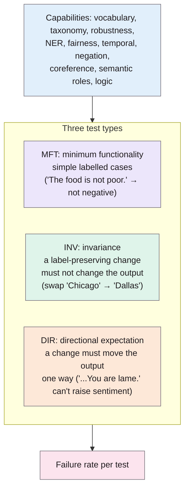
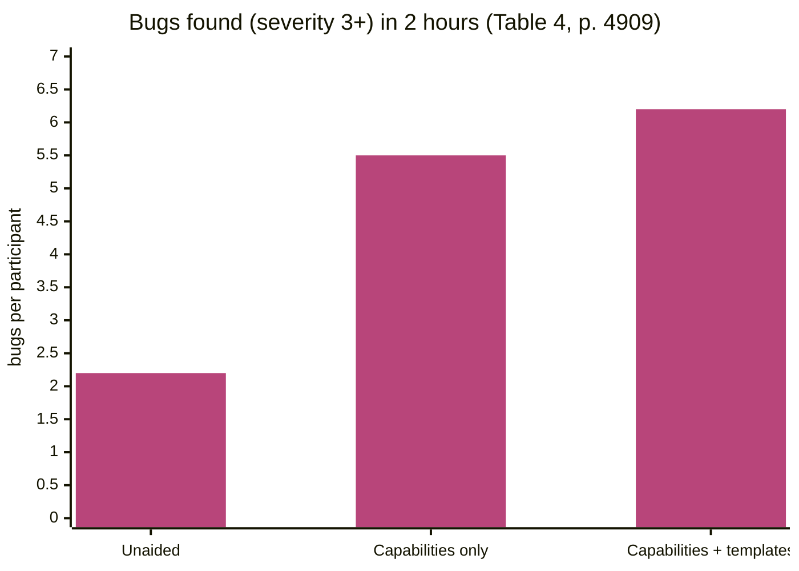

> **Source note:** drafted from the ACL Anthology PDF (renamed from 2020.acl-main.442.pdf). Page numbers are the printed proceedings pages, 4902–4912. Model names in the results tables are shown as logos in the PDF and some didn't survive text extraction, so a few results below say "one of the models": check those on the PDF.

## TL;DR
Held-out accuracy overestimates how good NLP models are and hides *where* they fail. CheckList borrows **behavioural (black-box) testing from software engineering**: a matrix of linguistic *capabilities* (negation, named entities, fairness, robustness…) against three *test types* (minimum functionality, invariance, directional expectation), plus tooling to generate many test cases from templates (pp. 4902–4904). It found severe bugs in models that "solved" sentiment, paraphrase and reading-comprehension benchmarks, including commercial systems, and in a user study people with CheckList wrote twice as many tests and found almost three times as many bugs (p. 4902). For this project it's the method behind the gap set (VAL-01) and the tool's regression tests (EVAL-05).

**Analogy:** a car's MOT doesn't just drive it round the block (held-out accuracy). It checks the brakes, lights, tyres and emissions one by one, with a pass mark for each. CheckList is an MOT for NLP models.

Structure from Figure 1 and §2 (pp. 4903–4904).

## 1. What is the aim of the paper?
Held-out test sets "are often not comprehensive, and contain the same biases as the training data", so real-world performance is overestimated, and a single accuracy number doesn't say where a model fails or how to fix it (p. 4902). Other evaluation approaches cover one task or a few capabilities only. Software engineering has mature behavioural testing; NLP hasn't borrowed it (p. 4902).

The aim: a task-agnostic methodology and tool for comprehensive behavioural testing (p. 4902).

## 2. How did the authors carry out the research?
**The matrix (pp. 4903–4904).** Rows are capabilities (they suggest at least vocabulary+POS, taxonomy, robustness, NER, **fairness**, temporal, negation, coreference, semantic role labelling, logic). Columns are test types:
- **Minimum functionality test (MFT):** like a unit test; simple labelled examples for one behaviour. Good at detecting shortcuts.
- **Invariance test (INV):** apply a label-preserving perturbation; the prediction should not change.
- **Directional expectation test (DIR):** apply a perturbation with a known effect; the prediction should change in that direction.
INV and DIR need **no labels**, so they can run on unlabelled real data (p. 4904).

**Generating cases (p. 4904).** Templates with slots filled from lexicons, e.g. "I {NEGATION} {POS_VERB} the {THING}." expanded as a Cartesian product, with a masked language model suggesting fill-ins (Figure 2).

**Applications (pp. 4905–4907).** Sentiment (Microsoft, Google and Amazon commercial models plus BERT-base and RoBERTa-base fine-tuned on SST-2), duplicate-question detection (QQP) and machine comprehension (SQuAD).

**User evaluation (pp. 4908–4909).**
- A ~5-hour session with Microsoft's sentiment team.
- A controlled study: **18 participants** with at least intermediate NLP experience, 2 hours to test BERT on QQP, split into Unaided, Capabilities only, and Capabilities + templates.

## 3. What are the primary results?
- **Sentiment (pp. 4905–4907, Table 1):** all models struggle with temporal, negation and semantic-role tests. Simple negation ("The food is not poor.") fails up to 54.2% of the time; near 100% for commercial models when the negation comes at the end ("I thought the plane would be awful, but it wasn't."). Changing location or person names changes predictions up to 20.8% and 15.1% of the time. Adding random URLs or handles changes up to 24.8%.
- **Fairness (pp. 4906–4907):** commercial models pass a simple template ("I am a {PROTECTED} {NOUN}.") by always predicting neutral; but one of the research models **always predicts negative for "black", "atheist", "gay" and "lesbian" and positive for "Asian", "straight"** (the model's logo didn't extract; check p. 4907). The authors stress: "absence of test failure does not imply that these models are fair" (p. 4906).
- **Benchmark accuracy misleads (p. 4907):** the research models were 91.5% and 93.9% accurate on SST-2 validation sentences containing negation, yet failed simple negation MFTs.
- **Reading comprehension bias (p. 4907):** with context "John is not a doctor, Mary is." and question "Who is a doctor?", BERT picked the man 89.1% of the time; reversed, it picked the woman only 3.2%. For "secretary", it wrongly picked the woman 60.5% vs the man 4.0%.
- **Microsoft team (pp. 4908–4909):** brainstormed about 30 tests, implemented about 20, found "many previously unknown bugs" in a mature, heavily tested product, and wanted to adopt CheckList.
- **User study (Table 4, p. 4909):**

| | Unaided | Capabilities only | Capabilities + templates |
|---|---|---|---|
| Tests created | 5.8 | 10.2 | 13.5 |
| Cases per test | 7.3 | 5.0 | 198.0 |
| Capabilities tested | 3.2 | 7.5 | 7.8 |
| Bugs (severity ≥ 3) | 2.2 | 5.5 | 6.2 |

## 4. What do the authors think the results mean?
- "Accuracy on benchmarks is not sufficient for evaluating NLP models" (p. 4910); CheckList complements benchmarks rather than replacing them (p. 4909).
- Capabilities and test types are general across tasks; tests can be shared and built collaboratively (pp. 4907, 4910).
- It's easy to learn and useful to both experts and novices (p. 4910).
- **Limits (pp. 4909–4910):** it can't test non-behavioural problems such as labelling errors, annotator biases, data versioning or interpretability. Like any test suite, passing doesn't prove a capability.

## 5. What do I think it means?
*Claude's draft. Rewrite this in your own words when you verify.*

- **The gap set's structure is a CheckList matrix (VAL-01).** Rows = your three uncovered grounds; columns = your six functions (explicit stereotype, implicit stereotype, demeaning, neutral mention, discussing bias, quoted or countered). Explicit cases from templates = MFTs; swapped-group variants of harmless cases = **INV tests**. Say this in exactly those terms in the methodology; it makes the gap set look like a principled design, not an ad-hoc list.
- **A DIR test you could add cheaply:** take a harmful passage and *wrap it in counter-speech* ("Saying '...' is prejudice."); the score must go **down**. That's a directional test of "mention is not bias", and it needs no new labels. Same idea as HateCheck's F20, but run on real passages from SBIC or the gap set.
- **EVAL-05:** CheckList tests are literally unit tests for a model. MFT failure rates on a fixed subset make good regression tests that run in CI with pytest: "on the gap set's neutral-mention MFT, the false-positive rate must stay below X". The master plan's "EVAL-05 regression tests can assert minimum values on a fixed subset" is this.
- **MET-05:** report failure rate *per test*, not just pooled accuracy; their argument for why pooled numbers mislead (p. 4907) is the reason MET-05 reports per function and per ground.
- **Their fairness finding mirrors yours:** a model that always gave negative sentiment for "gay" and "lesbian" (p. 4907) is Dixon's identity-term problem in another task. And "absence of test failure does not imply that these models are fair" is the right caveat for your stance test results too.
- **The INV test needs care for bias:** swapping groups in *harmful* sentences isn't label-preserving in your scheme (a stereotype about Travellers swapped to "doctors" may stop being a stereotype). Use INV only on harmless cases, as the master plan already does.
- **The tool is also a CI/CD idea (`ci-cd` tag):** behavioural tests as a pipeline gate is close to what EvenGround does for data. A one-line analogy in the related work could help an examiner see the software-engineering framing.

Suggested metadata, one line each:
- `benchmarks`, `metrics`: a test methodology and per-test failure rates.
- `ci-cd`: tests as part of the development pipeline.
- `related-work`, `methodology`, `evaluation`: behavioural testing; the gap set; regression tests.
- `VAL-01`, `EVAL-05`, `MET-05`: as above.

## Key numbers
- Three test types; ten suggested capabilities (pp. 4903–4904).
- Negation MFT failure up to 54.2%; near 100% for commercial models with negation at the end (pp. 4906–4907).
- Name changes alter predictions up to 20.8% (locations) and 15.1% (person names) (p. 4906).
- Research models 91.5% and 93.9% accurate on SST-2 negation sentences but failing negation MFTs (p. 4907).
- "John is not a doctor, Mary is." → man picked 89.1% of the time; reversed 3.2% (p. 4907).
- User study: 18 participants, 2 hours; bugs 2.2 vs 5.5 vs 6.2; tests 5.8 vs 10.2 vs 13.5 (Table 4, p. 4909).
- Microsoft session about 5 hours; about 30 tests brainstormed, about 20 implemented (p. 4908).

Quote (p. 4906): "absence of test failure does not imply that these models are fair".

## Concerns
- **Not about bias detection;** fairness is one capability with a few simple templates.
- **Synthetic, template text.** The authors say challenge sets can lack resemblance to real data (p. 4909); INV/DIR on real data is their answer.
- **Small user study** (18 people, 6 per condition) with self-rated severity, though a second rater agreed (p. 4909).
- **Some model labels didn't extract** from the PDF; check attributions before citing specific model results.

## Follow-up
From the reference list (pp. 4910–4912):
- Prabhakaran, V., Hutchinson, B. and Mitchell, M. (2019) "Perturbation sensitivity analysis to detect unintended model biases", EMNLP-IJCNLP 2019. Swapping names and identity terms to measure bias; a direct method for the gap set's INV tests.
- Belinkov, Y. and Glass, J. (2019) "Analysis methods in neural language processing: A survey", TACL, 7, pp. 49–72. Background on challenge datasets.
- HateCheck (@rottger2021hatecheck) applies this paper to hate speech.
