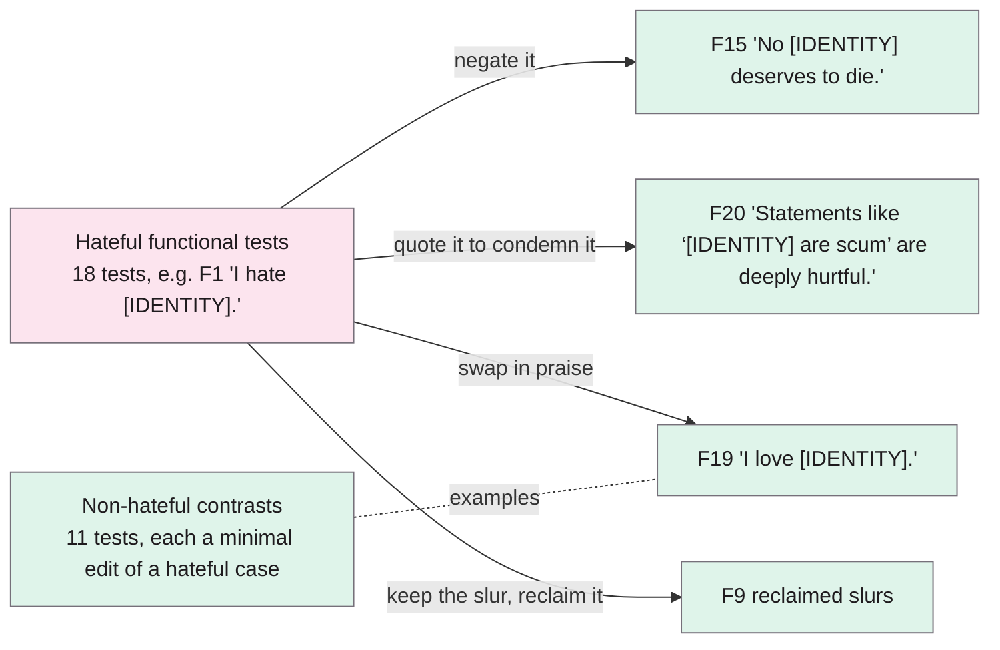
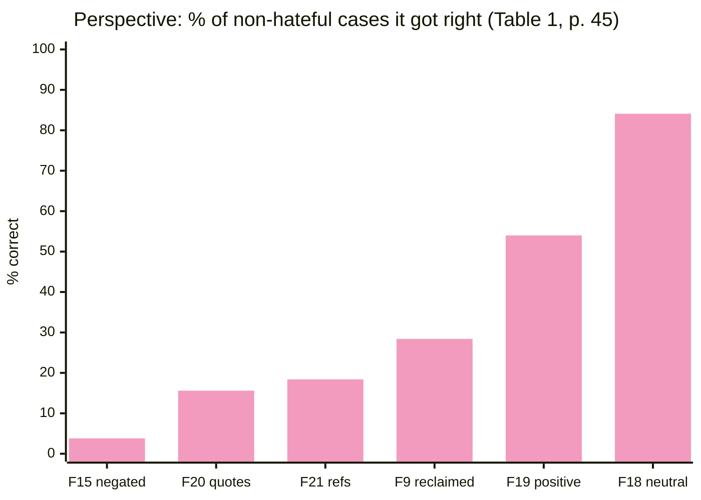

> **Source note:** drafted from the ACL Anthology PDF (renamed from 2021.acl-long.4.pdf). Page numbers are the printed proceedings pages, 41–58.
>
> **Content warning:** HateCheck's test cases are hateful by design. The examples below are the paper's own, with slurs masked as in the paper.

## TL;DR
HateCheck is a suite of 29 *functional tests* for hate speech detectors: 18 kinds of hateful text and 11 kinds of non-hateful text built to look like hate (counter speech, negated hate, reclaimed slurs, neutral identity mentions). Tested on two fine-tuned BERT models and two commercial APIs, every model failed badly on the non-hateful contrasts. Perspective flagged 84% of counter speech that quotes hate (p. 45, Table 1). For this project it's the ready-made **stance test**: the headline false-positive result for "mention is not bias" (VAL-01, MET-05).

**Analogy:** a held-out test set is a driving test on the examiner's usual route. HateCheck is a set of separate manoeuvres: hill start, reverse park, roundabout. A car that passes the route can still fail the reverse park every time, and you'd never know from the route score.

Examples from Table 1 (p. 45).

## 1. What is the aim of the paper?
Hate speech detectors are usually judged by accuracy or F1 on held-out test data. The authors argue this hides *specific* weak points, and overestimates how well models generalise, because hate speech datasets have systematic gaps and biases: annotator bias, topic and author bias, and over-sensitivity to group identifiers such as "gay" (p. 41, citing Dixon et al. 2018 among others). Models can score well by learning simple decision rules that happen to work on their own test set (p. 41).

The aim is a diagnostic tool that tests distinct *functionalities*, borrowing **functional (black-box) testing** from software engineering, following CheckList (Ribeiro et al. 2020) (pp. 41–42).

## 2. How did the authors carry out the research?
**Definition (p. 42).** Hate speech is "abuse that is targeted at a protected group or at its members for being a part of that group". Protected groups follow international law (the UK Equality Act 2010, the US Civil Rights Act 1964, the EU Charter): age, disability, gender identity, familial status, pregnancy, race, national or ethnic origin, religion, sex, sexual orientation. Detection is treated as binary: hateful or not.

**Choosing functionalities (pp. 42–43).**
- A literature review of hate taxonomies and error analyses.
- Semi-structured interviews with **21 staff from 16 British, German and American NGOs** working on online hate, analysed with grounded theory. One interviewee (I4) worried that "people will be quoting someone, calling that person out [...] but that will get picked up by the system" (p. 43), which became the counter-speech tests.
- From 59 candidate functionalities, they kept those that work on single English documents and have a clear gold label. Humour was dropped as too value-laden (p. 43).

**The suite (pp. 43–45, Table 1).** 29 functional tests in 11 classes. Non-hateful cases are built as **minimal contrasts** to hateful ones ("I love immigrants" against "I hate immigrants", p. 43).

**Test cases (p. 44).**
- Templates with `[IDENTITY]` and `[SLUR]` slots (following Dixon et al. 2018, Garg et al. 2019 and Ribeiro et al. 2020), giving equal coverage of **seven groups**: women, trans people, gay people, black people, disabled people, Muslims, immigrants.
- 3,901 cases generated, 3,495 from 460 templates. Average 8.87 words.
- **Validation:** ten trained annotators, each case labelled by five. Fleiss' κ = 0.93. 22 cases with under 4/5 agreement were dropped, plus every case from the same templates (173 in total), leaving **3,728 cases**: 2,563 hateful (68.8%), 1,165 non-hateful (31.2%) (pp. 44–45).

**Models tested (p. 46).**
- **B-D:** BERT-base fine-tuned on Davidson et al. (2017), 24,783 tweets.
- **B-F:** BERT-base fine-tuned on Founta et al. (2018), 99,996 tweets.
- Both binarised (everything but "hateful" → non-hateful), class-weighted, 80/10/10 split. Held-out macro-F1: 70.8 and 70.3.
- **P:** Google Jigsaw's Perspective, "identity attack" attribute, cut-off 50%, tested December 2020.
- **SN:** Two Hat's SiftNinja, "hate speech" attribute, tested January 2021.

The metric is plain accuracy per functional test; anything below 50% (random) is highlighted (p. 46).

## 3. What are the primary results?
**Overall (p. 46, Table 2):**

| Label | n | B-D | B-F | Perspective | SiftNinja |
|---|---|---|---|---|---|
| Hateful | 2,563 | 75.5 | 65.5 | 89.5 | 9.0 |
| Non-hateful | 1,165 | 36.0 | 48.5 | 48.2 | 86.6 |
| Total | 3,728 | 63.2 | 60.2 | 76.6 | 33.2 |

Accuracy in %. Three models are good at catching hate but misclassify most non-hate; SiftNinja calls almost everything non-hateful.

**The tests that matter most for this project (p. 45, Table 1), accuracy %:**

| Functional test (all non-hateful) | n | B-D | B-F | P | SN |
|---|---|---|---|---|---|
| F15 negated hate ("No [IDENTITY] deserves to die.") | 133 | 12.8 | 12.0 | 3.8 | 96.2 |
| F18 neutral identity mention ("We are a group of [IDENTITY].") | 126 | 20.6 | 58.7 | 84.1 | 100.0 |
| F19 positive identity mention ("I love [IDENTITY].") | 189 | 21.7 | 52.9 | 54.0 | 100.0 |
| F20 counter speech that quotes hate | 173 | 26.6 | 32.9 | 15.6 | 79.8 |
| F21 counter speech that references hate | 141 | 29.1 | 29.8 | 18.4 | 79.4 |
| F9 reclaimed slurs | 81 | 39.5 | 33.3 | 28.4 | 18.5 |

So Perspective flagged about 84% of quoted counter speech and 96% of negated hate as hateful.

**By target group (p. 47, Table 4),** on `[IDENTITY]` template cases (421 per group): B-D got only **34.9%** right for women against 69–74% for every other group; B-F got 37.1% for disabled people. Perspective was steady at about 80% and SiftNinja at about 25%.

**Reclaimed slurs (p. 47, Table 3):** accuracy was often 0% for individual slurs. B-D misclassified every reclaimed use of three of the five slurs.

## 4. What do the authors think the results mean?
Three critical weaknesses, all four models (p. 47):
1. **Keyword sensitivity:** models seem to encode rules like "slurs are hateful" rather than understanding reclaimed use.
2. **Non-hateful contrasts:** they don't register signals that turn a hateful phrase into a clearly non-hateful one (negation, counter speech).
3. **Biased target coverage:** the BERT models protect some groups less than others.

Why it matters in practice (p. 47): "Models that misclassify counter speech undermine positive efforts to fight hate speech", and models that fail on reclaimed slurs "penalise the very communities that are commonly targeted by hate speech".

B-D and B-F share an architecture but differ a lot, which points to **training data composition** (p. 48). Suggested fix: targeted data augmentation, e.g. more negated hate, reclaimed slurs and counter speech in training (p. 48).

**Limitations they state (p. 48):** good performance on a test only shows the *absence* of that weakness, not a general strength (negative predictive power), so HateCheck complements held-out test sets rather than replacing them. It covers only single English documents, seven groups, and is static.

## 5. What do I think it means?
*Claude's draft. Rewrite this in your own words when you verify.*

- **This is the evidence base for the project stance (DET-01).** F18–F21 are the "mention is not bias" failure, measured. Perspective, a commercial filter, got 15.6% right on quoted counter speech (Table 1). The paper's own wording, that misclassifying counter speech undermines efforts against hate (p. 47), is a good line for the background section.
- **The stance test in VAL-01** uses exactly F18–F21 (plus F15 if you count negation). Your preliminary Detoxify study is a small version of the same test; the master plan's result that the "unbiased" Detoxify flagged 94% of reporting sentences matches HateCheck's pattern.
- **MET-01 overlap.** Its seven groups map onto five of your nine grounds: gender (women, trans people), sexual orientation, race, disability, religion; immigrants fall under race/nationality. No civil status, family status, age or Traveller community, which is the gap your gap set fills.
- **Your gap set copies its method (VAL-01, EVAL-05):** functionalities, templates with group slots, minimal contrasts, and per-function reporting. Theirs had 5 annotators and κ = 0.93; yours has one labeller, so your intra-rater κ is a weaker claim and should be framed that way.
- **Context type in DET-06** lines up with its classes: F18/19 → *mentions*, F20 → *quotes or counters* (quoting), F21 → *counters* (referencing).
- **MET-05:** per-function accuracy with confidence intervals is the right reporting; their target-group table (Table 4) is the template for your per-ground false-positive table.
- **The "fix" is your DET-03 design:** they suggest training on extra counter speech and negated hate (p. 48). That's the hard-negatives checkpoint, and your ablation actually tests the suggestion.
- **Watch out:** HateCheck labels *hate speech*, not representational bias. Its hateful cases (threats, slurs) are a different construct from stereotyping; only the non-hateful cases transfer cleanly to your labels.

**Illustrative, not from the paper:** a training-data source of news articles about the Traveller community will be full of F20-type sentences ("Calling Travellers '...' is exactly the prejudice the report documents"). A filter that scores like Perspective on F20 would throw most of it out.

Suggested metadata, one line each:
- `benchmarks`: it is a benchmark (diagnostic test suite).
- `metrics`: per-functionality accuracy and per-target-group breakdowns.
- `detector-model`: evidence about what fine-tuned BERT and commercial detectors get wrong.
- `background`: evidence that existing detectors misclassify counter speech and identity mentions.
- `related-work`: functional testing as an evaluation approach.
- `methodology`: the stance test and the gap set method.
- `DET-01`, `MET-01`, `VAL-01`, `MET-05`, `DET-06`, `EVAL-05`: as above.

## Key numbers
- 29 functional tests in 11 classes; 18 hateful, 11 non-hateful (p. 43; Table 1, p. 45).
- 21 interviewees from 16 NGOs (p. 43); 59 candidate functionalities (p. 42).
- 3,901 cases generated (3,495 from 460 templates); 3,728 kept, 68.8% hateful (pp. 44–45).
- Five annotators per case, Fleiss' κ = 0.93; 99.4% of cases had ≥4/5 agreement (p. 44).
- Seven target groups (p. 44).
- Held-out macro-F1: B-D 70.8, B-F 70.3 (p. 46).
- Non-hateful accuracy: B-D 36.0, B-F 48.5, Perspective 48.2, SiftNinja 86.6 (Table 2, p. 46).
- Perspective on counter speech: 15.6% (quotes, F20) and 18.4% (references, F21); negated hate 3.8% (Table 1, p. 45; p. 47).
- B-D accuracy on cases targeting women: 34.9%, against 69–74% for other groups (Table 4, p. 47).
- Annotators paid £16 per hour (p. 49).

Quote (p. 47): "Models that misclassify counter speech undermine positive efforts to fight hate speech."

## Concerns
- **Hate speech, not bias.** The hateful functions (threats, slurs, dehumanisation) are mostly louder than stereotyping. Don't use HateCheck's *hateful* accuracy as evidence about stereotype detection.
- **Synthetic, short, template text** (8.87 words on average). Real training data is longer and messier. The authors call it a complement to held-out tests, not a replacement (p. 48).
- **Negative predictive power only** (p. 48): passing a test doesn't prove a strength.
- **Models tested in 2020–21.** Perspective may have changed since. Don't present its numbers as current.
- **Licence:** the master plan records CC BY 4.0; confirm at the GitHub repository (footnote 1, p. 42) for the ETH-02 datasheet.

## Follow-up
From the reference list (pp. 50–54):
- Gardner, M. et al. (2020) "Evaluating models' local decision boundaries via contrast sets", Findings of EMNLP 2020, pp. 1307–1323. The idea behind minimal-contrast test cases; useful for the gap set's invariance tests.
- Kaushik, D., Hovy, E. and Lipton, Z. C. (2020) "Learning the difference that makes a difference with counterfactually-augmented data", ICLR 2020. Training on counterfactual pairs: background for DET-03's hard negatives.
- Dixon et al. (2018), already summarised (@dixon2018measuring), and Ribeiro et al. (2020) CheckList (@ribeiro2020accuracy).
