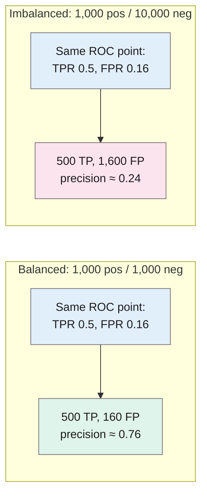

> **Source note:** drafted from the PLOS ONE PDF (saved as file.pdf; rename it to the citekey). PLOS articles have no journal page numbers; page numbers below are the article's own **"n / 21"** page numbers, which match the PDF pages. Cite as e0118432.

## TL;DR
When negatives vastly outnumber positives, a ROC curve can look excellent while most of the classifier's positive predictions are wrong, because the false-positive *rate* hides the false-positive *count*. Precision-recall (PRC) plots show the share of positive predictions that are right, and their baseline moves with the class ratio, so they reveal this (pp. 1, 7, 12–14). In simulations, a literature survey and a re-analysis of a published bioinformatics tool, PRC exposed poor performance that ROC hid (pp. 12–18). For this project it's the citation for MET-05's choice of precision-recall AUC, since biased passages are rare in real training data.

**Analogy:** an airport scanner that wrongly flags 1% of innocent bags sounds fine (ROC). But if one bag in 10,000 holds something dangerous, almost every alarm is a false alarm. Precision asks "when the alarm goes off, how often is it real?", which is what security staff actually live with.

Counts from the simulation on p. 12; the paper reads them off its PRC plot as about 75% and 25% correct positive predictions (p. 14). The precision values in the boxes are my arithmetic from those counts.

## 1. What is the aim of the paper?
Classifiers in bioinformatics are often applied to strongly imbalanced data, and are usually evaluated with ROC plots (p. 1). The authors ask whether ROC plots mislead in that setting and compare four threshold-free tools: ROC, concentrated ROC (CROC), cost curves (CC) and precision-recall (PRC) (p. 2). They focus on evaluating the *final* model, ideally on test data with the real-world class distribution (p. 2).

## 2. How did the authors carry out the research?
**Theory (pp. 3–8).** Confusion-matrix measures (Table 1, p. 4), including

$$\text{Precision} = \frac{TP}{TP + FP} \qquad \text{Recall (TPR)} = \frac{TP}{TP+FN} \qquad \text{FPR} = \frac{FP}{FP+TN}$$

$$F_1 = \frac{2\cdot\text{Prec}\cdot\text{Rec}}{\text{Prec} + \text{Rec}}$$

A ROC curve plots TPR against FPR; random is the diagonal and AUC(ROC) = 0.5 regardless of class balance (pp. 4–5). A PRC curve plots precision against recall; **its random baseline is $y = P/(P+N)$**, e.g. 0.09 at 1 positive to 10 negatives, so AUC(PRC) changes with the class ratio (p. 7). PRC interpolation is non-linear and needs care (p. 8).

**A toy example (Table 2, p. 7).** Same classifier on 20 items, balanced vs 5 positives / 15 negatives: accuracy, sensitivity, specificity all stay 0.6; precision drops from 0.6 to 0.33.

**Simulations (pp. 12–14).** Five performance levels (random, poor early retrieval, good early retrieval, excellent, perfect), balanced (1,000 positives, 1,000 negatives) vs imbalanced (1,000 positives, 10,000 negatives).

**Literature analysis (pp. 14–16).** PubMed searches: "ROC" overall, and SVM genome-wide studies (63 articles, 58 with full text).

**Re-analysis (pp. 16–18).** The MiRFinder microRNA gene-discovery tool and four others on two test sets, T1 (the original) and T2 (a new, more imbalanced set from the *C. elegans* genome).

## 3. What are the primary results?
- **ROC, CROC and cost curves don't change** between balanced and imbalanced data; **only PRC does** (pp. 12–14, Figure 5).
- **The same ROC point means very different things (p. 12):** TPR 0.5 at FPR 0.16 is 500 true and 160 false positives in the balanced case but 500 and **1,600** in the imbalanced case. PRC shows this: 75% vs 25% of positive predictions correct (p. 14).
- **AUC(ROC) can hide early-retrieval differences:** two classifiers with clearly different early performance both scored 0.8 (p. 12).
- **ROC dominates the literature:** of 58 SVM studies, 60.3% used ROC and 6.9% PRC; among the 33 with binary classifiers on imbalanced, not-small data, 66.7% ROC and 12.1% PRC (Table 4, p. 15).
- **Re-analysis (Table 5, p. 17):**

| Tool | ROC AUC, T1 | PRC AUC, T1 | ROC AUC, T2 | PRC AUC, T2 |
|---|---|---|---|---|
| MiRFinder | 0.992 | 0.945 | 0.772 | 0.106 |
| miPred | 0.991 | 0.976 | 0.707 | 0.024 |
| RNAmicro | 0.858 | 0.559 | 0.886 | 0.054 |
| ProMiR | 0.974 | 0.801 | 0.711 | 0.035 |
| RNAfold | 0.964 | 0.670 | 0.706 | 0.015 |

```mermaid
%%{init: {"themeVariables": {"xyChart": {"plotColorPalette": "#F29BBE, #B8457A"}}}}%%
xychart-beta
  title "On the harder test set T2, ROC looks fine and PRC collapses (Table 5, p. 17)"
  x-axis ["MiRFinder", "miPred", "RNAmicro", "ProMiR", "RNAfold"]
  y-axis "AUC" 0 --> 1
  bar [0.772, 0.707, 0.886, 0.711, 0.706]
  bar [0.106, 0.024, 0.054, 0.035, 0.015]
```

On T2, ROC makes RNAmicro the clear winner (0.886), while PRC shows every tool except MiRFinder is close to random in precision: "the PRC plot in Fig. 7D reveals the bitter truth" (p. 18).

## 4. What do the authors think the results mean?
- ROC "requires special caution when used with imbalanced datasets"; viewers misread specificity intuitively (pp. 1, 19).
- PRC plots "express the susceptibility of classifiers to imbalanced datasets with clear visual cues and allow for an accurate and intuitive interpretation of practical classifier performance" (p. 19).
- Because ROC is so widely used on imbalanced data, switching to PRC "may influence many studies" (p. 16).
- The PRC baseline also shows how hard the problem is (p. 19).
- They "strongly recommend PRC plots as the most informative visual analysis tool" (p. 19).

## 5. What do I think it means?
*Claude's draft. Rewrite this in your own words when you verify.*

- **MET-05's "precision-recall AUC, not ROC" rests on this paper.** The master plan states the reason without a citation ("ROC plots look misleadingly good on imbalanced data"); this is the citation. Add it to the MET-05 "Why".
- **Your imbalance is likely worse than theirs.** Mendu et al. found 2.1–4.1% toxic content in web corpora (@mendu2025safer); biased passages in a typical training source may be rarer. At 2%, the random PRC baseline is 0.02, and a detector with ROC-AUC 0.95 could still have most of its flags wrong. Always report the baseline ($P/(P+N)$) next to PR-AUC.
- **Test sets have artificial balance.** SBIC is about 45% offensive (@sap2020social); HateCheck 69% hateful (@rottger2021hatecheck). PR-AUC on those overstates real-world precision. A useful MET-05/MET-06 addition: **report precision at the deployment threshold re-weighted to a realistic prevalence** (e.g. 2%), or at least say that test-set precision isn't deployment precision.
- **MET-04 thresholds:** the gate's false alarms land on real people (data reviewers). Precision at the chosen threshold is the number that tells a reviewer how much of their review queue is wasted, which is also a usability point for UI-01.
- **The headline result is an FPR, and that's fine.** The stance test measures false-positive *rate* on harmless text, not precision. FPR is the right measure *there*, because the question is "how much harmless text gets removed", not "how many flags are right". Say why you use FPR for the stance test and PR-AUC for the main test, so the two don't look inconsistent.
- **MET-06:** if backends are compared on PR-AUC, compare on the *same* test set with the same class ratio, since PR-AUC isn't comparable across different ratios.

**Illustrative, not from the paper:** a source of 10,000 passages with 100 truly stereotyping. A detector with 90% recall and 2% FPR flags 90 true and about 198 false passages: precision about 31%. Its ROC-AUC might be 0.97. A data reviewer would see two harmless passages for every real one.

Suggested metadata, one line each:
- `metrics`: evaluation measures for imbalanced classification.
- `methodology`, `evaluation`: the choice of PR-AUC and how to report it.
- `MET-05`, `MET-06`, `MET-04`: as above.

## Key numbers
- Toy example: precision 0.6 (balanced) vs 0.33 (imbalanced) while accuracy, sensitivity and specificity stay 0.6 (Table 2, p. 7).
- PRC random baseline $y = P/(P+N)$; 0.09 at 1:10 (p. 7).
- Simulation: 1,000/1,000 vs 1,000/10,000; same ROC point = 160 vs 1,600 false positives (p. 12).
- Literature: 58 articles; ROC 60.3%, PRC 6.9%; filtered 33 articles: ROC 66.7%, PRC 12.1% (Table 4, p. 15).
- Re-analysis T2: ROC AUCs 0.706–0.886, PRC AUCs 0.015–0.106 (Table 5, p. 17).

Quote (p. 19): "we strongly recommend PRC plots as the most informative visual analysis tool". *(Exact wording is "The results of our study strongly recommend PRC plots as the most informative visual analysis tool"; quote that version.)*

## Concerns
- **Bioinformatics examples,** not NLP. The argument is mathematical and transfers; the case studies don't.
- **PRC isn't free of problems:** interpolation is non-linear and some tools get it wrong (p. 8). Use scikit-learn's average precision (a step-wise estimate) and say so.
- **Open access, CC BY,** so figures can be reused with credit.
- **PDF saved as file.pdf;** rename it to `saito2015precisionrecall.pdf`.

## Follow-up
From the reference list (p. 20):
- Davis, J. and Goadrich, M. (2006) "The relationship between precision-recall and ROC curves", Proceedings of the 23rd International Conference on Machine Learning, pp. 233–240. The formal link between PR and ROC space, and correct PR interpolation.
- Fawcett, T. (2006) "An introduction to ROC analysis", Pattern Recognition Letters, 27, pp. 861–874. The standard ROC reference, if you need one.
