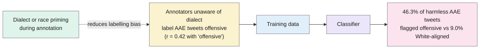

> **Source note:** drafted from the ACL Anthology PDF (renamed from P19-1163.pdf). Page numbers are the printed proceedings pages, 1668–1678. The appendix wasn't summarised.
>
> **Content warning:** the paper discusses a reclaimed slur, masked here as in the paper.

## TL;DR
In two widely used hate speech datasets, tweets in **African American English (AAE)** were much more likely to be labelled offensive (correlation r = 0.42 with the "offensive" label), because annotators didn't recognise dialect (pp. 1669–1670). Classifiers trained on them learned it: one predicted **almost 50% of harmless AAE tweets as offensive**, vs 9% for White-aligned tweets, and on other corpora AAE tweets were labelled offensive about **twice as often** (pp. 1670–1671). Telling annotators the tweet's likely dialect and the author's likely race made them significantly less likely to call AAE tweets offensive (p. 1671). For this project it's evidence that bias in *labels* propagates into detectors, which matters for DET-03's training data, DET-06's guidelines and EVAL-06.

**Analogy:** marking essays without knowing the student writes in Hiberno-English, and docking points for "I'm after doing it" as bad grammar. The marker isn't malicious, but the rubric is biased, and a model trained on the marks inherits it.

## 1. What is the aim of the paper?
Toxic language mostly targets minorities, but automatic removal "risks further suppressing already-marginalized voices" (p. 1668). Offensiveness depends on social context, such as the speaker's identity or dialect; reclaimed terms can be fine in-group and offensive from outsiders (p. 1668). Perspective scores AAE phrases far more toxic than their general American English equivalents (Figure 1, p. 1668). The aim: (1) measure racial bias in widely used toxic-language corpora and how models propagate it; (2) test whether dialect and race priming reduces annotator bias (p. 1668).

## 2. How did the authors carry out the research?
**Dialect as a proxy for race (p. 1669).** Lexical dialect probabilities from Blodgett et al.'s (2016) model, trained on 60M geolocated tweets with census data. AAE is common among, but not unique to, African Americans.

**Datasets (p. 1669).** DWMW17 (Davidson et al. 2017): 24,783 tweets, hate speech / offensive / none. FDCL18 (Founta et al. 2018): 99,996 tweets, hateful / abusive / spam / none.

**Bias propagation (p. 1670).** A BiLSTM-with-attention classifier trained on each dataset; false-positive rates compared by dialect; then applied to two reference corpora: DEMOGRAPHIC16 (56M tweets with dialect labels) and USERLEVELRACE18 (5.4M tweets from 4,132 people who self-reported race: 3,184 White, 374 African American). Assumption stated: the average tweet isn't inherently more toxic in either dialect (footnote 5).

**Annotation experiment (p. 1671).** MTurk, 1,351 tweets stratified by dialect, five annotations each, three conditions: control, dialect priming (shown the tweet's dialect), race priming (asked to consider the author's likely race). IRB-approved.

## 3. What are the primary results?
- **Label bias (Table 1, p. 1669):** AAE probability correlates with DWMW17 "offensive" (r = 0.420) and FDCL18 "abusive" (r = 0.355), and negatively with "none".
- **False positives by dialect (Figure 2, p. 1670):**

| Model | Error | AAE | White-aligned | Overall |
|---|---|---|---|---|
| Trained on DWMW17 | harmless tweet → "offensive" | 46.3% | 9.0% | 17.9% |
| Trained on FDCL18 | harmless tweet → "abusive" | 26.0% | 4.5% | 6.6% |

Accuracy was similar for both groups (DWMW17: 94.3% AAE, 87.5% White), so **overall accuracy hides the disparity**; the authors note this violates equality of opportunity (p. 1671, citing Hardt et al. 2016).

```mermaid
%%{init: {"themeVariables": {"xyChart": {"plotColorPalette": "#F29BBE, #B8457A"}}}}%%
xychart-beta
  title "Harmless tweets wrongly flagged, % (Figure 2, p. 1670)"
  x-axis ["DWMW17 'offensive'", "FDCL18 'abusive'"]
  y-axis "% false positives" 0 --> 50
  bar [46.3, 26.0]
  bar [9.0, 4.5]
```

First bar: AAE; second: White-aligned English.

- **On new data (p. 1671):** AAE tweets were more than twice as likely to be labelled offensive or abusive; tweets by self-identified African Americans 1.5 times as likely.
- **Perspective** shows similar racial bias (footnote 8, p. 1671).
- **Priming works (Figure 3, p. 1671):** mean "offensive to anyone" rating for AAE tweets fell from 0.55 (control) to 0.44 with dialect or race priming (p < 0.001). Agreement: 76% pairwise, κ = 0.48. The worker pool was 75% White.

## 4. What do the authors think the results mean?
- Existing toxic-language detection has racial biases, and "text alone does not determine offensiveness" (p. 1669).
- Earlier bias work focused on explicit identity mentions (Dixon et al. 2018); this shows discrimination **without any identity mention**, through dialect (p. 1672).
- Extra attention should go to dialect and speaker identity in annotation and modelling (p. 1672).

## 5. What do I think it means?
*Claude's draft. Rewrite this in your own words when you verify.*

- **DET-01 background:** it's the dialect half of the "existing filters get this wrong" argument (identity terms → Dixon; dialect → this paper; blocklists → Dodge, @dodge2021documenting).
- **DET-03, label bias in your training data.** SBIC draws partly on Davidson et al. (2017) and Founta et al. (2018) tweets (@sap2020social), the two datasets shown biased here. Your detector may learn that AAE (or other non-standard English) signals harm. Your hard negatives are standard English templates, so they won't fix this. At minimum, name it as a threat to validity; better, add some dialect variants to the gap set's harmless cases.
- **Irish angle (illustrative, not from the paper):** Hiberno-English and Traveller Cant (Gammon/Shelta) are the local equivalents. A detector that treats unfamiliar dialect as suspect would hit exactly the Traveller ground. A few harmless gap-set sentences written in Hiberno-English would test this cheaply.
- **DET-06 guidelines:** their priming result supports writing dialect awareness into the labelling guideline: e.g. "non-standard English and reclaimed terms are not harmful in themselves". Since you're the only labeller, it's a reminder to yourself as much as a rule.
- **MET-05:** per-group false-positive rates catch what overall accuracy hides (similar accuracy, 5× difference in FPR). That's the argument for per-ground FPR in your metrics.
- **EVAL-06:** if the gate rejects a source, does it disproportionately reject sources in non-standard dialects? Dodge et al.'s dialect analysis plus this paper suggest that's a measurable side effect.

Suggested metadata, one line each:
- `detector-model`, `metrics`, `ethics`: bias in labels and detectors; group FPR.
- `background`, `related-work`, `methodology`, `evaluation`: evidence, training-data risk, threats to validity.
- `DET-01`, `DET-03`, `DET-06`, `MET-05`, `EVAL-06`: as above.

## Key numbers
- DWMW17: 24,783 tweets; FDCL18: 99,996 tweets (Table 1, p. 1669).
- AAE correlation with "offensive" r = 0.420; with "abusive" r = 0.355 (Table 1, p. 1669).
- Harmless tweets flagged: DWMW17 46.3% AAE vs 9.0% White-aligned; FDCL18 26.0% vs 4.5% (Figure 2, p. 1670).
- AAE tweets over twice as likely to be labelled offensive/abusive; self-identified African American authors 1.5 times (p. 1671).
- Priming: mean offensiveness 0.55 → 0.44 (p < 0.001); 1,351 tweets, 5 annotators each (p. 1671).
- Worker pool 75% White (p. 1671).

Quote (p. 1669): "text alone does not determine offensiveness".

## Concerns
- **Dialect is inferred** from a lexical model and used as a proxy for race (p. 1669).
- **Older classifiers** (BiLSTM with GloVe); the authors say findings held with other classifiers (footnote 7), but not shown.
- **Hate speech/offensiveness, not stereotyping.**
- **US dialect;** Irish dialect effects are untested.

## Follow-up
From the reference list (pp. 1672–1678):
- Davidson, T., Warmsley, D., Macy, M. and Weber, I. (2017) and Founta et al. (2018) are the datasets studied; both feed SBIC. Not added as follow-ups: you don't use them directly.
- Blodgett, Green and O'Connor (2016) is already in the follow-up list (from @dodge2021documenting).
