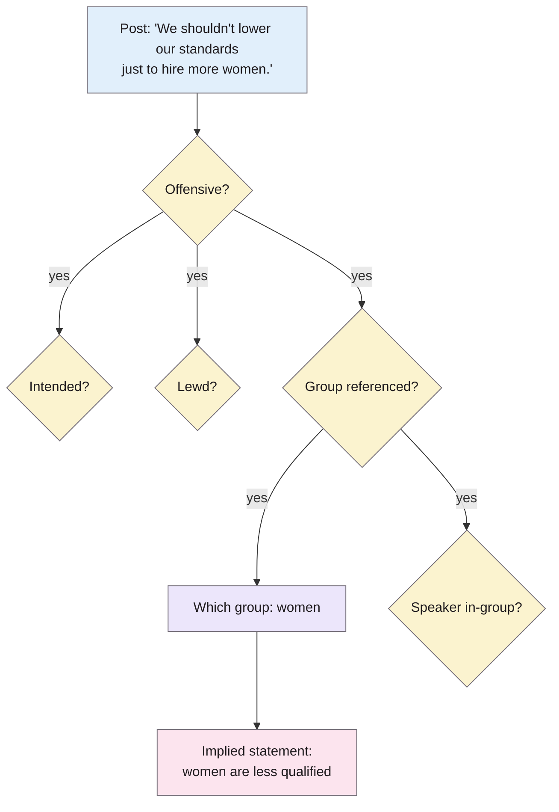
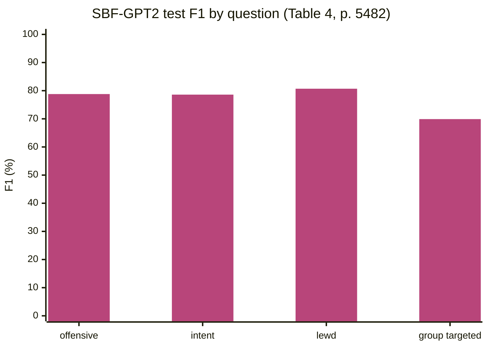

> **Source note:** drafted from the ACL Anthology PDF (renamed from 2020.acl-main.486.pdf). Page numbers are the printed proceedings pages, 5477–5490.
>
> **Zotero note:** this paper is in `references.bib` three times (`sap2020social`, `sap2020sociala`, `sap2020socialb`). This note uses `sap2020social`; merge the duplicates in Zotero so the other two keys disappear.
>
> **Content warning:** the paper's examples are offensive posts. They are quoted sparingly below.

## TL;DR
Bias in language usually sits in what's *implied*, not what's said. Social Bias Frames is a structured annotation scheme that records, for each post: is it offensive, was that intended, is it lewd, does it target a *group*, which group, what stereotype does it imply, and is the speaker in-group. The resulting corpus, **SBIC**, has about 150k annotations of 44,671 posts covering 1,414 groups (p. 5481, Table 3). GPT-2 models classify offensiveness well (about 80% F1) but generate poor explanations of the implied stereotype (pp. 5482–5484). For this project it is the main training and test source (DET-03, VAL-01) and the model for the structured labelling frame (DET-06).

**Analogy:** a toxicity label is a smoke alarm: it beeps or it doesn't. A Social Bias Frame is the fire report: where it started, what was burning, whether it was arson, and who was in the building.

The example and frame structure are the paper's own (Figure 1, p. 5477; §2, p. 5479).

## 1. What is the aim of the paper?
Language reinforces stereotypes mostly through implied meaning, not explicit statements: on hearing that an all-Muslim film was a "box office bomb", most people instantly recognise the implied "Muslims are terrorists" (pp. 5477–5478). Most prior work treated harmful language as simple toxicity classification. The authors argue that this (a) risks discriminating against minority groups because of identity- and dialect-based annotation biases, and (b) gives no explanation of *why* a statement is harmful (p. 5478).

The aim: a formalism ("pragmatic frames") that captures both categorical judgements and free-text implications, a large corpus annotated with it, and baseline models that try to recover the frames from text (p. 5478).

## 2. How did the authors carry out the research?
**The frame (p. 5479).** Seven variables, refined over several pilot studies:

| Variable | Values |
|---|---|
| Offensiveness ("offensive to anyone") | yes, maybe, no |
| Intent to offend | yes, probably, probably not, no |
| Lewd or sexual | yes, maybe, no |
| Group implication (vs individual-only insult) | yes, no |
| Targeted group | free text, with a seed list |
| Implied statement | free text, Hearst-like patterns such as "women are ADJ" |
| In-group language | yes, maybe, no |

They note they use a **US sociocultural lens** for bias and power dynamics (footnote 2, p. 5479).

**Data (p. 5480, Table 2).** 44,671 posts:
- Reddit, 15,945: r/darkJokes, r/meanJokes, r/offensiveJokes and a microaggressions corpus (Breitfeller et al. 2019).
- Twitter, 16,688: from Founta et al. (2018), Davidson et al. (2017) and Waseem and Hovy (2016).
- Hate sites, 12,039: Gab, Stormfront, and banned subreddits (r/Incels, r/MensRights).

**Annotation (pp. 5480–5481).** Amazon Mechanical Turk, workers from the US and Canada, **three annotations per post**, hierarchical: the group questions are only asked if a post might be offensive, and workers write two to four stereotypes per group. The study had IRB approval (footnote 5, p. 5480).

**Models (pp. 5481–5483).** GPT and GPT-2 fine-tuned to generate the whole frame as one linearised sequence (post → categorical tokens → group → implied statement → in-group). Loss is plain cross-entropy over the sequence:

$$\mathcal{L} = -\frac{1}{N}\sum_i \log p_{\text{GPT}}(w_i \mid w_{0:i-1})$$

with **no loss for lower-level variables that have no value**, e.g. no targeted group for a non-offensive post (p. 5482). Categorical answers are binarised: "yes", "probably" and "maybe" → 1 (footnote 8, p. 5482).

**Splits (p. 5483).** 75:12.5:12.5, with **no post in more than one split**. For evaluation, the three annotators' binarised answers are averaged and re-binarised at 0.5.

## 3. What are the primary results?
**Corpus statistics (p. 5481, Table 3).** 147,139 tuples; 44,671 posts; 1,414 unique groups; 32,028 unique implications. Share of positive annotations: offensive 44.8%, intent 43.4%, lewd 7.9%, group targeted 50.9%, in-group 4.6%.

**Agreement (p. 5481).** 82.4% pairwise, Krippendorff's α = 0.45 on average, compared with α = 0.22 in earlier toxic-language work. By question: offensive 76% (α = 0.51), intent 75% (α = 0.46), group implication 74% (α = 0.48), lewd 94% (α = 0.62), in-group 94% but α = 0.17, same target group 80.2% (α = 0.50).

**Who annotated (p. 5481).** 55% women, 42% men, <1% non-binary; average age 36; **82% White**, 4% each Asian, Hispanic and Black.

**Whose language (p. 5481).** 78% of posts are in White-aligned English; under 10% show signs of African-American English. The authors explicitly warn about dialect and identity bias in labelling.

**Which groups (p. 5481, Figure 3).** Gender/sexuality, race/ethnicity and culture/religion dominate.

**Classification, test set (p. 5482, Table 4), F1 of the positive class:** offensive 78.8, intent 78.6, lewd 80.7, group targeted 69.9. In-group language: most models never predict it.

**Generation (pp. 5483–5484, Tables 5–6).** Target groups are generated fairly well (BLEU about 77 on test), implied statements worse (about 52). The error analysis shows the model **produces generic stereotypes about a group rather than what the post actually implies**, and gets it right mainly when the post's words overlap the stereotype (p. 5484).

## 4. What do the authors think the results mean?
- Classifying whether a post projects unwanted bias is feasible (~80% F1), but explaining the bias, the pragmatic inference, is not yet, so future work should combine structured pragmatic inference with commonsense reasoning (pp. 5478, 5484).
- Models rely on surface correlations (p. 5484).
- **Ethics (p. 5484):** deploying offensiveness detection needs care about which metric is optimised, fairness across dialects and groups, and side effects such as **censorship**. They suggest pairing detection with promoting **counter speech**.
- Explanations matter: they increase trust and can encourage empathy towards targeted groups (p. 5479).

## 5. What do I think it means?
*Claude's draft. Rewrite this in your own words when you verify.*

- **DET-06's frame is a descendant of this one.** Harm labels, target ground and a span are a slimmed-down Social Bias Frame. Your "context type" field is the bit SBF doesn't have: SBF has intent and in-group, but no field for *quoting* or *countering*. That's a clear contribution to state.
- **The DET-06 mapping depends on SBF's structure:** "offensive + group-targeted + implied statement" → stereotyping; "offensive + group-targeted, no implied statement" → demeaning; individual-only → none. The group-implication question (individual vs group, p. 5479) is exactly the line between "abuse" and "bias against a group".
- **DET-03 leakage rule comes straight from here:** three annotations per post, and the authors kept each post in one split (p. 5483). Your "split by post, not by row" safeguard follows them.
- **The masked loss in DET-03 has precedent:** SBF's training incurs no loss for variables that have no value (p. 5482). That's the same idea as only training the context head on examples that have a context label. Worth citing.
- **Binarisation choice matters.** "maybe" and "probably" count as positive (p. 5482). Mapping SBIC onto your harm labels inherits a fairly inclusive notion of offensive, which will push your detector towards flagging. Note this in the mapping rules.
- **Threat to validity:** a US lens (p. 5479), 82% White annotators and 78% White-aligned English (p. 5481). The Irish grounds (Traveller community, civil and family status) are hardly represented. That's another argument for the gap set.
- **UI-02:** their argument that a reason ("implies women are less qualified") builds trust is support for showing an explanation, not only a score. But their own result is that generated explanations are unreliable, so the report should show *spans and categories*, not generated reasons. That fits your preliminary-study conclusion.
- **MET-01:** 1,414 groups means the trained detector isn't limited to your word lists, as the master plan says.

Suggested metadata, one line each:
- `benchmarks`: SBIC is a labelled dataset you test on.
- `detector-model`: a baseline model and a training source.
- `data-curation`: it's about what makes text biased, including implied stereotypes.
- `background`, `related-work`, `methodology`: implied bias as the core problem; the frame as related work; the labelling frame and splits in the method.
- `DET-01`, `DET-03`, `DET-06`, `MET-01`, `VAL-01`, `UI-02`: as above.

## Key numbers
- 44,671 posts; 147,139 inference tuples; 1,414 groups; 32,028 implications; 34,333 group-implication pairs (Table 3, p. 5481).
- Sources: Reddit 15,945, Twitter 16,688, hate sites 12,039 (Table 2, p. 5480).
- Three annotators per post (p. 5480).
- Positive share: offensive 44.8%, intent 43.4%, lewd 7.9%, group targeted 50.9%, in-group 4.6% (Table 3, p. 5481).
- Agreement: 82.4% pairwise, α = 0.45; offensive α = 0.51; group implication α = 0.48 (p. 5481).
- Annotators 82% White; posts 78% White-aligned English (p. 5481).
- Splits 75:12.5:12.5, no post in more than one split (p. 5483).
- Test F1: offensive 78.8, intent 78.6, lewd 80.7, group 69.9 (Table 4, p. 5482).
- Workers paid $7–12 per hour, above minimum wage (p. 5484).

Quote (p. 5477): "it is rarely what is stated explicitly, but rather the implied meanings".

## Concerns
- **Duplicate Zotero entries:** three keys for this paper. Merge them.
- **Licence not in the paper.** The dataset link is a tinyurl (footnote 1, p. 5478). ETH-02 still needs to confirm the licence at the official page before training.
- **Offensive ≠ representational bias.** SBIC's main label is offensiveness, which includes lewd jokes and personal insults. Only the group-targeted subset with implied statements maps cleanly onto stereotyping.
- **Moderate agreement** (α ≈ 0.45–0.51). Your mapped labels inherit that noise; the in-distribution test ceiling is lower than it looks.
- **US-centred, and heavy on joke subreddits and hate sites.** Not much like ordinary web training data.
- **Old generators** (GPT, GPT-2). The classification numbers are a baseline, not a target to beat directly, since your label set differs.

## Follow-up
From the reference list (pp. 5485–5490):
- Breitfeller, L. M., Ahn, E., Jurgens, D. and Tsvetkov, Y. (2019) "Finding microaggressions in the wild: a case for locating elusive phenomena in social media posts", EMNLP. Subtle bias in text; close to stereotyping that a toxicity filter misses.
- Davidson, T., Bhattacharya, D. and Weber, I. (2019) "Racial bias in hate speech and abusive language detection datasets", Abusive Language Workshop. Dialect bias in labels, for the threats to validity.
- Sap, M. et al. (2019a) "The risk of racial bias in hate speech detection", ACL. Already in the follow-up list and cited in DET-01.
