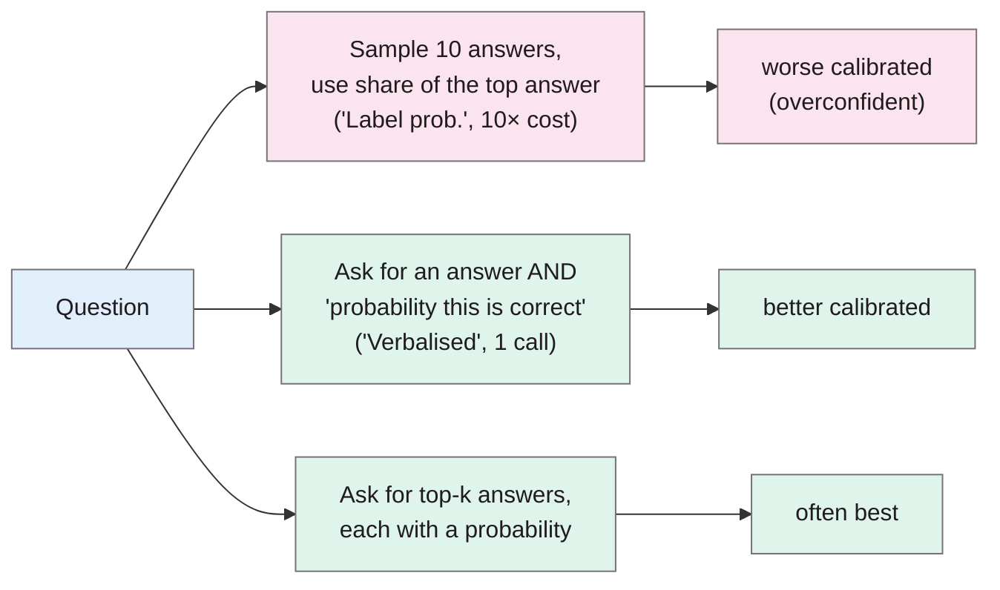

> **Source note:** drafted from the ACL Anthology PDF (renamed from 2023.emnlp-main.330.pdf). Page numbers are the printed proceedings pages, 5433–5442.

## TL;DR
Chat models tuned with human feedback (RLHF) such as ChatGPT, GPT-4 and Claude are known to have poorly calibrated token probabilities, and closed APIs often don't expose them anyway (pp. 5433–5434). The authors show that **simply asking the model to state a probability** ("verbalised confidence") is usually better calibrated than probabilities estimated from the model's outputs, **often cutting expected calibration error by about half** on TriviaQA, SciQ and TruthfulQA; asking it to list several candidate answers with a probability each ("top-k") helps further (pp. 5433–5437). For this project it's the reason DET-04 asks the API for a 0–1 confidence and then recalibrates it.

**Analogy:** instead of watching which answer a quiz contestant blurts out most often over ten tries, you ask "how sure are you?". Surprisingly, the honest answer to that question tracks how often they're right better than their repeated guesses do.

## 1. What is the aim of the paper?
Real-world prediction systems should give confidence that reflects their chance of being right, so that low-confidence cases can be passed to a human (p. 5433). Pretrained LMs' probabilities are well calibrated, but RLHF may break that, and the most-used models are RLHF models whose token probabilities are often unavailable (pp. 5433–5434). The aim: a broad evaluation of ways to extract confidence from RLHF models (p. 5433).

## 2. How did the authors carry out the research?
**Models (p. 5434).** gpt-3.5-turbo, GPT-4, Claude 1, Claude 2, Llama-2-70B-Chat.

**Datasets (p. 5435).** Short-answer factual QA: 1,000 TriviaQA and 1,000 SciQ validation questions, and all 817 TruthfulQA questions. Correctness judged by GPT-4 or GPT-3.5 checking equivalence with the gold answer.

**Methods (pp. 5435–5436, Table 6).**
- *Label prob.*: the share of 10 sampled answers that match the most common answer (estimated by sampling, since APIs don't give probabilities).
- *'Is True' prob.*: ask whether a proposed answer is true; estimate P(True) by sampling.
- *Verbalised, one stage (Verb. 1S top-k)*: in one reply, give k guesses with a probability for each.
- *Verbalised, two stage (Verb. 2S)*: answer first, then give probabilities in a second turn; also a chain-of-thought variant.
- *Linguistic (Ling. 1S)*: express confidence in words ("highly likely") mapped to numbers.

**Metrics (pp. 5434–5435).** ECE (defined here with squared error per bin), ECE after temperature scaling (ECE-t, fitting $\tilde{p}_i \propto p_i^{\beta}$), Brier score after temperature scaling, and AUC of selective accuracy vs coverage. They note ECE alone "completely fails to capture the confidences' discriminative power": a binary classifier guessing at 50% has perfect ECE (footnote 5, p. 5434).

## 3. What are the primary results?
- **RLHF worsens calibration** of Llama-2-70B's log probabilities on all three datasets (Figure 2, p. 5434).
- **Verbalised beats sampled probabilities.** gpt-3.5-turbo on TriviaQA (Table 1, p. 5435): Label prob. ECE 0.140 vs Verb. 1S top-2 0.050 and Verb. 2S top-2 0.047. On SciQ: 0.256 vs 0.132 and 0.169. Similar patterns for GPT-4 and Claude (Tables 2–4); mixed for Llama-2-70B-Chat (p. 5437).

```mermaid
%%{init: {"themeVariables": {"xyChart": {"plotColorPalette": "#F29BBE, #B8457A"}}}}%%
xychart-beta
  title "gpt-3.5-turbo ECE: sampled vs verbalised (top-2), Table 1 (p. 5435)"
  x-axis ["TriviaQA", "SciQ", "TruthfulQA"]
  y-axis "ECE (lower is better)" 0 --> 0.5
  bar [0.140, 0.256, 0.451]
  bar [0.050, 0.132, 0.361]
```

First bar: Label prob. (10 samples); second: Verb. 1S top-2.

- **Considering alternatives helps:** asking for several candidate answers before giving confidence improves calibration, echoing "considering the opposite" in psychology (pp. 5433–5434).
- **Prompt sensitivity:** one-stage and two-stage prompts "sometimes differ drastically" in calibration (p. 5437).
- **Cost note:** using 20 samples instead of 10 didn't meaningfully improve sampled calibration (footnote 6, p. 5436).

## 4. What do the authors think the results mean?
- For RLHF models, verbalised probabilities are a practical, cheap way to get calibrated confidence, especially when log probabilities aren't available (p. 5437).
- Open questions: why models differ in this ability, how to reduce prompt sensitivity, and whether it holds beyond factual QA (p. 5437).
- **Limitations (p. 5437):** only short-form factual QA; closed models' training is opaque; no reasoning-heavy or long-form tasks.

## 5. What do I think it means?
*Claude's draft. Rewrite this in your own words when you verify.*

- **DET-04's design is supported.** Ask for a 0–1 confidence per label in the JSON reply, rather than sampling repeatedly, and then recalibrate. The paper's "often cutting calibration error by about half" claim in the master plan is accurate (p. 5433).
- **Recalibration method:** they temperature-scale verbalised confidences ($p^\beta$). The master plan uses Platt scaling. Both are fine; Platt has one extra parameter. Use the same family as the local model (MET-02) if you want the two backends' scores directly comparable, or state why they differ.
- **Consider "top-k" for DET-04:** ask the API for confidence for *each* label (stereotyping, demeaning, none) rather than one. Their top-k result suggests listing alternatives improves calibration, and you need per-label probabilities anyway.
- **Repeated sampling isn't worth it:** the master plan rejects "asking several times" as about 5× the cost; here 10 samples were *worse* calibrated than one verbalised answer (Table 1), and 20 samples didn't help (p. 5436). That's a stronger reason than cost alone.
- **Transfer risk (MET-05):** their tasks are factual QA, yours is a judgement on bias. Calibration may not transfer, and they say results are prompt-sensitive (p. 5437). Measure ECE for the API backend on your own calibration split before trusting the DET-05 thresholds.
- **ECE definition:** they use squared error per bin, Guo et al. use absolute error (@guo2017calibration). Pick one and say which in MET-05. Their point that ECE ignores discrimination is also a good reason to report PR-AUC alongside it (MET-05 already does).

Suggested metadata, one line each:
- `detector-model`: confidence from the API backend.
- `metrics`: calibration metrics.
- `methodology`: DET-04 prompt and calibration design.
- `DET-04`, `DET-05`, `MET-02`, `MET-05`, `MET-06`: as above.

## Key numbers
- Five RLHF models; TriviaQA and SciQ (1,000 questions each), TruthfulQA (817) (pp. 5434–5435).
- Sampled methods use n = 10 samples; n = 20 gave no meaningful improvement (p. 5436).
- gpt-3.5-turbo ECE, Label prob. vs Verb. 1S top-2: TriviaQA 0.140 vs 0.050; SciQ 0.256 vs 0.132; TruthfulQA 0.451 vs 0.361 (Table 1, p. 5435).
- Verbalised confidence often reduces ECE by a relative 50% (p. 5433).

Quote (p. 5433): "verbalized confidences emitted as output tokens are typically better-calibrated than the model's conditional probabilities".

## Concerns
- **Factual QA only;** classification judgements like yours aren't tested.
- **Closed models change** over time (gpt-3.5-turbo accessed June 2023); results may not hold for current versions.
- **Correctness judged by another LLM** (p. 5435), which adds noise.
- **ECE variant differs** from Guo et al.

## Follow-up
None added: the reference list covers LLM calibration more broadly (e.g. Kadavath et al. 2022); not needed unless DET-04's calibration fails in testing.
