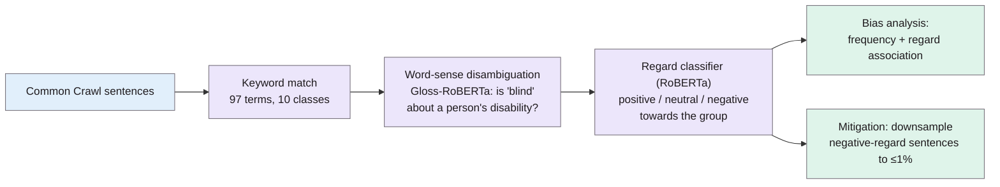

> **Source note:** drafted from the ACL Anthology PDF (renamed from 2025.findings-emnlp.2.pdf). Page numbers are the printed proceedings pages, 16–25. A short (4-page) Findings paper plus appendices.
>
> **Content warning:** includes examples of stereotyped word associations.

## TL;DR
IBM researchers propose a two-step pipeline to measure social bias in pretraining data at scale: (1) **protected attribute detection**, keyword matching for 97 group terms in 10 classes, with a small **word-sense disambiguation** model to drop false matches like "blind date" or "Asian cuisine"; (2) **regard classification**, labelling each mention as positive, neutral or negative towards the group (pp. 16–17). On 3 million Common Crawl documents they find, for example, "white" described with negative regard in over 20% of sentences, and show that **downsampling negative-regard sentences** to 1% cuts associations like "white"→"supremacist" and "arab"→"terrorist" (pp. 18–19). For this project it's the closest prior work to EvenGround's source level, but it rebalances a whole corpus offline rather than gating each source, and its regard filter would remove news reports of racist attacks.

**Analogy:** a census of how each group is talked about, recording not just *how often* each group is mentioned with "terrorist", but whether the sentence says something *bad about the group*. Then thinning out the bad-press sentences until every group's coverage is roughly balanced.

Pipeline from Figure 1 (p. 17).

## 1. What is the aim of the paper?
Web-crawled pretraining data contains biases (e.g. associating Muslims with terrorism) that LLMs inherit, but auditing and fixing them at scale is very hard (p. 16). The aim: a scalable annotation pipeline to analyse and mitigate social bias in pretraining corpora (p. 16).

## 2. How did the authors carry out the research?
**Protected attribute detection (pp. 16–17).**
- A taxonomy of 10 classes and 97 keywords (e.g. race/ethnicity, nationality, disability), built from companies' diversity and inclusion policies, expanded with an LLM and curated by hand (p. 22).
- Keywords are polysemous, so each gets a hand-written **gloss** ("a person of asian race/ethnicity"), and a GlossBERT-style classifier decides whether the keyword in context means the protected attribute. Training labels came from Mixtral-8x22B on 1,000 Common Crawl sentences per keyword; the student model is RoBERTa-base ("Gloss-RoBERTa").

**Regard classification (p. 17).** Existing regard classifiers (Sheng et al. 2019) were trained on templates, so they generated new labels with Mixtral-8x7B on 50,000 sentences per keyword and trained a RoBERTa-base classifier: positive, neutral or negative regard towards the group.

**Data (p. 18).** Over 3 million English Common Crawl documents; sentences of 16–128 tokens; up to 100,000 sentences per attribute.

**Bias scores (pp. 18–19).** Frequency bias (Bordia and Bowman 2019):

$$\text{bias}_{\text{freq}}(w, a) = \frac{p(w \mid a)}{\langle p(w \mid a) \rangle_{a \in A}}$$

and their frequency + regard score:

$$\text{bias}_r(w, a) = \min\!\left(\frac{p(w \mid a)}{\langle p(w \mid a) \rangle_{a \in A}},\; \frac{p(r \mid w, a)}{\langle p(r \mid w, a) \rangle_{r \in R}}\right)$$

so a word scores high for "negative" only if it co-occurs with the group *and* those co-occurrences are negative about the group.

**Mitigation (p. 19).** Downsample negative-regard sentences so that each attribute has at most 1% negative regard, then measure the change in $p(w \mid a)$.

## 3. What are the primary results?
- **Agreement (p. 18):** WSD: Cohen's κ ≈ 0.59 between Mixtral and Gloss-RoBERTa on average; human–human and human–model agreement on a few attributes 0.56–0.70. Regard classifier: F1 0.91 micro, 0.82 macro against a test set checked by two Mixtral models.
- **Frequency alone isn't informative (p. 18, Table 2):** words co-occurring with "arab" are mostly place names; "supremacist" co-occurs with "white" but that doesn't say whether the text is negative. With regard: positive words for "arab" include "generosity", "hospitality"; negative include "terrorist", "assaults", "bomb"; for "white", negative includes "supremacist", "racists".
- **Regard is imbalanced (p. 19, Figure 2):** "white" people are described with negative regard in over 20% of race/ethnicity sentences.
- **Mitigation (p. 19):** with negative regard capped at 1%, $p(\text{"supremacist"} \mid \text{white})$ fell to 19% of its original value, "racists" to 18%; "terrorist" | arab to 46%, "assaults" to 26%; positive associations stayed or rose (up to 112% for "generosity", "hospitality").
- **What gets removed (p. 19):** "Not every white person is racist and not every black person is a criminal" is *neutral* and kept; "Report says he was attacked by three white males ... who made racist comments as they assaulted him" is *negative* and **subject to downsampling**.
- Their scores matched known stereotypes in SeeGULL better than frequency alone (p. 19, Appendix B).

## 4. What do the authors think the results mean?
- Word-sense disambiguation makes attribute detection accurate while staying efficient; regard adds the missing "how is the group described" dimension that earlier corpus studies (Dodge et al. 2021; FineWeb) overlooked (p. 19).
- Balancing regard distributions is "a promising technique" for mitigating bias (p. 19).
- **Limitations (p. 20):** no age, marital status or political belief classes; incomplete attribute lists; WSD still struggles on some attributes; the regard classifier inherits Mixtral's own biases; no LLM was actually pretrained on the rebalanced data.

## 5. What do I think it means?
*Claude's draft. Rewrite this in your own words when you verify.*

- **Related work: your closest neighbour.** Same goal (bias in pretraining data), similar parts (group detection → judgement of how the group is portrayed → corpus statistics). Your differences, stated in the master plan, hold up: (1) **per-source gate in CI**, not offline corpus rebalancing; (2) **Irish equality grounds** including age, civil and family status, which they explicitly don't cover (p. 20); (3) **"mention is not bias"**: their regard filter downsamples the news report of a racist assault (p. 19), which is exactly the reporting your stance protects.
- **Regard ≠ representational bias.** "Negative regard" counts any negative portrayal of a group member, including true reports of crimes against them or by them. Your stereotyping/demeaning labels with a context type are a finer cut. That's a strong argument for DET-06 in the related-work section.
- **MET-01 disambiguation:** the master plan already cites them for "blind date". Their numbers help: κ ≈ 0.59 for an LLM-trained disambiguator (p. 18). Your plan to start with simple context rules and report the false-match rate is a reasonable lighter version; cite this as the heavier alternative.
- **Source level (DET-01 skewed association, MET-03):** their frequency + regard score is a concrete formula you could adopt for "skewed association", with $p(w \mid a)$ over occupations or traits. It's more interpretable than embedding methods, and works on counts.
- **EVAL-01 and EVAL-06:** they didn't train a model on the rebalanced data (p. 20), the same gap as Mendu et al. If EVAL-01 trains even a small model, that's a step beyond both.
- **Distillation pattern (DET-04):** LLM labels → small RoBERTa classifier is the same API-then-local pattern as your backends.

Suggested metadata, one line each:
- `data-curation`, `metrics`, `detector-model`: corpus bias analysis and mitigation; bias scores; small distilled classifiers.
- `related-work`, `methodology`: closest prior work; source-level formulas.
- `DET-01`, `MET-01`, `MET-03`, `EVAL-01`, `EVAL-06`: as above.

## Key numbers
- 10 attribute classes, 97 keywords (p. 17; p. 22).
- Over 3 million Common Crawl documents; up to 100,000 sentences per attribute (p. 18).
- WSD agreement κ ≈ 0.59 (model–model); 0.56–0.70 (human checks) (p. 18).
- Regard classifier F1: 0.91 micro, 0.82 macro (p. 18).
- "white" negative regard over 20% (Figure 2, p. 19).
- After capping negative regard at 1%: "supremacist"|white to 19%, "racists" to 18%, "terrorist"|arab to 46%, "assaults" to 26%; "generosity"/"hospitality" up to 112% (p. 19).

Quote (p. 19): "Report says he was attacked by three white males at about 3:25 a.m., who made racist comments as they assaulted him. (r = negative)"

## Concerns
- **Short paper;** most details are in appendices, and the taxonomy and glosses aren't fully listed in the main text.
- **LLM-generated labels** for both steps; human validation is small.
- **No downstream training experiment** (p. 20).
- **Regard balancing can erase reporting of real events**, as their own example shows.
- **Corporate D&I taxonomy,** not law.

## Follow-up
From the reference list (pp. 20–21):
- Jha, A., Mostafazadeh Davani, A., Reddy, C. K., Dave, S., Prabhakaran, V. and Dev, S. (2023) "SeeGULL: a stereotype benchmark with broad geo-cultural coverage leveraging generative models", ACL 2023, pp. 9851–9870. Stereotypes across many nationalities and regions; a possible source of documented stereotypes beyond the US (VAL-01 gap set).
- Bordia, S. and Bowman, S. R. (2019) "Identifying and reducing gender bias in word-level language models", NAACL 2019 Student Research Workshop, pp. 7–15. The frequency bias score adapted here; a candidate for the source-level association measure.
- Penedo, G. et al. (2024) "The FineWeb datasets: decanting the web for the finest text data at scale", arXiv:2406.17557. A modern pretraining corpus and its filtering; context for where EvenGround would sit.
