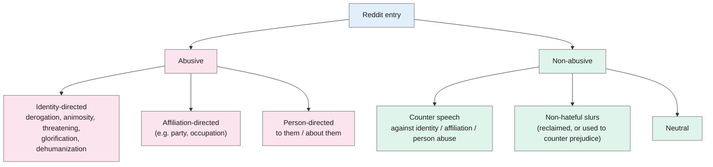
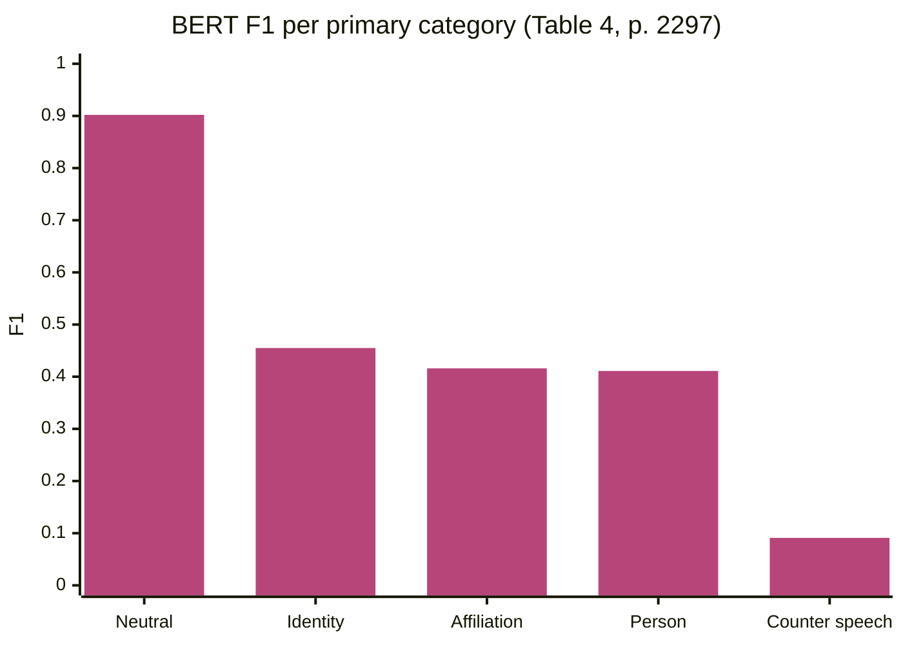

> **Source note:** drafted from the ACL Anthology PDF (renamed from 2021.naacl-main.182.pdf). Page numbers are the printed proceedings pages, 2289–2303.

## TL;DR
CAD is about 25,000 Reddit posts and comments labelled **in the context of their conversation thread**, with six primary categories: three kinds of abuse (identity-, affiliation- and person-directed) and three kinds of *non-abuse* (counter speech, non-hateful slurs, neutral). Each label also records whether the thread context was needed, and annotators highlighted the responsible span (rationale) (pp. 2289, 2293–2294). Labels came from trained annotators plus expert-led group discussion, not crowdworkers. Baseline BERT reached macro-F1 0.455, and only 0.091 F1 on counter speech (p. 2296). For this project it's the source of labelled counter speech for training (DET-03) and the precedent for giving harmless-but-sensitive text its own categories (DET-06).

**Analogy:** most abuse datasets judge each comment like a quote cut out of a newspaper. CAD reads the whole letters page first. "Go do it!" is harmless on its own and abusive as a reply to "I want to shoot some X" (p. 2294).

Taxonomy from Figure 1 (p. 2291).

## 1. What is the aim of the paper?
Progress in abuse detection is held back by a lack of high-quality, detailed datasets (p. 2289). Problems the authors list in earlier datasets (pp. 2290–2291):
- taxonomies that mix up identities and affiliations, or ignore non-abusive content that looks abusive;
- low annotation quality: agreement scores such as α = 0.45 or κ = 0.15–0.17 in other datasets; in one study 27% of classification errors were annotation mistakes;
- crowdsourcing, which is cheap but poor for complex tasks;
- content labelled without the thread it appeared in.

The aim: a dataset with (1) six conceptually distinct primary categories plus secondary ones, (2) labels made in thread context, (3) rationales, and (4) expert-led group adjudication (p. 2289).

## 2. How did the authors carry out the research?
**Taxonomy (pp. 2291–2293).**
- **Identity-directed abuse:** a negative statement against a social category: religion, race, ethnicity, gender, sexuality, nationality, disability, class. Five subtypes: *derogation* (explicit), *animosity* (implicit or subtle, e.g. denying discrimination or claiming "special treatment"), *threatening*, *glorification* of hateful entities, *dehumanization*.
- **Affiliation-directed abuse:** the same, against a (more or less) voluntary group: parties, unions, occupations.
- **Person-directed abuse:** at a named or identifiable person, in the thread or outside it.
- **Counter speech:** content that "challenges, condemns or calls out the abusive language of others"; treated as relational, so it always needs previous context (pp. 2293–2294).
- **Non-hateful slurs:** slurs used non-derogatorily, to counter prejudice or reclaimed (p. 2293). Hateful slur use counts as identity-directed abuse.
- **Neutral:** none of the above.

**Data (p. 2293).** Community-based sampling instead of keyword sampling (which introduces topic and author bias): 117 candidate subreddits filtered to 16 (no clear political ideology, not aimed at a single group, still active). 187,806 threads collected (February–July 2019), stratified down to 1,394 posts and 23,762 comments; titles and bodies annotated separately → **26,550 entries**, **27,494 labels** (multi-label allowed) (pp. 2293–2294).

**Annotation (p. 2294).** Two annotators per entry, after **4 weeks' training**, working through whole threads in order. Every disagreement discussed with an expert against the codebook, then a final expert review for consistency. Each label has a context flag (Current or Previous). Rationales: one gold span per entry.

**Experiments (pp. 2295–2296).** Multi-label classification of primary categories (non-hateful slurs merged into neutral because there are so few). 23,417 usable entries split 58/19.3/22.7, **all entries in a thread in the same split**, and some subreddits only in dev or test. Models: logistic regression, DistilBERT and BERT-base with class weighting and multi-hot binary cross-entropy, five seeds. **Only the entry text is input; thread context isn't used.** Macro-F1 is preferred because of the skew.

## 3. What are the primary results?
**Prevalence (p. 2295, Table 3):** neutral 79.8% of labels, identity-directed 9.9%, affiliation-directed 5.0%, person-directed 4.0%, **counter speech 0.8% (220 labels)**, non-hateful slurs 0.5% (149). Within identity-directed abuse: animosity 58.1%, derogation 37.8%.

**Agreement (p. 2294; Table 2, p. 2295):** Fleiss' κ 0.583 overall ("moderate"); non-hateful slurs 0.754, neutral 0.579, person 0.513, affiliation 0.453, **counter speech 0.267**. Identity-directed is 0.419 in the text and 0.498 in Table 2; check the PDF.

**Context matters (p. 2294):** 25–32% of identity-, affiliation- and person-directed labels needed the previous thread.

**Classification (pp. 2296–2297, Tables 4–5):**

| Model | Accuracy | Macro-F1 | Micro-F1 |
|---|---|---|---|
| Logistic regression | 0.634 | 0.343 | 0.711 |
| DistilBERT | 0.769 | 0.440 | 0.797 |
| BERT | 0.762 | 0.455 | 0.799 |

- A model that labels everything neutral would get 0.818 accuracy but 0.180 macro-F1 (p. 2296).
- **Error analysis (p. 2296):** BERT often misclassifies **neutral content that mentions identities** (e.g. non-misogynistic discussion of women) or contains profanity, and misses identity abuse that uses fewer abusive keywords.
- **Context hurts recall (p. 2296):** BERT's recall on identity-directed abuse is 25.3% when the label needed previous context, 60.1% when it didn't.
- **Implicit is harder (p. 2297):** BERT's recall for animosity 45.3% vs derogation 65.9%.

## 4. What do the authors think the results mean?
- Social-scientific categories give a more nuanced and robust way of characterising, and so detecting, abuse; there's "much room for improvement" (p. 2297).
- Future work: models that use the conversation thread, classification of secondary categories, using the rationales (p. 2297).
- Limitations: heavy skew to neutral (realistic, but few training signals for rare classes), and agreement that could be better on edge cases (p. 2297).
- Ethics: Turing Institute approval before data collection; examples in Table 1 are **synthetic**, not real user quotes; trained, supervised annotators with counselling available, paid above the living wage (pp. 2297–2298).

## 5. What do I think it means?
*Claude's draft. Rewrite this in your own words when you verify.*

- **DET-03: the counter-speech supply is tiny.** Only 220 counter-speech labels, and 115 of them counter identity-directed abuse (Table 3). That's not enough on its own to teach the context head "counters"; the generated hard negatives will carry most of that load. Worth saying in the method so the master plan's "CAD is a candidate for counter speech" isn't over-read.
- **Bigger catch for DET-03:** counter speech in CAD is defined *relationally* and always needed the previous message (p. 2294). Your detector sees a passage, not a thread. Many CAD counter-speech entries ("Sorry but that's just factually incorrect", Table 1) won't look like counter speech without the parent. Consider filtering to counter speech whose span itself quotes or names the abuse, or accept the noise and say so.
- **DET-06 precedent:** CAD gives harmless-but-sensitive text its own labels (counter speech, non-hateful slurs). That's the precedent the master plan cites, and your context type generalises it.
- **DET-06 mapping:** identity-directed abuse maps to your harm labels; "animosity" is close to stereotyping and implicit bias (e.g. "I dont think black people face any discrimination", Table 1), "derogation" and "dehumanization" to demeaning. Person- and affiliation-directed abuse → none, as the master plan says, because they aren't about an Equal Status ground. (Exception to note: an *occupation* isn't a ground, but "class" is in CAD's identity list and isn't in yours.)
- **The Traveller community appears** in CAD's own illustrative examples ("Travellers are nothing but trash", dehumanization, Table 1). The examples are synthetic, but it suggests the British team considered Travellers a target identity. Worth checking whether CAD's 185 targets include Travellers; if so, it's a small source for that ground.
- **ARCH-04:** 25–32% of abuse needed thread context, and recall halved without it (p. 2296). That supports passage-level scoring with surrounding sentences rather than single sentences.
- **Error pattern = your stance problem again:** BERT misclassified neutral content mentioning identities (p. 2296). Fourth paper in a row with the same failure.
- **Splits:** they put whole threads in one split, and kept some subreddits out of training (p. 2295). That's the CAD version of "split by post" for DET-03. If your training data takes CAD comments, keep threads together.
- **MET-05:** five seeds with standard deviations (Table 5), and macro-F1 because of skew: same reporting as yours.
- **ETH-02:** the licence (CC BY 4.0 in the master plan) isn't stated in the paper; confirm at the GitHub repository (footnote 1, p. 2290). Data was collected via Pushshift, which matters if the datasheet asks about collection terms.

Suggested metadata, one line each:
- `benchmarks`: a labelled abuse dataset.
- `detector-model`: baseline results and error analysis.
- `data-curation`: community-based sampling and expert annotation as dataset practice.
- `related-work`, `methodology`: an abuse taxonomy with non-abusive categories; the training data and labelling plan.
- `DET-03`, `DET-06`, `ARCH-04`, `MET-05`, `ETH-02`: as above.

## Key numbers
- 26,550 entries (1,394 titles, 1,394 bodies, 23,762 comments); 27,494 labels (pp. 2293–2294).
- 16 subreddits from 117 candidates; 187,806 threads, 1 Feb–31 Jul 2019 (p. 2293).
- Neutral 79.8%, identity 9.9%, affiliation 5.0%, person 4.0%, counter speech 0.8%, non-hateful slurs 0.5% (p. 2295).
- Counter speech: 220 labels (115 against identity abuse) (Table 3, p. 2295).
- Fleiss' κ: overall 0.583, counter speech 0.267 (Table 2, p. 2295).
- 25–32% of abuse labels needed previous context (p. 2294).
- 185 targets in 8 top-level categories (p. 2294).
- Experiment split: 13,584 / 4,526 / 5,307 entries (p. 2295).
- BERT macro-F1 0.455 (sd 0.006); counter speech F1 0.091 (Tables 4–5, p. 2297).
- BERT recall on identity abuse: 25.3% (needed context) vs 60.1% (didn't) (p. 2296).

Quote (p. 2293): "Content which challenges, condemns or calls out the abusive language of others."

## Concerns
- **Reddit only, 2019, 16 subreddits** chosen to be abuse-heavy. Not representative of training-data sources like web pages or books.
- **Very little counter speech** (220) and low agreement on it (κ 0.267), so it's a noisy, small signal.
- **Counter speech depends on thread context** that your passage-level detector doesn't see.
- **Text vs table discrepancy** for identity-directed κ (0.419 vs 0.498).
- **Taxonomy is about abuse, not stereotyping;** "animosity" is the closest match, and it's a judgement call.
- **Licence not stated in the paper.**

## Follow-up
From the reference list (pp. 2299–2301):
- Qian, J., Bethke, A., Liu, Y., Belding, E. and Wang, W. Y. (2019) "A benchmark dataset for learning to intervene in online hate speech", EMNLP-IJCNLP 2019, pp. 4757–4766. Counter speech as a labelled category; a possible extra source for DET-03.
- Mathew, B. et al. (2019) "Thou shalt not hate: Countering online hate speech", ICWSM 2019, pp. 369–380. A counter-speech dataset.
- Wiegand, M., Ruppenhofer, J. and Kleinbauer, T. (2019) "Detection of abusive language: the problem of biased datasets", NAACL-HLT, pp. 602–608. Keyword sampling causes topic and author bias; relevant to how training data was collected (DET-03).
