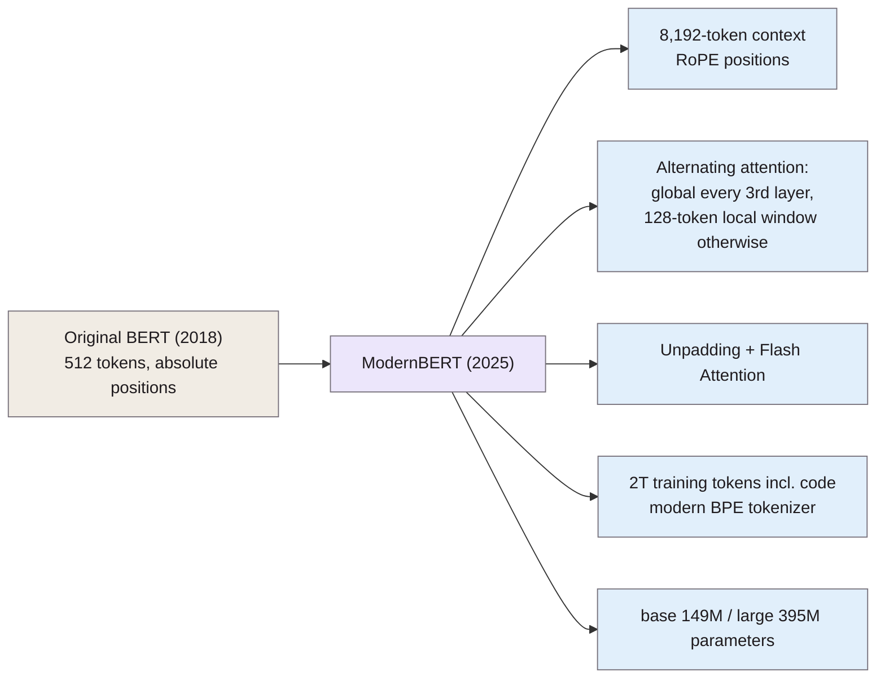

> **Source note:** drafted from the ACL Anthology PDF (renamed from 2025.acl-long.127.pdf). Page numbers are the printed proceedings pages, 2526–2547. The architecture ablations and full benchmark tables in the appendices weren't summarised.

## TL;DR
ModernBERT brings recent LLM improvements to the old BERT-style encoder: rotary position embeddings, GeGLU activations, alternating local/global attention, unpadding and Flash Attention, a modern tokenizer, and **2 trillion training tokens** including code, with a **native 8,192-token context** (pp. 2526–2528). The base model has **149M parameters** (p. 2528). It sets the state of the art among encoders on classification (first base model to beat DeBERTaV3-base on GLUE) and retrieval, and is the fastest and most memory-efficient encoder tested: long inputs about 2–3× faster than the next-fastest, and twice the batch size of other base models (pp. 2532–2533). For this project it's the chosen detector backbone (DET-02).

**Analogy:** the original BERT is a reliable 2018 family car. ModernBERT is the same kind of car rebuilt with a modern engine, longer fuel tank and better mileage: still a car, not a lorry (an LLM), so it's cheap to run.

Details from §2 (pp. 2527–2528).

## 1. What is the aim of the paper?
Encoder-only models like BERT remain the workhorses for retrieval and classification because they're cheap at inference, including for "detecting toxic prompts" alongside LLMs (p. 2526). Yet pipelines still rely on old models with 512-token limits, inefficient architectures and narrow, dated training data (p. 2526). The aim: a modernised encoder that improves both downstream performance and efficiency, especially on long inputs (p. 2527).

## 2. How did the authors carry out the research?
**Architecture (pp. 2527–2528).** No bias terms in most linear and LayerNorm layers; rotary positional embeddings; pre-normalisation; GeGLU activation; attention alternating between global (every third layer) and a 128-token local sliding window; unpadding (concatenating a batch's sequences without padding) with Flash Attention; `torch.compile`. Deep and narrow: 22 layers (base) and 28 (large), sized for common inference GPUs.

**Training (p. 2528).** 2 trillion tokens of mainly English web, code and scientific text; a modified OLMo BPE tokenizer keeping BERT's special tokens; native 8,192-token sequences; all intermediate checkpoints released.

**Evaluation (pp. 2529–2533).** Classification (GLUE), single- and multi-vector retrieval (BEIR, long-context retrieval), and code tasks, against BERT, RoBERTa, DeBERTaV3, NomicBERT and GTE-en-MLM. Efficiency measured as tokens per second on a single **NVIDIA RTX 4090** GPU, averaged over ten runs, on fixed and variable-length document sets (p. 2533).

## 3. What are the primary results?
- **Classification (p. 2532):** ModernBERT-base "surpasses all existing base models" on GLUE, including DeBERTaV3-base, "the first MLM-trained model to do so"; ModernBERT-large is second-best among large models, close to DeBERTaV3-large with fewer parameters and half the processing time.
- **Retrieval and code (pp. 2532–2533):** best encoder overall; at least 9 NDCG@10 points ahead of other long-context models on long-context retrieval; best on code (it's the only one trained on code).
- **Speed (p. 2533):**
  - fixed 512-token inputs: faster than all recent encoders, though slower than the original BERT and RoBERTa (fewer parameters);
  - long context: 2.65× (base) and 3× (large) faster than the next-fastest encoder;
  - variable-length inputs: 14.5–30.9% more tokens per second than GTE-en-MLM at short lengths, 98.8–118.8% at long.
- **Memory (p. 2533):** base processes batch sizes twice as large as every other base model.
- **Conclusion (p. 2533):** short inputs processed twice as fast as DeBERTaV3.

## 4. What do the authors think the results mean?
- Encoders benefit from modern data scale and LLM architecture improvements (p. 2533).
- ModernBERT is "a generational leap over the original encoder models" (p. 2534).
- **Limitations (p. 2534):** English only; "trained largely on web data, as a result, all of its representations are subject to the biases present in such data"; MLM-only training may be weaker for classification than adding replaced-token detection (as DeBERTaV3 does); model size not scaled.

## 5. What do I think it means?
*Claude's draft. Rewrite this in your own words when you verify.*

- **DET-02's citation.** 149M parameters, 8,192 tokens, state-of-the-art base encoder on GLUE, efficient: the master plan's reasons all check out. Note the precise figure is 149M (the master plan says 150M).
- **CI-03 and MET-06 caution: all speed numbers are on a GPU** (RTX 4090) with Flash Attention (p. 2533). Your tool runs on a **CPU** in CI, and the master plan already says to install without flash-attention. So don't cite their speed-ups as CPU expectations; measure your own CPU latency (MET-06), as planned. On short inputs it's even slower than BERT-base (p. 2533), which is close to your 512-token passages.
- **Its own bias.** Trained on web data, it carries web data's biases (p. 2534). Fine-tuning a detector on top inherits a backbone that may associate identity terms with negativity, the Dixon problem. That's one more reason for the hard-negatives ablation and for testing HateBERT as a comparison (DET-02).
- **ARCH-04:** the native 8,192-token context makes the 512 vs 1,024-token comparison on the stance test cheap; local attention means long passages don't cost quadratically.
- **DeBERTa-v3 as the stretch comparison** is reasonable: they say MLM+RTD might be better for classification (p. 2534). If DeBERTa-v3 beats ModernBERT on your task, that's consistent with this paper, not a contradiction.

Suggested metadata, one line each:
- `detector-model`: the backbone model.
- `architecture`, `ci-cd`: inference efficiency and deployment.
- `methodology`, `deliverable`: DET-02 and the tool's model.
- `DET-02`, `ARCH-04`, `ARCH-05`, `CI-03`, `MET-06`: as above.

## Key numbers
- Base 149M parameters, 22 layers, hidden size 768; large 395M, 28 layers (p. 2528).
- 2 trillion training tokens; native 8,192-token context (pp. 2526, 2528).
- Global attention every third layer (RoPE θ 160,000); local 128-token window otherwise (RoPE θ 10,000) (p. 2527).
- Long-context speed: 2.65× (base) and 3× (large) the next-fastest encoder (p. 2533).
- Efficiency measured on one NVIDIA RTX 4090, ten runs (p. 2533).
- Batch size twice as large as other base models (p. 2533).

Quote (p. 2534): "all of its representations are subject to the biases present in such data".

## Concerns
- **Industry authors (Answer.AI, LightOn) evaluating their own model.**
- **GPU-only efficiency results;** CPU behaviour not reported.
- **Training data mixture described only broadly** (web, code, science); no datasheet-level detail in the main text.
- **English only.**

## Follow-up
None added: the reference list is about encoder architectures and retrieval, not this project's questions. If DET-02 is revisited, He et al. (2023) DeBERTaV3 is the obvious next read.
