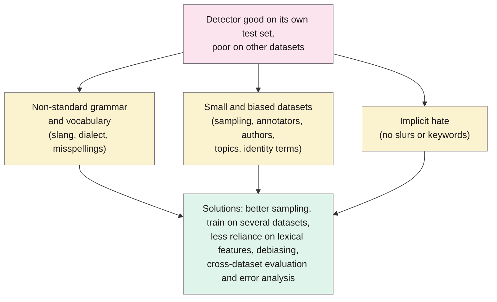

> **Source note:** drafted from the PeerJ PDF (renamed from peerj-cs-598.pdf). PeerJ has no journal page numbers; page numbers below are the article's own **"n / 38"** page numbers. Cite as e598. The detailed tables of individual studies (Tables 1–4) weren't transcribed.

## TL;DR
A literature review asking why hate speech detectors that score well on their own test set fail on other datasets (pp. 1–3). It summarises cross-dataset studies (performance drops, often sharply), then identifies **three obstacles** to generalisation: **non-standard grammar and vocabulary** (social media language, dialect, obfuscation), **small and biased datasets** (sampling, annotator, author and topic bias, identity-term correlations), and **implicit hate** (no slurs or keywords) (p. 12). It ends with recommendations for data, models and evaluation (pp. 24–27). For this project it's the general citation for "results on a dataset's own test split are overestimated" and the reason for leave-one-dataset-out tests.

**Analogy:** a dog trained to spot "dangerous" by the sound of one neighbour's voice. Inside that house it's perfect. Take it to another street with different accents and quiet threats, and it barks at the wrong people and ignores the burglar.

The three obstacles are from p. 12.

## 1. What is the aim of the paper?
Recent research shows hate speech detectors "generalise poorly to unseen data": performance drops significantly on a different dataset, so "the generalisation performance of existing models have been severely overestimated" (p. 2). The aims (p. 3): summarise the evidence of poor generalisation; analyse the main obstacles and attempts to address them; suggest future research.

## 2. How did the authors carry out the research?
A staged literature search on Google Scholar with general keywords ("hate speech", "offensive", "abusive", "toxic"...) and generalisation keywords ("cross-dataset", "cross-domain", "bias"...), following references and citations, prioritising highly cited peer-reviewed work and existing surveys; then analysis of error analyses to identify obstacles (pp. 3–4). It's a narrative review, not a systematic one with counts.

## 3. What are the primary results?
- **Cross-dataset testing** (training on one dataset, testing on another) is the main way to estimate generalisation; studies consistently show drops (pp. 4–9).
- **Broader labels generalise better:** "toxicity", "offensive" or "abusive" transfer better than finer "hate speech" categories, which datasets define differently (p. 9).
- **What helps is inconsistent across studies:** the share of abusive posts, less biased sampling, wider coverage of phenomena, general rather than platform-specific topics, and data size (with size mattering less once other factors are controlled) (pp. 9–10).
- **Obstacle 1, non-standard language (pp. 12–14):** casual syntax, dialect, deliberate misspellings.
- **Obstacle 2, data (pp. 14–19):** small datasets; sampling bias from keyword and user-based collection; **author bias** (e.g. 65% of one dataset's hate from two users, citing Arango et al.); topic bias; annotator bias; identity terms associated with labels (citing Dixon et al. 2018 and template-based debiasing).
- **Obstacle 3, implicit hate (pp. 19–21):** hate without distinctive keywords, understandable only with context or world knowledge.
- **Recommendations (pp. 24–27):** start from a general sample and boost positives rather than keyword-filtered sampling; cap each user's contribution; measure sampling bias; train on more than one dataset or transfer from larger data; reduce reliance on lexical features; compare debiasing approaches systematically; evaluate on unseen datasets with error analysis, not only F1/AUC; treat models as part of a socio-technical system (e.g. aiding human moderators); open-source data and code; more multilingual work.
- Abusive content is under 3% of social media (p. 25).

## 4. What do the authors think the results mean?
"Existing hate speech detection models generalise poorly on new, unseen datasets"; the reasons come from NLP methods, dataset building and the nature of hate speech, and are intertwined. Some dataset biases come from sampling or definitions, "others merely reflect long-standing biases in our society" (p. 27).

## 5. What do I think it means?
*Claude's draft. Rewrite this in your own words when you verify.*

- **VAL-01 and DET-03 cite this for the cross-dataset test.** Leave-one-dataset-out runs are the field's standard for honest generalisation (pp. 4–5). The master plan says results will be "comparable with Yin and Zubiaga (2021)", but this is a review without its own benchmark numbers, so you can compare with the *pattern* they describe, not with a figure. Reword to "following the cross-dataset evaluation recommended by Yin and Zubiaga (2021)".
- **DET-03 design choices backed here:** training on several datasets reduces overfitting (p. 25); their point that broad labels generalise better than fine ones (p. 9) is a reason to expect your *harmful vs none* result to transfer better than stereotyping vs demeaning; report both.
- **The three obstacles as a threat-to-validity checklist (EVAL-06):** dialect (Sap et al. 2019, @sap2019risk), dataset bias (Arango, @arango2019hate; Dixon, @dixon2018measuring), implicit bias (ToxiGen, @hartvigsen2022toxigen). Nice structure for the limitations section.
- **"Models as part of a socio-technical system" (p. 26)** supports DET-05's review outcome and the reviewer persona: the tool assists human reviewers rather than deciding alone.
- **MET-05:** "F1/AUC should not be the only measurement" plus error analysis (p. 26): the per-function gap-set results and per-context-type FPR are that error analysis.

Suggested metadata, one line each:
- `detector-model`, `benchmarks`: generalisation of detectors across datasets.
- `background`, `related-work`, `methodology`, `evaluation`: why within-dataset scores mislead; evaluation design.
- `DET-03`, `VAL-01`, `MET-05`, `EVAL-06`: as above.

## Key numbers
- Three obstacles: non-standard language, biased or small datasets, implicit hate (p. 12).
- Abusive content under 3% of social media (p. 25).
- Broad labels ("toxic", "offensive", "abusive") generalise better than fine "hate speech" labels (p. 9).

Quote (p. 2): "the generalisation performance of existing models have been severely overestimated".

## Concerns
- **Narrative review,** not systematic: no inclusion counts or pooled results.
- **Hate speech focus,** mostly social media and English.
- **Published 2021;** before LLM-based detectors and the newer datasets you use (ToxiGen, CAD only partly covered).
- **Open access, CC BY 4.0** (p. 1).

## Follow-up
None added: the specific studies it reviews (Wiegand et al. 2019; Arango et al. 2019/2020; Dixon et al. 2018) are already summarised or in the follow-up list.
