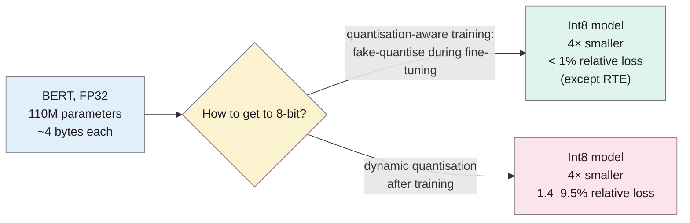

> **Source note:** drafted from the arXiv preprint (1910.06188v2, 17 Oct 2019, renamed from 1910.06188v2.pdf). Page numbers are **PDF pages 1–5**; the published workshop version (Zotero) is pp. 36–39, so page numbers will differ. Check against it before citing.

## TL;DR
Intel researchers fine-tune BERT with **quantisation-aware training**: during fine-tuning they simulate 8-bit integer arithmetic so the model learns to cope with rounding, then run all embedding and fully connected layers in **8-bit integers** (PDF pp. 1–3). The model is **4× smaller** and loses under 1% relative accuracy on eight GLUE tasks and SQuAD (except RTE), while simply quantising a finished model afterwards ("dynamic quantisation") loses up to 9.5% (PDF pp. 3–4). For this project it supports ARCH-05's claim that 8-bit quantisation "typically shrinks a model about four times with little accuracy loss", with one important caveat: that result needs quantisation-aware training, not just post-hoc conversion.

**Analogy:** storing every weight to 8 significant bits instead of 32 is like rounding all prices to the nearest euro. If you plan your shopping with rounded prices from the start (quantisation-aware training), your budget comes out almost right; if you round an existing receipt afterwards (post-training quantisation), the errors can add up.

Numbers from Tables 1–2 (PDF pp. 3–4).

## 1. What is the aim of the paper?
Pretrained transformers are large (BERT-Base 110M parameters, BERT-Large 334M, in 32-bit floating point), with high memory, compute and power needs, which makes low-latency production deployment hard (PDF p. 1). The aim: a method with a best-in-class compression-to-accuracy ratio for BERT, so it can run efficiently on 8-bit-capable hardware (PDF p. 1).

## 2. How did the authors carry out the research?
**Symmetric linear quantisation (PDF p. 2),** for weights and activations:

$$\text{Quantize}(x \mid S_x, M) = \text{Clamp}(\lfloor x \cdot S_x \rceil, -M, M), \qquad M = 2^{b-1} - 1 = 127 \text{ for 8 bits}$$

with weight scale $S_W = M / \max(|W|)$ and activation scale $S_x = M / \text{EMA}(\max|x|)$, an exponential moving average of activation ranges seen in training.

**Quantisation-aware training (PDF p. 2).** "Fake quantisation" simulates rounding in the forward pass during fine-tuning; because rounding has no gradient, the straight-through estimator treats it as the identity ($\partial x_q / \partial x = 1$). The full-precision weights learn to compensate for the rounding error.

**Implementation (PDF p. 3).** All embedding and fully connected (GEMM) layers quantised to Int8, with biases in Int32; softmax, layer normalisation and GELU kept in FP32. Built on Hugging Face PyTorch-Transformers. The quantised layers hold over 99% of BERT's weights (PDF p. 2).

**Evaluation (PDF pp. 3–4).** GLUE tasks (CoLA, MRPC, QNLI, QQP, RTE, SST-2, STS-B) and SQuAD v1.1, mostly BERT-Base (some BERT-Large); five runs each, mean and standard deviation. Compared with the FP32 baseline and with **dynamic quantisation (DQ)**, i.e. post-training quantisation with scales computed on the fly.

## 3. What are the primary results?
**Selected results (Table 1, PDF p. 3):**

| Task | Metric | FP32 | QAT 8-bit | DQ 8-bit |
|---|---|---|---|---|
| SST-2 | Accuracy | 92.36 | 92.24 | 91.04 |
| QQP | F1 | 87.84 | 87.96 | 84.98 |
| MRPC | F1 | 90.00 | 89.56 | 87.88 |
| RTE | Accuracy | 69.70 | 68.78 | 63.32 |
| SQuAD v1.1 | F1 | 88.46 | 87.74 | 80.02 |

**Relative accuracy loss (Table 2, PDF p. 4):** QAT −0.35% to 1.32% (negative = better than baseline); DQ 1.43% to 9.54%.

```mermaid
%%{init: {"themeVariables": {"xyChart": {"plotColorPalette": "#F29BBE, #B8457A"}}}}%%
xychart-beta
  title "Relative accuracy loss from 8-bit, % (Table 2, PDF p. 4)"
  x-axis ["CoLA", "MRPC", "QNLI", "QQP", "RTE", "SST-2", "STS-B", "SQuAD"]
  y-axis "% loss vs FP32" -1 --> 10
  bar [2.98, 2.36, 1.69, 1.85, 9.13, 1.43, 2.19, 9.54]
  bar [0.00, 0.49, -0.35, -0.14, 1.32, 0.13, 0.65, 0.81]
```

First bar per task: dynamic quantisation; second: quantisation-aware training.

- Relative error under 1% except RTE, with **4× less storage** (PDF p. 4).
- DQ "produces significantly worse results over all tasks" (PDF p. 4). (No significance test is reported; "significantly" is used informally.)
- Speed isn't measured; they cite another paper reporting a 3.7× speed-up for Int8 matrix multiplication on Intel Cascade Lake CPUs with VNNI instructions (PDF p. 2).

## 4. What do the authors think the results mean?
- 8-bit BERT is possible "with minimum loss in accuracy", and efficient inference "will enable low-latency NLP applications on a variety of hardware platforms from edge devices to data centers" (PDF p. 4).
- Quantisation-aware training is necessary: post-training quantisation is clearly worse (PDF p. 4).
- The method isn't specific to BERT (PDF p. 2).

## 5. What do I think it means?
*Claude's draft. Rewrite this in your own words when you verify.*

- **ARCH-05's claim needs a qualifier.** "8-bit quantisation typically shrinks a model about four times with little accuracy loss" is true *with quantisation-aware training* (QAT). The master plan's plan is to export to ONNX and "quantise to 8-bit" afterwards, which is closer to this paper's **DQ** column: up to 9.5% relative loss (Table 2). Two options:
  1. reword ARCH-05 to "post-training 8-bit quantisation can cost several points of accuracy (Zafrir et al. 2019), so it is kept only if test metrics are unchanged" (which the master plan already says as a condition, so the safeguard is right; only the "little accuracy loss" wording overstates it), or
  2. add QAT to DET-03 as an optional fine-tuning variant.
  Option 1 is simpler and fits "ONNX is optional".
- **Calibration interacts with quantisation.** Quantisation changes logits slightly, so temperature-scaling parameters fitted on the FP32 model may not transfer. If a quantised model ships, refit $T$ (MET-02) on the quantised model and re-measure ECE (@guo2017calibration).
- **MET-06 and CI-03:** the paper gives no CPU latency numbers for BERT; only a cited 3.7× speed-up for Int8 matrix multiplication on specific Intel hardware (PDF p. 2). Measure on the actual CI runner; don't quote the 3.7× as an expected speed-up.
- **Memory is the reliable win.** 4× smaller weights (110M × 4 bytes ≈ 440 MB → about 110 MB for BERT-Base; *my arithmetic*) matters for ARCH-06 (Docker image size) and CI-03 (time to download or restore the cached checkpoint).
- **Old model, old library:** BERT-Base and PyTorch-Transformers (2019). ModernBERT's architecture differs (the master plan already notes ONNX export problems). Treat this as evidence that the approach is sound, not that it'll work out of the box for ModernBERT.

Suggested metadata, one line each:
- `detector-model`: compressing the detector.
- `architecture`, `ci-cd`: deployment size and CI runtime.
- `methodology`, `deliverable`: the inference stack and its trade-offs.
- `ARCH-05`, `ARCH-06`, `CI-03`, `MET-06`, `DET-02`: as above.

## Key numbers
All page numbers are PDF pages of arXiv:1910.06188v2.
- BERT-Base 110M, BERT-Large 334M parameters in FP32 (p. 1).
- 8-bit: M = 127 (p. 2).
- Quantised layers hold over 99% of weights; model 4× smaller (p. 2).
- QAT relative loss under 1% except RTE (1.32%); DQ 1.43–9.54% (Table 2, p. 4).
- SQuAD F1: 88.46 (FP32), 87.74 (QAT), 80.02 (DQ) (Table 1, p. 3).
- Five runs per experiment (p. 3).
- Cited Int8 matrix multiplication speed-up: 3.7× on Intel Cascade Lake with VNNI (p. 2).

Quote (p. 1): "compress BERT by 4× with minimal accuracy loss".

## Concerns
- **Workshop paper, industry authors** (Intel) with an interest in Int8 hardware.
- **No measured inference speed.**
- **GLUE, not classification of bias;** small, older tasks.
- **DQ comparison is their own implementation;** modern post-training quantisation (e.g. ONNX Runtime with a calibration set) may do better than their DQ. Don't over-generalise the 9.5%.
- **arXiv version;** the published workshop version is pp. 36–39.

## Follow-up
From the reference list (PDF pp. 4–5):
- Jacob, B. et al. (2018) "Quantization and training of neural networks for efficient integer-arithmetic-only inference", Proceedings of the IEEE Conference on Computer Vision and Pattern Recognition, pp. 2704–2713. The quantisation method this paper builds on.
- Bhandare, A. et al. (2019) "Efficient 8-bit quantization of transformer neural machine language translation model", arXiv:1906.00532. The source of the 3.7× Int8 speed-up claim.
